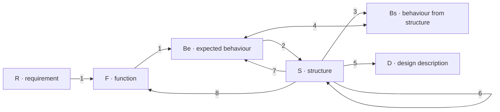
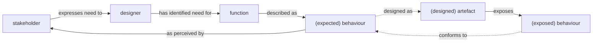

# Fresh Author content-reading transcript

Each block records the actual selected bytes preserved during the reading exercise. Earlier displayed reads are marked as preservation reads. All excerpts are complete for their recorded selection. See session-notes.md for navigation searches and failed operational attempts.

## Read 1

- Source: /home/mike1/projects/dev/workflow-server/AGENTS.md
- Selection: whole document
- Lines: 1-71
- Full source SHA-256: 58896f5d8b3044d4274d949e4d2dd674bc4163fb59514acd4027073f7cb6821e
- Recorded at: 2026-10-11T11:32:20.306545+00:00
- Purpose: Previously displayed reads, preserved from the same working files; no tool output truncation occurred
- Truncated: false

~~~~text
# Workspace Instructions

- **Here:** how work is conducted, how prose is written, and the local code index.
- **Edits to *this* file shall be succinct.** State the rule, not the reasoning behind it. Keep an example only where it makes the rule followable.

## Project Instructions

- You must adopt all content from .project/<folder> *when* working on content in that folder:
  - .project/main/[AGENTS.md](http://AGENTS.md)

- Any instructions found in those files that *conflict* with those prescribed here *override* these instructions for *that* component.
- Follow the folder naming pattern at: /.engineering/artifacts/planning/ and use to store *all* planning artifacts


## Design principles

- No backward compatibility. Remove obsolete paths rather than adding compatibility layers, fallbacks, or migrations.
- Simplest implementation that fully meets requirements — no speculative abstraction, configuration, or indirection.
- Grow in layers: smallest version that works end to end, then build on a product that already works.
- Never trade working for unfinished.
- Modular components, separated concerns (see SOLID)
- Prefer established libraries to reimplementing. Check a library's docs and types before assuming it lacks a capability.
- Exhaust existing dependencies before adding a package.
- Decide for the long term. No stopgap meant to be replaced later.
- Obey SOLID principles (Single responsibility, Open–closed, Liskov substitution, Interface segregation, Dependency inversion) when making changes to both source and documentation.


## Code and Documentation

- Follow existing patterns
- Clear, professional language
- No process attribution in comments (“Added by agent”).
- **Describe the design, not the change to it.** Definitions, code and doc comments, and **commit subjects** state the system as it is, present tense, without naming what they replaced (eg write `account for token usage per dispatch`, not `move usage accounting off the transition and onto the dispatch`). For an absent value, say what holds when it is missing. Cut “instead of”, “no longer”, “previously”, “unchanged behaviour”.
  - A live hazard survives, stated as an invariant: *a marker is unreadable to a context that never received the bytes* — not *this is why the old rule forbade it*.
  - Exceptions: issue and PR bodies, and commit bodies. A reviewer needs the before-state; nothing that persists past merge does.
  - After a behaviour change, grep out surviving descriptions of the old one — doc comments, tool descriptions, technique `## Rules`, resource prose, READMEs. A stale claim reads as current fact.
- **Prefer removing the thing that needs a prohibition.** Prose warning "do not also use X" usually means two paths now do one job. Retire one and the warning goes, along with the validation that policed the overlap.


## User Interaction

- Words cost tokens! Be as succinct as possible *without* compromising fidelity.
- First and foremost your job is to *maximise* fidelity while *minimising* cognitive load
- Reponses should use plain language and be as succinct as possible
- Prefer bullet points instead of large blocks of prose when responding to the user
- For responses that concern system design should split by area of concern in the system eg corpus, guards, tests, source. 
- Each area of conern should be titled and sub-divided into a bulletted list of problem/solution pairs with one plain-language paragraph for each of the problem solution. Jargon should be disambiguated. Use two space seperators between title items.
- When user input is required to reconcile outstanding issues or design choices, present the user a sequence of questions, one-at-a-time, interview-style. Each question should have multiple choice answers with a recommended option. Each question should be preceded by a plain-language paragraph worded to aid the decision kaing process.
- Always treat user requests at the start of a new chat as an incomplete specification. Use the interview style to illicit further information fromf the user until you are confident you have sufficient understanding to properly proceed.


## Commits and pushes

- Commit and push upon completion of any discrete user request to the current branch
- **A fix belongs in the pull request whose code it fixes.** A defect found while reviewing a branch is corrected on that branch, not carried onto a later one in a stack. Amend, rebase or force-push as needed to put it there — a branch with no other contributors is yours to rewrite.
- **Commit incrementally while building.** Distinct work lands as its own commit, so the branch records how it was built. That is about not collapsing unrelated changes into one commit; it is never a reason to leave a fix in the wrong place.
- **Push with plain** `git push`**.** When a push will not fast-forward on a branch someone else may hold, stop and ask rather than rewriting.
- **A pull request delivering initiative work starts its title with the epic reference:** `[I07:E00] Purpose`.


## Task management

- Complete **one** task at a time unless the user asks for multiple.
- For multi-step work, use todos and mark them complete as you finish; only one todo in progress at a time.
- Request permission before starting a new task or making changes outside the current request.
- *ALWAYS* use a local work-tree when working on a branch
~~~~

## Read 2

- Source: /home/mike1/projects/dev/workflow-server/.project/main/AGENTS.md
- Selection: whole document
- Lines: 1-61
- Full source SHA-256: 197304c1325f6c80256aabd6d1c783325f0151841a0adb73f451d2f39f51fb94
- Recorded at: 2026-10-11T11:32:20.306711+00:00
- Purpose: Previously displayed reads, preserved from the same working files; no tool output truncation occurred
- Truncated: false

~~~~text
# Project Instructions

Project instructions for this repository.

- **Here:** rules that change what an agent does on an ordinary turn. A how-to for one kind of task lives in the doc that task already has.
- A rule that names a path on this machine, or a tool not in `package.json`, belongs here rather than the repo.
- **Edits to *this* file shall be succinct.** State the rule, not the reasoning behind it. Keep an example only where it makes the rule followable.
- When building, testing, or changing a checkout, follow [development.md](docs/development.md).

## Worktrees

- **Work a branch in its own worktree.** `.worktrees/workflows` stays on `workflows`; a feature branch lives at `.worktrees/<branch>`. Switching the shared dest moves the corpus under whatever is reading it — a guard sweep, a coverage walk, another agent — and the result reads as a defect in the change.
- **Name a worktree for its branch in full**, slashes as nested directories: `.worktrees/workflow/353-context-scoped-delivery`. `git worktree list` then reads as a branch index, and a path in a command or a stack trace says which branch it belongs to without anyone inspecting its `HEAD`.
- Provision, rename, and a corpus-only sweep: [guards/README.md](guards/README.md#running-guards-in-a-worktree).


## Dependencies

- **Never delete the lockfile or run** `npm update`**.** An install-time payload runs before any of this repo's code, so the lockfile is the last point a build can refuse.
- Adding a dependency, exact versions, and the known-bad denylist: [development.md](docs/development.md#dependencies).


## Boundaries

- Do **not** modify server source (`src/`, `schemas/`) or workflow YAML unless the user explicitly asks.
- Call `discover` first and follow what it returns. A fresh `start_session` passes `working_directory` as the checkout under work. The rest of the sequence is [setup](docs/setup.md).


## Issues and PRs

- **Shape:** See the reference example: [#394](https://github.com/m2ux/workflow-server/issues/394)
- **Explain the situation before naming it.** Ordinary sentences first, then the concept's name. Never open with a term of art the reader hasn't been handed.
- **Title:** `Name: plain description`**.** No conventional-commit prefixes, no abbreviations ("references", not "refs"), no anti-pattern numbers, no code tokens unless the token is the subject.
- **No file:line citations in the body.** Evidence reads as prose.
- **Spell out jargon.** "Phase 0/1/2" becomes named stages; shorthand like fold-by-reference gets a sentence or a definition on first use. Reference an anti-pattern by name with its meaning stated, so the reference corroborates rather than being required reading.
- **One paragraph per stage, and no section that restates another.** Where a "what was verified" section states what was proved, an acceptance-criteria list repeats it. Cut the prose around the counts, never the counts.
- **These bodies narrate against what preceded them.** They are the one sanctioned home for before/after; everything persisting past merge stays in positive present tense.
- Prefer replacement over accretion. When updating PR bodies. Don't narrate history. Don't add changes as comments. Replace the body with the version correct today.
- **A pull request lands on** `main` **or on** `workflows`**.** Code and definitions sit on separate long-lived branches, so the base is a choice. One aimed anywhere else is a stack: it merges, reads as delivered, and reaches neither branch until its base lands. Check the base before merging, and re-target a stacked request the moment its base merges.
- **A branch is absorbed when its content is on the target, not its commits.** The same change arriving by another route leaves the branch reading as unmerged. `git diff <target> <branch> -- <paths>` settles it; a commit count does not.


## Testing

Commands, what CI runs, and how a walk is re-baselined: [development](docs/development.md). Delivery cost: [benchmark](benchmark/README.md#appendix).

- **Definition changes land on** `workflows`, with the walk baselines and triage entries that describe them, in the same commit. A closed binding finding moves with the change that settled it: delete it and it is untriaged, keep it and it matches nothing.


## Where to look

[docs/README.md](docs/README.md) is the index. Open the page for the task. 

A **workflow** is the guide an operator follows. An **activity** is one phase of it. A **technique** is one capability a step names. A **routine** is steps written once and spliced in. A **resource** is material a technique cites and does not contain.

Engineering work starts at [its AGENTS.md](https://github.com/m2ux/workflow-server/blob/engineering/AGENTS.md).
~~~~

## Read 3

- Source: /home/mike1/projects/dev/workflow-server/.engineering/AGENTS.md
- Selection: whole document
- Lines: 1-12
- Full source SHA-256: 96b538381abfbcd74eaf9c970def5256d83a210f440d81bc93ba9750adb11cf8
- Recorded at: 2026-10-11T11:32:20.306789+00:00
- Purpose: Previously displayed reads, preserved from the same working files; no tool output truncation occurred
- Truncated: false

~~~~text
# Engineering Instructions

Scope: `.engineering/` directory (artifacts, planning, history, and scripts).

## Project overview

This folder contains:

- **Artifacts** — Planning work packages under `artifacts/planning/`

The main application lives at the repo root. See the root `README.md`.
~~~~

## Read 4

- Source: /home/mike1/projects/dev/workflow-server/.worktrees/skill/canon-audit-matrices/AGENTS.md
- Selection: whole document
- Lines: 1-71
- Full source SHA-256: 58896f5d8b3044d4274d949e4d2dd674bc4163fb59514acd4027073f7cb6821e
- Recorded at: 2026-10-11T11:32:20.306855+00:00
- Purpose: Previously displayed reads, preserved from the same working files; no tool output truncation occurred
- Truncated: false

~~~~text
# Workspace Instructions

- **Here:** how work is conducted, how prose is written, and the local code index.
- **Edits to *this* file shall be succinct.** State the rule, not the reasoning behind it. Keep an example only where it makes the rule followable.

## Project Instructions

- You must adopt all content from .project/<folder> *when* working on content in that folder:
  - .project/main/[AGENTS.md](http://AGENTS.md)

- Any instructions found in those files that *conflict* with those prescribed here *override* these instructions for *that* component.
- Follow the folder naming pattern at: /.engineering/artifacts/planning/ and use to store *all* planning artifacts


## Design principles

- No backward compatibility. Remove obsolete paths rather than adding compatibility layers, fallbacks, or migrations.
- Simplest implementation that fully meets requirements — no speculative abstraction, configuration, or indirection.
- Grow in layers: smallest version that works end to end, then build on a product that already works.
- Never trade working for unfinished.
- Modular components, separated concerns (see SOLID)
- Prefer established libraries to reimplementing. Check a library's docs and types before assuming it lacks a capability.
- Exhaust existing dependencies before adding a package.
- Decide for the long term. No stopgap meant to be replaced later.
- Obey SOLID principles (Single responsibility, Open–closed, Liskov substitution, Interface segregation, Dependency inversion) when making changes to both source and documentation.


## Code and Documentation

- Follow existing patterns
- Clear, professional language
- No process attribution in comments (“Added by agent”).
- **Describe the design, not the change to it.** Definitions, code and doc comments, and **commit subjects** state the system as it is, present tense, without naming what they replaced (eg write `account for token usage per dispatch`, not `move usage accounting off the transition and onto the dispatch`). For an absent value, say what holds when it is missing. Cut “instead of”, “no longer”, “previously”, “unchanged behaviour”.
  - A live hazard survives, stated as an invariant: *a marker is unreadable to a context that never received the bytes* — not *this is why the old rule forbade it*.
  - Exceptions: issue and PR bodies, and commit bodies. A reviewer needs the before-state; nothing that persists past merge does.
  - After a behaviour change, grep out surviving descriptions of the old one — doc comments, tool descriptions, technique `## Rules`, resource prose, READMEs. A stale claim reads as current fact.
- **Prefer removing the thing that needs a prohibition.** Prose warning "do not also use X" usually means two paths now do one job. Retire one and the warning goes, along with the validation that policed the overlap.


## User Interaction

- Words cost tokens! Be as succinct as possible *without* compromising fidelity.
- First and foremost your job is to *maximise* fidelity while *minimising* cognitive load
- Reponses should use plain language and be as succinct as possible
- Prefer bullet points instead of large blocks of prose when responding to the user
- For responses that concern system design should split by area of concern in the system eg corpus, guards, tests, source. 
- Each area of conern should be titled and sub-divided into a bulletted list of problem/solution pairs with one plain-language paragraph for each of the problem solution. Jargon should be disambiguated. Use two space seperators between title items.
- When user input is required to reconcile outstanding issues or design choices, present the user a sequence of questions, one-at-a-time, interview-style. Each question should have multiple choice answers with a recommended option. Each question should be preceded by a plain-language paragraph worded to aid the decision kaing process.
- Always treat user requests at the start of a new chat as an incomplete specification. Use the interview style to illicit further information fromf the user until you are confident you have sufficient understanding to properly proceed.


## Commits and pushes

- Commit and push upon completion of any discrete user request to the current branch
- **A fix belongs in the pull request whose code it fixes.** A defect found while reviewing a branch is corrected on that branch, not carried onto a later one in a stack. Amend, rebase or force-push as needed to put it there — a branch with no other contributors is yours to rewrite.
- **Commit incrementally while building.** Distinct work lands as its own commit, so the branch records how it was built. That is about not collapsing unrelated changes into one commit; it is never a reason to leave a fix in the wrong place.
- **Push with plain** `git push`**.** When a push will not fast-forward on a branch someone else may hold, stop and ask rather than rewriting.
- **A pull request delivering initiative work starts its title with the epic reference:** `[I07:E00] Purpose`.


## Task management

- Complete **one** task at a time unless the user asks for multiple.
- For multi-step work, use todos and mark them complete as you finish; only one todo in progress at a time.
- Request permission before starting a new task or making changes outside the current request.
- *ALWAYS* use a local work-tree when working on a branch
~~~~

## Read 5

- Source: /home/mike1/projects/dev/workflow-server/.worktrees/skill/canon-audit-matrices/skills/workflow-canon/SKILL.md
- Selection: whole document
- Lines: 1-78
- Full source SHA-256: befd30ff67933e35c319265022179ba7ac5dbe3ce5d1dc1823ea8216d236cf3e
- Recorded at: 2026-10-11T11:32:20.306929+00:00
- Purpose: Previously displayed reads, preserved from the same working files; no tool output truncation occurred
- Truncated: false

~~~~text
---
name: workflow-canon
description: >-
  A work-design assistant for workflow-server goals, requirements, architecture, contracts and design decisions. Use to author workflow definitions ("write a new activity", "apply this finding"), audit them against the design canon ("audit workflow X", "why is this an anti-pattern?"), review integrations ("check these branches together", "assess integration readiness"), or revise this skill ("update the workflow-canon skill").
hooks:
  PostToolUse:
    - matcher: "Edit|Write|MultiEdit"
      hooks:
        - type: command
          command: "python3 \"${CLAUDE_PROJECT_DIR}/.claude/skills/workflow-canon/scripts/edit_guard.py\""
---

# Workflow Canon

Workflow Canon is a work-design assistant for shaping workflow-server work around its goals, requirements, architecture and constraints.

- **Work**  Intended outcomes, requirements and constraints.
- **Design**  Architecture, responsibilities, definitions and contracts.
- **Canon**  The project's authoritative design criteria and conventions.
- **Evidence**  Observations supporting design decisions, with their limits stated.

## Modes

Read the selected mode's file in full, then follow its links as each step needs them:

- **[Author](references/author-mode.md)**
  - Authoring definitions and specified changes
  - Closing confirmed findings with their prescribed fixes
  - Mapped draft walks and verification of written changes
- **[Audit](references/audit-mode.md)**
  - Canon questions and conformance of existing definitions
  - Attribution and verification of findings
  - Applicability matrices with independent verification
  - Complete coverage reports
- **[Review](references/review-mode.md)**
  - Scope and revision pairings for integrations
  - Tracing design and architecture through declarations and consumers
  - Coverage matched to affected branches and languages
  - Evidence for findings and readiness
- **[Revise](references/revise-mode.md)**
  - Changes to this skill's own files
  - Conformance with shared and local skill guidelines

## Rules

- **Measured claims.**
  Counts, revision identities and check outcomes come from command output or preserved run evidence.
- **One home.**
  Project documents own their design criteria. Fetch the authoritative section and apply it as written, including its exclusions; notes taken from it do not replace it.
- **Linked sections.**
  Retrieve a heading-linked section and its subsections only, stopping before the next heading of equal or higher level. Use targeted search and range reads; follow required prerequisites and expand only to resolve missing context. Explicit whole-document reading requirements still apply.
- **Planning.**
  When creating or using artifacts, all modes follow [Planning](references/planning.md).
- **Commands.**
  Before the first command spec, read the [shared command conventions](references/commands.md#conventions) and any additional conventions linked by its caller. Reuse complete prerequisites already read at the same revision; retrieve each operation's spec at its point of use.

## Dependencies

- **Git and repository search**
  Revision capture, comparisons, isolated worktrees and locating criteria and consumers.
- **GitHub CLI**
  PR metadata, requirements, check evidence and authorized publication through REST on GitHub.
- **Project instructions, documentation and runtimes**
  Branch ownership, canon homes, schemas and validation tools for the affected product.
- **Node and npm**
  Engine and corpus checks use the paired engine's runtime, lockfile and installed tools, including TypeScript and `tsx`.
- **Docker and Compose**
  Packaging checks build and exercise disposable images and containers when deployment behavior is affected.
- **Python 3.10+**
  The definition edit hook, audit inventory/state/dispatch scripts and their tests.
- **Paired YAML parser**
  The audit adapter loads the paired engine's installed `yaml` package through Node; its identity is captured with the source snapshot.
- **Agent host and sandbox**
  Repository access, local execution and artifact writing within the selected mode's authority. Independent sub-agents and observable tool results support audit slices and reading-path validation.
- **Claude Code hooks**
  Registers the definition edit hook for the session; its script resolves beneath the workspace root named by `CLAUDE_PROJECT_DIR`. Hosts without skill-hook support run the applicable explicit checks.
- **Workflow resource access**
  A running workflow's resource tool can supply canon sections and report guides when available.
~~~~

## Read 6

- Source: /home/mike1/projects/dev/workflow-server/.worktrees/skill/canon-audit-matrices/skills/workflow-canon/references/author-mode.md
- Selection: whole document
- Lines: 1-41
- Full source SHA-256: 0f8ea48005aaac878fe11844b6e4b995e733fc360cba84851755d2127bf8f4c5
- Recorded at: 2026-10-11T11:32:20.306997+00:00
- Purpose: Previously displayed reads, preserved from the same working files; no tool output truncation occurred
- Truncated: false

~~~~text
# Author Mode

Writes definition content: a new definition, or a specified change to existing ones, such as a work item, a finding, or a defect with a location. A finding is closed with the Fix its entry states.

## Prerequisites

Read the [canon prerequisites](canon-context.md#prerequisites), then its [terms](canon-context.md#terms) and [criteria](canon-context.md#criteria).

## Procedure

1. **Resolve to files.**
   - List every file the change adds or edits. A new definition also edits each file that wires it in, such as `workflow.yaml` or the activity that binds it.
   - Add the I/O-contract closure and consumers per the shared [scope](canon-context.md#scope).
   - For a specified change, the surface is the specification, not the diff. Confirm it still holds against the tree: the construct is where it says, the count is what it says, the absence is an absence.
   - What has moved is reported first. Where nothing remains to change, that is the finding.
2. **Read what binds.**
   - Read the [design flow](design-flow.md). Structure is synthesised from expected behaviour. Exposed behaviour is derived from that structure and compared with the expected behaviour. A failed comparison reformulates the structure, the expected behaviour, or the function.
   - Read the shared [change-surface lifecycle](change-surface.md). Intended items can have provisional planning rows; applicability and evaluation bind captured draft bytes.
   - When the change answers a finding, follow that entry's Fix and Do not flag.
3. **Open a live sibling.**  Conformance compares against those files.
4. **Preserve.**  Name what the entries require the change to preserve.
5. **Walk the draft, then write.**
   - Each fix is a draft of its own: its replacement text is walked before it is written.
   - Capture the candidate in an isolated corpus tree, create all four matrices, and follow the shared lifecycle through independent inventory and mapping verification before evaluating the draft. Prioritize the prescribing entry without dropping any AP/DP cell.
   - Rewrite while an entry still fires.
   - Before writing definitions, read the [edit hook](canon-context.md#edit-hook). Apply the evaluated bytes through [Author Byte Agreement](change-surface.md#freshness-and-resume), then run the selected [checks](canon-context.md#checks).
6. **Check what the pass wrote.**
   - Reconcile actual bytes and affected consumers using [freshness](change-surface.md#freshness-and-resume). Every correction receives its current inventory, mapping verification and evaluation.
   - A hit is a `fix` finding, per Audit's [Attribution](audit-mode.md#attribution). Close it by step 5 before any report.
7. **Stop on oscillation.**
   - Stop when an entry fires on text written to satisfy it, or when a round's `fix` findings do not fall below the round before.
   - Report the entries in conflict to the user as a canon defect, with the text each one rejected.
8. **Audit.**
   - Reconcile the current run through the shared [completion gate](change-surface.md#completion). Read [Report Context](reporting.md#report-context) before [report selection](reporting.md#which-report).
   - A draft-only request stops with its measured draft coverage and writes no findings register for a commit.

## Rules

- **Commit gate.**  A definition change commits only once the procedure's audit is complete.
- **Scope.**
  Changes close the specified requirement or confirmed finding, including its affected consumers. Canon defects that prevent convergence are reported with the conflicting entries.
~~~~

## Read 7

- Source: /home/mike1/projects/dev/workflow-server/.worktrees/skill/canon-audit-matrices/skills/workflow-canon/references/planning.md
- Selection: whole document
- Lines: 1-19
- Full source SHA-256: 3431738a83fa9f401aeb62876cc1e1eb76f2509d75fc33bd57590c629203ee13
- Recorded at: 2026-10-11T11:32:20.307049+00:00
- Purpose: Previously displayed reads, preserved from the same working files; no tool output truncation occurred
- Truncated: false

~~~~text
# Planning

A planning record holds the artifacts for one piece of work: requirements, design decisions, analysis, evidence and reports. Modes share its location; the active mode determines which artifacts the work needs.

## Location

- **Instructions.**
  Use the location specified by the user and applicable project instructions. The project default is `.engineering/artifacts/planning/` beneath the workspace checkout that owns the engineering history.
- **Resolution.**
  Resolve the workspace checkout and planning root before writing artifacts, including when working in a linked worktree. Record the resolved location.

## Records

- **Naming.**
  Use `YYYY-MM-DD-<ref>-<slug>/`, omitting the reference when none exists, unless applicable instructions specify another convention. Derive the reference and descriptive slug from the work; the mode does not impose a folder suffix.
- **Continuity.**
  Reuse the record already established for the same work. Its artifacts from different modes remain together, with evidence and revision identities beside the conclusions they support.
- **Authority.**
  Writing, committing and publishing artifacts follow the active mode's authority and the user's instructions. A configured planning location does not grant publication authority.
~~~~

## Read 8

- Source: /home/mike1/projects/dev/workflow-server/.worktrees/skill/canon-audit-matrices/skills/workflow-canon/test/fixtures/audit-qualification/seeded/scope.json
- Selection: whole document
- Lines: 1-21
- Full source SHA-256: 4ffe1a099d197eeca9523bd23fb04858f7c746a4446e287f0f51b0accedc48bc
- Recorded at: 2026-10-11T11:32:20.307101+00:00
- Purpose: Previously displayed reads, preserved from the same working files; no tool output truncation occurred
- Truncated: false

~~~~text
{
  "paths": [
    "corpus/qualification/workflow.yaml",
    "corpus/qualification/activities/run.yaml",
    "corpus/qualification/techniques/produce.md"
  ],
  "checks": ["guards"],
  "relationships": [
    {
      "source": "corpus/qualification/routines/deliver.yaml",
      "target": "corpus/qualification/techniques/produce.md",
      "address": "execution/qualification/run/delivery/deliver/emit",
      "label": "qualification/run#delivery invokes deliver#emit; export emit.report; inherit qualification destination",
      "context": [
        "corpus/qualification/workflow.yaml",
        "corpus/qualification/activities/run.yaml",
        "corpus/qualification/techniques/TECHNIQUE.md"
      ]
    }
  ]
}
~~~~

## Read 9

- Source: /home/mike1/projects/dev/workflow-server/.worktrees/skill/canon-audit-matrices/skills/workflow-canon/references/canon-context.md
- Selection: 5-46
- Lines: 5-46
- Full source SHA-256: 055e863f90b66ea997d81700a40e939cf1ea14492d66deea4a8bfad14f09cac7
- Recorded at: 2026-10-11T11:32:20.307187+00:00
- Purpose: Previously displayed reads, preserved from the same working files; no tool output truncation occurred
- Truncated: false

~~~~text
## Prerequisites

Read the [command conventions](commands.md#conventions) before the first command spec. Read the sections below as the task needs them.

## Terms

- **Unit**  One criterion at the level the [canon inventory](canon-map.md#unit-inventory) specifies.
- **Entry**
  An anti-pattern unit: its Detect finds the defect, its Do not flag excuses a look-alike, and its Fix closes it.
- **Walk**  Applying each unit to every file on the surface and recording its status.
- **Change surface**  Touched files and their contract closure, resolved through [Scope](#scope).

## Criteria

Use the [canon homes](#homes) at the captured revisions. Read the complete [canon map](canon-map.md) before the first unit for its enumeration and prior-judgment guidance. Fetch each required unit through [Fetch Unit](commands.md#fetch-unit).

Follow covering entries where their Detect reaches, and the owning principle for spellings beyond that Detect. Every walk follows the complete [walk rules](walk-rules.md).

## Scope

Resolve the requested definitions to files, touched paths, changed I/O contracts, their reference closure, consumers and relevant siblings using [Definition Scope](definition-scope.md#scope). Record the base and full revision identities through [Resolve Ref](commands.md#resolve-ref). A new definition includes the files that bind it into the project.

Resolve any prior residual from the shared [planning record](planning.md) by current path before continuing it.

## Homes

Read homes on disk at the captured revisions. The links identify paths from the corpus or engine root; they do not substitute the latest web copy for the reviewed tree.

| Home | Authority |
| --- | --- |
| Design principles | [Design principles](https://github.com/m2ux/workflow-server/blob/workflows/corpus/canon/resources/design-principles.md) |
| Anti-patterns | [Anti-pattern catalog](https://github.com/m2ux/workflow-server/blob/workflows/corpus/canon/resources/anti-patterns.md) |
| Convention conformance | [Convention conformance](https://github.com/m2ux/workflow-server/blob/workflows/corpus/canon/resources/convention-conformance.md) |
| Guards | [Guard registry](https://github.com/m2ux/workflow-server/blob/main/guards/guards.ts) |
| Schema fields | [Schemas](https://github.com/m2ux/workflow-server/blob/main/docs/schemas.md) |

Locate unresolved roots through [Find the Server Checkout](commands.md#find-the-server-checkout) and [Check the Corpus Tree](commands.md#check-the-corpus-tree). The engine's instructions own paired checks, worktree selection and binding-fidelity triage. Node, npm and installed engine dependencies supply the guards; a live workflow session may supply individual sections through its resource tool.

## Checks

Read [Canon Check Conventions](commands.md#canon-check-conventions) before a selected canon check. A full audit prefers [Run Guards on the Delta](commands.md#run-guards-on-the-delta); draft and post-write checks use [Run Guard Suite](commands.md#run-guard-suite). A step-list, exit, gate or graph change also requires [Run Option Coverage](commands.md#run-option-coverage), baselined before editing. Select broader consumer coverage from [Workflows Coverage](coverage.md#workflows-coverage) when shared constructs are affected.
~~~~

## Read 10

- Source: /home/mike1/projects/dev/workflow-server/.worktrees/skill/canon-audit-matrices/skills/workflow-canon/references/design-flow.md
- Selection: whole document
- Lines: 1-60
- Full source SHA-256: 9ae8afc051fcf49a239e075a58a7a6278aa94768767e88354cae2d0cb82d02a6
- Recorded at: 2026-10-11T11:32:20.307251+00:00
- Purpose: Previously displayed reads, preserved from the same working files; no tool output truncation occurred
- Truncated: false

~~~~text
# Design Flow

How a definition is designed. A requirement becomes a function and an expected behaviour. Structure is synthesised from that behaviour. The behaviour the structure exposes is compared with the expected behaviour, and the structure can be reformulated.

The process steps are the function–behaviour–structure ontology of Gero and Kannengiesser, as Figure 3 of Nouwens, *Researching Sensemaking and Situational Architecting* (EEWC 2021, CC BY 4.0). A single arrow is a transformation. A double arrow is a comparison.



| Mark | Name | In a definition |
| --- | --- | --- |
| R | Requirement | The need the definition answers |
| F | Function | What the definition is for |
| Be | Expected behaviour | The behaviour a stakeholder can perceive |
| Bs | Behaviour from structure | The behaviour a walk or a test derives |
| S | Structure | Routines, techniques, resources, and activities |
| D | Design description | The written definition |

| Step | Arrow | What the designer does |
| --- | --- | --- |
| 1 | R → F → Be | A requirement becomes a function, and that function becomes the expected behaviour |
| 2 | Be → S | Expected behaviour is synthesised into structure |
| 3 | S → Bs | Exposed behaviour is derived from the structure |
| 4 | Be ↔ Bs | Expected behaviour is compared with exposed behaviour |
| 5 | S → D | Structure is written as the design description |
| 6 | S → S | Structure is reformulated |
| 7 | S → Be | Expected behaviour is reformulated |
| 8 | S → F | Function is reformulated |

Teleological language and ontological language share no terms. There is no procedure that derives a structure from a purpose. Step 2 is a synthesis. Steps 6, 7, and 8 are the same synthesis run again when the comparison fails.

## Two Cycles

Nouwens combines that ontology with the distinction between stakeholder and designer (Figure 4 of the same paper). One cycle elicits the requirement. The other designs the artefact and matches its exposed behaviour to the expected behaviour.



- **Requirements elicitation.**
  The stakeholder expresses a need. The designer identifies a function and describes it as expected behaviour. The stakeholder perceives that behaviour.
- **Iterative design.**
  Expected behaviour is designed as an artefact. The artefact exposes behaviour. That exposed behaviour is compared with the expected behaviour, and the design repeats until they conform.
~~~~

## Read 11

- Source: /home/mike1/projects/dev/workflow-server/.worktrees/skill/canon-audit-matrices/skills/workflow-canon/references/change-surface.md
- Selection: whole document
- Lines: 1-79
- Full source SHA-256: 8dcff4d9afa654b65e23537759432743c53b8918d83ab59ed80772667813b0cc
- Recorded at: 2026-10-11T11:32:20.307317+00:00
- Purpose: Previously displayed reads, preserved from the same working files; no tool output truncation occurred
- Truncated: false

~~~~text
# Change Surface

Author and Audit use the same captured inventory, applicability matrices and evidence gates. Scripts establish structural coverage; independent agents establish semantic accuracy.

## Capture

1. **Locate the record.**
   Resolve the shared [planning record](planning.md), corpus root and paired engine. Each run has its own directory beneath that record. Read the [audit command conventions](commands.md#audit-command-conventions) before the first audit command.
2. **Declare the scope.**
   Fill the [scope input](../templates/audit-scope.json) with paths relative to the corpus root, the exact base commit when comparing changes, and checks selected through [canon context](canon-context.md#checks). Include supporting resources, READMEs, routines, unchanged consumers and relationship context. The guard obligation is required. Candidate draft bytes must exist in an isolated corpus tree before capture.
3. **Capture the bytes.**
   [Initialize the surface](commands.md#initialize-audit-surface). It captures source bytes, revisions, parser/tool identities, deleted base files, all AP/DP entries and supplemental canon units. Four Markdown documents contain workflow, technique, routine and activity tables separated by source and section; empty types explicitly say so. The coordinator owns the state and generated views.
4. **Check the proposed inventory.**
   Read [Identity](#identity), then assign [independent inventory verification](audit-dispatch.md#phases). Verifiers derive expected items and relationships from captured sources and the corpus manifest. They compare the proposed rows, complete AP/DP inventory, diagnostics and unselected files against those expectations. Automated extraction is a candidate inventory, including unresolved reference candidates; it does not establish completeness.

## Identity

- **Items.**
  Rows use the source path and native section, rule, input, output or step identifier. Nested steps retain their full ancestry and duplicate occurrences. Positional prose, paragraphs and candidate clauses use revision-bound source addresses. Independently testable constraints sharing one line need separate clause rows; verifiers add any missed boundary through the scope input's `rows` list. Whole-section, whole-element, missing-structure and relationship rows retain checks that span items.
- **Relationships.**
  Each call records its source, target, binding site, executing workflow and complete routine reference chain. Instantiations are separate from routine declarations. Check the paired engine's resolution and inheritance semantics; record ancestor sources and both endpoints explicitly. Add relationships and required context through the scope input when extraction cannot resolve them. An unresolved target can be a measured defect, but uncertainty about its actual target or context leaves inventory verification disputed.
- **Supporting material.**
  Resource and README rows belong to Workflow / Supporting Material under their actual namespace and source path. A namespace without a workflow definition remains a namespace. Shared content has one content row; referencing elements have relationship rows.
- **Criteria.**
  AP identity uses the canonical named entry; its current AP number is a display alias. DP aliases retain their numbered source headings and titles. Every row accounts for every captured AP and DP. Fires-on hints can order work; absent metadata or a missing lookup command cannot remove cells. The [canon inventory](canon-map.md#unit-inventory) also supplies family, creation-rule, convention and guard obligations.

## Applicability

Use [mapping assignments](audit-dispatch.md#phases) to decide every cell in the full row × AP/DP product. Each cell links to source evidence and exactly one disposition:

| Status | Evidence |
| --- | --- |
| `A` | The criterion's scope and the construct that makes it apply |
| `N` | The criterion's excluding wording and source facts satisfying it |
| `U` | The evidence or decision still missing |

Shared reasons name the exact assigned row set and hold for every member. A clean result or a Do not flag exception is an evaluation under an applicable criterion; it does not by itself establish inapplicability. Blank cells are unresolved. Table pagination preserves every logical pair exactly once.

After all decisions are `A` or `N`, independent verifiers check every cell, including every exclusion, against the original criterion and source. They cannot verify cells they mapped. The receipt binds the exact mapping reason, disposition and evidence. Disputes return to the coordinator for correction through [reset](commands.md#reset-audit-cells) or [refresh](commands.md#refresh-audit-surface), then fresh verification. Open the evaluation gate only when [status requires the map](commands.md#check-audit-status) successfully.

## Evaluation

Assign the verified applicable cells through [dispatch](audit-dispatch.md#phases). Workers follow the complete [walk rules](walk-rules.md), read the full source and required relationship context, and return evidence for each pass, finding or blockage. Reconcile returns through the typed [receipt](audit-dispatch.md#returns). Whole-file reads, supplemental units, selected project checks and independent finding confirmation are separate obligations. A command result carries its command, working directory, exit status and captured output; an unmeasured check stays blocked.

The calling mode owns remediation authority. Corrections to definitions return through Author's draft procedure. Review-only audits report findings. Workers have read authority; authorized edits are serialized by the coordinator or assigned disjoint file ownership before execution.

## Completion

The audit is complete only when the current inventory is independently verified, every AP/DP cell has independently verified applicability, every applicable cell has an evidence-backed pass or finding, and every whole-file read, supplemental unit, required check and finding confirmation is settled. Unknown, disputed, stale, unread, unmeasured or blocked work keeps it incomplete. Every required item has one reconciled primary result; retries cannot overwrite accepted items. Use [status requiring completion](commands.md#check-audit-status) for the final claim.

Coverage completion and conformance are separate. Confirmed violations can have complete coverage; [reporting](reporting.md#report-context) determines their bands and verdict. A user stop or resource limit leaves a saved incomplete run with its residual, never a finished audit.

## Freshness and Resume

- **Inspect the run.**
  Start with [status](commands.md#check-audit-status), which returns bounded counts, generation identity and artifact paths. Locate residuals through the coverage document's headings and assignment identifiers; issue the relevant [packet](commands.md#write-audit-packet) for source, mapping and ownership detail. The script-owned JSON ledger stores the complete dataset and is accessed through these projections.
- **Source generations.**
  Any corpus membership/byte change, scope correction, canon change, parser/engine change or audit-tool change blocks use of the captured generation. [Refresh](commands.md#refresh-audit-surface) captures the current generation and invalidates all its mapping, verification and evaluation evidence because cross-element dependency reach can exceed local source rows. An identical generation preserves its pending work. Archived state and immutable returns retain prior evidence.
- **Mapping corrections.**
  [Reset](commands.md#reset-audit-cells) invalidates a selected mapping and its verification/evaluation, including intersecting assignments. A reason or evidence edit changes the mapping fingerprint. Renewed evaluation waits for the entire current map to be verified.
- **Interrupted workers.**
  Accepted partial work remains recorded. [Retry](commands.md#retry-audit-assignment) retires an assignment and [planning](commands.md#plan-audit-assignments) assigns its unresolved residual. A fresh agent can continue after the coordinator checks captured identities and current status.
- **Author byte agreement.**
  Before applying a verified draft, compare its captured source hashes with the bytes to write. After writing, capture the actual working tree and run its selected checks. Reuse evidence only for an identical generation; changed roots, contracts or candidate bytes require their current verification. A draft-only request makes no commit-completion claim.

## Artifacts

| Artifact | Role |
| --- | --- |
| `audit-state.json` | Coordinator-owned inventory, evidence, assignments and history |
| `change-surface-{workflow,technique,routine,activity}.md` | Section matrices, including explicit empty types |
| `audit-evidence.md` | Cell reasons, independent receipts and evidence links |
| `audit-coverage.md` | Inventory, criterion aliases, assignments and residuals |
| `sources/` | Captured source and check-output bytes |
| `worker-results/` | Immutable typed returns by assignment and attempt |
| `generations/` | Prior state when the captured generation changes |
| `audit-report.md` | Generated standalone findings and completion status |

For a workflow-owned report, follow [Workflow Reports](reporting.md#workflow-reports) and transfer the generated counts, residuals and links into that guide's layout. The generated coverage remains authoritative.
~~~~

## Read 12

- Source: /home/mike1/projects/dev/workflow-server/.worktrees/skill/canon-audit-matrices/skills/workflow-canon/references/commands.md
- Selection: 3-30
- Lines: 3-30
- Full source SHA-256: afff3935b62e5fc29bc1d65b07fc1fe414fbd42f11a5934fc0f3942c4859ce0e
- Recorded at: 2026-10-11T11:32:20.307426+00:00
- Purpose: Previously displayed reads, preserved from the same working files; no tool output truncation occurred
- Truncated: false

~~~~text
## Conventions

Each operation has one spec. Commands use example values that the caller replaces with the repository, revisions and paths under work.

- **Locations.**
  `<workspace>` holds the skills and engineering history; `<engine>` is the engine checkout; `<corpus>` is the definition-branch root; `<docker-tree>` is the packaging checkout; `<tool-checkout>` owns a selected check; `<record>` is the shared planning record; `<scratch>` is disposable storage. Use absolute paths for cross-tree inputs.
- **Execution.**
  Follow the current host's shell, sandbox and permission instructions. Run Git operations in the tree under work, engine checks in the engine checkout, and skill checks in the workspace. Corpus searches run in the corpus root. Each operation identifies exceptions and separately versioned inputs.
- **Remote access.**
  Use the authentication and execution permissions required by the host. GitHub operations use its REST API through the GitHub CLI.
- **Evidence.**
  Save outputs under the planning record with their command, working directory, input revisions and exit status. Preserve failed and skipped observations.
- **Substitution.**
  Replace angle-bracket placeholders and `{owner}/{repo}` before execution. `950` is an example PR or issue. Derive remote, target and revision-branch names from the repository under work, and check installed command interfaces at the captured revision.
- **Authored text.**
  Commit messages and PR bodies go through files.

## Audit Command Conventions

- **Runtime.**
  Read [Conventions](#conventions) first. Use Python 3.10+ and Node with the paired engine's installed `yaml` package. Resolve `<skill-root>`, `<corpus-root>`, `<engine-root>` and the shared planning `<run>` directory to absolute paths. Apply the host's sandbox rules.
- **Ownership.**
  The coordinator invokes mutations sequentially; workers return files. Preserve failures and output in the planning record.
- **Inputs.**
  JSON files follow the [scope](../templates/audit-scope.json), [budget](../templates/audit-budgets.json) and [receipt](../templates/audit-receipt.json) contracts. Fill actual limits and measured calibration. Scope can include `base`, additional `rows` with source/address/section/start/end/context, and `relationships` with source/target/address/label/context.
- **Exit status.**
  Exit 0 means the operation succeeded; status with `--require` returns 2 when the requested gate is incomplete; exit 1 means invalid input or unavailable operation. Rendering and planning do not establish audit completion.
~~~~

## Read 13

- Source: /home/mike1/projects/dev/workflow-server/.worktrees/skill/canon-audit-matrices/skills/workflow-canon/references/canon-map.md
- Selection: whole document
- Lines: 1-33
- Full source SHA-256: ffcdf1473366d8cabfd9a00a12b74e6f81ce4a981e449a59c051502327148391
- Recorded at: 2026-10-11T11:32:20.307495+00:00
- Purpose: Previously displayed reads, preserved from the same working files; no tool output truncation occurred
- Truncated: false

~~~~text
# Canon Map

How each home is enumerated, and where a judgement already made is recorded.

## Unit Inventory

Read the enumeration from the home at the commit audited, with [List units](commands.md#list-units).

| Home | Unit |
|------|------|
| Anti-Patterns | One `##` family; each `###` entry inside it |
| Design Principles | One `##` |
| Convention Conformance | One `##` |
| Guards | One registry entry in `guards/guards.ts` |

- Read the catalog through its last family. Appended entries share that family, so its title is not the end of the list.
- The catalog's first family binds when the change edits a canon home: `anti-patterns.md`, `design-principles.md`, or `convention-conformance.md`. Otherwise it is `not-applicable`, with that reason.

## Prior Judgments

An entry can fire against an instance a surface has already judged. Read that surface before hand-walking an entry whose registry line claims the check.

| Authority | Where | Records |
|-----------|-------|---------|
| A guard's exemption surface | In the guard or a module it shares — `EXEMPT_DATA_IDS` in `src/schema/identifiers.ts`; the kind and pipeline sets in `guards/check-prism-lens-reachability.ts` | Instances the check excuses, each with a reason |
| Triage ledgers | `ledgers/binding-fidelity-triage.json` and `ledgers/section-framing-triage.json` on the corpus tree | A verdict and a rationale per finding. Binding-fidelity stamps the corpus commit |
| Reasoned exemption lists | `walks/option-coverage.json` on the corpus tree | Options a walk need not reach, under the reason that covers them |

`EXEMPT_DATA_IDS` is compiled into the Zod variable schema and the published JSON schemas.

## File Kinds

Author and Audit establish applicability through the shared [matrix contract](change-surface.md#applicability). The complete [unit inventory](#unit-inventory) supplies the matrix and supplemental obligations. Fires-on metadata, when available, is a prioritization hint.
~~~~

## Read 14

- Source: /home/mike1/projects/dev/workflow-server/.worktrees/skill/canon-audit-matrices/skills/workflow-canon/references/walk-rules.md
- Selection: whole document
- Lines: 1-41
- Full source SHA-256: 251b6f3cd380e357a90ef3a8daca2d641d1e27b9c75d9c1e8e7e4f5d5f4c04b3
- Recorded at: 2026-10-11T11:32:20.307550+00:00
- Purpose: Previously displayed reads, preserved from the same working files; no tool output truncation occurred
- Truncated: false

~~~~text
# Walk Rules

These govern every walk of the canon's units, in each mode. The criterion applied on a hit is the entry's.

## Order

- **Entry-major.**
  One unit across the surface, paths recorded, then the next. A file-major walk drops later instances of an entry that already fired.
- **Compound headings.**
  - On a `## Rules` or I/O heading, apply each binding entry to each constraint on its own, before testing the heading whole.
  - The entry's Do not flag covers that constraint. A sound first sentence leaves the sibling clause still to test.

## Evidence

- **The construct.**
  A finding quotes or names the construct the entry's Detect keys on. Where that construct is the harness tool surface or a bootstrap resource, read that surface.
- **Identifiers.**
  Take an identifier at full length from its authority: [Resolve Ref](commands.md#resolve-ref), the registry, the resolved path. The calling mode supplies command prerequisites through its canon context.
- **Search hits.**
  - A search hit is a site. Read the construct around it, and cite that construct.
  - An empty search leaves open a construct the pattern did not name.
- **Probes.**
  Read a probe's field, label, id, and anchor back from the schema, the registry, or the catalog before reading the result.
- **Consumers.**
  A claim about what consumes a construct is settled at that consumer: the guard, the loader, or the call sites.
- **Forms.**
  Where an entry keys on a form, sweep the reference workflows before recording. Convention conformance decides a form the siblings carry.
- **Hand-checks.**
  - An empty hand-check is `blocked` until it has reported a case already in the corpus.
  - Take a set the entry names from that entry's wording.

## Candidates and Fixes

- **Falling candidates.**
  A candidate that falls identifies a correction to the entry's Do not flag or the guard's exemption surface. Apply that correction within authorized remediation; a review-only audit records it for Author.
- **Unread paths.**
  `unread` paths are outside the remediation scope.
  - An audit walks them under [Rules](audit-mode.md#rules).
- **Consumers of a Fix.**  Follow the entry's Fix through to the consumer it names.
- **Ledgers, fixtures and snapshots.**
  Edit the lines a ledger, fixture, or snapshot needs. The diff's size is the check.
~~~~

## Read 15

- Source: /home/mike1/projects/dev/workflow-server/.worktrees/skill/canon-audit-matrices/skills/workflow-canon/references/definition-scope.md
- Selection: Scope
- Lines: 5-37
- Full source SHA-256: 8ed4aaebcb1064ca85228a97fbdc4f11cb49e4db5fcd51ae2c9ab0fe4895fac4
- Recorded at: 2026-10-11T11:32:33.175365+00:00
- Purpose: Resolve scope and retrieve capture plus independent verification guidance
- Truncated: false

~~~~text
## Scope

- **Base ref.**  The ref the change is measured against.
- **Surface files.**
  `workflow.yaml`, `activities/`, `techniques/`, `routines/`, `resources/`, READMEs of the target.
- **Touched.**
  Definition paths whose bytes differ from the base ref, each the whole file. Hunks discover membership.
- **I/O contract.**
  - Technique `## Inputs` / `## Outputs`, including nested component and artifact declarations.
  - Activity inputs, outputs, and step binds that name those ids.
  - Routine parameters, outputs, internals, nested reference sites and technique arguments.
  - Renames, additions, removals, optionality flips, and type or shape changes.
- **Reference.**
  - `techniques[]`, step `technique` / `technique.name`, Protocol `Apply` / `::` / a markdown link to an op, or a resource or README cite that resolves to the op file.
  - Sweep the workflows tree. Resolve each to a file path.
  - Resolve routine references and their full instantiation chains, graph entries, ancestors and shared resources through [surface identity](change-surface.md#identity).
- **Closure.**
  Affected elements and supporting sources reached through callers, consumers, invoked definitions and inherited contracts, including unchanged files across workflow boundaries.
- **Change surface.**  Touched ∪ closure. The header reports the two subsets separately.
- **Consumers.**
  - References other workflows hold into the target. Always computed.
  - A consumer joins the change surface when the file it names is on it.
  - Start from [Find consumers](commands.md#find-consumers), then resolve binds and Apply links.
- **Reference workflows.**  Siblings of similar type, as convention conformance requires.
- **Prior residual.**
  - `unread` paths in the latest findings register in the shared [planning record](planning.md).
  - Reconcile captured identities through [freshness](change-surface.md#freshness-and-resume). A deleted path remains a base-side obligation when the selected comparison includes it.
  - Reading starts at the residual. The walk follows [audit rules](audit-mode.md#rules). Paths a stop leaves unread are the next residual.
- **Second entry.**
  - Where a graph gives one activity two entry points, both are on the surface.
  - Read each outcome against the state that entry arrives in. Take entries from every graph that includes the activity.

Hunk lines are not the surface. A unit read from a hunk is not `walked`. A referencer stays on the surface when its bind site was not edited.
~~~~

## Read 16

- Source: /home/mike1/projects/dev/workflow-server/.worktrees/skill/canon-audit-matrices/skills/workflow-canon/templates/audit-scope.json
- Selection: whole document
- Lines: 1-6
- Full source SHA-256: d558c25c47207237e67ef428addd8d3e7c6285ae70e7fb7a642a3481b8d7ffde
- Recorded at: 2026-10-11T11:32:33.175522+00:00
- Purpose: Resolve scope and retrieve capture plus independent verification guidance
- Truncated: false

~~~~text
{
  "paths": ["corpus/example/techniques/operation.md"],
  "checks": ["guards"],
  "rows": [],
  "relationships": []
}
~~~~

## Read 17

- Source: /home/mike1/projects/dev/workflow-server/.worktrees/skill/canon-audit-matrices/skills/workflow-canon/references/audit-dispatch.md
- Selection: Phases
- Lines: 5-18
- Full source SHA-256: 48547a2aa2f840c7905a68828d6667f3d9e8577d6cb3ca442ea3f7309c2b4ed2
- Recorded at: 2026-10-11T11:32:33.175626+00:00
- Purpose: Resolve scope and retrieve capture plus independent verification guidance
- Truncated: false

~~~~text
## Phases

| Phase | Required Work | Independent Role |
| --- | --- | --- |
| `inventory` | Source enumeration, closure, every proposed row and complete canon inventory | Agent other than the inventory author |
| `map` | Every row × AP/DP cell | Mapping author recorded per cell |
| `verify` | Every settled mapping, including `N` | Agent other than that cell's mapper |
| `evaluate` | Every independently verified `A` cell | Audit worker with full source and relationship context |
| `obligations` | Whole-file reads, supplemental units, selected checks and finding confirmation | Finding confirmer differs from its author |

Inventory and mapping can proceed together. Verification requires all mapping decisions settled. Evaluation and audit obligations require the complete independently verified map. Plan finding confirmations after findings return. Critical and High findings are re-derived, Mediums spot-confirmed; downgrades state the resulting severity and band.

Use [Plan Audit Assignments](commands.md#plan-audit-assignments), [Bind Audit Agent](commands.md#bind-audit-agent), then [Write Audit Packet](commands.md#write-audit-packet). Bind the actual host agent identity, give it the packet and [return contract](#returns), and dispatch through the host. Scripts do not create agents or turn simulated judgments into semantic validation. Inventory packets carry proposed rows, AP/DP and supplemental criteria, required checks, diagnostics and corpus manifest slices; captured bytes for unselected sources remain inspectable.
~~~~

## Read 18

- Source: /home/mike1/projects/dev/workflow-server/.worktrees/skill/canon-audit-matrices/skills/workflow-canon/references/commands.md
- Selection: Initialize Audit Surface
- Lines: 33-42
- Full source SHA-256: afff3935b62e5fc29bc1d65b07fc1fe414fbd42f11a5934fc0f3942c4859ce0e
- Recorded at: 2026-10-11T11:32:33.175907+00:00
- Purpose: Resolve scope and retrieve capture plus independent verification guidance
- Truncated: false

~~~~text
### Initialize Audit Surface

Capture source bytes and render all four matrices with unresolved cells.

- Read [Audit Command Conventions](#audit-command-conventions). Paths are relative to a root containing `corpus/`. Use the actual inventory author identity and a new run directory.

```bash
python3 <skill-root>/scripts/audit_surface.py init --root <corpus-root> --engine <engine-root> --scope <scope.json> --actor <host-agent-id> --run <run>
```
~~~~

## Read 19

- Source: /home/mike1/projects/dev/workflow-server/.worktrees/skill/canon-audit-matrices/skills/workflow-canon/references/commands.md
- Selection: Check Audit Status
- Lines: 43-53
- Full source SHA-256: afff3935b62e5fc29bc1d65b07fc1fe414fbd42f11a5934fc0f3942c4859ce0e
- Recorded at: 2026-10-11T11:32:33.176192+00:00
- Purpose: Resolve scope and retrieve capture plus independent verification guidance
- Truncated: false

~~~~text
### Check Audit Status

Reconcile current evidence, rendered views and outstanding obligations.

- Read [Audit Command Conventions](#audit-command-conventions). Require `map` before evaluation and `complete` before claiming completion; omit `--require` for status only.
- Output contains bounded counts, the generation identity and artifact paths. Read the relevant coverage section or assignment packet for individual residuals.

```bash
python3 <skill-root>/scripts/audit_surface.py status --run <run> --require <map-or-complete>
```
~~~~

## Read 20

- Source: /home/mike1/projects/dev/workflow-server/.worktrees/skill/canon-audit-matrices/skills/workflow-canon/references/commands.md
- Selection: Canon Check Conventions
- Lines: 487-514
- Full source SHA-256: afff3935b62e5fc29bc1d65b07fc1fe414fbd42f11a5934fc0f3942c4859ce0e
- Recorded at: 2026-10-11T11:32:33.176453+00:00
- Purpose: Resolve scope and retrieve capture plus independent verification guidance
- Truncated: false

~~~~text
## Canon Check Conventions

- **Branch point.**
  Hold the baseline checkout and paired engine revision fixed for each comparison. Refresh the selected integration refs before deriving the baseline.
- **Exit status.**
  Capture the check's own exit status before filtering output; a pipe reports the filter's status.
- **Guard outcomes.**
  Capture measured findings separately from an unmeasured result, which exits 2. A schema-reading failure may reflect an engine/corpus pairing mismatch; establish the pairing before attributing a definition defect.
- **Option coverage.**
  The full CI test suite skips the coverage walk. Inspect the recorded exceptions against the reason for each unreachable option.

### Guard Obligations

- **Binding fidelity.**
  - It exits `OK` while carrying triaged debt, stamped with the corpus commit.
  - On drift, a clean result means the verdicts are old: record `blocked`, and re-affirm entries whose cited file changed since the stamp.
- **Suppressions.**
  - A suppression matches a normalised key. Its reason and its line sit outside the comparison, and the key drops the line number, so one line can earn two entries.
  - Count the findings at the site before calling an entry redundant.
- **New guards.**
  - Prove a new guard against the corpus at the commit before the fix it was written for.
  - A carve-out that follows from the entry belongs in the guard's condition.
  - Take a file's kind from its declaration, and name in the check the kinds it admits.
- **Definition changes.**
  - A definition change owes the code branch its pointer, walk baseline, stamp, and every triage entry it settled, in the order `AGENTS.md` states.
  - The suppression of a binding finding it closed is the entry that goes stale on that commit.
~~~~

## Read 21

- Source: /home/mike1/projects/dev/workflow-server/.worktrees/skill/canon-audit-matrices/skills/workflow-canon/references/coverage.md
- Selection: Workflows Coverage
- Lines: 100-114
- Full source SHA-256: 9a5738e444acb78388ce083710f2262741fce5d90f11166fb7d62d4b53d33f7f
- Recorded at: 2026-10-11T11:32:33.176571+00:00
- Purpose: Resolve scope and retrieve capture plus independent verification guidance
- Truncated: false

~~~~text
## Workflows Coverage

Read [Canon Check Conventions](commands.md#canon-check-conventions), then [Run Guard Suite](commands.md#run-guard-suite) and [Run Corpus Checks](commands.md#run-corpus-checks) from the intended engine checkout for the registered guard sweep, roster and walk-protocol validation, snapshots and all-workflows drift. The corpus supplies definitions and baselines; its tooling comes from the paired engine.

- **Definition contracts.**
  Inspect schema agreement; steps, gates, actions, loops, checkpoints, exits and fans; value provenance and absence/null/falsy behavior; routine expansion; technique anatomy and inherited contracts; defaults, executable references and artifact persistence.
- **Receiving roles.**
  Trace the actual content and resource sections delivered to each role, including review, interactive and headless paths when affected. Apply Review's [Coverage](review-mode.md#coverage) to separate instruction inspection from execution evidence.
- **Option coverage.**
  [Run Option Coverage](commands.md#run-option-coverage) over the full roster for shared engine behavior, meta definitions, common routines/contracts, routing, walker/policy or roster changes. A smaller scope needs evidence that its dependency analysis includes every affected consumer.
- **Records and exceptions.**
  Inspect snapshots, roster membership, option-coverage exceptions and triage entries with the definitions they describe. Check stale keys, newly unobserved options, missing consumers and the rationale for each affected exception.
- **Running sessions.**
  Assess definition versions and the documented resume/seeding behavior. [Count Running Sessions](commands.md#count-running-sessions) where the relevant state is available; a local census establishes nothing about another deployment.
~~~~

## Read 22

- Source: /home/mike1/projects/dev/workflow-server/.worktrees/skill/canon-audit-matrices/skills/workflow-canon/references/commands.md
- Selection: Run Guard Suite
- Lines: 593-603
- Full source SHA-256: afff3935b62e5fc29bc1d65b07fc1fe414fbd42f11a5934fc0f3942c4859ce0e
- Recorded at: 2026-10-11T11:32:33.176819+00:00
- Purpose: Resolve scope and retrieve capture plus independent verification guidance
- Truncated: false

~~~~text
### Run Guard Suite

Runs the guard registry, or a named subset.

- The caller supplies the canon check conventions, including guard obligations.

```bash
WORKFLOWS_DIR=<corpus> npm run check:all
WORKFLOWS_DIR=<corpus> npm run check:all -- --only <id>,<id>
```
~~~~

## Read 23

- Source: /home/mike1/projects/dev/workflow-server/.worktrees/skill/canon-audit-matrices/skills/workflow-canon/test/fixtures/audit-qualification/seeded/corpus/canon/resources/anti-patterns.md
- Selection: whole document
- Lines: 1-21
- Full source SHA-256: 0c5b2c9f9813d5f4545fc938f1a0e41b167b3ad6e450db95f35a0f3ef6084025
- Recorded at: 2026-10-11T11:32:52.920912+00:00
- Purpose: Read the explicitly controlled fixture dialect and candidate bytes without evaluating criteria
- Truncated: false

~~~~text
# Controlled qualification anti-patterns

These two entries are test criteria, not the project's full canon. Interpret only the binding and instruction constructs defined here. Each distinct failing instruction or binding is one finding; section and whole-element rows can expose the same finding.

## Controlled Qualification

### AP-01. emission-without-validation

Detect: A technique's Protocol instruction or Rules clause explicitly directs an artifact's emission without validating that artifact first. Review each instruction and each semicolon-separated clause independently. Validation elsewhere does not excuse an instruction or clause that explicitly permits unvalidated emission.

Do not flag: A directive to validate before emission satisfies this criterion. A heading, output declaration, retention clause, destination declaration, routine call, binding or graph label does not itself direct emission. Capability descriptions describe the service and are not imperative instructions.

Fix: Require validation of the same artifact before emission in every emitting instruction and clause.

### AP-02. broken-binding

Detect: Either binding contract fails: (1) an activity's routine invocation has an argument-key set different from the routine's Inputs list; or (2) a routine Outputs binding of the form step-id.output-name names an output absent from the technique called by that step. Resolve the step and technique before comparing their names. The keys below a technique's Outputs heading declare its output names. Check each concrete routine invocation, even when its routine declaration is valid.

Do not flag: Matching argument keys and declared output names satisfy the contract. Argument values such as sealed are opaque test values. The fixture has no optional parameters or aliases. Markdown artifact mentions are not bindings. An output's declared name need not match the name of its exported routine binding.

Fix: Match the routine's exact input names at the invocation and bind only outputs that its called technique declares.
~~~~

## Read 24

- Source: /home/mike1/projects/dev/workflow-server/.worktrees/skill/canon-audit-matrices/skills/workflow-canon/test/fixtures/audit-qualification/seeded/corpus/canon/resources/design-principles.md
- Selection: whole document
- Lines: 1-11
- Full source SHA-256: 6c205b2ef7f2ef9498ffe1d801a42438a5350bddac684702a58ea9a525bf2121
- Recorded at: 2026-10-11T11:32:52.921076+00:00
- Purpose: Read the explicitly controlled fixture dialect and candidate bytes without evaluating criteria
- Truncated: false

~~~~text
# Controlled qualification design principles

These two principles apply only to this controlled qualification dialect. They do not stand in for the project's full canon.

## 1. Honor the executing workflow's inherited destination

A leaf technique's Destination declaration must satisfy the Rules of the ancestor TECHNIQUE.md in its executing workflow's techniques directory. This fixture executes produce through qualification's run activity and deliver routine, so it inherits qualification/techniques/TECHNIQUE.md. Compare the leaf's destination value with the inherited required value. The ancestor's constraint is a declaration, not a conflicting leaf destination. Files without a leaf destination declaration are not independently checked for this principle; explicit call and inheritance relationships must carry the rule to the leaf instance.

## 2. Provide a terminating workflow path

A workflow must have at least one finite path from initialActivity through its graph to a null destination. Each graph key names an activity and each nested label names an exit whose value is the next activity or null. A self-loop is legal only when another reachable path terminates. Assess this as a whole-workflow invariant; matching individual activity IDs does not prove termination. Activity and routine steps do not add graph exits in this dialect.
~~~~

## Read 25

- Source: /home/mike1/projects/dev/workflow-server/.worktrees/skill/canon-audit-matrices/skills/workflow-canon/test/fixtures/audit-qualification/seeded/corpus/canon/resources/convention-conformance.md
- Selection: whole document
- Lines: 1-5
- Full source SHA-256: 4ddbeecb525a65e353b11d9640f59e57175f7fa2925b91bc2252d1ceba6d3f39
- Recorded at: 2026-10-11T11:32:52.921157+00:00
- Purpose: Read the explicitly controlled fixture dialect and candidate bytes without evaluating criteria
- Truncated: false

~~~~text
# Controlled qualification conventions

## Evidence scope

Use the complete captured definitions and the four controlled criteria. Source lines identify instructions; YAML addresses identify bindings. The explicit execution relationship supplies the call chain and inherited contract. Unknown applicability remains unresolved. These toy definitions do not claim engine schema or full-project-canon conformance.
~~~~

## Read 26

- Source: /home/mike1/projects/dev/workflow-server/.worktrees/skill/canon-audit-matrices/skills/workflow-canon/test/fixtures/audit-qualification/seeded/corpus/qualification/workflow.yaml
- Selection: whole document
- Lines: 1-5
- Full source SHA-256: be38d65675bed55315fdb8dcb8b2ebe468cbf5a9ba63ac9a281ecd0549e63fc1
- Recorded at: 2026-10-11T11:32:52.921213+00:00
- Purpose: Read the explicitly controlled fixture dialect and candidate bytes without evaluating criteria
- Truncated: false

~~~~text
id: qualification
initialActivity: run
graph:
  run:
    done: run
~~~~

## Read 27

- Source: /home/mike1/projects/dev/workflow-server/.worktrees/skill/canon-audit-matrices/skills/workflow-canon/test/fixtures/audit-qualification/seeded/corpus/qualification/activities/run.yaml
- Selection: whole document
- Lines: 1-6
- Full source SHA-256: e53c6d5d9ae4db6015872c0df77b1a2111f7736f2e0c7712f058940ed08f4813
- Recorded at: 2026-10-11T11:32:52.921263+00:00
- Purpose: Read the explicitly controlled fixture dialect and candidate bytes without evaluating criteria
- Truncated: false

~~~~text
id: run
steps:
  - id: delivery
    routine:
      name: deliver
      arguments: {packet: sealed}
~~~~

## Read 28

- Source: /home/mike1/projects/dev/workflow-server/.worktrees/skill/canon-audit-matrices/skills/workflow-canon/test/fixtures/audit-qualification/seeded/corpus/qualification/routines/deliver.yaml
- Selection: whole document
- Lines: 1-6
- Full source SHA-256: ee37bfa52b91453754fed501b94fc62d03177e68f02a5b38e76b5339f1e059f1
- Recorded at: 2026-10-11T11:32:52.921312+00:00
- Purpose: Read the explicitly controlled fixture dialect and candidate bytes without evaluating criteria
- Truncated: false

~~~~text
id: deliver
inputs: [envelope]
outputs: {report: emit.report}
steps:
  - id: emit
    technique: produce
~~~~

## Read 29

- Source: /home/mike1/projects/dev/workflow-server/.worktrees/skill/canon-audit-matrices/skills/workflow-canon/test/fixtures/audit-qualification/seeded/corpus/qualification/techniques/produce.md
- Selection: whole document
- Lines: 1-12
- Full source SHA-256: 27aec38a4461c1024c390cf4601ccb17ae6f07a40a3c0d5c43dc6b0c7a6b0729
- Recorded at: 2026-10-11T11:32:52.921357+00:00
- Purpose: Read the explicitly controlled fixture dialect and candidate bytes without evaluating criteria
- Truncated: false

~~~~text
## Capability
Produce a report.

## Outputs
### summary

## Protocol
- Emit the report without validation.

## Rules
- Retain the report ID; emit the report without validation.
- Destination is public.
~~~~

## Read 30

- Source: /home/mike1/projects/dev/workflow-server/.worktrees/skill/canon-audit-matrices/skills/workflow-canon/test/fixtures/audit-qualification/seeded/corpus/qualification/techniques/TECHNIQUE.md
- Selection: whole document
- Lines: 1-5
- Full source SHA-256: dd68739fd074be026cbe01f93d2509e9d0c65fa0aa4a19eb1b2f60b4d3441c8b
- Recorded at: 2026-10-11T11:32:52.921405+00:00
- Purpose: Read the explicitly controlled fixture dialect and candidate bytes without evaluating criteria
- Truncated: false

~~~~text
## Capability
Constrain inherited delivery.

## Rules
- Destination must be archive.
~~~~

## Read 31

- Source: /home/mike1/projects/dev/workflow-server/.worktrees/skill/canon-audit-matrices/skills/workflow-canon/references/commands.md
- Selection: Resolve Ref
- Lines: 146-153
- Full source SHA-256: afff3935b62e5fc29bc1d65b07fc1fe414fbd42f11a5934fc0f3942c4859ce0e
- Recorded at: 2026-10-11T11:33:16.137593+00:00
- Purpose: Retrieve operation prerequisites for inventory, mapping, actual-byte reconciliation and result submission
- Truncated: false

~~~~text
### Resolve Ref

Read the full commit identity for a captured ref.

```bash
git rev-parse <ref>
```
~~~~

## Read 32

- Source: /home/mike1/projects/dev/workflow-server/.worktrees/skill/canon-audit-matrices/skills/workflow-canon/references/commands.md
- Selection: List Units
- Lines: 548-559
- Full source SHA-256: afff3935b62e5fc29bc1d65b07fc1fe414fbd42f11a5934fc0f3942c4859ce0e
- Recorded at: 2026-10-11T11:33:16.137947+00:00
- Purpose: Retrieve operation prerequisites for inventory, mapping, actual-byte reconciliation and result submission
- Truncated: false

~~~~text
### List Units

Lists a home's `##` units, then its `###` entries, with their line numbers.

- The [unit inventory](canon-map.md#unit-inventory) names the level each home's unit sits at.
- Run from the corpus root.

```bash
rg -n "^## " corpus/canon/resources/anti-patterns.md
rg -n "^### " corpus/canon/resources/anti-patterns.md
```
~~~~

## Read 33

- Source: /home/mike1/projects/dev/workflow-server/.worktrees/skill/canon-audit-matrices/skills/workflow-canon/references/commands.md
- Selection: Fetch Unit
- Lines: 572-579
- Full source SHA-256: afff3935b62e5fc29bc1d65b07fc1fe414fbd42f11a5934fc0f3942c4859ce0e
- Recorded at: 2026-10-11T11:33:16.138212+00:00
- Purpose: Retrieve operation prerequisites for inventory, mapping, actual-byte reconciliation and result submission
- Truncated: false

~~~~text
### Fetch Unit

Reads one section or entry of a home.

- **On disk.**
  [List units](#list-units) for the range, then Read it. For one entry, list the `###` lines and read that block.
- **In a workflow session.**  `get_resource` with `canon/<home>#<heading>`.
~~~~

## Read 34

- Source: /home/mike1/projects/dev/workflow-server/.worktrees/skill/canon-audit-matrices/skills/workflow-canon/references/commands.md
- Selection: Find Consumers
- Lines: 580-590
- Full source SHA-256: afff3935b62e5fc29bc1d65b07fc1fe414fbd42f11a5934fc0f3942c4859ce0e
- Recorded at: 2026-10-11T11:33:16.138464+00:00
- Purpose: Retrieve operation prerequisites for inventory, mapping, actual-byte reconciliation and result submission
- Truncated: false

~~~~text
### Find Consumers

Lists the references other workflows hold into the target.

- Run from the corpus root.
- Resolve each hit's binds and Apply links from there.

```bash
rg -n "work-package/" corpus/ -g "*.md" -g "*.yaml"
```
~~~~

## Read 35

- Source: /home/mike1/projects/dev/workflow-server/.worktrees/skill/canon-audit-matrices/skills/workflow-canon/references/commands.md
- Selection: Plan Audit Assignments
- Lines: 64-73
- Full source SHA-256: afff3935b62e5fc29bc1d65b07fc1fe414fbd42f11a5934fc0f3942c4859ce0e
- Recorded at: 2026-10-11T11:33:16.138701+00:00
- Purpose: Retrieve operation prerequisites for inventory, mapping, actual-byte reconciliation and result submission
- Truncated: false

~~~~text
### Plan Audit Assignments

Compute disjoint residual assignments under declared budgets.

- Read [Audit Command Conventions](#audit-command-conventions) and [Sizing](audit-dispatch.md#sizing). Select `inventory`, `map`, `verify`, `evaluate` or `obligations`. Unknown limits, unmet gates or indivisible oversized context refuse dispatch.

```bash
python3 <skill-root>/scripts/audit_surface.py plan --run <run> --phase <phase> --budgets <budgets.json>
```
~~~~

## Read 36

- Source: /home/mike1/projects/dev/workflow-server/.worktrees/skill/canon-audit-matrices/skills/workflow-canon/references/commands.md
- Selection: Bind Audit Agent
- Lines: 74-83
- Full source SHA-256: afff3935b62e5fc29bc1d65b07fc1fe414fbd42f11a5934fc0f3942c4859ce0e
- Recorded at: 2026-10-11T11:33:16.138944+00:00
- Purpose: Retrieve operation prerequisites for inventory, mapping, actual-byte reconciliation and result submission
- Truncated: false

~~~~text
### Bind Audit Agent

Bind an assignment to its actual host agent identity.

- Read [Audit Command Conventions](#audit-command-conventions). Independent roles cannot own their authored work; retired assignments require a new residual plan.

```bash
python3 <skill-root>/scripts/audit_surface.py bind --run <run> --assignment <id> --actor <host-agent-id>
```
~~~~

## Read 37

- Source: /home/mike1/projects/dev/workflow-server/.worktrees/skill/canon-audit-matrices/skills/workflow-canon/references/commands.md
- Selection: Write Audit Packet
- Lines: 84-93
- Full source SHA-256: afff3935b62e5fc29bc1d65b07fc1fe414fbd42f11a5934fc0f3942c4859ce0e
- Recorded at: 2026-10-11T11:33:16.139186+00:00
- Purpose: Retrieve operation prerequisites for inventory, mapping, actual-byte reconciliation and result submission
- Truncated: false

~~~~text
### Write Audit Packet

Write captured context and ownership for one agent.

- Read [Audit Command Conventions](#audit-command-conventions). Give the packet and [return contract](audit-dispatch.md#returns) to the bound host agent. Serialized size must fit the plan.

```bash
python3 <skill-root>/scripts/audit_surface.py packet --run <run> --assignment <id> --out <packet.json>
```
~~~~

## Read 38

- Source: /home/mike1/projects/dev/workflow-server/.worktrees/skill/canon-audit-matrices/skills/workflow-canon/references/commands.md
- Selection: Submit Audit Results
- Lines: 94-103
- Full source SHA-256: afff3935b62e5fc29bc1d65b07fc1fe414fbd42f11a5934fc0f3942c4859ce0e
- Recorded at: 2026-10-11T11:33:16.139412+00:00
- Purpose: Retrieve operation prerequisites for inventory, mapping, actual-byte reconciliation and result submission
- Truncated: false

~~~~text
### Submit Audit Results

Validate a typed return and preserve its immutable receipt.

- Read [Audit Command Conventions](#audit-command-conventions). Invalid returns cannot partially change state; valid partial results leave the residual incomplete.

```bash
python3 <skill-root>/scripts/audit_surface.py submit --run <run> --receipt <receipt.json>
```
~~~~

## Read 39

- Source: /home/mike1/projects/dev/workflow-server/.worktrees/skill/canon-audit-matrices/skills/workflow-canon/references/commands.md
- Selection: Reset Audit Cells
- Lines: 104-113
- Full source SHA-256: afff3935b62e5fc29bc1d65b07fc1fe414fbd42f11a5934fc0f3942c4859ce0e
- Recorded at: 2026-10-11T11:33:16.139641+00:00
- Purpose: Retrieve operation prerequisites for inventory, mapping, actual-byte reconciliation and result submission
- Truncated: false

~~~~text
### Reset Audit Cells

Reopen selected decisions and invalidate dependent evidence and assignments.

- Read [Audit Command Conventions](#audit-command-conventions). Supply a JSON array of cell IDs and the correction reason.

```bash
python3 <skill-root>/scripts/audit_surface.py reset --run <run> --items <items.json> --reason '<reason>'
```
~~~~

## Read 40

- Source: /home/mike1/projects/dev/workflow-server/.worktrees/skill/canon-audit-matrices/skills/workflow-canon/references/commands.md
- Selection: Refresh Audit Surface
- Lines: 114-123
- Full source SHA-256: afff3935b62e5fc29bc1d65b07fc1fe414fbd42f11a5934fc0f3942c4859ce0e
- Recorded at: 2026-10-11T11:33:16.139870+00:00
- Purpose: Retrieve operation prerequisites for inventory, mapping, actual-byte reconciliation and result submission
- Truncated: false

~~~~text
### Refresh Audit Surface

Capture current inputs and invalidate a changed generation.

- Read [Audit Command Conventions](#audit-command-conventions). Add `--scope <scope.json>` for inventory corrections. Identical generations retain evidence; changed generations archive prior state.

```bash
python3 <skill-root>/scripts/audit_surface.py refresh --run <run>
```
~~~~

## Read 41

- Source: /home/mike1/projects/dev/workflow-server/.worktrees/skill/canon-audit-matrices/skills/workflow-canon/references/audit-dispatch.md
- Selection: Sizing
- Lines: 19-32
- Full source SHA-256: 48547a2aa2f840c7905a68828d6667f3d9e8577d6cb3ca442ea3f7309c2b4ed2
- Recorded at: 2026-10-11T11:33:16.139952+00:00
- Purpose: Retrieve operation prerequisites for inventory, mapping, actual-byte reconciliation and result submission
- Truncated: false

~~~~text
## Sizing

Record actual host context/output limits, available child slots, prompt/tool reserve, safety reserve and work limit in the [budget input](../templates/audit-budgets.json). Reserve the coordinator and occupied slots once. The input contains estimates, never a promise of runtime capacity.

Calibrate each phase separately with a bounded pilot from its required work. Record measured packet/output sizes and elapsed time; retain useful pilot results. A pilot's maximum input and output must already fit the declared host limits. Unknown host limits block dispatch. Use the host tokenizer when available; the CLI's explicit bytes-per-token proxy requires a conservative ratio and safety reserve.

For each slice, the planner counts the serialized packet, including source/canon context, identifiers, mapping reasons and assignment metadata. Verification and evaluation include the exact source spans cited by their mappings, merged with required row and criterion context. It estimates output and elapsed work from the recorded phase calibration. It requires input + output ≤ context − prompt/tool reserve − safety reserve, output ≤ output limit, and work ≤ work limit. Output is counted once in the context equation. Use an effective combined context limit consistent with the host's input/output accounting.

Read packet fields and source excerpts in batches within the host's tool-return limit. Retain all owned identifiers, reasons and relationship context across those batches. Reuse source bytes already read at the same hash; retrieve every missing portion of a truncated return before making a judgment.

Bundles group criterion, source and section, with relationship context retained. Oversized bundles split into bounded item groups; a single item that cannot fit blocks dispatch. Largest bundles are packed first within their criterion or obligation kind, preferring shared context. This keeps an entry's walk together and bounds the planner's packing search. Each phase's assignments are disjoint and exactly cover its unassigned residual. The final list determines agent count `N`; free slots `K` determine concurrency `min(K,N)` and a lower bound of `ceil(N/K)` waves. Zero slots blocks dispatch. Lower concurrency changes elapsed time, never coverage.

The coordinator observes actual work. When a worker exceeds its calibrated cost, retain accepted evidence, retire its unfinished assignment, recalibrate and plan the remaining work. Shared source context may overlap; primary items and file write ownership do not. Inventory closure is partitioned by manifest source so a large surface can fan out without one whole-corpus input packet.
~~~~

## Read 42

- Source: /home/mike1/projects/dev/workflow-server/.worktrees/skill/canon-audit-matrices/skills/workflow-canon/references/audit-dispatch.md
- Selection: Returns
- Lines: 33-48
- Full source SHA-256: 48547a2aa2f840c7905a68828d6667f3d9e8577d6cb3ca442ea3f7309c2b4ed2
- Recorded at: 2026-10-11T11:33:16.140050+00:00
- Purpose: Retrieve operation prerequisites for inventory, mapping, actual-byte reconciliation and result submission
- Truncated: false

~~~~text
## Returns

Return a JSON file following the [receipt example](../templates/audit-receipt.json). The coordinator [submits it](commands.md#submit-audit-results); workers do not edit the canonical ledger.

- **Identity.**
  Copy the assignment ID, captured snapshot and host-bound actor. Give each attempt a unique safe name. Return only owned item IDs, once each. Group IDs only when the same source facts and reason hold for every member.
- **Evidence.**
  Each record has a status, substantive reason and source spans `{source,start,end}`. Mapping, verification and evaluation cite every source in each assigned `row.sources` plus `criterion.source`, including exclusions. Evidence must overlap the named row and criterion. Absence claims and whole-file reads account for the complete relevant source. Inventory discrepancies name missing rows, clauses, references or criteria; the coordinator corrects scope and refreshes.
- **Statuses.**
  Mapping uses `A`, `N`, `U`; verification uses `verified`, `disputed`; evaluation uses `pass`, `finding`, `blocked`. Reads use `read` or `blocked`. Supplemental units use `walked`, `not-applicable`, `finding`, `blocked`. Selected checks use `pass`, `finding`, `blocked`. Finding confirmation uses `confirmed`, `downgraded`, `withdrawn`, `blocked`.
- **Findings.**
  A `finding` record carries a nonempty `findings` array; each member has `band`, `severity`, `origin`, `summary`, `fix`, `entry` and `location`. Before returning findings, read [bands](reporting.md#bands), [severity](reporting.md#severity), [finding rows](reporting.md#finding-rows) and [attribution](audit-mode.md#attribution). A cell can expose several violations. Evidence spans sit on the record. Keep entry, location and construct summary consistent across cells detecting the same violation, so the report deduplicates it. Duplicate reports retain their classification; conflicting band, severity or origin requires independent reconciliation. A downgrade also supplies `severity` and `band` on the confirmation record; withdrawal states what did not reproduce.
- **Check observations.**
  A measured check includes `check: {command: [program, arguments], cwd, exit_code, output}` where `output` names the captured output file. `pass` requires exit 0; a measured finding requires exit 1 and structured attribution. Exit 2 or unavailable execution remains blocked. The coordinator captures the output bytes alongside source evidence.
- **Partial work.**
  A valid partial return keeps accepted items and leaves the residual incomplete. Failed or invalidated assignments cannot return; a new attempt cannot replace a previously returned item. Correction of an accepted decision uses [reset](commands.md#reset-audit-cells). [Retry](commands.md#retry-audit-assignment) releases residual ownership for a new bounded assignment.
~~~~

## Read 43

- Source: /home/mike1/projects/dev/workflow-server/.worktrees/skill/canon-audit-matrices/skills/workflow-canon/templates/audit-budgets.json
- Selection: whole document
- Lines: 1-12
- Full source SHA-256: dd53999256ae17da2cf236d8dbc61d213f5b0bf6fd267759c8f795e742f0b4f2
- Recorded at: 2026-10-11T11:33:16.140113+00:00
- Purpose: Retrieve operation prerequisites for inventory, mapping, actual-byte reconciliation and result submission
- Truncated: false

~~~~text
{
  "context_tokens": null,
  "reserve_tokens": null,
  "safety_tokens": null,
  "output_tokens": null,
  "work_seconds": null,
  "slots": null,
  "bytes_per_token": null,
  "calibration": {
    "map": {"output_tokens_per_item": null, "seconds_per_item": null, "evidence": ""}
  }
}
~~~~

## Read 44

- Source: /home/mike1/projects/dev/workflow-server/.worktrees/skill/canon-audit-matrices/skills/workflow-canon/templates/audit-receipt.json
- Selection: whole document
- Lines: 1-14
- Full source SHA-256: da8f5efc9fe04abb24a43913480f1bedbf7e05d9d17e14aa7e7b9df72bd55e55
- Recorded at: 2026-10-11T11:33:16.140162+00:00
- Purpose: Retrieve operation prerequisites for inventory, mapping, actual-byte reconciliation and result submission
- Truncated: false

~~~~text
{
  "assignment": "copy-from-packet",
  "snapshot": "copy-from-packet",
  "actor": "host-bound-agent-id",
  "attempt": "attempt-1",
  "records": [
    {
      "items": ["copy-owned-item-id"],
      "status": "U",
      "reason": "Identify the missing evidence; supply a source-derived judgment when settled.",
      "evidence": [{"source": "copy-source-key", "start": 1, "end": 1}]
    }
  ]
}
~~~~

## Read 45

- Source: /home/mike1/projects/dev/workflow-server/.worktrees/skill/canon-audit-matrices/skills/workflow-canon/references/canon-context.md
- Selection: Edit Hook
- Lines: 47-51
- Full source SHA-256: 055e863f90b66ea997d81700a40e939cf1ea14492d66deea4a8bfad14f09cac7
- Recorded at: 2026-10-11T11:33:42.198221+00:00
- Purpose: Retrieve pre-write hook, attribution, reporting and completion guidance
- Truncated: false

~~~~text
## Edit Hook

The registered hook uses Python 3.10+ and the workspace's `.project/main` checkout with installed `tsx`. Its integration refs are the corpus tree's latest fetched `origin/workflows` and `origin/iNN/workflows`; it measures against their nearest merge-base. Read [Run the Edit Guard](commands.md#run-the-edit-guard) when handling its result or invoking it explicitly. The hook's operational contract also applies to a host without automatic registration.

When the hook returns a failure, close the introduced defect or state why the result is unmeasured before the next edit.
~~~~

## Read 46

- Source: /home/mike1/projects/dev/workflow-server/.worktrees/skill/canon-audit-matrices/skills/workflow-canon/references/commands.md
- Selection: Run the Edit Guard
- Lines: 616-638
- Full source SHA-256: afff3935b62e5fc29bc1d65b07fc1fe414fbd42f11a5934fc0f3942c4859ce0e
- Recorded at: 2026-10-11T11:33:42.198587+00:00
- Purpose: Retrieve pre-write hook, attribution, reporting and completion guidance
- Truncated: false

~~~~text
### Run the Edit Guard

Runs the corpus guards over an edited definition's corpus tree, and reports the failures its branch introduced, as the hook does after each edit.

- Run from the workspace root.

- **Input.**
  - The hook's JSON on stdin. `tool_input.file_path` names the edited file, and a relative path resolves against `cwd`.
  - Only a corpus definition file runs a guard: a `workflow.yaml`, a README, or a file under `activities/`, `routines/`, `techniques/` or `resources/`, beneath `corpus/` of a corpus tree.
- **Measure.**
  - The guards run in `.project/main`, with `--root` naming the file's corpus tree.
  - A failing run is compared with a run at the branch point: the nearest merge-base with `origin/workflows` and each `origin/iNN/workflows`.
  - The branch point's run is cached in `.project/main/.guard-cache`, by branch point and server HEAD. A server checkout with uncommitted changes caches nothing.
- **Exits.**
  - 0 when no guard runs, every guard is clean, or every failure is present at the branch point.
  - 2 with the introduced failures on stderr, or with the reason the run cannot measure.
- **Flags.**
  `--server`, `--guards` and `--cache` replace the server checkout, guard runner and cache folder.

```bash
echo '{"tool_input": {"file_path": ".project/workflows/corpus/work-package/workflow.yaml"}}' | python3 skills/workflow-canon/scripts/edit_guard.py
```
~~~~

## Read 47

- Source: /home/mike1/projects/dev/workflow-server/.worktrees/skill/canon-audit-matrices/skills/workflow-canon/references/audit-mode.md
- Selection: Attribution
- Lines: 35-44
- Full source SHA-256: 2312ad99a5027b318e845f553982d97d8dcf2df226d356374855020ca4ed1fcb
- Recorded at: 2026-10-11T11:33:42.198702+00:00
- Purpose: Retrieve pre-write hook, attribution, reporting and completion guidance
- Truncated: false

~~~~text
## Attribution

- **`diff`**
  A touched file, or a break that exists because an I/O contract on the change surface changed, including a stale bind or Apply in an untouched referencer or consumer.
- **`pre-existing`**
  The same construct and evidence at the base ref, independent of an I/O contract change on this surface.
- **`known`**  A prior pass accepted this key. Keep the row. Leave it out of the decision surface.
- **`fix`**
  Text written in this pass to close a finding. Closed within the pass by [Author](author-mode.md), never reported open.
~~~~

## Read 48

- Source: /home/mike1/projects/dev/workflow-server/.worktrees/skill/canon-audit-matrices/skills/workflow-canon/references/reporting.md
- Selection: Report Context
- Lines: 5-76
- Full source SHA-256: 62fb07da7485f4fc0a7ae6714b13f9e443d2ea39706381b4182f229e792a3c87
- Recorded at: 2026-10-11T11:33:42.198842+00:00
- Purpose: Retrieve pre-write hook, attribution, reporting and completion guidance
- Truncated: false

~~~~text
## Report Context

Read this section before selecting a report layout.

### Bands

| Band | Holds | Target |
|---|---|---|
| **Live** | The definition misbehaves as it stands — a value read before its producer runs, a bind of the wrong value, a gate option that reaches no path | Zero, every pass |
| **Contract** | The defect propagates while the run still works — a second home for an owned fact, a constraint with no structural backing, a citation whose home lacks the claim | Zero, every pass |
| **Hygiene** | Contained to the prose it sits in | A falling ratchet against the prior pass |

State each band's count. The verdict is Live and Contract. Text a fix writes is checked within its pass, so a pass reports no finding its own fixes made.

### Severity

Severity ranks urgency inside a band. The band says whether the finding gates.

| Severity | Fires when |
|----------|-----------|
| `Critical` | Schema-invalid or structurally broken. Must not be committed. Every guard failure is Critical. |
| `High` | An entry fires on a construct the change ships, and the defect propagates |
| `Medium` | An entry fires and the defect stays in that construct |
| `Low` | Hygiene with no consumer consequence |

The [dispatch phases](audit-dispatch.md#phases) own finding confirmation. An unmeasured guard records `blocked` coverage; the [canon check conventions](commands.md#canon-check-conventions) define its exit statuses.

### Finding Rows

| Column | Carries |
|--------|---------|
| ID | Stable within the report |
| Band | `Live`, `Contract`, or `Hygiene` |
| Severity | The scale above |
| Entry | As the catalog's entry-identity rule states. A principle by the title its file uses: an anchor that embeds the section ordinal breaks when a principle is inserted ahead of it |
| Location | File and field, at the depth the evidence sits |
| Evidence | The construct Detect keys on, quoted or named. A closure-only file says which contract it references |
| Origin | `diff` or `pre-existing`, per [Attribution](audit-mode.md#attribution) |
| Known | Set when a prior pass accepted this key |
| Fix | The action the entry prescribes, in one line |

A row whose Evidence cannot name a construct is not a finding. Evidence and Location cite any construct in a change-surface file.

### Coverage Ledger

The generated [coverage state](change-surface.md#artifacts) accounts for every row–criterion cell, inventory, file read and supplemental obligation. The findings report summarizes divergences and links to that complete ledger.

| Column | Carries |
|--------|---------|
| Home | The criteria home |
| Unit | The section title or anchor, as the home spells it |
| Status | `not-applicable` with the unit's own reason, or `blocked` with what prevented the walk |

Derive unknown, unverified, unevaluated and supplemental residuals from current state. Preserve each residual's identifiers. Display counts summarize those lists.

### File Coverage

Independent of the unit ledger: every unit can be `walked` while the surface stays unopened.

| Disposition | Means |
|-------------|-------|
| `read` | The whole file was inspected |
| `unread` | Anything else |

A scan hit is `read` only when the file was then inspected whole. A scan is evidence for a finding, not a path disposition. `read` and `unread` sum to the enumeration; where they do not, the report states the list that was walked.

List the `unread` paths. While any remain, the header's status is the [coverage header](#coverage-header). An existence claim over a list that still has `unread` paths says so on the finding.

### Coverage Header

Use `finished` only when the shared [completion predicate](change-surface.md#completion) holds; otherwise use `in progress`. Include the captured generation, row and AP/DP counts, verified applicability, applicable-cell evaluations, unread sources and unresolved supporting obligations. Every count reconciles to the generated state.
~~~~

## Read 49

- Source: /home/mike1/projects/dev/workflow-server/.worktrees/skill/canon-audit-matrices/skills/workflow-canon/references/reporting.md
- Selection: Which Report
- Lines: 77-80
- Full source SHA-256: 62fb07da7485f4fc0a7ae6714b13f9e443d2ea39706381b4182f229e792a3c87
- Recorded at: 2026-10-11T11:33:42.198959+00:00
- Purpose: Retrieve pre-write hook, attribution, reporting and completion guidance
- Truncated: false

~~~~text
## Which Report

Inside workflow-authoring or workflow-design, use [Workflow Reports](#workflow-reports). Otherwise use the [Standalone](#standalone) layout. Stored artifacts follow the shared [planning guide](planning.md).
~~~~

## Read 50

- Source: /home/mike1/projects/dev/workflow-server/.worktrees/skill/canon-audit-matrices/skills/workflow-canon/references/reporting.md
- Selection: 81-125
- Lines: 81-125
- Full source SHA-256: 62fb07da7485f4fc0a7ae6714b13f9e443d2ea39706381b4182f229e792a3c87
- Recorded at: 2026-10-11T11:33:42.199034+00:00
- Purpose: Retrieve pre-write hook, attribution, reporting and completion guidance
- Truncated: false

~~~~text
## Standalone

In the chat, or in a file the user named:

~~~markdown
# Canon Audit — `{target}`

**Status:** in progress | finished · **Base ref:** `{ref}` · **Snapshot:** `{hash}` · **Coverage:** N rows × N AP/DP criteria — N of N mappings independently verified, N of N applicable cells evaluated · **Change surface:** N files (touched: N · context: N · consumers: N) · **Guards:** clean | N findings | N unmeasured

**Verdict:** Live N · Contract N · Hygiene N, at that coverage. Residual: N unknown mappings · N unverified mappings · N unevaluated applicable cells · N unverified inventory items · N supporting obligations · N unread files. Live and Contract converge to zero over the coverage measured. Hygiene ratchets against the prior pass's N.

| Band | Open | Known | Prior pass |
|------|-----:|------:|-----------:|
| Live | N | N | N |
| Contract | N | N | N |
| Hygiene | N | N | N |

## Change Surface

| Path | How it joined |
|------|----------------|
| `{path}` | touched |
| `{path}` | closure — references `{contract-path}` |
| `{path}` | consumer of a change-surface file |

## Findings

| ID | Band | Severity | Entry | Location | Evidence | Origin | Fix |
|----|------|----------|-------|----------|----------|--------|-----|

## Coverage

## File Coverage

read N · unread N.

| Disposition | Paths |
|-------------|-------|
| `unread` | `{path}` |

## Known
~~~

Omit an empty section. Order findings Critical → High → Medium → Low. Link the entry; the report holds no criteria prose. Say which Highs were withdrawn or downgraded. Every header figure reconciles against the generated ledger. Status is the [coverage header](#coverage-header). Live or Contract at zero over partial coverage is a statement about that part. A Live or Contract count that rose says a fix moved a defect.
~~~~

## Read 51

- Source: /home/mike1/projects/dev/workflow-server/.worktrees/skill/canon-audit-matrices/skills/workflow-canon/references/commands.md
- Selection: Find the Server Checkout
- Lines: 517-526
- Full source SHA-256: afff3935b62e5fc29bc1d65b07fc1fe414fbd42f11a5934fc0f3942c4859ce0e
- Recorded at: 2026-10-11T11:34:16.163569+00:00
- Purpose: Resolve missing engine-root prerequisites and the broader-check selection linked by the guard guidance
- Truncated: false

~~~~text
### Find the Server Checkout

Prints the root of the server checkout.

- Read the workspace's component configuration when the current tree has no engine package manifest. Resolve the engine path it names and confirm that checkout's root.

```bash
git -C <engine> rev-parse --show-toplevel
```
~~~~

## Read 52

- Source: /home/mike1/projects/dev/workflow-server/.worktrees/skill/canon-audit-matrices/skills/workflow-canon/references/commands.md
- Selection: Check the Corpus Tree
- Lines: 527-537
- Full source SHA-256: afff3935b62e5fc29bc1d65b07fc1fe414fbd42f11a5934fc0f3942c4859ce0e
- Recorded at: 2026-10-11T11:34:16.163945+00:00
- Purpose: Resolve missing engine-root prerequisites and the broader-check selection linked by the guard guidance
- Truncated: false

~~~~text
### Check the Corpus Tree

Lists the canon's prose homes, confirming the corpus tree holds them.

- Resolve the actual corpus root from the workspace or engine configuration, including any explicit `WORKFLOWS_DIR` or `--root` selection.
- When the listing fails, say so, or run [Provision the corpus](#provision-the-corpus).

```bash
ls <corpus>/corpus/canon/resources/
```
~~~~

## Read 53

- Source: /home/mike1/projects/dev/workflow-server/.worktrees/skill/canon-audit-matrices/skills/workflow-canon/references/commands.md
- Selection: Run Corpus Checks
- Lines: 381-392
- Full source SHA-256: afff3935b62e5fc29bc1d65b07fc1fe414fbd42f11a5934fc0f3942c4859ce0e
- Recorded at: 2026-10-11T11:34:16.164214+00:00
- Purpose: Resolve missing engine-root prerequisites and the broader-check selection linked by the guard guidance
- Truncated: false

~~~~text
## Run Corpus Checks

Validate the corpus roster, protocol and recorded paths with the paired engine.

```bash
bash <corpus>/walks/check-roster.sh
python3 <corpus>/walks/check-walk-protocol.py
python3 <corpus>/walks/check-walk-protocol.py --self-test
WORKFLOWS_DIR=<corpus> npx vitest run tests/e2e/snapshot.test.ts
WORKFLOWS_DIR=<corpus> npx vitest run tests/e2e/all-workflows-walk.test.ts
```
~~~~

## Read 54

- Source: /home/mike1/projects/dev/workflow-server/.worktrees/skill/canon-audit-matrices/skills/workflow-canon/references/commands.md
- Selection: Run Option Coverage
- Lines: 393-404
- Full source SHA-256: afff3935b62e5fc29bc1d65b07fc1fe414fbd42f11a5934fc0f3942c4859ce0e
- Recorded at: 2026-10-11T11:34:16.164462+00:00
- Purpose: Resolve missing engine-root prerequisites and the broader-check selection linked by the guard guidance
- Truncated: false

~~~~text
## Run Option Coverage

Walk the current corpus roster and compare checkpoint reachability with its exceptions.

- Read the roster first and supply its walked IDs as a literal comma-separated value.
- An omitted scope walks the full roster. [Workflows Coverage](coverage.md#workflows-coverage) determines when a literal `WF_COVERAGE_SCOPE` narrows the walk.

```bash
jq -r '.walked | join(",")' <corpus>/walks/roster.json
WORKFLOWS_DIR=<corpus> WF_WALKED=<walked-ids> npm run test:coverage-walk
```
~~~~

## Read 55

- Source: /home/mike1/projects/dev/workflow-server/.project/main/docs/development.md
- Selection: What you need
- Lines: 5-8
- Full source SHA-256: db1dc7fa0379507fdfb5c6122231e4cd3afc2a4e23869a124e9fde4135088c81
- Recorded at: 2026-10-11T11:35:09.079427+00:00
- Purpose: Read applicable engine runtime and selected-guard operating guidance; no check executed
- Truncated: false

~~~~text
## What you need

Node.js 20, npm, and Git. Continuous integration runs on Node 20.
~~~~

## Read 56

- Source: /home/mike1/projects/dev/workflow-server/.project/main/docs/development.md
- Selection: Getting a working checkout
- Lines: 9-21
- Full source SHA-256: db1dc7fa0379507fdfb5c6122231e4cd3afc2a4e23869a124e9fde4135088c81
- Recorded at: 2026-10-11T11:35:09.079668+00:00
- Purpose: Read applicable engine runtime and selected-guard operating guidance; no check executed
- Truncated: false

~~~~text
## Getting a working checkout

The workflow definitions live on the `workflows` branch. Cloning the server on its own leaves `.worktrees/workflows` absent: `typecheck` and `test:ci` still pass, live-corpus tests skipping, and every corpus guard has nothing to measure. Take both:

```bash
git clone https://github.com/m2ux/workflow-server.git
cd workflow-server
git worktree add .worktrees/workflows workflows
npm ci
```

A linked worktree needs the corpus checkout and a resolvable `node_modules`, and starts with neither. `npm run worktree:provision` supplies them — see [running guards in a worktree](../guards/README.md#running-guards-in-a-worktree).
~~~~

## Read 57

- Source: /home/mike1/projects/dev/workflow-server/.project/main/docs/development.md
- Selection: Commands
- Lines: 22-40
- Full source SHA-256: db1dc7fa0379507fdfb5c6122231e4cd3afc2a4e23869a124e9fde4135088c81
- Recorded at: 2026-10-11T11:35:09.079818+00:00
- Purpose: Read applicable engine runtime and selected-guard operating guidance; no check executed
- Truncated: false

~~~~text
## Commands

```bash
npm ci                # install from the lockfile
npm run typecheck     # type check: server source, then guards + tests + scripts
npm run build         # production build
npm start             # production, stdio
npm run start:http    # production HTTP entry point
npm run dev           # hot reload via tsx, stdio transport
npm run dev:http      # hot reload over HTTP
npm test              # watch mode
npm run test:ci       # once
npm run check:all     # every guard
npm run check:delta   # guards against the merge-base
npm run worktree:provision
```

`typecheck` is two compilations and fails on either: `tsconfig.json` over `src/` under the full house style, `tsconfig.tools.json` over guards, tests and scripts under the same strictness with `noPropertyAccessFromIndexSignature` relaxed.
~~~~

## Read 58

- Source: /home/mike1/projects/dev/workflow-server/.project/main/docs/development.md
- Selection: Dependencies
- Lines: 41-48
- Full source SHA-256: db1dc7fa0379507fdfb5c6122231e4cd3afc2a4e23869a124e9fde4135088c81
- Recorded at: 2026-10-11T11:35:09.079939+00:00
- Purpose: Read applicable engine runtime and selected-guard operating guidance; no check executed
- Truncated: false

~~~~text
## Dependencies

Installs resolve from the lockfile. CI runs `npm ci`; use it locally too, and `npm install` only when deliberately changing a dependency. When a worktree cannot resolve `node_modules`, provision tells you to run `npm ci` in the primary checkout.

- **New direct dependencies take an exact version.**
- **Known-bad versions** sit in `scripts/known-bad-versions.json`, are held out of resolution by `overrides` in `package.json`, and fail `npm run check:lockfile`. That file says how to refresh it.
- **No blanket `ignore-scripts`** without an allowlist and a green build behind it; native addons need their install hooks.
~~~~

## Read 59

- Source: /home/mike1/projects/dev/workflow-server/.project/main/docs/development.md
- Selection: Authoring definitions
- Lines: 138-140
- Full source SHA-256: db1dc7fa0379507fdfb5c6122231e4cd3afc2a4e23869a124e9fde4135088c81
- Recorded at: 2026-10-11T11:35:09.080064+00:00
- Purpose: Read applicable engine runtime and selected-guard operating guidance; no check executed
- Truncated: false

~~~~text
## Authoring definitions

How to add a workflow is the [authoring guide](https://github.com/m2ux/workflow-server/blob/workflows/docs/README.md). The file contract is the [technique protocol](technique.md). The schema the server loads stays in this tree: [schemas](schemas.md).
~~~~

## Read 60

- Source: /home/mike1/projects/dev/workflow-server/.project/main/guards/README.md
- Selection: One sweep, one registry
- Lines: 15-36
- Full source SHA-256: 68c6bd7b7d19d18d72ff4db08aed61755300411d71c9cd0a771dbbdc4bc0690a
- Recorded at: 2026-10-11T11:35:09.080161+00:00
- Purpose: Read applicable engine runtime and selected-guard operating guidance; no check executed
- Truncated: false

~~~~text
## One sweep, one registry

```bash
npm run check:all              # every guard, one table, ~1.5s
npm run check:all -- --verbose # plus each guard's own output
npm run check:all -- --corpus-only
npm run check:all -- --only binding-fidelity,refs
npm run check:all -- --root /path/to/worktree/workflows
```

The set of guards is [`guards.ts`](guards.ts). Adding an entry there enforces the guard in `check:all` and `check:delta`. Corpus CI (`verify-corpus.yml`) runs the sweep; engine CI does not.

Each guard is still runnable on its own — `npm run check:binding`, `npm run check:refs`, and so on — and reports through one protocol ([`guard-protocol.ts`](guard-protocol.ts)):

| Exit | Meaning |
|------|---------|
| `0` | clean |
| `1` | findings — printed as `[check] site / detail`, or as JSON under `--json` |
| `2` | **could not measure** — the corpus root was missing, empty, or unreachable |

Exit 2 exists because a guard aimed at a corpus it cannot reach used to walk nothing and report success. Every corpus guard resolves its root through `requireWorkflowsRoot` (`--root`, then `WORKFLOWS_DIR`, then the default) and asserts it inspected something before reporting clean.
~~~~

## Read 61

- Source: /home/mike1/projects/dev/workflow-server/.project/main/guards/README.md
- Selection: Running guards in a worktree
- Lines: 69-89
- Full source SHA-256: 68c6bd7b7d19d18d72ff4db08aed61755300411d71c9cd0a771dbbdc4bc0690a
- Recorded at: 2026-10-11T11:35:09.080263+00:00
- Purpose: Read applicable engine runtime and selected-guard operating guidance; no check executed
- Truncated: false

~~~~text
## Running guards in a worktree

A fresh worktree has no corpus checkout and no `node_modules`, so the guards and the test suite cannot measure the edits that live there:

```bash
npm run worktree:provision            # this worktree
npm run worktree:provision -- <path>  # another one
```

It runs on the primary checkout, adds `.worktrees/workflows`, and makes `node_modules` resolvable. A nested engine worktree reads that dest and does not take the branch lock. Idempotent.

Name the worktree for its branch in full, slashes as nested directories (`.worktrees/workflow/353-context-scoped-delivery`). Rename by removing and re-adding: `git worktree remove --force`, `git worktree add` at the new path, then provision.

Add the corpus worktree with `git worktree add .worktrees/workflows workflows`, or let provision do it. That tree holds `workflows` alone — no `package.json`, so provision does not apply to it. Guard it with:

```bash
npx tsx guards/check-all.ts --root <path-to-worktree> --corpus-only
```

Without `--root` the sweep measures `.worktrees/workflows` of the primary checkout.
~~~~
