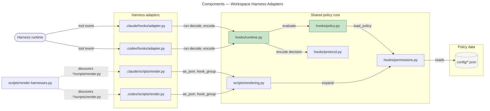
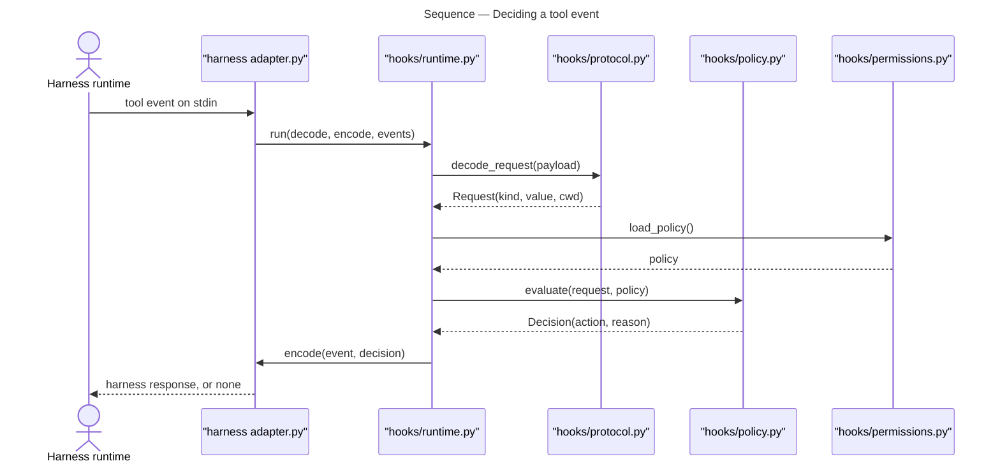
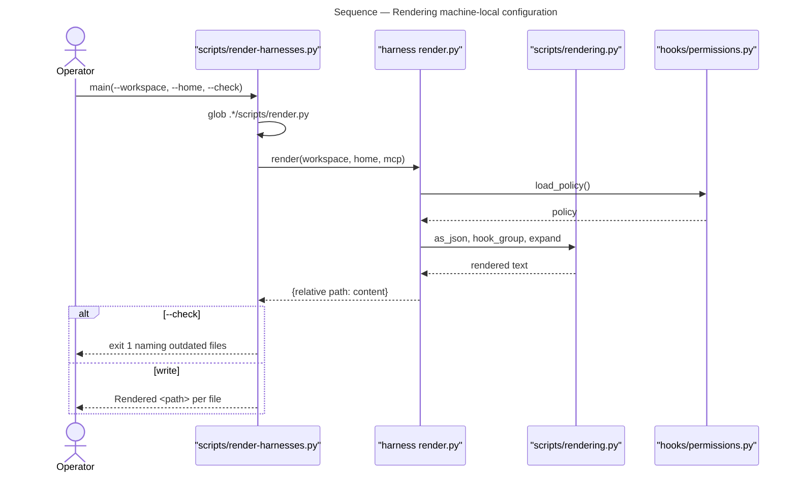

# Architecture Overview — Workspace Harness Adapters

> architecture-overview · [m2ux/workflow-server#1300](https://github.com/m2ux/workflow-server/pull/1300) · 2026-10-13

## Summary

One command policy now lives in `hooks/` and `config/`, and each harness reaches it through an adapter of its own. Claude and Codex keep separate entry points that translate their own event shapes, while the decision itself is made once. Machine-local configuration is generated from that policy rather than hand-maintained per harness.

## Structure

The change splits what was per-harness configuration into three layers: a shared policy core that decides, a per-harness adapter that translates events and permissions, and a renderer that generates each harness's machine-local files from the same policy data. The adapters reach the core through a `shared` symlink into `hooks/`, so each harness directory stays self-contained on disk while holding one copy of the logic.

### Shared policy core

- **`hooks/runtime.py`.** Runs one evaluation given a harness's decode and encode functions, and its event-name mapping. Its outgoing edges are `policy.evaluate` and `protocol.pre_tool_response`.
- **`hooks/policy.py`.** Decides a request against the loaded permissions. Its only non-test caller is `runtime.run`.
- **`hooks/protocol.py`.** Decodes a tool payload into a `Request` and encodes a `Decision` into the hook response shape, parameterised by each harness's shell tool names.
- **`hooks/permissions.py`.** Loads and expands the policy data; `rendering.py` uses the same `expand` for workspace and home placeholders.
- **`config/*.json`.** The policy itself: shell prefixes, web domains, curl and compound-bash allowances.

### Harness adapters

- **`.claude/hooks/adapter.py`.** Translates Claude events and additionally honours Claude's own user, project and local `Bash(...)` grants at the adapter boundary, so a grant made in Claude's settings is respected without entering the shared policy.
- **`.codex/hooks/adapter.py`.** Translates Codex events, including `PermissionRequest`, and maps an `ask` decision onto Codex's native approval rather than a hook verdict.
- **`.claude/scripts/render.py`, `.codex/scripts/render.py`.** Each builds its harness's machine-local configuration from the shared policy.

### Rendering

- **`scripts/render-harnesses.py`.** Discovers every `.*/scripts/render.py` by glob and imports it by path, so a new harness is added by adding its directory. The graph does not record this edge, because the import is dynamic.
- **`scripts/rendering.py`.** Shared helpers the adapters' renderers use: JSON formatting, hook-group construction, and the always-apply rule text.

## Behaviour

Two flows matter to a reviewer: how a tool event reaches a decision, and how machine-local configuration is produced.

### Deciding a tool event

A harness sends a tool event to its adapter, and the adapter returns the verdict in that harness's own response shape.

- **The adapter owns translation only.** It supplies `decode`, `encode` and the event-name map; the decision is `policy.evaluate`'s.
- **A failure denies.** `runtime.run` wraps decode and evaluation, and any exception becomes a deny carrying the reason, so a malformed payload cannot pass by accident.
- **An abstain is silence.** `pre_tool_response` returns `None` for abstain, and `run` prints nothing, leaving the harness's own rules to decide.
- **Codex diverges at encode.** An `ask` becomes additional context rather than a verdict, deferring to Codex's native approval.

### Rendering machine-local configuration

One command regenerates every harness's local files from the shared policy, and the same command checks them without writing.

- **Discovery is by glob, not by registry.** Adding a harness directory with `scripts/render.py` adds it to the run.
- **`--check` is the drift gate.** It compares rendered content against what is on disk and exits non-zero naming each outdated file, which is what continuous integration runs.
- **MCP configuration arrives on stdin.** `--mcp-stdin` lets a caller supply resolved MCP servers rather than having the renderer resolve them.

## What Changed

### Shared policy core

- **`hooks/` holds the decision once.** `runtime`, `policy`, `protocol`, `permissions` and `contracts` are harness-agnostic, and the per-harness hook scripts are gone from the shared directory.
- **Module names are underscored.** The hyphenated scripts are replaced by importable module names, which is what lets the adapters import them.

### Harness adapters

- **Each harness has one adapter.** Claude and Codex each translate their own events and encode their own responses.
- **Claude's own grants are honoured at its boundary.** User, project and local `Bash(...)` allow rules are read by the Claude adapter, not by the shared policy.
- **`shared` is a symlink into the root.** Each harness directory resolves the core by relative path.

### Rendering

- **Machine-local configuration is generated.** `scripts/render-harnesses.py` writes each harness's files, and `--check` reports drift.
- **`docs/harness.md` states the layout**, its shared sources, and each harness's native limits.

## Reading Order

1. **[hooks/contracts.py](https://github.com/m2ux/workflow-server/blob/ffed6221c54ffbe6cfad76c13f6b75f9011987c1/hooks/contracts.py)** — the `Request` and `Decision` types every other module is written against.
2. **[hooks/runtime.py](https://github.com/m2ux/workflow-server/blob/ffed6221c54ffbe6cfad76c13f6b75f9011987c1/hooks/runtime.py)** — the whole evaluation in one short function; the rest is detail hanging off it.
3. **[hooks/protocol.py](https://github.com/m2ux/workflow-server/blob/ffed6221c54ffbe6cfad76c13f6b75f9011987c1/hooks/protocol.py)** — how a payload becomes a request and a decision becomes a response.
4. **[.codex/hooks/adapter.py](https://github.com/m2ux/workflow-server/blob/ffed6221c54ffbe6cfad76c13f6b75f9011987c1/.codex/hooks/adapter.py)** — the smaller adapter, which shows the seam plainly.
5. **[.claude/hooks/adapter.py](https://github.com/m2ux/workflow-server/blob/ffed6221c54ffbe6cfad76c13f6b75f9011987c1/.claude/hooks/adapter.py)** — the same seam plus the settings-grant reading.
6. **[scripts/render-harnesses.py](https://github.com/m2ux/workflow-server/blob/ffed6221c54ffbe6cfad76c13f6b75f9011987c1/scripts/render-harnesses.py)** and **[scripts/rendering.py](https://github.com/m2ux/workflow-server/blob/ffed6221c54ffbe6cfad76c13f6b75f9011987c1/scripts/rendering.py)** — generation, read after the policy it generates from.
7. **[docs/harness.md](https://github.com/m2ux/workflow-server/blob/ffed6221c54ffbe6cfad76c13f6b75f9011987c1/docs/harness.md)** — the layout as documented, to check the code against.

## Risks and Watch Points

- **The renderer's discovery edge is invisible to static analysis.** `render-harnesses.py` imports adapters by path from a glob, so no tool will report a broken adapter until the command runs. The `--check` run in continuous integration is the only guard.
- **Generated files can drift silently.** Anything hand-edited under `.claude/` or `.codex/` that the renderer also writes is overwritten on the next run; `--check` reports it, so confirm that check is wired into the gate.
- **`shared` symlinks must survive checkout.** The adapters resolve the core through `.claude/hooks/shared` and `.codex/hooks/shared`; a worktree or export that does not preserve symlinks breaks every hook at import time.
- **Deny-on-exception is load-bearing.** `runtime.run` turns any decode or evaluation failure into a deny. That is the safe direction, but a bug in `load_policy` denies every command rather than failing visibly.
- **The two adapters can diverge.** `ask` already means different things to Claude and Codex. Each further divergence is a behaviour the shared tests do not cover, since it lives in the adapter.

## References

- **R1.** [Harness documentation](https://github.com/m2ux/workflow-server/blob/ffed6221c54ffbe6cfad76c13f6b75f9011987c1/docs/harness.md) — the shared sources, the render-and-activate procedure, and each harness's native limits.
