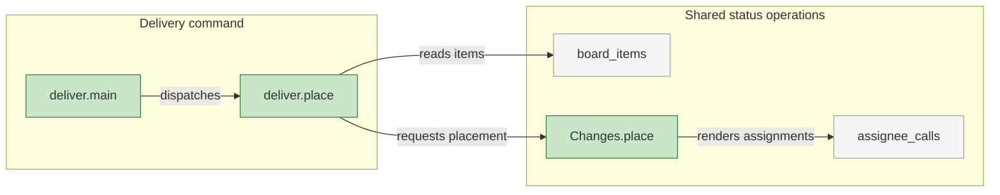
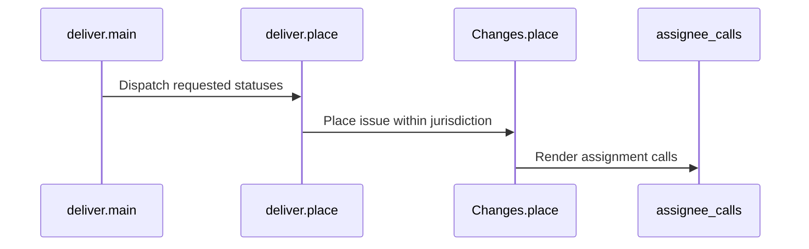

# Architecture Overview — Delivery Signals

> architecture-overview · [workflow-server#1477](https://github.com/m2ux/workflow-server/pull/1477) · 2026-10-31

## Summary

The planner distinguishes evidence available for verification from delivery sufficient for closure. Reservations preserve task status, and a shared status component constrains dispatch writes. Completed epics reach review while repository rules retain control of integration.

## Structure

The indexed dispatch relationships connect the delivery entry point to its placement function and the shared status functions. Reservation parsing also serves board synchronization and delivery row handling.

### Dispatch Status

- **Placement.**
  The dispatch command passes requested statuses through the DISPATCH jurisdiction before rendering calls. Its permitted values are In Progress for tasks and epics and In Review for epics.
- **Reservation.**
  A planning-folder link identifies held work. Board synchronization reads that same parser, so a held task retains In Progress.

## Behaviour

The measured assignment flow carries a dispatch request through placement to assignment-call rendering.

### Dispatch Assignment

GitNexus process `proc_49_main` orders these four symbols at the review head.

- **Execution boundary.**
  The command renders calls. The calling procedure applies them and reads GitHub back to confirm state.
- **Evidence boundary.**
  Open task pull requests permit verification at their exact head. Task closure still requires merged delivery and the complete Development relation.
- **Review boundary.**
  A completed epic reaches In Review and its draft becomes ready. Required human review remains a merge prerequisite.

## What Changed

### Evidence and Status

- **Criteria.**
  Verification and closure have distinct evidence requirements.
- **Delivery.**
  Held rows, complete-epic signals and dispatch writes share the status model described in [PR #1431](https://github.com/m2ux/workflow-server/pull/1431).

## Reading Order

1. [deliver.place](https://github.com/m2ux/workflow-server/blob/b32496cfb8d051ab43cb9ac57ae7c504f678277c/skills/work-planner/scripts/deliver.py#L310) — the dispatch placement entry.
2. [Changes.place](https://github.com/m2ux/workflow-server/blob/b32496cfb8d051ab43cb9ac57ae7c504f678277c/skills/work-planner/scripts/statuses.py#L149) — shared placement and assignment calls.
3. [reservation](https://github.com/m2ux/workflow-server/blob/b32496cfb8d051ab43cb9ac57ae7c504f678277c/skills/work-planner/scripts/format.py#L270) — the held-row representation.
4. [sync.main](https://github.com/m2ux/workflow-server/blob/b32496cfb8d051ab43cb9ac57ae7c504f678277c/skills/work-planner/scripts/sync.py#L614) — issue evidence and readiness reporting.

## Risks and Watch Points

- **Target review.**
  The workspace rules require one human approval. Ready state does not authorize bypassing that rule.
- **Graph coverage.**
  GitNexus 1.6.12 indexed commit `b32496cfb8d051ab43cb9ac57ae7c504f678277c`; freshness matched all 160 covered files. The change surface reported 22 files, 109 symbols and 20 affected processes. The analyzer explicitly reported truncated flow discovery, so the diagrams describe the measured dispatch path, not every possible execution path.
- **Disclosure coverage.**
  Targeted independent instruction walks passed after corrections; the initial full recursive Deliver walk was incomplete. See the recorded validation limits.

## References

- **R1.** [Validation](https://github.com/m2ux/workflow-server/blob/engineering/artifacts/planning/2026-10-31-1431-delivery-signals/validation.md) — regression results and disclosure scope.
