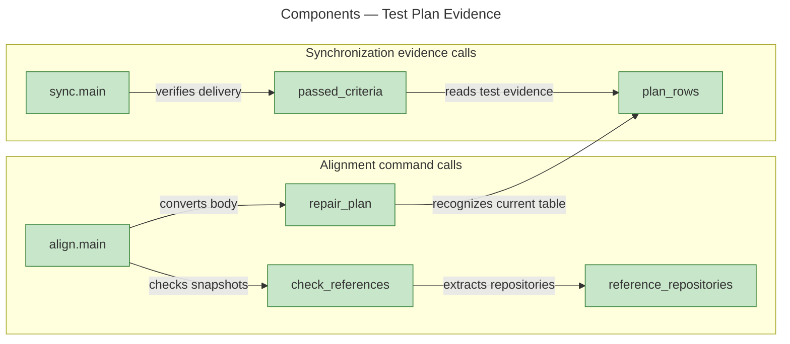
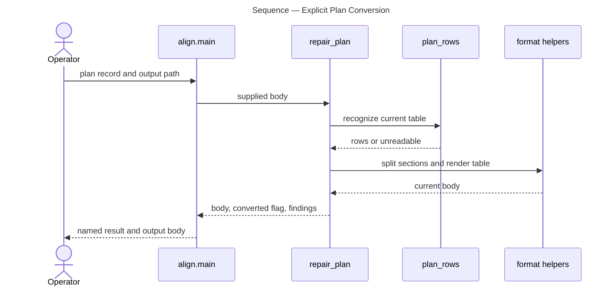
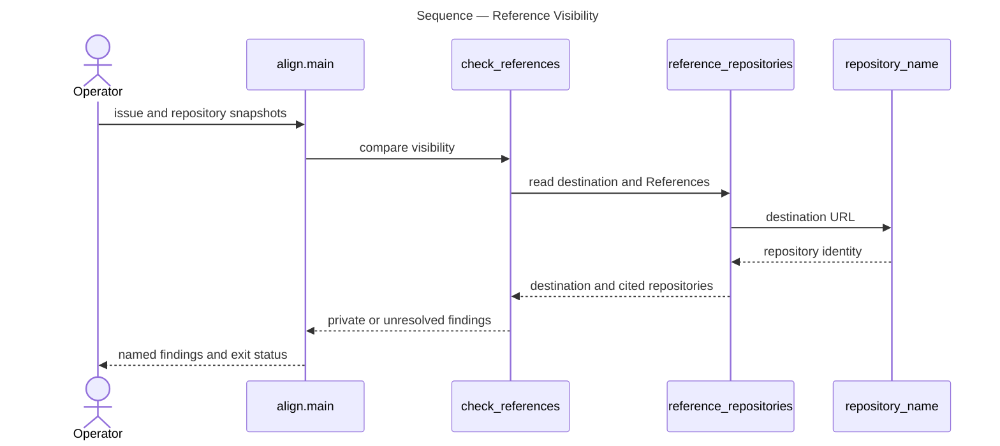
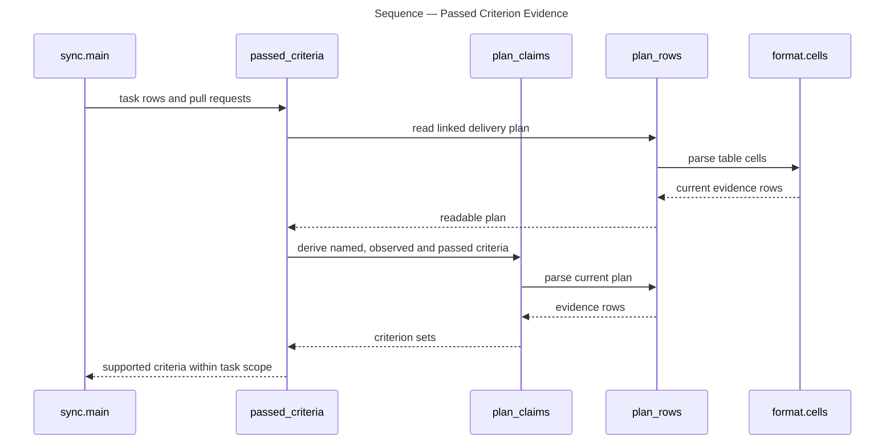

# Architecture Overview — Test Plan Evidence

> architecture-overview · [m2ux/workflow-server#1479](https://github.com/m2ux/workflow-server/pull/1479) · 2026-10-31

## Summary

Work Planner verifies epic criteria from passed task checks and aligns test plans with the current evidence table. Explicit conversion and visibility checks make malformed plans and private references actionable. The review head is `325aa15df86729925c6d9baa0e502ff63c86d98c`, whose tree matches tested task head `5491f81f051af3bfab35fe2848b3b532b6224164`.

## Structure

The measured call graph connects the alignment command to explicit repair and visibility functions, with the shared table parser also serving synchronization. The graph identifies these runtime dependencies; the procedure documents supply their invocation contracts.

### Alignment

- **Explicit repair.**
  [repair_plan](https://github.com/m2ux/workflow-server/blob/325aa15df86729925c6d9baa0e502ff63c86d98c/skills/work-planner/scripts/align.py#L25) converts only a fully accounted-for list and coverage table. Ambiguity preserves the supplied body and produces a finding.
- **Visibility snapshots.**
  [check_references](https://github.com/m2ux/workflow-server/blob/325aa15df86729925c6d9baa0e502ff63c86d98c/skills/work-planner/scripts/align.py#L87) compares the issue destination and References repositories using fetched visibility. Unknown visibility remains unresolved.

### Synchronization

- **Observed checks.**
  [passed_criteria](https://github.com/m2ux/workflow-server/blob/325aa15df86729925c6d9baa0e502ff63c86d98c/skills/work-planner/scripts/sync.py#L447) scopes claims to the task's Coverage and requires merged delivery with passed observations.
- **Readable plans.**
  [plan_rows](https://github.com/m2ux/workflow-server/blob/325aa15df86729925c6d9baa0e502ff63c86d98c/skills/work-planner/scripts/sync.py#L408) accepts the current four-column table. [test_plan_agreement](https://github.com/m2ux/workflow-server/blob/325aa15df86729925c6d9baa0e502ff63c86d98c/skills/work-planner/scripts/sync.py#L503) reports an unreadable plan before reporting criterion disagreement.

## Behaviour

The measured flows separate current evidence reading, explicit conversion and repository visibility.

### Plan conversion

The alignment command returns a converted body or a named finding.

- **Evidence retention.**
  A checked entry retains a linked result; a checked entry lacking that evidence remains pending. The publication procedure verifies link accessibility before saving the body.

### Public reference check

The command reports private references on a public issue from supplied repository snapshots.

### Criterion verification

Synchronization gathers passed evidence for each covered criterion before completing task rows.

## What Changed

### Evidence operations

- **One current representation.**
  Readers consume Test, Description, Coverage and Pass; Align owns explicit conversion. Missing or malformed representation has its own diagnosis.
- **Verification contract.**
  A merged delivery's passed checks settle criteria only within their task scope. A public issue's References require known public visibility.

## Reading Order

1. **[Align mode](https://github.com/m2ux/workflow-server/blob/325aa15df86729925c6d9baa0e502ff63c86d98c/skills/work-planner/modes/align-mode.md#L41)** — Find the visibility and test-plan operation calls.
2. **[Alignment command](https://github.com/m2ux/workflow-server/blob/325aa15df86729925c6d9baa0e502ff63c86d98c/skills/work-planner/scripts/align.py#L104)** — Follow the explicit command dispatch to each operation.
3. **[Synchronization evidence](https://github.com/m2ux/workflow-server/blob/325aa15df86729925c6d9baa0e502ff63c86d98c/skills/work-planner/scripts/sync.py#L408)** — Read parsing, pass aggregation and unreadable diagnosis together.
4. **[Alignment fixtures](https://github.com/m2ux/workflow-server/blob/325aa15df86729925c6d9baa0e502ff63c86d98c/skills/work-planner/test/test_align.py#L1)** — Inspect positive, negative and CLI observations for AC2–AC4.
5. **[Synchronization fixtures](https://github.com/m2ux/workflow-server/blob/325aa15df86729925c6d9baa0e502ff63c86d98c/skills/work-planner/test/test_sync.py#L1)** — Inspect automatic evidence and readiness regressions.

## Risks and Watch Points

- **Graph limits.**
  GitNexus 1.6.12 at this exact head reports 3,020 nodes, 8,249 edges, 106 clusters and 203 flows. Status confirms all 162 covered files match. Comparison to origin/workspace reports 11 changed files, 92 symbols and 18 affected processes; its heuristic labels broad shared-parser reach critical. Discovery dropped 49 entry candidates, left 77 unexplored, skipped 386 callees and cut 16 walks by budget. An absent flow proves nothing about absent code.
- **Evidence boundaries.**
  The 453 planner fixtures, 76 shared fixtures and 49-file structural check pass. Local fixture URLs do not establish accessible production evidence. The independent disclosure run found no missing context on the new paths, but the pre-existing blanket-prerequisite route loads unrelated material and cannot be certified as a complete compliant disclosure walk.
- **Integration approval.**
  Workspace requires one human approval. This overview supplies review evidence and does not waive that requirement.

## References

- **R1.** [W02 validation](../2026-10-31-1249-i11-e11-w02-plan-repair-diagnosis-and/validation.md) — Fixture results, disclosure findings and graph limitations.
- **R2.** [W01 task PR](https://github.com/m2ux/workflow-server/pull/1478) — Passed-evidence aggregation.
- **R3.** [W02 task PR](https://github.com/m2ux/workflow-server/pull/1481) — Alignment and diagnosis.
