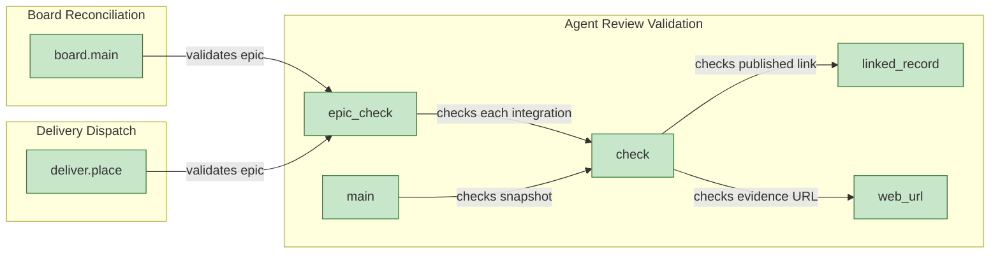
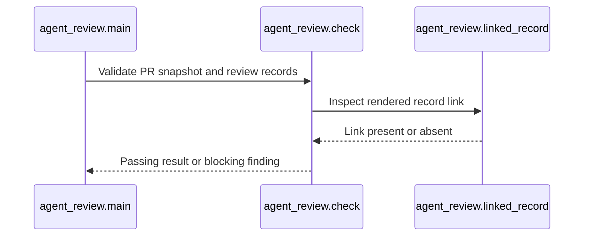

# Architecture Overview — Epic Review Handoff

> architecture-overview · [workflow-server#1484](https://github.com/m2ux/workflow-server/pull/1484) · 2026-10-31

## Summary

Epic handoff requires a published agent review of the current integration head and target. Work Planner validates that evidence at readiness and board boundaries, while required human approval continues to govern merge.

## Structure

Graph measurements identify board.main and deliver.place as callers of agent_review.epic_check. That function selects the epic integration PRs and calls the shared check validator; the CLI reaches check directly. The validator depends on linked_record and web_url for publication and disposition evidence.

## Behaviour

The measured three-step process Main → Linked_record validates the publication link inside a current review record.

The ordered process is read directly from graph STEP_IN_PROCESS edges (steps 1–3), corroborated by the indexed directed trace. The sequence intentionally contains only its three measured symbols. Missing or stale head/base, incomplete records and unresolved findings return a blocker. Fenced and inline code examples cannot supply a publication link.

## What Changed

### Review Evidence

- **Exact comparison.**
  Published JSON identifies both full commit SHAs, scope, criteria, validation and finding dispositions. The last record for a revision is authoritative.
- **Shared decision.**
  Board and dispatch use the same validator; missing evidence keeps an epic In Progress.

### Handoff Instructions

- **Owned sequencing.**
  Epic Integration withdraws prior handoff before preparing, publishes the review, validates it, then readies the PR and records In Review. Any failed operation withdraws the handoff.
- **Current metadata.**
  PR reads replace one full REST JSON object. Sync passes board context into integration; board reconciliation refreshes metadata and review records.
- **Human decision.**
  A required approving review remains a separate merge condition.

## Reading Order

1. [Epic Integration](https://github.com/m2ux/workflow-server/blob/df57ac9a3c230614142364a654fe27a5d21bea1e/skills/work-planner/protocols/epic-integration.md#L20) — The review and handoff sequence.
2. [Agent Review](https://github.com/m2ux/workflow-server/blob/df57ac9a3c230614142364a654fe27a5d21bea1e/skills/work-planner/artifacts/agent-review.md#L9) — The substantive review contract and publication shape.
3. [Review validator](https://github.com/m2ux/workflow-server/blob/df57ac9a3c230614142364a654fe27a5d21bea1e/skills/work-planner/scripts/agent_review.py#L44) — Exact revisions, required fields and finding dispositions.
4. [Board caller](https://github.com/m2ux/workflow-server/blob/df57ac9a3c230614142364a654fe27a5d21bea1e/skills/work-planner/scripts/board.py#L368) — Evidence controls epic status.
5. [Dispatch caller](https://github.com/m2ux/workflow-server/blob/df57ac9a3c230614142364a654fe27a5d21bea1e/skills/work-planner/scripts/deliver.py#L321) — Review writes share the gate.
6. [Sync caller](https://github.com/m2ux/workflow-server/blob/df57ac9a3c230614142364a654fe27a5d21bea1e/skills/work-planner/modes/sync-mode.md#L122) — Integration owns the status transition.

## Risks and Watch Points

- **Evidence freshness.**
  A changed head or target invalidates the review; final live readbacks must match the published pair.
- **Graph coverage.**
  GitNexus 1.6.12 indexed this exact head and reported all 165 covered files current. Change surface reports 13 files,76 symbols and20 affected processes; its printed surface truncates details. Analyzer flow discovery omitted52 candidate entries,67 ranked entries,394 callees and16 budget-cut walks. Missing flows do not establish absent paths. Graph diagrams use only observed relationships; Markdown workflow behavior was separately audited directly.
- **Measurement access.**
  CLI status supplies freshness; per-response staleness blocks were not emitted. Search ranked an unrelated flow, so the sequence uses exact process-ID Cypher and directed trace rather than that search result.
- **Disclosure.**
  Required whole-document prerequisites still include unrelated material. The audit records this existing E14-owned limitation without claiming context savings.

## References

- [Graph status](graph-status.txt), [measured callers](graph-epic-check.json), [validator context](graph-check.json), [ordered process](graph-ordered.json) and [trace](graph-trace.json).
- [Final audit](../2026-10-31-1482-i11-e17-w02-audit-the-delivery-review/coverage.md).
