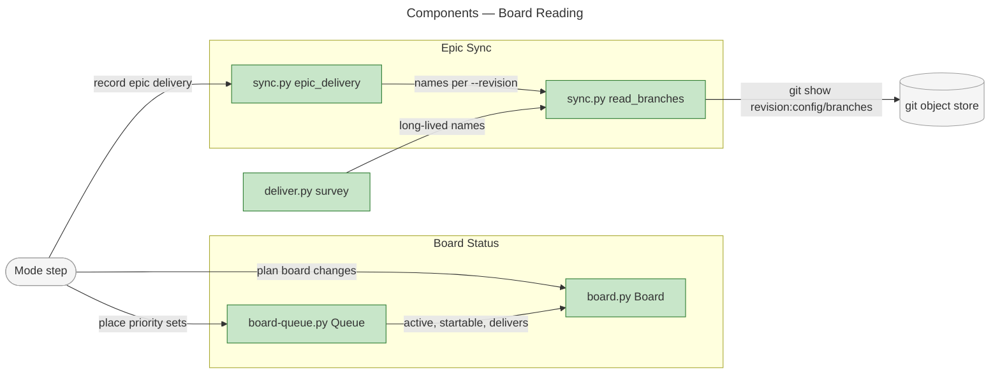
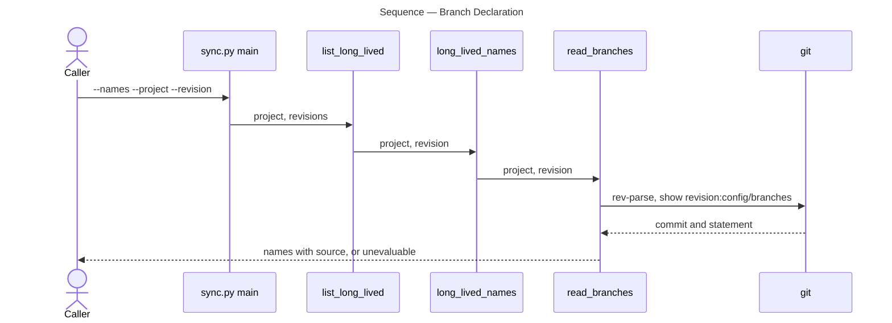

# Architecture Overview — Board Reading: Delivery Activity and Historical Evidence

> architecture-overview · [m2ux/workflow-server#1487](https://github.com/m2ux/workflow-server/pull/1487) · 2026-11-01

## Summary

The change rewrites how the work-planner skill reads a board and an epic: board status follows an initiative's listed epics and their current work, and epic sync reads long-lived branch names from the commit it evaluates. It lands in the skill's scripts (`board.py`, `board-queue.py`, `sync.py`, `deliver.py`) and the artifact prose that states their rules. Board runs can then hold an epic In Progress only while work is under way, open Ready only under the initiative, and sync any epic base, historical tables included.

## Structure

The change reaches four scripts and the prose that defines them. `board.py` computes a board's status calls; `board-queue.py` decides Ready and In Progress across initiatives; `sync.py` records delivery against an epic and reads the project's branch declaration; `deliver.py` surveys the units a delivery session dispatches. Measured edges: `board-queue.py` imports `Board`, `READY_UNDER` and `delivers` from `board.py`; `deliver.py` reads branch names through `sync.py`.



### Board Status

- **`Board.active`.**
  An epic is active while a session holds one of its rows or a delivery pull request is open on it. The epic's integration pull request is excluded through `delivers`.
- **`Board.startable`.**
  An unstarted epic can start only under a Ready or In Progress initiative (`READY_UNDER`) with its prerequisites met.
- **`Queue`.**
  Places priority sets, readies the next set, waits on open pull requests, and cascades Backlog through `shelve` and `park`.

### Epic Sync

- **`read_branches`.**
  Reads `config/branches` at one resolved commit and returns a `Branches` record carrying names, source and any problem.
- **`epic_delivery` and `compose_id`.**
  Links every pull request named for a task id, one per long-lived branch, idempotently.
- **`normalize_closed_table` and `title_repairs`.**
  Bring a closed epic's table to current columns and name the titles to repair.

## Behaviour

Three flows carry the change: reading the branch declaration, placing the queue, and judging an epic's pull requests.

### Branch Declaration

`sync.py --names` or an epic sync with `--revision` yields the declared names or an unevaluable report.



- **Pinned commit.**
  The revision resolves to a commit first; the worktree and its working files choose nothing.
- **Unevaluable.**
  An absent, empty, non-text or directory statement is reported with its source; disagreeing bases are each reported.

### Queue Placement

A board-queue run yields Status calls for initiatives and epics.

```mermaid
---
title: Sequence — Queue Placement
---
sequenceDiagram
    actor Caller
    participant Decide as Queue.decide
    participant Sets as Queue.place_sets
    participant Activate as Queue.activate
    participant Board as Board.startable

    Caller->>Decide: board items, prs
    Decide->>Sets: open initiatives
    Sets->>Activate: initiative in highest or next set
    Activate->>Board: epic, depends
    Board-->>Activate: met, unmet or unresolvable
    Activate-->>Sets: In Progress, Ready or Backlog
    Sets-->>Decide: waits and shelves
    Decide-->>Caller: park, then calls
```

- **Waiting initiative.**
  An initiative kept In Progress only by open pull requests readies none of its epics, and `park` returns their Ready epics to Backlog.

### Epic Pull Requests

`board.py` judges each epic's pull requests through `pr_status` and `delivers`, so the integration draft never counts as delivery activity.

## What Changed

### Board Status

- **Activity.**
  Reservations and open delivery pull requests hold an epic In Progress until the reviewed-handoff gate passes.
- **Membership.**
  Only an epic the initiative's table lists raises it.
- **Ready and Backlog.**
  Ready follows the initiative; Backlog cascades to unstarted epics and task issues without assignees.

### Epic Sync

- **Declaration.**
  Branch names come from each epic base's commit, with unevaluable sources and unmade checks named.
- **Links.**
  A task id links each delivering pull request once per long-lived branch.
- **History.**
  Closed tables are normalized and linked titles repaired before delivery is read.

### Delivery

- **Task branches.**
  A unit changing several long-lived branches takes one task branch and worktree per epic base.

## Reading Order

1. **[sync.py read_branches](https://github.com/m2ux/workflow-server/blob/400703b086b86a2e5d9135d4e6d9f89cdb7d630d/skills/work-planner/scripts/sync.py#L615-L710)** — the declaration every other reader depends on.
2. **[sync.py epic_delivery](https://github.com/m2ux/workflow-server/blob/400703b086b86a2e5d9135d4e6d9f89cdb7d630d/skills/work-planner/scripts/sync.py#L150-L200)** — linking several pull requests per task id.
3. **[sync.py normalize_closed_table](https://github.com/m2ux/workflow-server/blob/400703b086b86a2e5d9135d4e6d9f89cdb7d630d/skills/work-planner/scripts/sync.py#L744-L771)** — historical tables and title repairs.
4. **[board.py Board](https://github.com/m2ux/workflow-server/blob/400703b086b86a2e5d9135d4e6d9f89cdb7d630d/skills/work-planner/scripts/board.py#L127-L260)** — activity, delivery and startability.
5. **[board-queue.py Queue](https://github.com/m2ux/workflow-server/blob/400703b086b86a2e5d9135d4e6d9f89cdb7d630d/skills/work-planner/scripts/board-queue.py#L146-L285)** — placement, waiting, park and shelve.
6. **[deliver.py task_branches](https://github.com/m2ux/workflow-server/blob/400703b086b86a2e5d9135d4e6d9f89cdb7d630d/skills/work-planner/scripts/deliver.py#L94-L121)** — one branch per epic base.
7. **[board-queue.md](https://github.com/m2ux/workflow-server/blob/400703b086b86a2e5d9135d4e6d9f89cdb7d630d/skills/work-planner/artifacts/board-queue.md)** — the rules the queue implements.

## Risks and Watch Points

- **Callers without bases.**
  A Record Epic Delivery caller that omits `--project` and `--revision` gets an unevaluable, never-closable result; it fails safe.
- **Survey breadth.**
  The delivery survey lists a branch per epic base for every unit, whether or not the unit changes that branch.

## References

- **R1.** [Epic I11:E09](https://github.com/m2ux/workflow-server/issues/1176) — the criteria this change delivers.
