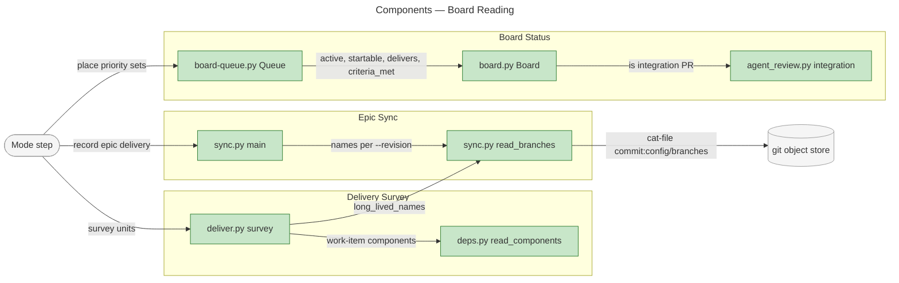
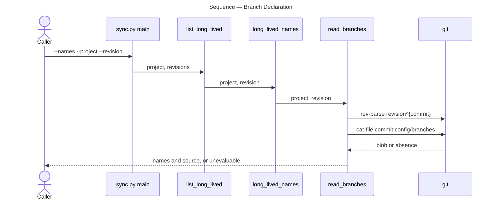
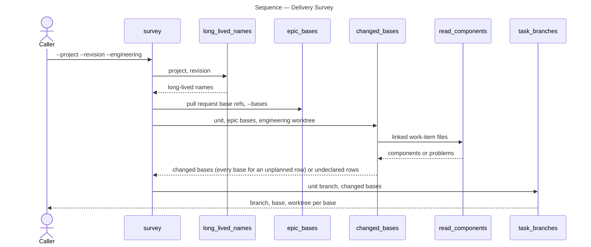

# Architecture Overview — Board Reading: Delivery Activity and Historical Evidence

> architecture-overview · [m2ux/workflow-server#1487](https://github.com/m2ux/workflow-server/pull/1487) · 2026-11-01 · head `e818761e`

## Summary

The change rewrites how the work-planner skill reads a board, an epic and a delivery unit: board status follows an initiative's listed epics and the work under way on them, epic sync reads long-lived branch names at the commits it evaluates, and the delivery survey gives a unit a task branch only for the epic bases its work items name. It lands in the skill's scripts (`board.py`, `board-queue.py`, `sync.py`, `deliver.py`) and the artifact and mode prose that states their rules and calls them. Board runs then hold an epic In Progress only while work is under way, sync any epic base with its historical tables, and dispatch multi-base epics without spare branches.

## Structure

The change reaches three areas. Board Status computes Status calls: `board.py` judges one epic, and `board-queue.py` places initiatives and their epics by priority set. Epic Sync (`sync.py`) records delivery against an epic and owns the branch declaration every other reader takes its names from. Delivery Survey (`deliver.py`) lists the units a delivery session can dispatch and the branches each needs. Every edge below is a measured call or import.



### Board Status

- **`Board.active`.**
  An epic is active while a task row links a session's planning record (a reservation) or an open pull request delivers to it.
- **`delivers` and `integration`.**
  A delivering pull request is open, names the epic, and is not the epic's integration pull request (head `i{xx}/e{yy}/<base>` into `<base>`).
- **`Board.startable`.**
  An unstarted epic can start when it is open, has no Open Questions, and its Depends on entries and prerequisite epics are met.
- **`Queue`.**
  Places priority sets, readies the next set, holds a waiting initiative In Progress, and cascades Backlog through `shelve` and `park`.
- **`handed_off`.**
  An epic is past the queue when it is In Review, Done, closed, or open with every criterion ticked (`criteria_met`), which `board.py` places In Review or holds In Progress while its agent review is missing. `activate` and `park` leave it where it stands, and `shelve` names it `awaiting review` on a reconcile line.
- **`Queue.holding` and `Queue.wait`.**
  An initiative In Progress waits, in any set and when unplanned, while an epic it lists is active, awaiting review or In Review. The wait line names the open delivery pull requests and each epic In Review, awaiting review or held by a session.

### Epic Sync

- **`read_branches`.**
  Reads `config/branches` at one resolved commit and returns a `Branches` record: names, source, and any problem.
- **`epic_base_declarations`.**
  Reads every `--revision` an epic sync names and agrees their names, or reports each disagreeing source.
- **`epic_delivery` and `compose_id`.**
  Link every pull request named for a task id, one per long-lived branch, idempotently.
- **`normalize_closed_table` and `title_repairs`.**
  Bring a closed epic's table to current columns, and name linked titles lacking the epic prefix, over the rows the run writes.

### Delivery Survey

- **`changed_bases`.**
  Keeps the epic bases whose long-lived branch a unit's work items name in their `Component:` line (`<long-lived branch>:<path>`). A free row linking no work item is unplanned and gives its unit every epic base; a linked work item naming no base is reported `undeclared`.
- **`task_branches`.**
  One branch and worktree per changed base, suffixed with the base's long-lived name when there are several.

## Behaviour

Three measured flows carry the change: reading the branch declaration, placing the queue, and surveying delivery units.

### Branch Declaration

`sync.py --names`, or an epic sync with `--project` and `--revision`, yields the declared names with their source, or an unevaluable report.



- **Pinned commit.**
  The revision resolves to a commit first; the checkout only locates the repository, so its worktree and working files choose nothing.
- **Unevaluable.**
  An absent, empty, non-UTF-8 or non-file statement, or a revision that resolves to no commit, is reported with its source. An epic sync reading several bases reports each disagreeing base and names every check it did not make.

### Queue Placement

A board-queue run yields Status calls for initiatives and their epics. `Queue.decide` runs `place_sets` and then `park`.

```mermaid
---
title: Sequence — Queue Placement
---
sequenceDiagram
    actor Caller
    participant Decide as Queue.decide
    participant Sets as Queue.place_sets
    participant Wait as Queue.wait
    participant Activate as Queue.activate
    participant Park as Queue.park
    participant Board as Board
    participant Review as integration

    Caller->>Decide: board items, prs
    Decide->>Wait: unplanned initiative In Progress
    Wait-->>Decide: waiting, or shelve
    Decide->>Sets: open initiatives
    Sets->>Wait: initiative in next or lower set
    Wait-->>Sets: waiting with holding line, or not
    Sets->>Activate: initiative in highest or next set
    Activate->>Board: criteria_met(epic), skip if handed off
    Activate->>Board: startable(epic, depends)
    Board-->>Activate: met, unmet or unresolvable
    Decide->>Park: after placement
    Park->>Board: active(epic)
    Board->>Review: delivers excludes integration PR
    Board-->>Park: active or idle
    Park-->>Caller: Status calls and notes
```

- **Waiting initiative.**
  `wait` asks `holding` what keeps an initiative In Progress: open delivery pull requests, an epic In Review, an epic awaiting review, or an epic a session holds. A waiting initiative is not shelved, `activate` readies none of its epics, and `park` places each epic not handed off by activity, In Progress while active and Backlog otherwise.
- **Handed-off epic.**
  `activate` and `park` skip an epic `handed_off` reports, so the queue never moves an epic whose criteria are all ticked; `board.py` decides between In Review and In Progress by its agent review.
- **Inactive initiative.**
  A Ready epic whose initiative ends neither Ready nor In Progress goes Backlog.

### Delivery Survey

`deliver.py survey` yields each free unit with its record folder and one branch, base and worktree per epic base it changes.



- **One base.**
  A unit of an epic with one base changes it, needs no work-item read, and keeps the unsuffixed branch.
- **Unplanned row.**
  A free row linking no work item has its work item written after dispatch, so its unit takes a branch per epic base and opens a pull request only from the branches its work changes.
- **Undeclared.**
  A linked work item read without `--engineering`, unreadable, or whose component names no long-lived branch with an epic base is printed `undeclared` with its cause, and the run exits 1.

## What Changed

### Board Status

- **Activity.**
  Reservations and open delivery pull requests, never the integration pull request, hold an epic In Progress.
- **Membership.**
  Only an epic the initiative's table lists raises it, and Ready follows the initiative.
- **Waiting initiatives.**
  An initiative In Progress waits while a listed epic is active, awaiting review or In Review, in every set and when unplanned; its wait line names what holds it, and its epics are placed by activity alone, none readied.
- **Epic handoff.**
  An open epic with every criterion ticked stays where `board.py` places it; the queue neither readies nor parks it, and a shelved initiative reconciles it as awaiting review.
- **Backlog cascade.**
  A shelved initiative returns its unstarted epics, and task issues without assignees, to Backlog.

### Epic Sync

- **Declaration.**
  Branch names come from each epic base's commit, with unevaluable sources and unmade checks named.
- **Links.**
  A task id links each delivering pull request once per long-lived branch, and a `--link` target lacking the epic prefix is refused in the run that links it.
- **History.**
  Closed tables are normalized before delivery is read.
- **Callers.**
  Every Record Epic Delivery call in the modes and protocols passes the project checkout and fetched epic bases.

### Delivery Survey

- **Bases from work items.**
  A work item's `Component:` names its long-lived branch, and a unit takes a task branch and worktree only for the bases its rows change. A unit with an unplanned row takes every base.

## Reading Order

1. **[sync.py read_branches](https://github.com/m2ux/workflow-server/blob/e818761e143a4b49d6aed4644ef4ee761811a6a8/skills/work-planner/scripts/sync.py#L615-L710)** — the declaration every other reader depends on, with `epic_base_declarations` and `--names`.
2. **[sync.py main](https://github.com/m2ux/workflow-server/blob/e818761e143a4b49d6aed4644ef4ee761811a6a8/skills/work-planner/scripts/sync.py#L789-L852)** — bases read per `--revision`, closed tables normalized, then delivery and title repairs in that order.
3. **[sync.py compose_id and epic_delivery](https://github.com/m2ux/workflow-server/blob/e818761e143a4b49d6aed4644ef4ee761811a6a8/skills/work-planner/scripts/sync.py#L150-L249)** — several pull requests per task id.
4. **[sync.py normalize_closed_table and title_repairs](https://github.com/m2ux/workflow-server/blob/e818761e143a4b49d6aed4644ef4ee761811a6a8/skills/work-planner/scripts/sync.py#L744-L770)** — historical tables and prefix checks.
5. **[board.py delivers and Board](https://github.com/m2ux/workflow-server/blob/e818761e143a4b49d6aed4644ef4ee761811a6a8/skills/work-planner/scripts/board.py#L127-L302)** — activity, delivery and startability, with [agent_review.py integration](https://github.com/m2ux/workflow-server/blob/e818761e143a4b49d6aed4644ef4ee761811a6a8/skills/work-planner/scripts/agent_review.py#L84-L87).
6. **[board-queue.py Queue](https://github.com/m2ux/workflow-server/blob/e818761e143a4b49d6aed4644ef4ee761811a6a8/skills/work-planner/scripts/board-queue.py#L96-L324)** — `handed_off`, then `activate`, `park`, `shelve`, `holding`, `wait` and `place_sets`.
7. **[deliver.py changed_bases and task_branches](https://github.com/m2ux/workflow-server/blob/e818761e143a4b49d6aed4644ef4ee761811a6a8/skills/work-planner/scripts/deliver.py#L107-L169)** — bases from work items, one branch per base.
8. **[deliver.py survey](https://github.com/m2ux/workflow-server/blob/e818761e143a4b49d6aed4644ef4ee761811a6a8/skills/work-planner/scripts/deliver.py#L287-L382)** — where the declaration, bases and branches meet.
9. **[delivery-branches.md](https://github.com/m2ux/workflow-server/blob/e818761e143a4b49d6aed4644ef4ee761811a6a8/skills/work-planner/artifacts/delivery-branches.md)** — which revision each run evaluates, and the task-branch rule.
10. **[board-queue.md](https://github.com/m2ux/workflow-server/blob/e818761e143a4b49d6aed4644ef4ee761811a6a8/skills/work-planner/artifacts/board-queue.md)** — the rules the queue implements.
11. **[epic-issue-body.md](https://github.com/m2ux/workflow-server/blob/e818761e143a4b49d6aed4644ef4ee761811a6a8/skills/work-planner/artifacts/epic-issue-body.md)** — Sync Epic's inputs, `--revision` and repeated `--link`.

## Risks and Watch Points

- **Callers without bases.**
  A Record Epic Delivery run that omits `--project` and `--revision` reports the names unevaluable and never closes the epic; it fails safe, and every in-skill caller passes them.
- **Work items without a branch.**
  On an epic with several bases, a work item whose `Component:` lacks the `<long-lived branch>:` prefix blocks its unit as `undeclared` until the item is rewritten.
- **Survey breadth.**
  `--engineering` must point at the engineering worktree for multi-base epics, or every unit with a linked work item there is `undeclared`. A unit with an unplanned row is offered a branch per epic base, and its session must leave unchanged branches without a pull request.

## References

- **R1.** [Epic I11:E09](https://github.com/m2ux/workflow-server/issues/1176) — the criteria this change delivers.
- **R2.** Task pull requests [#1521](https://github.com/m2ux/workflow-server/pull/1521), [#1522](https://github.com/m2ux/workflow-server/pull/1522), [#1523](https://github.com/m2ux/workflow-server/pull/1523), [#1524](https://github.com/m2ux/workflow-server/pull/1524), [#1526](https://github.com/m2ux/workflow-server/pull/1526), [#1527](https://github.com/m2ux/workflow-server/pull/1527), [#1532](https://github.com/m2ux/workflow-server/pull/1532), [#1533](https://github.com/m2ux/workflow-server/pull/1533), [#1535](https://github.com/m2ux/workflow-server/pull/1535) — the review fixes, the per-base survey, unplanned rows, the initiative wait and epic handoff.
