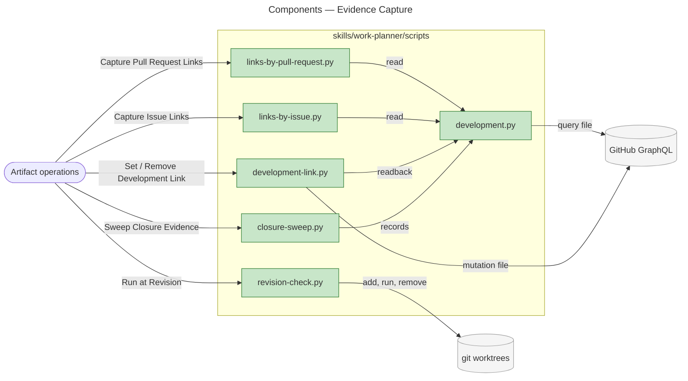
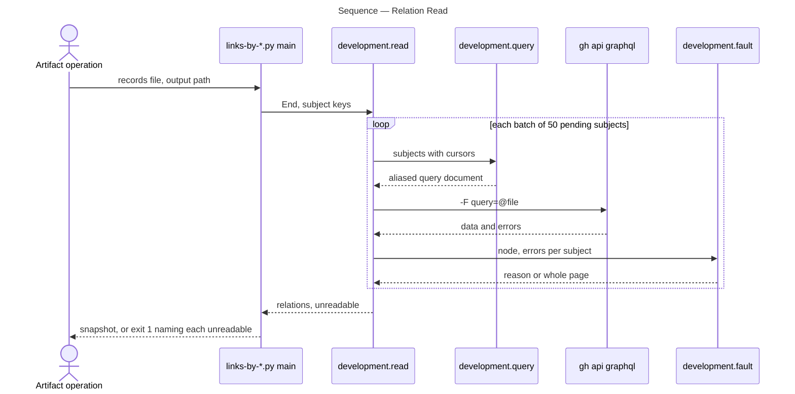
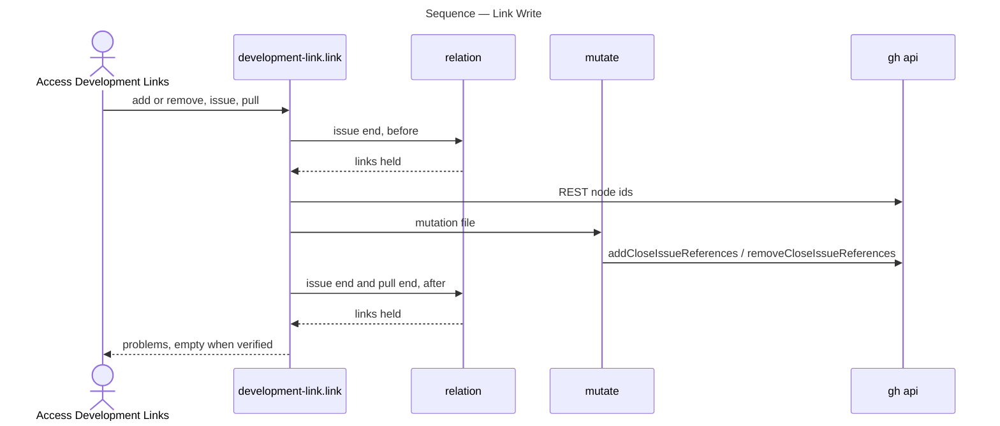

# Architecture Overview — Evidence Capture

> architecture-overview · [m2ux/workflow-server#1505](https://github.com/m2ux/workflow-server/pull/1505) · 2026-11-01

## Summary

The work-planner skill names evidence reads that no command performed: the Development relation between issues and pull requests, a repository-wide closure audit, and a criterion check at a fixed revision. This change adds six scripts under `skills/work-planner/scripts/` and wires each into the artifact operation that runs it. Sync, delivery and verification runs now spend one call per batch of subjects rather than assembling evidence by hand.

## Structure

The change reaches two areas. The skill's markdown layers (modes, protocols, artifacts) gain the command specifications and the operations that cite them. The scripts area gains one shared reader module and five command-line scripts; a test per script and one reachability test sit beside them.

### Scripts

- **`development.py`.**
  The shared reader. One `End` names each side of the relation (`closingIssuesReferences` from a pull request, `closedByPullRequestsReferences` from an issue). `read` batches subjects into one aliased GraphQL document per call, follows each subject's cursor to its last page, and returns the complete relations plus each unreadable subject with its reason.
- **`links-by-pull-request.py` and `links-by-issue.py`.**
  Capture commands. They write the link snapshot the epic sync consumes, keyed by pull request, or the issue-end map keyed by issue number; an unreadable relation exits 1 and writes nothing.
- **`development-link.py`.**
  Adds or removes one Development link through the `addCloseIssueReferences` and `removeCloseIssueReferences` mutations, then reads both ends back and reports any disagreement.
- **`closure-sweep.py`.**
  Lists each closed issue whose criteria are unticked or whose linked pull request has not merged, with its state reason. An issue the snapshot holds no list for is unevaluable.
- **`revision-check.py`.**
  Resolves a branch, tag or commit, runs the instrument in a detached worktree at that commit, and removes the worktree whatever the instrument returns.

### Skill Operations

- **Commands.**
  Each script is one command specification in the artifact whose operation runs it: `pull-request.md` (capture, set, remove), `issue.md` (capture, sweep) and `acceptance-criteria.md` (run at revision).
- **Callers.**
  Fetch Pull Request Issue Links, Read Issue Development, Access Development Links (which reads the pull request's record before a single capture), Audit Closure Evidence and Verify Selected Criteria cite those commands; Sync Mode runs the audit, and the Issue Closure protocol runs a link removal the user decides on.

## Behaviour

Two flows carry the change: reading the relation, and writing a link with its readback.

### Relation Read

A capture command starts the flow with a subject list; it yields each subject's complete link list or names the subjects it could not read.

- **A refused call ends the run.**
  A `gh` failure carrying no GraphQL errors, such as a rejected credential, exits with what `gh` reported; GraphQL errors are matched to the subjects they reach.
- **The query travels by file.**
  A GraphQL variable is a literal `$`, which the workspace shell denies, so every value is inlined into a generated file.
- **A page that is not whole drops the subject.**
  A missing node, an error on its path, a null connection or a further page with no cursor marks it unreadable and discards pages already read.

### Link Write

`development-link.py` starts from an issue and a pull request; it yields the verified relation from both ends or the failed step and its error.

- **Other links are preserved.**
  The expected issue set is the before set without the pull request, plus it once for an add, so a write that disturbs another link is reported.

## What Changed

### Scripts

- **Development relation.**
  Read in batches from either end, every page, with an unreadable relation reported as missing evidence.
- **Link edits.**
  Written by mutation and verified from both ends.
- **Closure audit and revision checks.**
  Run as commands with nonzero exits on findings or failures.

### Skill Operations

- **Every script has a caller.**
  Each is named by a cited command specification or imported by a script that is, and `test_documents.py` fails on one that is not.

## Reading Order

1. **[development.py](https://github.com/m2ux/workflow-server/blob/22974dd02632bc30e408293994dd859be48a25db/skills/work-planner/scripts/development.py#L114-L149)** — the shared reader every capture and readback relies on.
2. **[links-by-pull-request.py](https://github.com/m2ux/workflow-server/blob/22974dd02632bc30e408293994dd859be48a25db/skills/work-planner/scripts/links-by-pull-request.py#L24)** — the snapshot the epic sync consumes.
3. **[links-by-issue.py](https://github.com/m2ux/workflow-server/blob/22974dd02632bc30e408293994dd859be48a25db/skills/work-planner/scripts/links-by-issue.py#L26)** — the same read from the issue end.
4. **[pull-request.md](https://github.com/m2ux/workflow-server/blob/22974dd02632bc30e408293994dd859be48a25db/skills/work-planner/artifacts/pull-request.md#L31-L58)** — Access Development Links and Fetch Pull Request Issue Links, which run the captures and writes.
5. **[development-link.py](https://github.com/m2ux/workflow-server/blob/22974dd02632bc30e408293994dd859be48a25db/skills/work-planner/scripts/development-link.py#L108-L124)** — the write and its two-ended readback.
6. **[closure-sweep.py](https://github.com/m2ux/workflow-server/blob/22974dd02632bc30e408293994dd859be48a25db/skills/work-planner/scripts/closure-sweep.py#L34-L48)** — the closure findings.
7. **[issue.md](https://github.com/m2ux/workflow-server/blob/22974dd02632bc30e408293994dd859be48a25db/skills/work-planner/artifacts/issue.md#L94-L112)** — Read Issue Development and Audit Closure Evidence.
8. **[revision-check.py](https://github.com/m2ux/workflow-server/blob/22974dd02632bc30e408293994dd859be48a25db/skills/work-planner/scripts/revision-check.py#L48-L84)** — the detached checkout and its removal.
9. **[acceptance-criteria.md](https://github.com/m2ux/workflow-server/blob/22974dd02632bc30e408293994dd859be48a25db/skills/work-planner/artifacts/acceptance-criteria.md#L15-L87)** — Verify Selected Criteria and Run at Revision.
10. **[test_documents.py](https://github.com/m2ux/workflow-server/blob/22974dd02632bc30e408293994dd859be48a25db/skills/work-planner/test/test_documents.py#L141-L166)** — the script-reachability guard.

## Risks and Watch Points

- **Some commands run outside the sandbox.**
  The capture and link commands call `gh`, and the revision helper registers a worktree in the repository's git directory, which `sbx` leaves read-only, so their specifications omit `sbx`. The helper's instrument carries its own `sbx` prefix where it needs one; the sweep runs under `sbx`.
- **Schema dependence.**
  The relation fields are current GraphQL names; a renamed field surfaces as an unreadable relation, not an empty one.

## References

- **R1.** [I11:E16 Evidence Capture](https://github.com/m2ux/workflow-server/issues/1474) — the epic, its rows and criteria.
