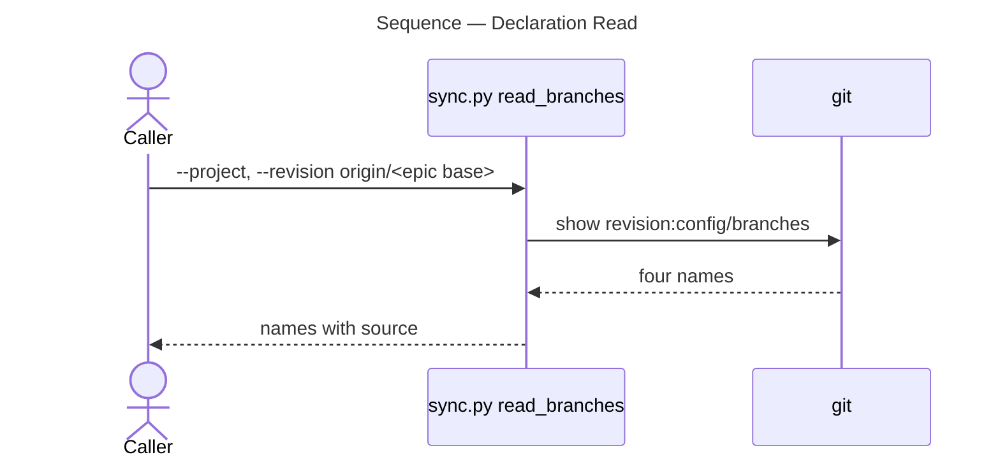

# Architecture Overview — Branch Declaration: main

> architecture-overview · [m2ux/workflow-server#1506](https://github.com/m2ux/workflow-server/pull/1506) · 2026-11-01

## Summary

The change commits `config/branches` to `main`, naming the project's four long-lived branches. It lands in the project's configuration and touches no code. An epic base cut from `main` can then state its long-lived branches at its own commit, which is where the work-planner's epic sync reads them.

## Structure

The one changed file is data read by the work-planner skill on `workspace`. The graph finds no indexed symbol in the diff; the reader is `sync.py read_branches`, which reads the file from git at a resolved commit.

```mermaid
---
title: Components — Branch Declaration: main
---
flowchart LR
    Sync([sync.py on workspace])

    subgraph Branch [main and its epic bases]
        Decl[(config/branches)]
    end

    Sync -->|git show revision:config/branches| Decl

    style Decl fill:#c8e6c9,stroke:#2e7d32
    style Sync fill:#f5f5f5,stroke:#9e9e9e
```

### Main and Its Epic Bases

- **`config/branches`.**
  Names `docker`, `main`, `workflows` and `workspace`, one per line, the set `workspace` states.

## Behaviour

One flow reads the declaration.

### Declaration Read

An epic sync given a `main` epic base as `--revision` yields the long-lived names.



- **Without the file.**
  A `main` epic base would be unevaluable, and the sync would name the checks it did not make.

## What Changed

### Main and Its Epic Bases

- **Declaration.**
  `main` states the long-lived set at its own commit.

## Reading Order

1. **[config/branches](https://github.com/m2ux/workflow-server/blob/1cd4a87d9314a939517beaccd1ef317b6d361ede/config/branches)** — the whole change.

## References

- **R1.** [Task pull request #1494](https://github.com/m2ux/workflow-server/pull/1494) — the task merge this base carries.
