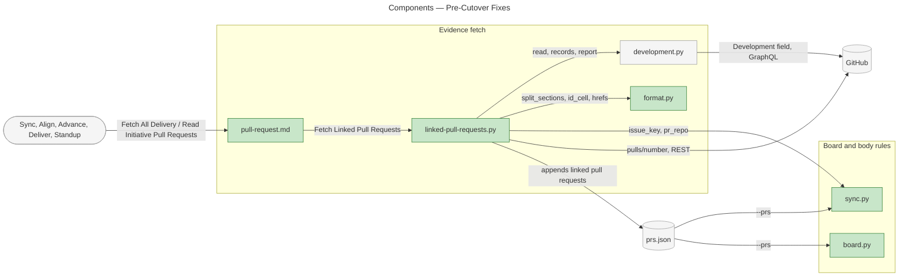
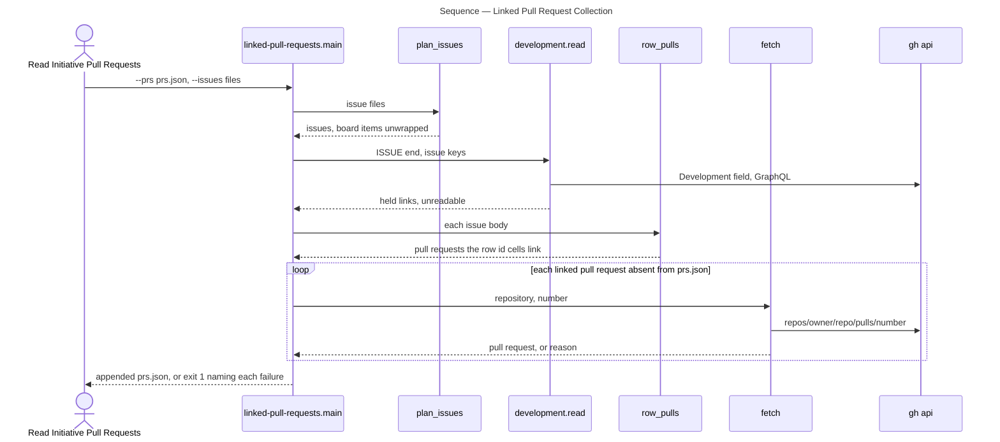
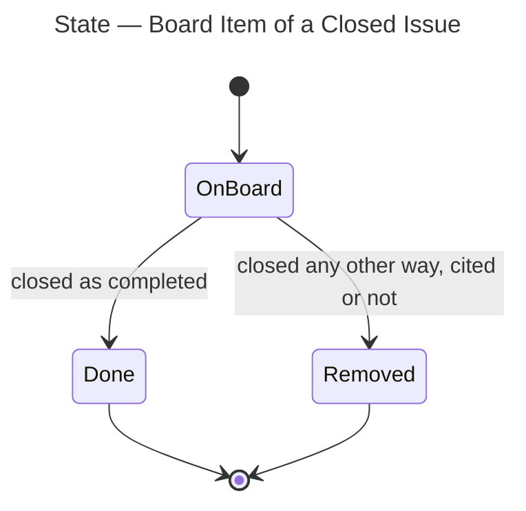

# Architecture Overview — Pre-Cutover Fixes

> architecture-overview · [m2ux/workflow-server#1604](https://github.com/m2ux/workflow-server/pull/1604) · 2026-11-02

## Summary

The change corrects four behaviours of the work-planner skill: how a plan is published, how a not-planned epic leaves its initiative, which closed items a board sync removes, and which pull requests delivery evidence holds. It lands in the skill's modes and artifacts (the markdown procedures an agent follows) and in three of its scripts, with one new script, `linked-pull-requests.py`. Sync, alignment and board runs read every pull request the plan links whatever its title, and a plan's drafts live in its planning record on the engineering branch.

## Structure

The change reaches three areas. The **evidence fetch** gathers the pull request collection (`prs.json`, one pull request per JSON line) that sync and board scripts read; it gains a step that adds every pull request the plan links. The **board and body rules** decide a board item's status and an issue body's format; they gain the removal of every closed-not-completed item and criterion labels that may skip a number. **Planning** is Plan Mode and its planning record, whose drafts become committed files of that record.

### Evidence Fetch

- **`pull-request.md`.**
  Holds Fetch All Delivery Pull Requests (the board-wide collection) and Read Initiative Pull Requests (one initiative's collection). Each ends by running the new Fetch Linked Pull Requests command over the collection it built.
- **`linked-pull-requests.py`.**
  Appends to `prs.json` each pull request the plan links that the collection lacks. A pull request is *linked* when a Work Breakdown row's id cell links it or an issue's Development field (GitHub's issue-to-pull-request relation) names it, in any repository and any state.
- **`development.py`.**
  The existing batched reader of the Development field; the new script reuses its `read`, `records` and `report` unchanged.
- **`delivery-evidence.md`.**
  Read Delivery Evidence passes the fetched initiative, epic and task issues to Read Initiative Pull Requests, so evidence is complete when every linked pull request has a record. Each caller supplies that issue JSON: Sync Mode, Align Mode, Deliver Mode and the Task Merge protocol.

### Board and Body Rules

- **`board.py`.**
  Removes every board item whose issue is closed other than as completed, whether or not an initiative, epic or task body cites it.
- **`format.py`.**
  `Review.in_sequence` accepts acceptance-criterion labels (`AC1`, `AC2` …) that ascend with a gap; references still count from `R1` without one.
- **`initiative-issue-body.md` and `issue-body.md`.**
  A not-planned epic's row leaves the Work Breakdown with the criteria only it covers; the remaining criteria keep their labels, and References link the issue that takes the epic's work.

### Planning

- **`plan-mode.md` and `planning-record.md`.**
  A plan's draft issue bodies and work items are files of its planning record, and Publish Planning Record commits and pushes that folder to the engineering branch. Plan Mode opens no pull request for a plan.
- **`deliver-mode.md`.**
  A delivery pull request opens from a body Populate Pull Request Body writes.

## Behaviour

Two flows carry the change: collecting linked pull requests, and settling a closed board item.

### Linked Pull Request Collection

A caller runs Fetch Linked Pull Requests with the collection and the plan's issues; it yields a collection holding every linked pull request, or names what could not be read and appends nothing.

- **Board items are issues too.**
  `plan_issues` unwraps a board item to the issue it carries and skips pull requests, so the board-wide fetch passes its items file directly.
- **An unreadable relation stops the run before any fetch.**
  `report` names each issue whose Development field did not read whole and the script exits 1.
- **Nothing is appended on a partial result.**
  A pull request that fails to read names its reason; the collection is written only when every fetch succeeds.
- **Repository names compare without case.**
  A pull request already held under another spelling of its repository is not added again.

### Closed Board Item

`board.py` settles each board item against the plan; an item whose issue is closed leaves one of two ways.

- **The rule reads only the issue's state reason.**
  An item outside the plan's computed statuses that is closed and not completed is marked for removal, and the board run reports `remove #n … (closed, not completed)`.

## What Changed

### Evidence Fetch

- **Pull request collections.**
  Hold every pull request whose title names the initiative and every pull request the plan links, whatever its title or repository.
- **Delivery evidence.**
  Is complete in one fetch; no mode re-reads an absent linked pull request afterwards.

### Board and Body Rules

- **Board sync.**
  Removes every closed-not-completed item on the board.
- **Initiative bodies.**
  Drop a not-planned epic's row and its sole criteria, and keep the surviving criteria's labels.
- **Format check.**
  Passes criterion labels that ascend with a gap and leaves repeated or descending labels to decide.

### Planning

- **Plan publication.**
  Plan drafts are committed files of the planning record on the engineering branch, published after each step that writes them.

## Reading Order

1. **[pull-request.md](https://github.com/m2ux/workflow-server/blob/6a6041c8e2d924d80809b7ad71ebf3ebb5988b70/skills/work-planner/artifacts/pull-request.md#L82-L103)** — the two fetch operations every mode runs, where the new command enters.
2. **[pull-request.md](https://github.com/m2ux/workflow-server/blob/6a6041c8e2d924d80809b7ad71ebf3ebb5988b70/skills/work-planner/artifacts/pull-request.md#L528-L549)** — Fetch Linked Pull Requests: what counts as linked, and its exit contract.
3. **[linked-pull-requests.py](https://github.com/m2ux/workflow-server/blob/6a6041c8e2d924d80809b7ad71ebf3ebb5988b70/skills/work-planner/scripts/linked-pull-requests.py#L73-L109)** — `main`, the collection flow above.
4. **[linked-pull-requests.py](https://github.com/m2ux/workflow-server/blob/6a6041c8e2d924d80809b7ad71ebf3ebb5988b70/skills/work-planner/scripts/linked-pull-requests.py#L35-L70)** — `plan_issues`, `row_pulls` and `fetch`, which `main` calls.
5. **[delivery-evidence.md](https://github.com/m2ux/workflow-server/blob/6a6041c8e2d924d80809b7ad71ebf3ebb5988b70/skills/work-planner/artifacts/delivery-evidence.md#L14-L42)** — Read Delivery Evidence and its Completeness rule.
6. **[board.py](https://github.com/m2ux/workflow-server/blob/6a6041c8e2d924d80809b7ad71ebf3ebb5988b70/skills/work-planner/scripts/board.py#L575-L580)** — the closed-item removal.
7. **[board-delivery.md](https://github.com/m2ux/workflow-server/blob/6a6041c8e2d924d80809b7ad71ebf3ebb5988b70/skills/work-planner/artifacts/board-delivery.md#L82-L84)** — Status Changes, the rule `board.py` implements.
8. **[initiative-issue-body.md](https://github.com/m2ux/workflow-server/blob/6a6041c8e2d924d80809b7ad71ebf3ebb5988b70/skills/work-planner/artifacts/initiative-issue-body.md#L149)** — the not-planned epic row rule, with its reference rule at [L181](https://github.com/m2ux/workflow-server/blob/6a6041c8e2d924d80809b7ad71ebf3ebb5988b70/skills/work-planner/artifacts/initiative-issue-body.md#L181).
9. **[issue-body.md](https://github.com/m2ux/workflow-server/blob/6a6041c8e2d924d80809b7ad71ebf3ebb5988b70/skills/work-planner/artifacts/issue-body.md#L154-L156)** — Criterion Labels.
10. **[format.py](https://github.com/m2ux/workflow-server/blob/6a6041c8e2d924d80809b7ad71ebf3ebb5988b70/skills/work-planner/scripts/format.py#L1039-L1067)** — `Review.fix_list` and the `in_sequence` check it calls.
11. **[plan-mode.md](https://github.com/m2ux/workflow-server/blob/6a6041c8e2d924d80809b7ad71ebf3ebb5988b70/skills/work-planner/modes/plan-mode.md#L38-L93)** — record preparation, drafting and the Publish Planning Record calls.
12. **[planning-record.md](https://github.com/m2ux/workflow-server/blob/6a6041c8e2d924d80809b7ad71ebf3ebb5988b70/skills/work-planner/artifacts/planning-record.md#L81)** — drafts as record files.
13. **[test_link_capture.py](https://github.com/m2ux/workflow-server/blob/6a6041c8e2d924d80809b7ad71ebf3ebb5988b70/skills/work-planner/test/test_link_capture.py#L209-L297)** — `LinkedPullRequests`, the collection flow against a stub `gh`.
14. **[test_board.py](https://github.com/m2ux/workflow-server/blob/6a6041c8e2d924d80809b7ad71ebf3ebb5988b70/skills/work-planner/test/test_board.py#L621-L644)** — `ClosedRemoval`, cited and uncited items.

## Risks and Watch Points

- **A shared board loses closed items from other plans.**
  The removal reads only the state reason, so a run for one initiative removes a not-planned item another initiative's issues sit beside on the same theme board. The reviewer sees it in [board.py](https://github.com/m2ux/workflow-server/blob/6a6041c8e2d924d80809b7ad71ebf3ebb5988b70/skills/work-planner/scripts/board.py#L575-L580), where no plan membership guards the branch.
- **A missing first criterion passes the format check.**
  `in_sequence` accepts labels starting past `AC1`, which a removed first criterion needs; a body that never had `AC1` passes as well.
- **The command runs outside `sbx`.**
  It calls `gh` for GraphQL and REST, so its specification omits the sandbox prefix; each missing pull request costs one REST call.

## References

- **R1.** [I17:E00 Pre-Cutover Fixes](https://github.com/m2ux/workflow-server/issues/1598) — the epic, its task rows and criteria.
