# Measured Integration Flows

PR #1641 at `00ec0b9dd516cf6031d44c1ac2184ca95d1e0a01`, against `03d353300ca4804194fd50d316d73e3bf1270d1d`.

All 37 affected static processes reported by GitNexus are represented below. The 163 ordered membership rows supply the sequences. Each arrow means the next indexed step, not an observed runtime invocation. Green identifies symbols in the measured change surface; grey identifies context. Short processes retain their actual symbol count.

Native ranked searches and their limits are preserved in the measurement archive; exact process-membership queries supply these complete reported paths. Analyzer coverage warnings mean unreported paths can still exist.

## 1. Main → Anchor_of

Process `proc_4_main` has 7 measured steps.

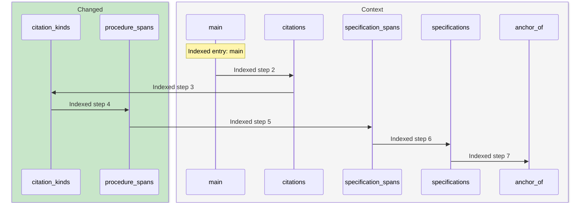

- **Step 1: [main](https://github.com/m2ux/workflow-server/blob/00ec0b9dd516cf6031d44c1ac2184ca95d1e0a01/skills/scripts/check_skill_files.py#L1372).**
  skills/scripts/check_skill_files.py.
- **Step 2: [citations](https://github.com/m2ux/workflow-server/blob/00ec0b9dd516cf6031d44c1ac2184ca95d1e0a01/skills/scripts/check_skill_files.py#L430).**
  skills/scripts/check_skill_files.py.
- **Step 3: [citation_kinds](https://github.com/m2ux/workflow-server/blob/00ec0b9dd516cf6031d44c1ac2184ca95d1e0a01/skills/scripts/check_skill_files.py#L1290).**
  skills/scripts/check_skill_files.py.
- **Step 4: [procedure_spans](https://github.com/m2ux/workflow-server/blob/00ec0b9dd516cf6031d44c1ac2184ca95d1e0a01/skills/scripts/check_skill_files.py#L408).**
  skills/scripts/check_skill_files.py.
- **Step 5: [specification_spans](https://github.com/m2ux/workflow-server/blob/00ec0b9dd516cf6031d44c1ac2184ca95d1e0a01/skills/scripts/check_skill_files.py#L390).**
  skills/scripts/check_skill_files.py.
- **Step 6: [specifications](https://github.com/m2ux/workflow-server/blob/00ec0b9dd516cf6031d44c1ac2184ca95d1e0a01/skills/scripts/check_skill_files.py#L374).**
  skills/scripts/check_skill_files.py.
- **Step 7: [anchor_of](https://github.com/m2ux/workflow-server/blob/00ec0b9dd516cf6031d44c1ac2184ca95d1e0a01/skills/scripts/check_skill_files.py#L180).**
  skills/scripts/check_skill_files.py.

## 2. Link_roles → Validate_structure_entry

Process `proc_17_link_roles` has 6 measured steps.

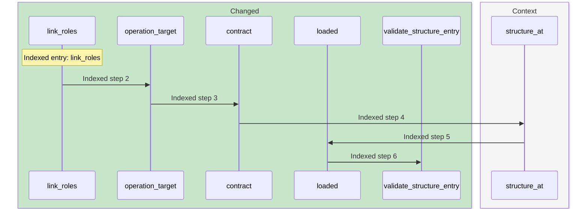

- **Step 1: [link_roles](https://github.com/m2ux/workflow-server/blob/00ec0b9dd516cf6031d44c1ac2184ca95d1e0a01/skills/scripts/check_skill_files.py#L513).**
  skills/scripts/check_skill_files.py.
- **Step 2: [operation_target](https://github.com/m2ux/workflow-server/blob/00ec0b9dd516cf6031d44c1ac2184ca95d1e0a01/skills/scripts/check_skill_files.py#L494).**
  skills/scripts/check_skill_files.py.
- **Step 3: [contract](https://github.com/m2ux/workflow-server/blob/00ec0b9dd516cf6031d44c1ac2184ca95d1e0a01/skills/scripts/check_skill_files.py#L363).**
  skills/scripts/check_skill_files.py.
- **Step 4: [structure_at](https://github.com/m2ux/workflow-server/blob/00ec0b9dd516cf6031d44c1ac2184ca95d1e0a01/skills/scripts/check_skill_files.py#L288).**
  skills/scripts/check_skill_files.py.
- **Step 5: [loaded](https://github.com/m2ux/workflow-server/blob/00ec0b9dd516cf6031d44c1ac2184ca95d1e0a01/skills/scripts/check_skill_files.py#L304).**
  skills/scripts/check_skill_files.py.
- **Step 6: [validate_structure_entry](https://github.com/m2ux/workflow-server/blob/00ec0b9dd516cf6031d44c1ac2184ca95d1e0a01/skills/scripts/check_skill_files.py#L318).**
  skills/scripts/check_skill_files.py.

## 3. Main → Heading_end

Process `proc_18_main` has 6 measured steps.

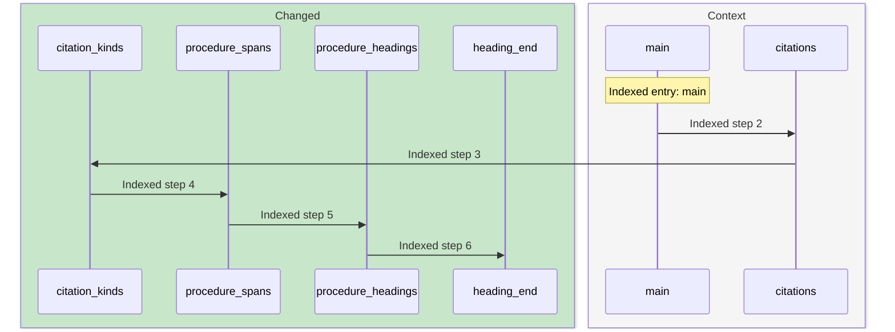

- **Step 1: [main](https://github.com/m2ux/workflow-server/blob/00ec0b9dd516cf6031d44c1ac2184ca95d1e0a01/skills/scripts/check_skill_files.py#L1372).**
  skills/scripts/check_skill_files.py.
- **Step 2: [citations](https://github.com/m2ux/workflow-server/blob/00ec0b9dd516cf6031d44c1ac2184ca95d1e0a01/skills/scripts/check_skill_files.py#L430).**
  skills/scripts/check_skill_files.py.
- **Step 3: [citation_kinds](https://github.com/m2ux/workflow-server/blob/00ec0b9dd516cf6031d44c1ac2184ca95d1e0a01/skills/scripts/check_skill_files.py#L1290).**
  skills/scripts/check_skill_files.py.
- **Step 4: [procedure_spans](https://github.com/m2ux/workflow-server/blob/00ec0b9dd516cf6031d44c1ac2184ca95d1e0a01/skills/scripts/check_skill_files.py#L408).**
  skills/scripts/check_skill_files.py.
- **Step 5: [procedure_headings](https://github.com/m2ux/workflow-server/blob/00ec0b9dd516cf6031d44c1ac2184ca95d1e0a01/skills/scripts/check_skill_files.py#L459).**
  skills/scripts/check_skill_files.py.
- **Step 6: [heading_end](https://github.com/m2ux/workflow-server/blob/00ec0b9dd516cf6031d44c1ac2184ca95d1e0a01/skills/scripts/check_skill_files.py#L454).**
  skills/scripts/check_skill_files.py.

## 4. Main → Scan_blocks

Process `proc_19_main` has 6 measured steps.

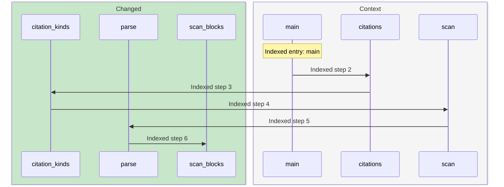

- **Step 1: [main](https://github.com/m2ux/workflow-server/blob/00ec0b9dd516cf6031d44c1ac2184ca95d1e0a01/skills/scripts/check_skill_files.py#L1372).**
  skills/scripts/check_skill_files.py.
- **Step 2: [citations](https://github.com/m2ux/workflow-server/blob/00ec0b9dd516cf6031d44c1ac2184ca95d1e0a01/skills/scripts/check_skill_files.py#L430).**
  skills/scripts/check_skill_files.py.
- **Step 3: [citation_kinds](https://github.com/m2ux/workflow-server/blob/00ec0b9dd516cf6031d44c1ac2184ca95d1e0a01/skills/scripts/check_skill_files.py#L1290).**
  skills/scripts/check_skill_files.py.
- **Step 4: [scan](https://github.com/m2ux/workflow-server/blob/00ec0b9dd516cf6031d44c1ac2184ca95d1e0a01/skills/scripts/check_skill_files.py#L192).**
  skills/scripts/check_skill_files.py.
- **Step 5: [parse](https://github.com/m2ux/workflow-server/blob/00ec0b9dd516cf6031d44c1ac2184ca95d1e0a01/skills/scripts/check_skill_files.py#L253).**
  skills/scripts/check_skill_files.py.
- **Step 6: [scan_blocks](https://github.com/m2ux/workflow-server/blob/00ec0b9dd516cf6031d44c1ac2184ca95d1e0a01/skills/scripts/check_skill_files.py#L210).**
  skills/scripts/check_skill_files.py.

## 5. Check → Named

Process `proc_60_check` has 4 measured steps.

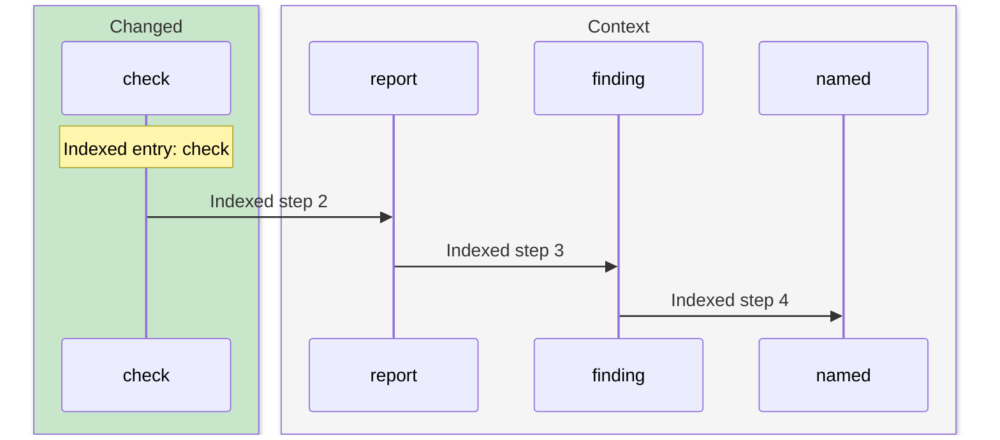

- **Step 1: [check](https://github.com/m2ux/workflow-server/blob/00ec0b9dd516cf6031d44c1ac2184ca95d1e0a01/skills/scripts/check_skill_files.py#L667).**
  skills/scripts/check_skill_files.py.
- **Step 2: [report](https://github.com/m2ux/workflow-server/blob/00ec0b9dd516cf6031d44c1ac2184ca95d1e0a01/skills/scripts/check_skill_files.py#L674).**
  skills/scripts/check_skill_files.py.
- **Step 3: [finding](https://github.com/m2ux/workflow-server/blob/00ec0b9dd516cf6031d44c1ac2184ca95d1e0a01/skills/scripts/check_skill_files.py#L820).**
  skills/scripts/check_skill_files.py.
- **Step 4: [named](https://github.com/m2ux/workflow-server/blob/00ec0b9dd516cf6031d44c1ac2184ca95d1e0a01/skills/scripts/check_skill_files.py#L185).**
  skills/scripts/check_skill_files.py.

## 6. Interfaces → Script_of

Process `proc_84_interfaces` has 3 measured steps.

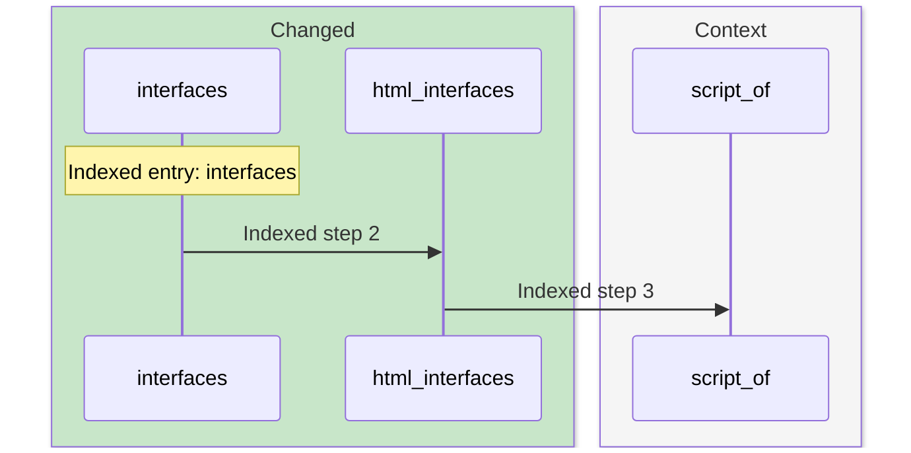

- **Step 1: [interfaces](https://github.com/m2ux/workflow-server/blob/00ec0b9dd516cf6031d44c1ac2184ca95d1e0a01/skills/scripts/check_skill_files.py#L950).**
  skills/scripts/check_skill_files.py.
- **Step 2: [html_interfaces](https://github.com/m2ux/workflow-server/blob/00ec0b9dd516cf6031d44c1ac2184ca95d1e0a01/skills/scripts/check_skill_files.py#L646).**
  skills/scripts/check_skill_files.py.
- **Step 3: [script_of](https://github.com/m2ux/workflow-server/blob/00ec0b9dd516cf6031d44c1ac2184ca95d1e0a01/skills/scripts/check_skill_files.py#L941).**
  skills/scripts/check_skill_files.py.

## 7. Retired_terms → Vocabulary

Process `proc_86_retired_terms` has 3 measured steps.

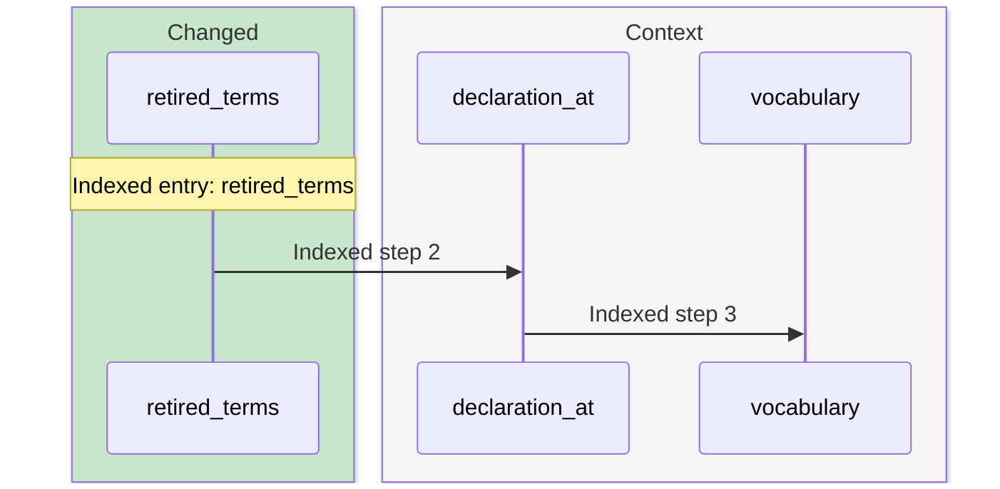

- **Step 1: [retired_terms](https://github.com/m2ux/workflow-server/blob/00ec0b9dd516cf6031d44c1ac2184ca95d1e0a01/skills/scripts/check_skill_files.py#L880).**
  skills/scripts/check_skill_files.py.
- **Step 2: [declaration_at](https://github.com/m2ux/workflow-server/blob/00ec0b9dd516cf6031d44c1ac2184ca95d1e0a01/skills/scripts/check_skill_files.py#L850).**
  skills/scripts/check_skill_files.py.
- **Step 3: [vocabulary](https://github.com/m2ux/workflow-server/blob/00ec0b9dd516cf6031d44c1ac2184ca95d1e0a01/skills/scripts/check_skill_files.py#L865).**
  skills/scripts/check_skill_files.py.

## 8. Reach → Anchor_of

Process `proc_119_reach` has 6 measured steps.

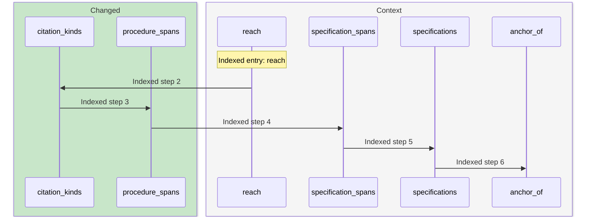

- **Step 1: [reach](https://github.com/m2ux/workflow-server/blob/00ec0b9dd516cf6031d44c1ac2184ca95d1e0a01/skills/scripts/check_skill_files.py#L1328).**
  skills/scripts/check_skill_files.py.
- **Step 2: [citation_kinds](https://github.com/m2ux/workflow-server/blob/00ec0b9dd516cf6031d44c1ac2184ca95d1e0a01/skills/scripts/check_skill_files.py#L1290).**
  skills/scripts/check_skill_files.py.
- **Step 3: [procedure_spans](https://github.com/m2ux/workflow-server/blob/00ec0b9dd516cf6031d44c1ac2184ca95d1e0a01/skills/scripts/check_skill_files.py#L408).**
  skills/scripts/check_skill_files.py.
- **Step 4: [specification_spans](https://github.com/m2ux/workflow-server/blob/00ec0b9dd516cf6031d44c1ac2184ca95d1e0a01/skills/scripts/check_skill_files.py#L390).**
  skills/scripts/check_skill_files.py.
- **Step 5: [specifications](https://github.com/m2ux/workflow-server/blob/00ec0b9dd516cf6031d44c1ac2184ca95d1e0a01/skills/scripts/check_skill_files.py#L374).**
  skills/scripts/check_skill_files.py.
- **Step 6: [anchor_of](https://github.com/m2ux/workflow-server/blob/00ec0b9dd516cf6031d44c1ac2184ca95d1e0a01/skills/scripts/check_skill_files.py#L180).**
  skills/scripts/check_skill_files.py.

## 9. Main → Validate_structure_entry

Process `proc_129_main` has 6 measured steps.

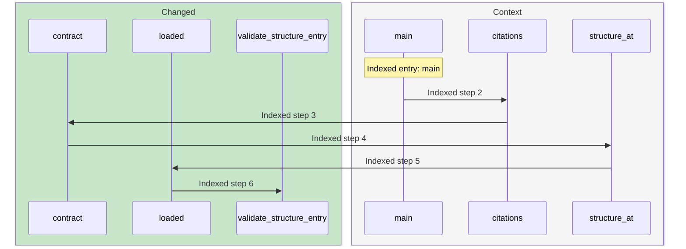

- **Step 1: [main](https://github.com/m2ux/workflow-server/blob/00ec0b9dd516cf6031d44c1ac2184ca95d1e0a01/skills/scripts/check_skill_files.py#L1372).**
  skills/scripts/check_skill_files.py.
- **Step 2: [citations](https://github.com/m2ux/workflow-server/blob/00ec0b9dd516cf6031d44c1ac2184ca95d1e0a01/skills/scripts/check_skill_files.py#L430).**
  skills/scripts/check_skill_files.py.
- **Step 3: [contract](https://github.com/m2ux/workflow-server/blob/00ec0b9dd516cf6031d44c1ac2184ca95d1e0a01/skills/scripts/check_skill_files.py#L363).**
  skills/scripts/check_skill_files.py.
- **Step 4: [structure_at](https://github.com/m2ux/workflow-server/blob/00ec0b9dd516cf6031d44c1ac2184ca95d1e0a01/skills/scripts/check_skill_files.py#L288).**
  skills/scripts/check_skill_files.py.
- **Step 5: [loaded](https://github.com/m2ux/workflow-server/blob/00ec0b9dd516cf6031d44c1ac2184ca95d1e0a01/skills/scripts/check_skill_files.py#L304).**
  skills/scripts/check_skill_files.py.
- **Step 6: [validate_structure_entry](https://github.com/m2ux/workflow-server/blob/00ec0b9dd516cf6031d44c1ac2184ca95d1e0a01/skills/scripts/check_skill_files.py#L318).**
  skills/scripts/check_skill_files.py.

## 10. Reach → Heading_end

Process `proc_130_reach` has 5 measured steps.

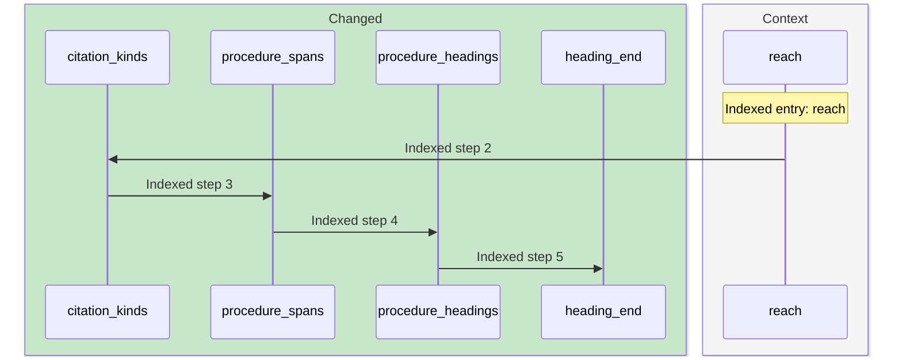

- **Step 1: [reach](https://github.com/m2ux/workflow-server/blob/00ec0b9dd516cf6031d44c1ac2184ca95d1e0a01/skills/scripts/check_skill_files.py#L1328).**
  skills/scripts/check_skill_files.py.
- **Step 2: [citation_kinds](https://github.com/m2ux/workflow-server/blob/00ec0b9dd516cf6031d44c1ac2184ca95d1e0a01/skills/scripts/check_skill_files.py#L1290).**
  skills/scripts/check_skill_files.py.
- **Step 3: [procedure_spans](https://github.com/m2ux/workflow-server/blob/00ec0b9dd516cf6031d44c1ac2184ca95d1e0a01/skills/scripts/check_skill_files.py#L408).**
  skills/scripts/check_skill_files.py.
- **Step 4: [procedure_headings](https://github.com/m2ux/workflow-server/blob/00ec0b9dd516cf6031d44c1ac2184ca95d1e0a01/skills/scripts/check_skill_files.py#L459).**
  skills/scripts/check_skill_files.py.
- **Step 5: [heading_end](https://github.com/m2ux/workflow-server/blob/00ec0b9dd516cf6031d44c1ac2184ca95d1e0a01/skills/scripts/check_skill_files.py#L454).**
  skills/scripts/check_skill_files.py.

## 11. Doubled_conventions → Scan_blocks

Process `proc_131_doubled_conventions` has 5 measured steps.

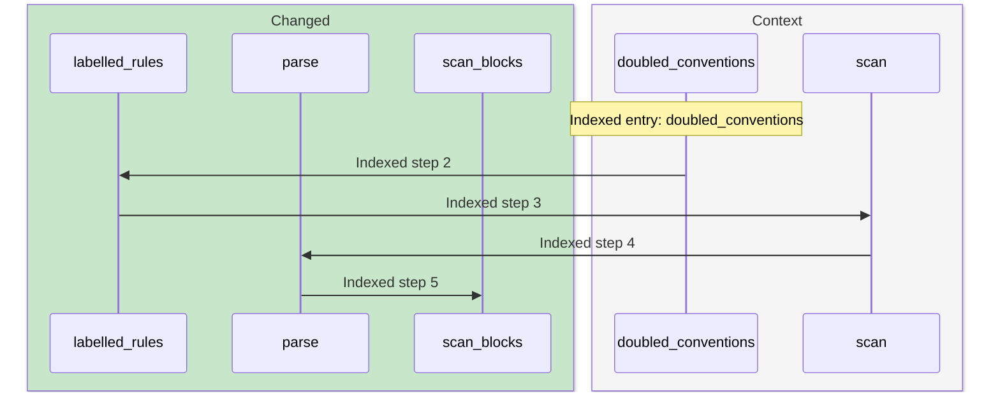

- **Step 1: [doubled_conventions](https://github.com/m2ux/workflow-server/blob/00ec0b9dd516cf6031d44c1ac2184ca95d1e0a01/skills/scripts/check_skill_files.py#L929).**
  skills/scripts/check_skill_files.py.
- **Step 2: [labelled_rules](https://github.com/m2ux/workflow-server/blob/00ec0b9dd516cf6031d44c1ac2184ca95d1e0a01/skills/scripts/check_skill_files.py#L900).**
  skills/scripts/check_skill_files.py.
- **Step 3: [scan](https://github.com/m2ux/workflow-server/blob/00ec0b9dd516cf6031d44c1ac2184ca95d1e0a01/skills/scripts/check_skill_files.py#L192).**
  skills/scripts/check_skill_files.py.
- **Step 4: [parse](https://github.com/m2ux/workflow-server/blob/00ec0b9dd516cf6031d44c1ac2184ca95d1e0a01/skills/scripts/check_skill_files.py#L253).**
  skills/scripts/check_skill_files.py.
- **Step 5: [scan_blocks](https://github.com/m2ux/workflow-server/blob/00ec0b9dd516cf6031d44c1ac2184ca95d1e0a01/skills/scripts/check_skill_files.py#L210).**
  skills/scripts/check_skill_files.py.

## 12. Interfaces → Named

Process `proc_155_interfaces` has 4 measured steps.

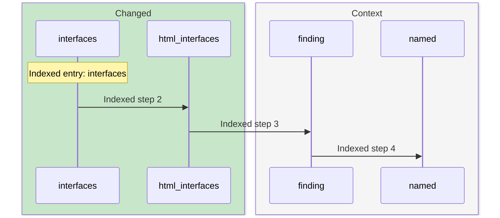

- **Step 1: [interfaces](https://github.com/m2ux/workflow-server/blob/00ec0b9dd516cf6031d44c1ac2184ca95d1e0a01/skills/scripts/check_skill_files.py#L950).**
  skills/scripts/check_skill_files.py.
- **Step 2: [html_interfaces](https://github.com/m2ux/workflow-server/blob/00ec0b9dd516cf6031d44c1ac2184ca95d1e0a01/skills/scripts/check_skill_files.py#L646).**
  skills/scripts/check_skill_files.py.
- **Step 3: [finding](https://github.com/m2ux/workflow-server/blob/00ec0b9dd516cf6031d44c1ac2184ca95d1e0a01/skills/scripts/check_skill_files.py#L820).**
  skills/scripts/check_skill_files.py.
- **Step 4: [named](https://github.com/m2ux/workflow-server/blob/00ec0b9dd516cf6031d44c1ac2184ca95d1e0a01/skills/scripts/check_skill_files.py#L185).**
  skills/scripts/check_skill_files.py.

## 13. Mode_commands → Anchor_of

Process `proc_168_mode_commands` has 4 measured steps.

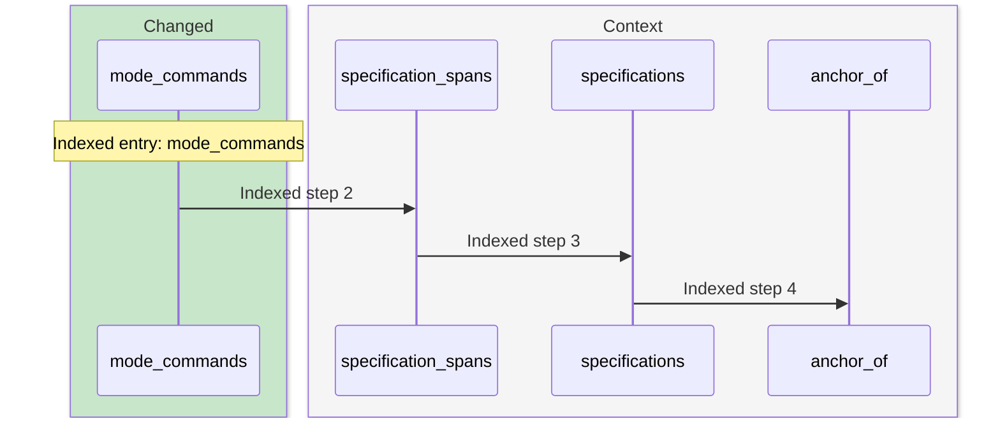

- **Step 1: [mode_commands](https://github.com/m2ux/workflow-server/blob/00ec0b9dd516cf6031d44c1ac2184ca95d1e0a01/skills/scripts/check_skill_files.py#L833).**
  skills/scripts/check_skill_files.py.
- **Step 2: [specification_spans](https://github.com/m2ux/workflow-server/blob/00ec0b9dd516cf6031d44c1ac2184ca95d1e0a01/skills/scripts/check_skill_files.py#L390).**
  skills/scripts/check_skill_files.py.
- **Step 3: [specifications](https://github.com/m2ux/workflow-server/blob/00ec0b9dd516cf6031d44c1ac2184ca95d1e0a01/skills/scripts/check_skill_files.py#L374).**
  skills/scripts/check_skill_files.py.
- **Step 4: [anchor_of](https://github.com/m2ux/workflow-server/blob/00ec0b9dd516cf6031d44c1ac2184ca95d1e0a01/skills/scripts/check_skill_files.py#L180).**
  skills/scripts/check_skill_files.py.

## 14. Operation_calls → Validate_structure_entry

Process `proc_175_operation_calls` has 6 measured steps.

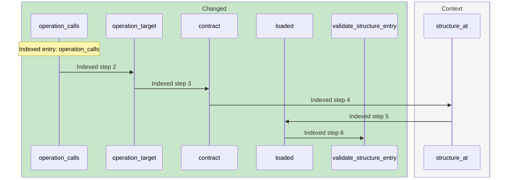

- **Step 1: [operation_calls](https://github.com/m2ux/workflow-server/blob/00ec0b9dd516cf6031d44c1ac2184ca95d1e0a01/skills/scripts/check_skill_files.py#L629).**
  skills/scripts/check_skill_files.py.
- **Step 2: [operation_target](https://github.com/m2ux/workflow-server/blob/00ec0b9dd516cf6031d44c1ac2184ca95d1e0a01/skills/scripts/check_skill_files.py#L494).**
  skills/scripts/check_skill_files.py.
- **Step 3: [contract](https://github.com/m2ux/workflow-server/blob/00ec0b9dd516cf6031d44c1ac2184ca95d1e0a01/skills/scripts/check_skill_files.py#L363).**
  skills/scripts/check_skill_files.py.
- **Step 4: [structure_at](https://github.com/m2ux/workflow-server/blob/00ec0b9dd516cf6031d44c1ac2184ca95d1e0a01/skills/scripts/check_skill_files.py#L288).**
  skills/scripts/check_skill_files.py.
- **Step 5: [loaded](https://github.com/m2ux/workflow-server/blob/00ec0b9dd516cf6031d44c1ac2184ca95d1e0a01/skills/scripts/check_skill_files.py#L304).**
  skills/scripts/check_skill_files.py.
- **Step 6: [validate_structure_entry](https://github.com/m2ux/workflow-server/blob/00ec0b9dd516cf6031d44c1ac2184ca95d1e0a01/skills/scripts/check_skill_files.py#L318).**
  skills/scripts/check_skill_files.py.

## 15. Interfaces → Heading_end

Process `proc_176_interfaces` has 4 measured steps.

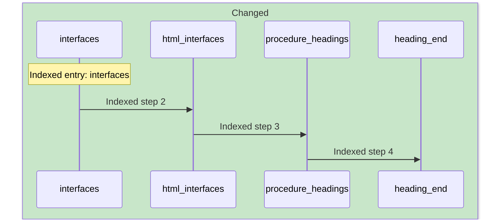

- **Step 1: [interfaces](https://github.com/m2ux/workflow-server/blob/00ec0b9dd516cf6031d44c1ac2184ca95d1e0a01/skills/scripts/check_skill_files.py#L950).**
  skills/scripts/check_skill_files.py.
- **Step 2: [html_interfaces](https://github.com/m2ux/workflow-server/blob/00ec0b9dd516cf6031d44c1ac2184ca95d1e0a01/skills/scripts/check_skill_files.py#L646).**
  skills/scripts/check_skill_files.py.
- **Step 3: [procedure_headings](https://github.com/m2ux/workflow-server/blob/00ec0b9dd516cf6031d44c1ac2184ca95d1e0a01/skills/scripts/check_skill_files.py#L459).**
  skills/scripts/check_skill_files.py.
- **Step 4: [heading_end](https://github.com/m2ux/workflow-server/blob/00ec0b9dd516cf6031d44c1ac2184ca95d1e0a01/skills/scripts/check_skill_files.py#L454).**
  skills/scripts/check_skill_files.py.

## 16. Inline_commands → Scan_blocks

Process `proc_177_inline_commands` has 5 measured steps.

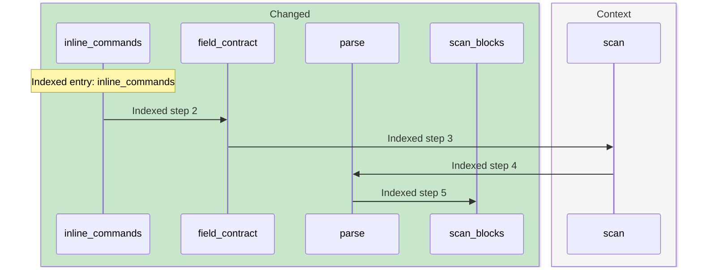

- **Step 1: [inline_commands](https://github.com/m2ux/workflow-server/blob/00ec0b9dd516cf6031d44c1ac2184ca95d1e0a01/skills/scripts/check_skill_files.py#L601).**
  skills/scripts/check_skill_files.py.
- **Step 2: [field_contract](https://github.com/m2ux/workflow-server/blob/00ec0b9dd516cf6031d44c1ac2184ca95d1e0a01/skills/scripts/check_skill_files.py#L471).**
  skills/scripts/check_skill_files.py.
- **Step 3: [scan](https://github.com/m2ux/workflow-server/blob/00ec0b9dd516cf6031d44c1ac2184ca95d1e0a01/skills/scripts/check_skill_files.py#L192).**
  skills/scripts/check_skill_files.py.
- **Step 4: [parse](https://github.com/m2ux/workflow-server/blob/00ec0b9dd516cf6031d44c1ac2184ca95d1e0a01/skills/scripts/check_skill_files.py#L253).**
  skills/scripts/check_skill_files.py.
- **Step 5: [scan_blocks](https://github.com/m2ux/workflow-server/blob/00ec0b9dd516cf6031d44c1ac2184ca95d1e0a01/skills/scripts/check_skill_files.py#L210).**
  skills/scripts/check_skill_files.py.

## 17. Doubled_conventions → Anchor_of

Process `proc_194_doubled_conventions` has 3 measured steps.

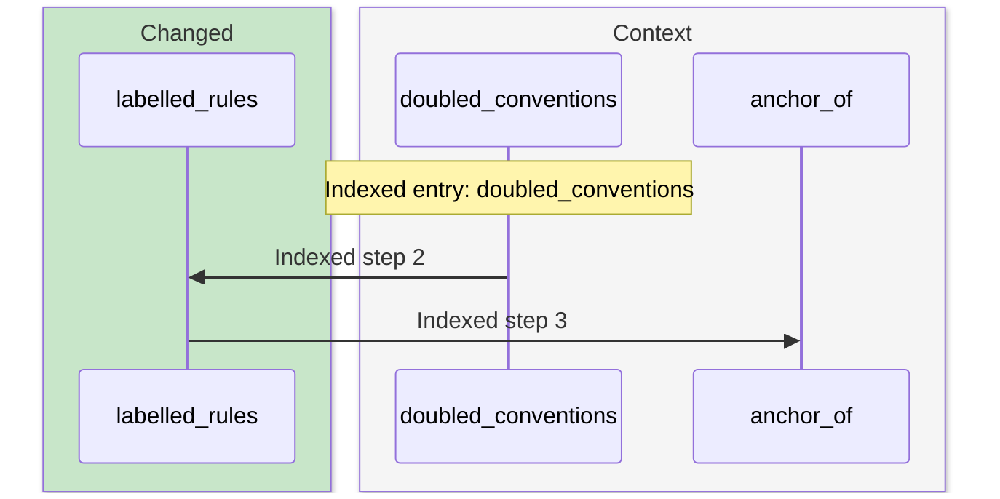

- **Step 1: [doubled_conventions](https://github.com/m2ux/workflow-server/blob/00ec0b9dd516cf6031d44c1ac2184ca95d1e0a01/skills/scripts/check_skill_files.py#L929).**
  skills/scripts/check_skill_files.py.
- **Step 2: [labelled_rules](https://github.com/m2ux/workflow-server/blob/00ec0b9dd516cf6031d44c1ac2184ca95d1e0a01/skills/scripts/check_skill_files.py#L900).**
  skills/scripts/check_skill_files.py.
- **Step 3: [anchor_of](https://github.com/m2ux/workflow-server/blob/00ec0b9dd516cf6031d44c1ac2184ca95d1e0a01/skills/scripts/check_skill_files.py#L180).**
  skills/scripts/check_skill_files.py.

## 18. Interfaces → Validate_structure_entry

Process `proc_198_interfaces` has 5 measured steps.


- **Step 1: [interfaces](https://github.com/m2ux/workflow-server/blob/00ec0b9dd516cf6031d44c1ac2184ca95d1e0a01/skills/scripts/check_skill_files.py#L950).**
  skills/scripts/check_skill_files.py.
- **Step 2: [contract](https://github.com/m2ux/workflow-server/blob/00ec0b9dd516cf6031d44c1ac2184ca95d1e0a01/skills/scripts/check_skill_files.py#L363).**
  skills/scripts/check_skill_files.py.
- **Step 3: [structure_at](https://github.com/m2ux/workflow-server/blob/00ec0b9dd516cf6031d44c1ac2184ca95d1e0a01/skills/scripts/check_skill_files.py#L288).**
  skills/scripts/check_skill_files.py.
- **Step 4: [loaded](https://github.com/m2ux/workflow-server/blob/00ec0b9dd516cf6031d44c1ac2184ca95d1e0a01/skills/scripts/check_skill_files.py#L304).**
  skills/scripts/check_skill_files.py.
- **Step 5: [validate_structure_entry](https://github.com/m2ux/workflow-server/blob/00ec0b9dd516cf6031d44c1ac2184ca95d1e0a01/skills/scripts/check_skill_files.py#L318).**
  skills/scripts/check_skill_files.py.

## 19. Link_roles → Heading_end

Process `proc_199_link_roles` has 4 measured steps.

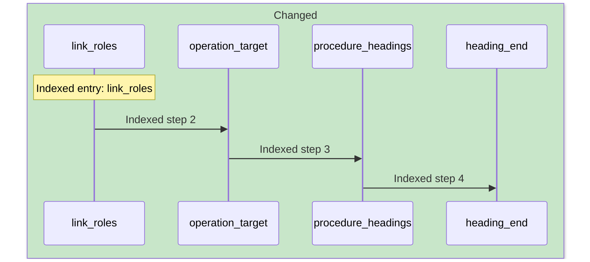

- **Step 1: [link_roles](https://github.com/m2ux/workflow-server/blob/00ec0b9dd516cf6031d44c1ac2184ca95d1e0a01/skills/scripts/check_skill_files.py#L513).**
  skills/scripts/check_skill_files.py.
- **Step 2: [operation_target](https://github.com/m2ux/workflow-server/blob/00ec0b9dd516cf6031d44c1ac2184ca95d1e0a01/skills/scripts/check_skill_files.py#L494).**
  skills/scripts/check_skill_files.py.
- **Step 3: [procedure_headings](https://github.com/m2ux/workflow-server/blob/00ec0b9dd516cf6031d44c1ac2184ca95d1e0a01/skills/scripts/check_skill_files.py#L459).**
  skills/scripts/check_skill_files.py.
- **Step 4: [heading_end](https://github.com/m2ux/workflow-server/blob/00ec0b9dd516cf6031d44c1ac2184ca95d1e0a01/skills/scripts/check_skill_files.py#L454).**
  skills/scripts/check_skill_files.py.

## 20. Link_roles → Scan_blocks

Process `proc_200_link_roles` has 5 measured steps.

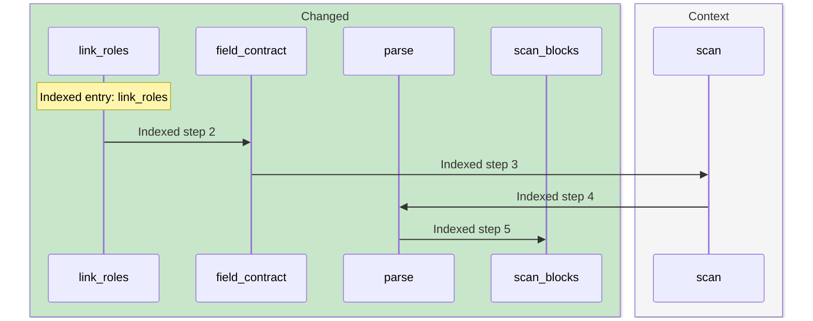

- **Step 1: [link_roles](https://github.com/m2ux/workflow-server/blob/00ec0b9dd516cf6031d44c1ac2184ca95d1e0a01/skills/scripts/check_skill_files.py#L513).**
  skills/scripts/check_skill_files.py.
- **Step 2: [field_contract](https://github.com/m2ux/workflow-server/blob/00ec0b9dd516cf6031d44c1ac2184ca95d1e0a01/skills/scripts/check_skill_files.py#L471).**
  skills/scripts/check_skill_files.py.
- **Step 3: [scan](https://github.com/m2ux/workflow-server/blob/00ec0b9dd516cf6031d44c1ac2184ca95d1e0a01/skills/scripts/check_skill_files.py#L192).**
  skills/scripts/check_skill_files.py.
- **Step 4: [parse](https://github.com/m2ux/workflow-server/blob/00ec0b9dd516cf6031d44c1ac2184ca95d1e0a01/skills/scripts/check_skill_files.py#L253).**
  skills/scripts/check_skill_files.py.
- **Step 5: [scan_blocks](https://github.com/m2ux/workflow-server/blob/00ec0b9dd516cf6031d44c1ac2184ca95d1e0a01/skills/scripts/check_skill_files.py#L210).**
  skills/scripts/check_skill_files.py.

## 21. Retired_terms → Named

Process `proc_206_retired_terms` has 3 measured steps.

```mermaid
sequenceDiagram
    box rgb(200,230,201) Changed
    participant P0 as retired_terms
    end
    box rgb(245,245,245) Context
    participant P1 as finding
    participant P2 as named
    end
    Note over P0: Indexed entry: retired_terms
    P0->>P1: Indexed step 2
    P1->>P2: Indexed step 3
```

- **Step 1: [retired_terms](https://github.com/m2ux/workflow-server/blob/00ec0b9dd516cf6031d44c1ac2184ca95d1e0a01/skills/scripts/check_skill_files.py#L880).**
  skills/scripts/check_skill_files.py.
- **Step 2: [finding](https://github.com/m2ux/workflow-server/blob/00ec0b9dd516cf6031d44c1ac2184ca95d1e0a01/skills/scripts/check_skill_files.py#L820).**
  skills/scripts/check_skill_files.py.
- **Step 3: [named](https://github.com/m2ux/workflow-server/blob/00ec0b9dd516cf6031d44c1ac2184ca95d1e0a01/skills/scripts/check_skill_files.py#L185).**
  skills/scripts/check_skill_files.py.

## 22. Inline_commands → Anchor_of

Process `proc_210_inline_commands` has 3 measured steps.

```mermaid
sequenceDiagram
    box rgb(200,230,201) Changed
    participant P0 as inline_commands
    participant P1 as field_contract
    end
    box rgb(245,245,245) Context
    participant P2 as anchor_of
    end
    Note over P0: Indexed entry: inline_commands
    P0->>P1: Indexed step 2
    P1->>P2: Indexed step 3
```

- **Step 1: [inline_commands](https://github.com/m2ux/workflow-server/blob/00ec0b9dd516cf6031d44c1ac2184ca95d1e0a01/skills/scripts/check_skill_files.py#L601).**
  skills/scripts/check_skill_files.py.
- **Step 2: [field_contract](https://github.com/m2ux/workflow-server/blob/00ec0b9dd516cf6031d44c1ac2184ca95d1e0a01/skills/scripts/check_skill_files.py#L471).**
  skills/scripts/check_skill_files.py.
- **Step 3: [anchor_of](https://github.com/m2ux/workflow-server/blob/00ec0b9dd516cf6031d44c1ac2184ca95d1e0a01/skills/scripts/check_skill_files.py#L180).**
  skills/scripts/check_skill_files.py.

## 23. Mode_commands → Validate_structure_entry

Process `proc_213_mode_commands` has 5 measured steps.

```mermaid
sequenceDiagram
    box rgb(200,230,201) Changed
    participant P0 as mode_commands
    participant P1 as contract
    participant P3 as loaded
    participant P4 as validate_structure_entry
    end
    box rgb(245,245,245) Context
    participant P2 as structure_at
    end
    Note over P0: Indexed entry: mode_commands
    P0->>P1: Indexed step 2
    P1->>P2: Indexed step 3
    P2->>P3: Indexed step 4
    P3->>P4: Indexed step 5
```

- **Step 1: [mode_commands](https://github.com/m2ux/workflow-server/blob/00ec0b9dd516cf6031d44c1ac2184ca95d1e0a01/skills/scripts/check_skill_files.py#L833).**
  skills/scripts/check_skill_files.py.
- **Step 2: [contract](https://github.com/m2ux/workflow-server/blob/00ec0b9dd516cf6031d44c1ac2184ca95d1e0a01/skills/scripts/check_skill_files.py#L363).**
  skills/scripts/check_skill_files.py.
- **Step 3: [structure_at](https://github.com/m2ux/workflow-server/blob/00ec0b9dd516cf6031d44c1ac2184ca95d1e0a01/skills/scripts/check_skill_files.py#L288).**
  skills/scripts/check_skill_files.py.
- **Step 4: [loaded](https://github.com/m2ux/workflow-server/blob/00ec0b9dd516cf6031d44c1ac2184ca95d1e0a01/skills/scripts/check_skill_files.py#L304).**
  skills/scripts/check_skill_files.py.
- **Step 5: [validate_structure_entry](https://github.com/m2ux/workflow-server/blob/00ec0b9dd516cf6031d44c1ac2184ca95d1e0a01/skills/scripts/check_skill_files.py#L318).**
  skills/scripts/check_skill_files.py.

## 24. Operation_calls → Heading_end

Process `proc_214_operation_calls` has 4 measured steps.

```mermaid
sequenceDiagram
    box rgb(200,230,201) Changed
    participant P0 as operation_calls
    participant P1 as operation_target
    participant P2 as procedure_headings
    participant P3 as heading_end
    end
    Note over P0: Indexed entry: operation_calls
    P0->>P1: Indexed step 2
    P1->>P2: Indexed step 3
    P2->>P3: Indexed step 4
```

- **Step 1: [operation_calls](https://github.com/m2ux/workflow-server/blob/00ec0b9dd516cf6031d44c1ac2184ca95d1e0a01/skills/scripts/check_skill_files.py#L629).**
  skills/scripts/check_skill_files.py.
- **Step 2: [operation_target](https://github.com/m2ux/workflow-server/blob/00ec0b9dd516cf6031d44c1ac2184ca95d1e0a01/skills/scripts/check_skill_files.py#L494).**
  skills/scripts/check_skill_files.py.
- **Step 3: [procedure_headings](https://github.com/m2ux/workflow-server/blob/00ec0b9dd516cf6031d44c1ac2184ca95d1e0a01/skills/scripts/check_skill_files.py#L459).**
  skills/scripts/check_skill_files.py.
- **Step 4: [heading_end](https://github.com/m2ux/workflow-server/blob/00ec0b9dd516cf6031d44c1ac2184ca95d1e0a01/skills/scripts/check_skill_files.py#L454).**
  skills/scripts/check_skill_files.py.

## 25. Operation_calls → Scan_blocks

Process `proc_215_operation_calls` has 5 measured steps.

```mermaid
sequenceDiagram
    box rgb(200,230,201) Changed
    participant P0 as operation_calls
    participant P1 as operation_target
    participant P3 as parse
    participant P4 as scan_blocks
    end
    box rgb(245,245,245) Context
    participant P2 as scan
    end
    Note over P0: Indexed entry: operation_calls
    P0->>P1: Indexed step 2
    P1->>P2: Indexed step 3
    P2->>P3: Indexed step 4
    P3->>P4: Indexed step 5
```

- **Step 1: [operation_calls](https://github.com/m2ux/workflow-server/blob/00ec0b9dd516cf6031d44c1ac2184ca95d1e0a01/skills/scripts/check_skill_files.py#L629).**
  skills/scripts/check_skill_files.py.
- **Step 2: [operation_target](https://github.com/m2ux/workflow-server/blob/00ec0b9dd516cf6031d44c1ac2184ca95d1e0a01/skills/scripts/check_skill_files.py#L494).**
  skills/scripts/check_skill_files.py.
- **Step 3: [scan](https://github.com/m2ux/workflow-server/blob/00ec0b9dd516cf6031d44c1ac2184ca95d1e0a01/skills/scripts/check_skill_files.py#L192).**
  skills/scripts/check_skill_files.py.
- **Step 4: [parse](https://github.com/m2ux/workflow-server/blob/00ec0b9dd516cf6031d44c1ac2184ca95d1e0a01/skills/scripts/check_skill_files.py#L253).**
  skills/scripts/check_skill_files.py.
- **Step 5: [scan_blocks](https://github.com/m2ux/workflow-server/blob/00ec0b9dd516cf6031d44c1ac2184ca95d1e0a01/skills/scripts/check_skill_files.py#L210).**
  skills/scripts/check_skill_files.py.

## 26. Link_roles → Anchor_of

Process `proc_222_link_roles` has 3 measured steps.

```mermaid
sequenceDiagram
    box rgb(200,230,201) Changed
    participant P0 as link_roles
    participant P1 as field_contract
    end
    box rgb(245,245,245) Context
    participant P2 as anchor_of
    end
    Note over P0: Indexed entry: link_roles
    P0->>P1: Indexed step 2
    P1->>P2: Indexed step 3
```

- **Step 1: [link_roles](https://github.com/m2ux/workflow-server/blob/00ec0b9dd516cf6031d44c1ac2184ca95d1e0a01/skills/scripts/check_skill_files.py#L513).**
  skills/scripts/check_skill_files.py.
- **Step 2: [field_contract](https://github.com/m2ux/workflow-server/blob/00ec0b9dd516cf6031d44c1ac2184ca95d1e0a01/skills/scripts/check_skill_files.py#L471).**
  skills/scripts/check_skill_files.py.
- **Step 3: [anchor_of](https://github.com/m2ux/workflow-server/blob/00ec0b9dd516cf6031d44c1ac2184ca95d1e0a01/skills/scripts/check_skill_files.py#L180).**
  skills/scripts/check_skill_files.py.

## 27. Reach → Validate_structure_entry

Process `proc_224_reach` has 5 measured steps.

```mermaid
sequenceDiagram
    box rgb(200,230,201) Changed
    participant P1 as contract
    participant P3 as loaded
    participant P4 as validate_structure_entry
    end
    box rgb(245,245,245) Context
    participant P0 as reach
    participant P2 as structure_at
    end
    Note over P0: Indexed entry: reach
    P0->>P1: Indexed step 2
    P1->>P2: Indexed step 3
    P2->>P3: Indexed step 4
    P3->>P4: Indexed step 5
```

- **Step 1: [reach](https://github.com/m2ux/workflow-server/blob/00ec0b9dd516cf6031d44c1ac2184ca95d1e0a01/skills/scripts/check_skill_files.py#L1328).**
  skills/scripts/check_skill_files.py.
- **Step 2: [contract](https://github.com/m2ux/workflow-server/blob/00ec0b9dd516cf6031d44c1ac2184ca95d1e0a01/skills/scripts/check_skill_files.py#L363).**
  skills/scripts/check_skill_files.py.
- **Step 3: [structure_at](https://github.com/m2ux/workflow-server/blob/00ec0b9dd516cf6031d44c1ac2184ca95d1e0a01/skills/scripts/check_skill_files.py#L288).**
  skills/scripts/check_skill_files.py.
- **Step 4: [loaded](https://github.com/m2ux/workflow-server/blob/00ec0b9dd516cf6031d44c1ac2184ca95d1e0a01/skills/scripts/check_skill_files.py#L304).**
  skills/scripts/check_skill_files.py.
- **Step 5: [validate_structure_entry](https://github.com/m2ux/workflow-server/blob/00ec0b9dd516cf6031d44c1ac2184ca95d1e0a01/skills/scripts/check_skill_files.py#L318).**
  skills/scripts/check_skill_files.py.

## 28. Heading_model → Heading_end

Process `proc_225_heading_model` has 3 measured steps.

```mermaid
sequenceDiagram
    box rgb(200,230,201) Changed
    participant P0 as heading_model
    participant P1 as procedure_headings
    participant P2 as heading_end
    end
    Note over P0: Indexed entry: heading_model
    P0->>P1: Indexed step 2
    P1->>P2: Indexed step 3
```

- **Step 1: [heading_model](https://github.com/m2ux/workflow-server/blob/00ec0b9dd516cf6031d44c1ac2184ca95d1e0a01/skills/scripts/check_skill_files.py#L532).**
  skills/scripts/check_skill_files.py.
- **Step 2: [procedure_headings](https://github.com/m2ux/workflow-server/blob/00ec0b9dd516cf6031d44c1ac2184ca95d1e0a01/skills/scripts/check_skill_files.py#L459).**
  skills/scripts/check_skill_files.py.
- **Step 3: [heading_end](https://github.com/m2ux/workflow-server/blob/00ec0b9dd516cf6031d44c1ac2184ca95d1e0a01/skills/scripts/check_skill_files.py#L454).**
  skills/scripts/check_skill_files.py.

## 29. Reach → Scan_blocks

Process `proc_226_reach` has 5 measured steps.

```mermaid
sequenceDiagram
    box rgb(200,230,201) Changed
    participant P1 as citation_kinds
    participant P3 as parse
    participant P4 as scan_blocks
    end
    box rgb(245,245,245) Context
    participant P0 as reach
    participant P2 as scan
    end
    Note over P0: Indexed entry: reach
    P0->>P1: Indexed step 2
    P1->>P2: Indexed step 3
    P2->>P3: Indexed step 4
    P3->>P4: Indexed step 5
```

- **Step 1: [reach](https://github.com/m2ux/workflow-server/blob/00ec0b9dd516cf6031d44c1ac2184ca95d1e0a01/skills/scripts/check_skill_files.py#L1328).**
  skills/scripts/check_skill_files.py.
- **Step 2: [citation_kinds](https://github.com/m2ux/workflow-server/blob/00ec0b9dd516cf6031d44c1ac2184ca95d1e0a01/skills/scripts/check_skill_files.py#L1290).**
  skills/scripts/check_skill_files.py.
- **Step 3: [scan](https://github.com/m2ux/workflow-server/blob/00ec0b9dd516cf6031d44c1ac2184ca95d1e0a01/skills/scripts/check_skill_files.py#L192).**
  skills/scripts/check_skill_files.py.
- **Step 4: [parse](https://github.com/m2ux/workflow-server/blob/00ec0b9dd516cf6031d44c1ac2184ca95d1e0a01/skills/scripts/check_skill_files.py#L253).**
  skills/scripts/check_skill_files.py.
- **Step 5: [scan_blocks](https://github.com/m2ux/workflow-server/blob/00ec0b9dd516cf6031d44c1ac2184ca95d1e0a01/skills/scripts/check_skill_files.py#L210).**
  skills/scripts/check_skill_files.py.

## 30. Mixed_moods → Anchor_of

Process `proc_232_mixed_moods` has 3 measured steps.

```mermaid
sequenceDiagram
    box rgb(200,230,201) Changed
    participant P0 as mixed_moods
    end
    box rgb(245,245,245) Context
    participant P1 as specifications
    participant P2 as anchor_of
    end
    Note over P0: Indexed entry: mixed_moods
    P0->>P1: Indexed step 2
    P1->>P2: Indexed step 3
```

- **Step 1: [mixed_moods](https://github.com/m2ux/workflow-server/blob/00ec0b9dd516cf6031d44c1ac2184ca95d1e0a01/skills/scripts/check_skill_files.py#L1143).**
  skills/scripts/check_skill_files.py.
- **Step 2: [specifications](https://github.com/m2ux/workflow-server/blob/00ec0b9dd516cf6031d44c1ac2184ca95d1e0a01/skills/scripts/check_skill_files.py#L374).**
  skills/scripts/check_skill_files.py.
- **Step 3: [anchor_of](https://github.com/m2ux/workflow-server/blob/00ec0b9dd516cf6031d44c1ac2184ca95d1e0a01/skills/scripts/check_skill_files.py#L180).**
  skills/scripts/check_skill_files.py.

## 31. Undecided_rules → Scan_blocks

Process `proc_234_undecided_rules` has 5 measured steps.

```mermaid
sequenceDiagram
    box rgb(200,230,201) Changed
    participant P1 as labelled_rules
    participant P3 as parse
    participant P4 as scan_blocks
    end
    box rgb(245,245,245) Context
    participant P0 as undecided_rules
    participant P2 as scan
    end
    Note over P0: Indexed entry: undecided_rules
    P0->>P1: Indexed step 2
    P1->>P2: Indexed step 3
    P2->>P3: Indexed step 4
    P3->>P4: Indexed step 5
```

- **Step 1: [undecided_rules](https://github.com/m2ux/workflow-server/blob/00ec0b9dd516cf6031d44c1ac2184ca95d1e0a01/skills/scripts/check_skill_files.py#L987).**
  skills/scripts/check_skill_files.py.
- **Step 2: [labelled_rules](https://github.com/m2ux/workflow-server/blob/00ec0b9dd516cf6031d44c1ac2184ca95d1e0a01/skills/scripts/check_skill_files.py#L900).**
  skills/scripts/check_skill_files.py.
- **Step 3: [scan](https://github.com/m2ux/workflow-server/blob/00ec0b9dd516cf6031d44c1ac2184ca95d1e0a01/skills/scripts/check_skill_files.py#L192).**
  skills/scripts/check_skill_files.py.
- **Step 4: [parse](https://github.com/m2ux/workflow-server/blob/00ec0b9dd516cf6031d44c1ac2184ca95d1e0a01/skills/scripts/check_skill_files.py#L253).**
  skills/scripts/check_skill_files.py.
- **Step 5: [scan_blocks](https://github.com/m2ux/workflow-server/blob/00ec0b9dd516cf6031d44c1ac2184ca95d1e0a01/skills/scripts/check_skill_files.py#L210).**
  skills/scripts/check_skill_files.py.

## 32. Operation_calls → Anchor_of

Process `proc_239_operation_calls` has 3 measured steps.

```mermaid
sequenceDiagram
    box rgb(200,230,201) Changed
    participant P0 as operation_calls
    participant P1 as operation_target
    end
    box rgb(245,245,245) Context
    participant P2 as anchor_of
    end
    Note over P0: Indexed entry: operation_calls
    P0->>P1: Indexed step 2
    P1->>P2: Indexed step 3
```

- **Step 1: [operation_calls](https://github.com/m2ux/workflow-server/blob/00ec0b9dd516cf6031d44c1ac2184ca95d1e0a01/skills/scripts/check_skill_files.py#L629).**
  skills/scripts/check_skill_files.py.
- **Step 2: [operation_target](https://github.com/m2ux/workflow-server/blob/00ec0b9dd516cf6031d44c1ac2184ca95d1e0a01/skills/scripts/check_skill_files.py#L494).**
  skills/scripts/check_skill_files.py.
- **Step 3: [anchor_of](https://github.com/m2ux/workflow-server/blob/00ec0b9dd516cf6031d44c1ac2184ca95d1e0a01/skills/scripts/check_skill_files.py#L180).**
  skills/scripts/check_skill_files.py.

## 33. Anchors → Scan_blocks

Process `proc_241_anchors` has 4 measured steps.

```mermaid
sequenceDiagram
    box rgb(200,230,201) Changed
    participant P2 as parse
    participant P3 as scan_blocks
    end
    box rgb(245,245,245) Context
    participant P0 as anchors
    participant P1 as scan
    end
    Note over P0: Indexed entry: anchors
    P0->>P1: Indexed step 2
    P1->>P2: Indexed step 3
    P2->>P3: Indexed step 4
```

- **Step 1: [anchors](https://github.com/m2ux/workflow-server/blob/00ec0b9dd516cf6031d44c1ac2184ca95d1e0a01/skills/scripts/check_skill_files.py#L677).**
  skills/scripts/check_skill_files.py.
- **Step 2: [scan](https://github.com/m2ux/workflow-server/blob/00ec0b9dd516cf6031d44c1ac2184ca95d1e0a01/skills/scripts/check_skill_files.py#L192).**
  skills/scripts/check_skill_files.py.
- **Step 3: [parse](https://github.com/m2ux/workflow-server/blob/00ec0b9dd516cf6031d44c1ac2184ca95d1e0a01/skills/scripts/check_skill_files.py#L253).**
  skills/scripts/check_skill_files.py.
- **Step 4: [scan_blocks](https://github.com/m2ux/workflow-server/blob/00ec0b9dd516cf6031d44c1ac2184ca95d1e0a01/skills/scripts/check_skill_files.py#L210).**
  skills/scripts/check_skill_files.py.

## 34. Interfaces → Scan_blocks

Process `proc_248_interfaces` has 4 measured steps.

```mermaid
sequenceDiagram
    box rgb(200,230,201) Changed
    participant P0 as interfaces
    participant P2 as parse
    participant P3 as scan_blocks
    end
    box rgb(245,245,245) Context
    participant P1 as scan
    end
    Note over P0: Indexed entry: interfaces
    P0->>P1: Indexed step 2
    P1->>P2: Indexed step 3
    P2->>P3: Indexed step 4
```

- **Step 1: [interfaces](https://github.com/m2ux/workflow-server/blob/00ec0b9dd516cf6031d44c1ac2184ca95d1e0a01/skills/scripts/check_skill_files.py#L950).**
  skills/scripts/check_skill_files.py.
- **Step 2: [scan](https://github.com/m2ux/workflow-server/blob/00ec0b9dd516cf6031d44c1ac2184ca95d1e0a01/skills/scripts/check_skill_files.py#L192).**
  skills/scripts/check_skill_files.py.
- **Step 3: [parse](https://github.com/m2ux/workflow-server/blob/00ec0b9dd516cf6031d44c1ac2184ca95d1e0a01/skills/scripts/check_skill_files.py#L253).**
  skills/scripts/check_skill_files.py.
- **Step 4: [scan_blocks](https://github.com/m2ux/workflow-server/blob/00ec0b9dd516cf6031d44c1ac2184ca95d1e0a01/skills/scripts/check_skill_files.py#L210).**
  skills/scripts/check_skill_files.py.

## 35. Undecided_rules → Anchor_of

Process `proc_253_undecided_rules` has 3 measured steps.

```mermaid
sequenceDiagram
    box rgb(200,230,201) Changed
    participant P1 as labelled_rules
    end
    box rgb(245,245,245) Context
    participant P0 as undecided_rules
    participant P2 as anchor_of
    end
    Note over P0: Indexed entry: undecided_rules
    P0->>P1: Indexed step 2
    P1->>P2: Indexed step 3
```

- **Step 1: [undecided_rules](https://github.com/m2ux/workflow-server/blob/00ec0b9dd516cf6031d44c1ac2184ca95d1e0a01/skills/scripts/check_skill_files.py#L987).**
  skills/scripts/check_skill_files.py.
- **Step 2: [labelled_rules](https://github.com/m2ux/workflow-server/blob/00ec0b9dd516cf6031d44c1ac2184ca95d1e0a01/skills/scripts/check_skill_files.py#L900).**
  skills/scripts/check_skill_files.py.
- **Step 3: [anchor_of](https://github.com/m2ux/workflow-server/blob/00ec0b9dd516cf6031d44c1ac2184ca95d1e0a01/skills/scripts/check_skill_files.py#L180).**
  skills/scripts/check_skill_files.py.

## 36. Mode_commands → Scan_blocks

Process `proc_255_mode_commands` has 4 measured steps.

```mermaid
sequenceDiagram
    box rgb(200,230,201) Changed
    participant P0 as mode_commands
    participant P2 as parse
    participant P3 as scan_blocks
    end
    box rgb(245,245,245) Context
    participant P1 as scan
    end
    Note over P0: Indexed entry: mode_commands
    P0->>P1: Indexed step 2
    P1->>P2: Indexed step 3
    P2->>P3: Indexed step 4
```

- **Step 1: [mode_commands](https://github.com/m2ux/workflow-server/blob/00ec0b9dd516cf6031d44c1ac2184ca95d1e0a01/skills/scripts/check_skill_files.py#L833).**
  skills/scripts/check_skill_files.py.
- **Step 2: [scan](https://github.com/m2ux/workflow-server/blob/00ec0b9dd516cf6031d44c1ac2184ca95d1e0a01/skills/scripts/check_skill_files.py#L192).**
  skills/scripts/check_skill_files.py.
- **Step 3: [parse](https://github.com/m2ux/workflow-server/blob/00ec0b9dd516cf6031d44c1ac2184ca95d1e0a01/skills/scripts/check_skill_files.py#L253).**
  skills/scripts/check_skill_files.py.
- **Step 4: [scan_blocks](https://github.com/m2ux/workflow-server/blob/00ec0b9dd516cf6031d44c1ac2184ca95d1e0a01/skills/scripts/check_skill_files.py#L210).**
  skills/scripts/check_skill_files.py.

## 37. Retired_terms → Scan_blocks

Process `proc_262_retired_terms` has 4 measured steps.

```mermaid
sequenceDiagram
    box rgb(200,230,201) Changed
    participant P0 as retired_terms
    participant P2 as parse
    participant P3 as scan_blocks
    end
    box rgb(245,245,245) Context
    participant P1 as scan
    end
    Note over P0: Indexed entry: retired_terms
    P0->>P1: Indexed step 2
    P1->>P2: Indexed step 3
    P2->>P3: Indexed step 4
```

- **Step 1: [retired_terms](https://github.com/m2ux/workflow-server/blob/00ec0b9dd516cf6031d44c1ac2184ca95d1e0a01/skills/scripts/check_skill_files.py#L880).**
  skills/scripts/check_skill_files.py.
- **Step 2: [scan](https://github.com/m2ux/workflow-server/blob/00ec0b9dd516cf6031d44c1ac2184ca95d1e0a01/skills/scripts/check_skill_files.py#L192).**
  skills/scripts/check_skill_files.py.
- **Step 3: [parse](https://github.com/m2ux/workflow-server/blob/00ec0b9dd516cf6031d44c1ac2184ca95d1e0a01/skills/scripts/check_skill_files.py#L253).**
  skills/scripts/check_skill_files.py.
- **Step 4: [scan_blocks](https://github.com/m2ux/workflow-server/blob/00ec0b9dd516cf6031d44c1ac2184ca95d1e0a01/skills/scripts/check_skill_files.py#L210).**
  skills/scripts/check_skill_files.py.

