# Measured Integration Flows

PR #1641 at `4882414d678268aaa282fb4c0b184f14e3e47d1b`, against `03d353300ca4804194fd50d316d73e3bf1270d1d`.

All 40 reported affected static processes appear below. The 172 ordered membership rows establish each sequence; arrows identify the next indexed step, not observed runtime calls. Green marks changed symbols; grey marks context. Ranked searches and exact membership records are retained separately. Analyzer coverage warnings mean unreported paths can exist.

## 1. Main → Anchor_of

Process `proc_4_main` has 7 measured steps.

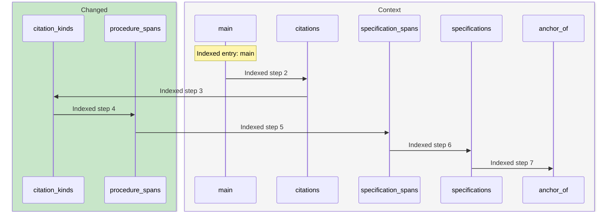

- **Step 1: [main](https://github.com/m2ux/workflow-server/blob/4882414d678268aaa282fb4c0b184f14e3e47d1b/skills/scripts/check_skill_files.py#L1411).**
  skills/scripts/check_skill_files.py.
- **Step 2: [citations](https://github.com/m2ux/workflow-server/blob/4882414d678268aaa282fb4c0b184f14e3e47d1b/skills/scripts/check_skill_files.py#L435).**
  skills/scripts/check_skill_files.py.
- **Step 3: [citation_kinds](https://github.com/m2ux/workflow-server/blob/4882414d678268aaa282fb4c0b184f14e3e47d1b/skills/scripts/check_skill_files.py#L1329).**
  skills/scripts/check_skill_files.py.
- **Step 4: [procedure_spans](https://github.com/m2ux/workflow-server/blob/4882414d678268aaa282fb4c0b184f14e3e47d1b/skills/scripts/check_skill_files.py#L413).**
  skills/scripts/check_skill_files.py.
- **Step 5: [specification_spans](https://github.com/m2ux/workflow-server/blob/4882414d678268aaa282fb4c0b184f14e3e47d1b/skills/scripts/check_skill_files.py#L395).**
  skills/scripts/check_skill_files.py.
- **Step 6: [specifications](https://github.com/m2ux/workflow-server/blob/4882414d678268aaa282fb4c0b184f14e3e47d1b/skills/scripts/check_skill_files.py#L379).**
  skills/scripts/check_skill_files.py.
- **Step 7: [anchor_of](https://github.com/m2ux/workflow-server/blob/4882414d678268aaa282fb4c0b184f14e3e47d1b/skills/scripts/check_skill_files.py#L185).**
  skills/scripts/check_skill_files.py.

## 2. Link_roles → Validate_structure_entry

Process `proc_17_link_roles` has 6 measured steps.

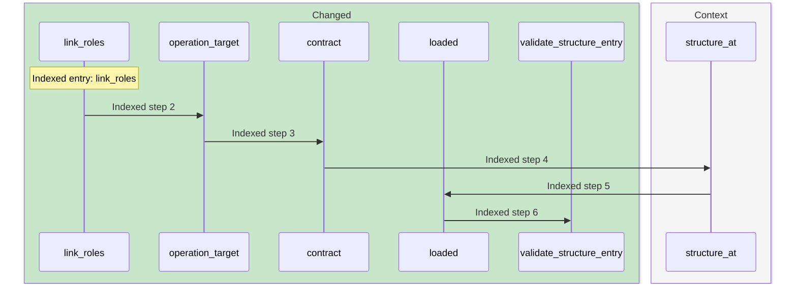

- **Step 1: [link_roles](https://github.com/m2ux/workflow-server/blob/4882414d678268aaa282fb4c0b184f14e3e47d1b/skills/scripts/check_skill_files.py#L536).**
  skills/scripts/check_skill_files.py.
- **Step 2: [operation_target](https://github.com/m2ux/workflow-server/blob/4882414d678268aaa282fb4c0b184f14e3e47d1b/skills/scripts/check_skill_files.py#L517).**
  skills/scripts/check_skill_files.py.
- **Step 3: [contract](https://github.com/m2ux/workflow-server/blob/4882414d678268aaa282fb4c0b184f14e3e47d1b/skills/scripts/check_skill_files.py#L368).**
  skills/scripts/check_skill_files.py.
- **Step 4: [structure_at](https://github.com/m2ux/workflow-server/blob/4882414d678268aaa282fb4c0b184f14e3e47d1b/skills/scripts/check_skill_files.py#L293).**
  skills/scripts/check_skill_files.py.
- **Step 5: [loaded](https://github.com/m2ux/workflow-server/blob/4882414d678268aaa282fb4c0b184f14e3e47d1b/skills/scripts/check_skill_files.py#L309).**
  skills/scripts/check_skill_files.py.
- **Step 6: [validate_structure_entry](https://github.com/m2ux/workflow-server/blob/4882414d678268aaa282fb4c0b184f14e3e47d1b/skills/scripts/check_skill_files.py#L323).**
  skills/scripts/check_skill_files.py.

## 3. Main → Heading_end

Process `proc_18_main` has 6 measured steps.

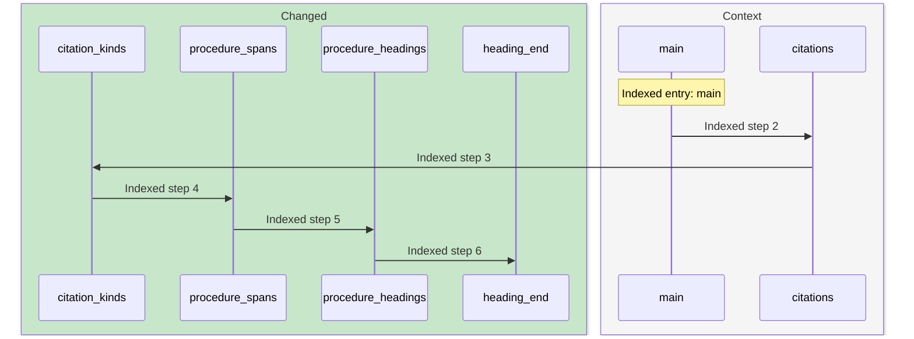

- **Step 1: [main](https://github.com/m2ux/workflow-server/blob/4882414d678268aaa282fb4c0b184f14e3e47d1b/skills/scripts/check_skill_files.py#L1411).**
  skills/scripts/check_skill_files.py.
- **Step 2: [citations](https://github.com/m2ux/workflow-server/blob/4882414d678268aaa282fb4c0b184f14e3e47d1b/skills/scripts/check_skill_files.py#L435).**
  skills/scripts/check_skill_files.py.
- **Step 3: [citation_kinds](https://github.com/m2ux/workflow-server/blob/4882414d678268aaa282fb4c0b184f14e3e47d1b/skills/scripts/check_skill_files.py#L1329).**
  skills/scripts/check_skill_files.py.
- **Step 4: [procedure_spans](https://github.com/m2ux/workflow-server/blob/4882414d678268aaa282fb4c0b184f14e3e47d1b/skills/scripts/check_skill_files.py#L413).**
  skills/scripts/check_skill_files.py.
- **Step 5: [procedure_headings](https://github.com/m2ux/workflow-server/blob/4882414d678268aaa282fb4c0b184f14e3e47d1b/skills/scripts/check_skill_files.py#L464).**
  skills/scripts/check_skill_files.py.
- **Step 6: [heading_end](https://github.com/m2ux/workflow-server/blob/4882414d678268aaa282fb4c0b184f14e3e47d1b/skills/scripts/check_skill_files.py#L459).**
  skills/scripts/check_skill_files.py.

## 4. Main → Scan_blocks

Process `proc_19_main` has 6 measured steps.

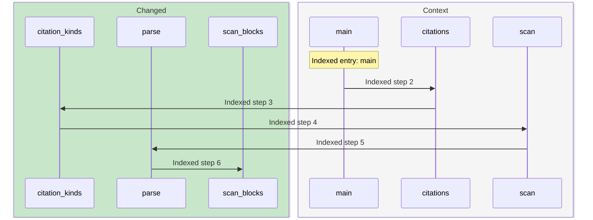

- **Step 1: [main](https://github.com/m2ux/workflow-server/blob/4882414d678268aaa282fb4c0b184f14e3e47d1b/skills/scripts/check_skill_files.py#L1411).**
  skills/scripts/check_skill_files.py.
- **Step 2: [citations](https://github.com/m2ux/workflow-server/blob/4882414d678268aaa282fb4c0b184f14e3e47d1b/skills/scripts/check_skill_files.py#L435).**
  skills/scripts/check_skill_files.py.
- **Step 3: [citation_kinds](https://github.com/m2ux/workflow-server/blob/4882414d678268aaa282fb4c0b184f14e3e47d1b/skills/scripts/check_skill_files.py#L1329).**
  skills/scripts/check_skill_files.py.
- **Step 4: [scan](https://github.com/m2ux/workflow-server/blob/4882414d678268aaa282fb4c0b184f14e3e47d1b/skills/scripts/check_skill_files.py#L197).**
  skills/scripts/check_skill_files.py.
- **Step 5: [parse](https://github.com/m2ux/workflow-server/blob/4882414d678268aaa282fb4c0b184f14e3e47d1b/skills/scripts/check_skill_files.py#L258).**
  skills/scripts/check_skill_files.py.
- **Step 6: [scan_blocks](https://github.com/m2ux/workflow-server/blob/4882414d678268aaa282fb4c0b184f14e3e47d1b/skills/scripts/check_skill_files.py#L215).**
  skills/scripts/check_skill_files.py.

## 5. Check → Named

Process `proc_60_check` has 4 measured steps.

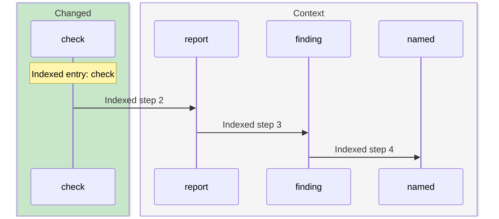

- **Step 1: [check](https://github.com/m2ux/workflow-server/blob/4882414d678268aaa282fb4c0b184f14e3e47d1b/skills/scripts/check_skill_files.py#L706).**
  skills/scripts/check_skill_files.py.
- **Step 2: [report](https://github.com/m2ux/workflow-server/blob/4882414d678268aaa282fb4c0b184f14e3e47d1b/skills/scripts/check_skill_files.py#L713).**
  skills/scripts/check_skill_files.py.
- **Step 3: [finding](https://github.com/m2ux/workflow-server/blob/4882414d678268aaa282fb4c0b184f14e3e47d1b/skills/scripts/check_skill_files.py#L859).**
  skills/scripts/check_skill_files.py.
- **Step 4: [named](https://github.com/m2ux/workflow-server/blob/4882414d678268aaa282fb4c0b184f14e3e47d1b/skills/scripts/check_skill_files.py#L190).**
  skills/scripts/check_skill_files.py.

## 6. Heading_model → Link_role

Process `proc_84_heading_model` has 3 measured steps.

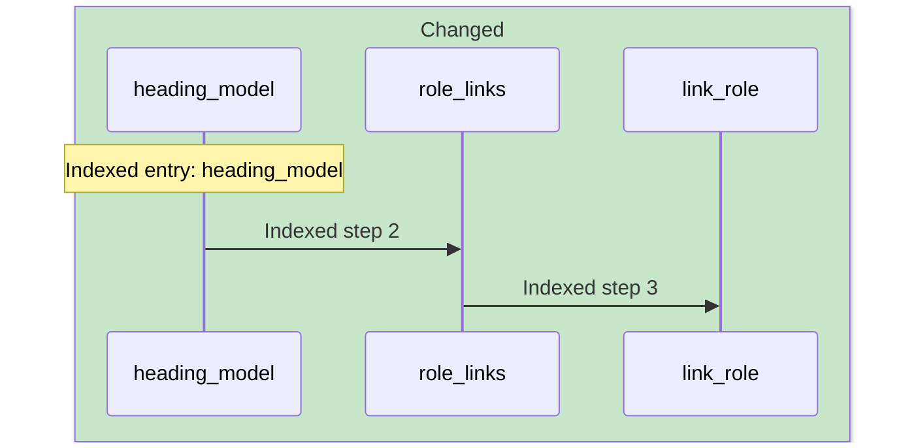

- **Step 1: [heading_model](https://github.com/m2ux/workflow-server/blob/4882414d678268aaa282fb4c0b184f14e3e47d1b/skills/scripts/check_skill_files.py#L550).**
  skills/scripts/check_skill_files.py.
- **Step 2: [role_links](https://github.com/m2ux/workflow-server/blob/4882414d678268aaa282fb4c0b184f14e3e47d1b/skills/scripts/check_skill_files.py#L499).**
  skills/scripts/check_skill_files.py.
- **Step 3: [link_role](https://github.com/m2ux/workflow-server/blob/4882414d678268aaa282fb4c0b184f14e3e47d1b/skills/scripts/check_skill_files.py#L493).**
  skills/scripts/check_skill_files.py.

## 7. Interfaces → Script_of

Process `proc_85_interfaces` has 3 measured steps.

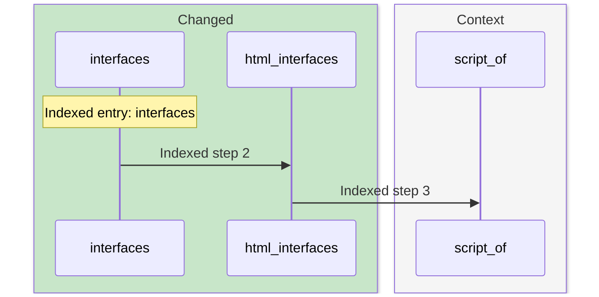

- **Step 1: [interfaces](https://github.com/m2ux/workflow-server/blob/4882414d678268aaa282fb4c0b184f14e3e47d1b/skills/scripts/check_skill_files.py#L989).**
  skills/scripts/check_skill_files.py.
- **Step 2: [html_interfaces](https://github.com/m2ux/workflow-server/blob/4882414d678268aaa282fb4c0b184f14e3e47d1b/skills/scripts/check_skill_files.py#L685).**
  skills/scripts/check_skill_files.py.
- **Step 3: [script_of](https://github.com/m2ux/workflow-server/blob/4882414d678268aaa282fb4c0b184f14e3e47d1b/skills/scripts/check_skill_files.py#L980).**
  skills/scripts/check_skill_files.py.

## 8. Retired_terms → Vocabulary

Process `proc_87_retired_terms` has 3 measured steps.

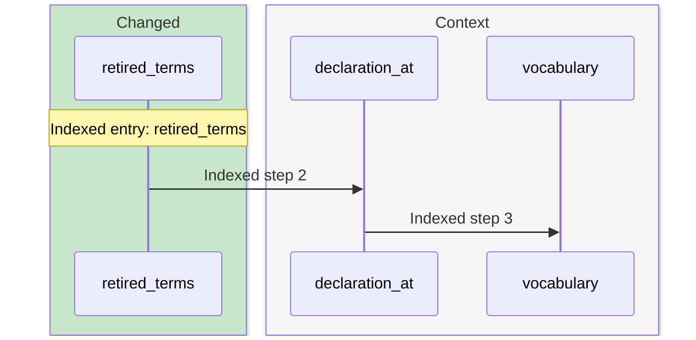

- **Step 1: [retired_terms](https://github.com/m2ux/workflow-server/blob/4882414d678268aaa282fb4c0b184f14e3e47d1b/skills/scripts/check_skill_files.py#L919).**
  skills/scripts/check_skill_files.py.
- **Step 2: [declaration_at](https://github.com/m2ux/workflow-server/blob/4882414d678268aaa282fb4c0b184f14e3e47d1b/skills/scripts/check_skill_files.py#L889).**
  skills/scripts/check_skill_files.py.
- **Step 3: [vocabulary](https://github.com/m2ux/workflow-server/blob/4882414d678268aaa282fb4c0b184f14e3e47d1b/skills/scripts/check_skill_files.py#L904).**
  skills/scripts/check_skill_files.py.

## 9. Reach → Anchor_of

Process `proc_120_reach` has 6 measured steps.

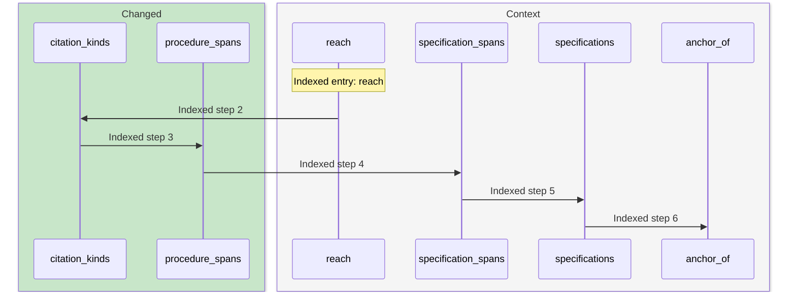

- **Step 1: [reach](https://github.com/m2ux/workflow-server/blob/4882414d678268aaa282fb4c0b184f14e3e47d1b/skills/scripts/check_skill_files.py#L1367).**
  skills/scripts/check_skill_files.py.
- **Step 2: [citation_kinds](https://github.com/m2ux/workflow-server/blob/4882414d678268aaa282fb4c0b184f14e3e47d1b/skills/scripts/check_skill_files.py#L1329).**
  skills/scripts/check_skill_files.py.
- **Step 3: [procedure_spans](https://github.com/m2ux/workflow-server/blob/4882414d678268aaa282fb4c0b184f14e3e47d1b/skills/scripts/check_skill_files.py#L413).**
  skills/scripts/check_skill_files.py.
- **Step 4: [specification_spans](https://github.com/m2ux/workflow-server/blob/4882414d678268aaa282fb4c0b184f14e3e47d1b/skills/scripts/check_skill_files.py#L395).**
  skills/scripts/check_skill_files.py.
- **Step 5: [specifications](https://github.com/m2ux/workflow-server/blob/4882414d678268aaa282fb4c0b184f14e3e47d1b/skills/scripts/check_skill_files.py#L379).**
  skills/scripts/check_skill_files.py.
- **Step 6: [anchor_of](https://github.com/m2ux/workflow-server/blob/4882414d678268aaa282fb4c0b184f14e3e47d1b/skills/scripts/check_skill_files.py#L185).**
  skills/scripts/check_skill_files.py.

## 10. Main → Validate_structure_entry

Process `proc_130_main` has 6 measured steps.

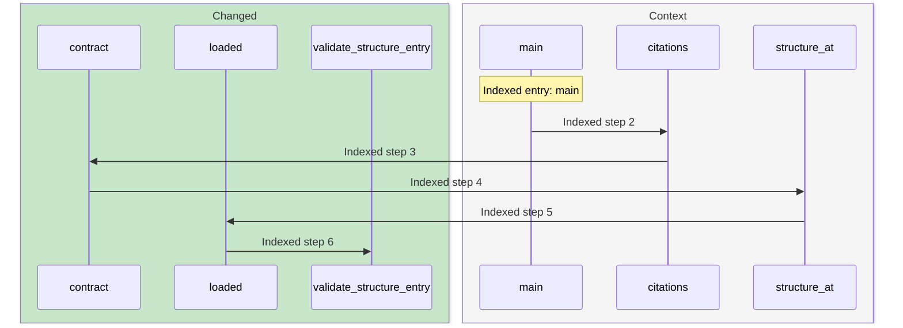

- **Step 1: [main](https://github.com/m2ux/workflow-server/blob/4882414d678268aaa282fb4c0b184f14e3e47d1b/skills/scripts/check_skill_files.py#L1411).**
  skills/scripts/check_skill_files.py.
- **Step 2: [citations](https://github.com/m2ux/workflow-server/blob/4882414d678268aaa282fb4c0b184f14e3e47d1b/skills/scripts/check_skill_files.py#L435).**
  skills/scripts/check_skill_files.py.
- **Step 3: [contract](https://github.com/m2ux/workflow-server/blob/4882414d678268aaa282fb4c0b184f14e3e47d1b/skills/scripts/check_skill_files.py#L368).**
  skills/scripts/check_skill_files.py.
- **Step 4: [structure_at](https://github.com/m2ux/workflow-server/blob/4882414d678268aaa282fb4c0b184f14e3e47d1b/skills/scripts/check_skill_files.py#L293).**
  skills/scripts/check_skill_files.py.
- **Step 5: [loaded](https://github.com/m2ux/workflow-server/blob/4882414d678268aaa282fb4c0b184f14e3e47d1b/skills/scripts/check_skill_files.py#L309).**
  skills/scripts/check_skill_files.py.
- **Step 6: [validate_structure_entry](https://github.com/m2ux/workflow-server/blob/4882414d678268aaa282fb4c0b184f14e3e47d1b/skills/scripts/check_skill_files.py#L323).**
  skills/scripts/check_skill_files.py.

## 11. Reach → Heading_end

Process `proc_131_reach` has 5 measured steps.

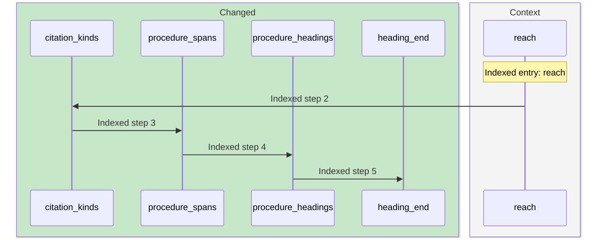

- **Step 1: [reach](https://github.com/m2ux/workflow-server/blob/4882414d678268aaa282fb4c0b184f14e3e47d1b/skills/scripts/check_skill_files.py#L1367).**
  skills/scripts/check_skill_files.py.
- **Step 2: [citation_kinds](https://github.com/m2ux/workflow-server/blob/4882414d678268aaa282fb4c0b184f14e3e47d1b/skills/scripts/check_skill_files.py#L1329).**
  skills/scripts/check_skill_files.py.
- **Step 3: [procedure_spans](https://github.com/m2ux/workflow-server/blob/4882414d678268aaa282fb4c0b184f14e3e47d1b/skills/scripts/check_skill_files.py#L413).**
  skills/scripts/check_skill_files.py.
- **Step 4: [procedure_headings](https://github.com/m2ux/workflow-server/blob/4882414d678268aaa282fb4c0b184f14e3e47d1b/skills/scripts/check_skill_files.py#L464).**
  skills/scripts/check_skill_files.py.
- **Step 5: [heading_end](https://github.com/m2ux/workflow-server/blob/4882414d678268aaa282fb4c0b184f14e3e47d1b/skills/scripts/check_skill_files.py#L459).**
  skills/scripts/check_skill_files.py.

## 12. Doubled_conventions → Scan_blocks

Process `proc_132_doubled_conventions` has 5 measured steps.

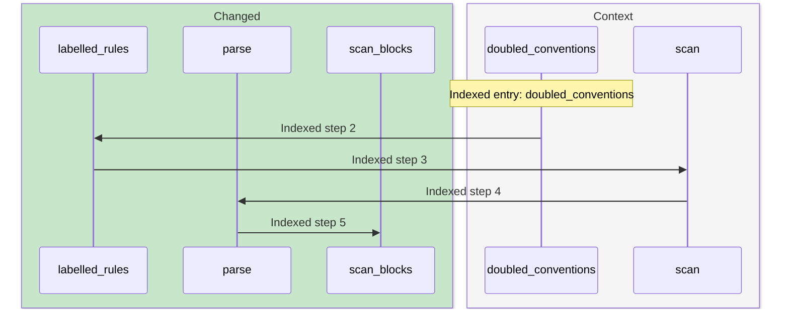

- **Step 1: [doubled_conventions](https://github.com/m2ux/workflow-server/blob/4882414d678268aaa282fb4c0b184f14e3e47d1b/skills/scripts/check_skill_files.py#L968).**
  skills/scripts/check_skill_files.py.
- **Step 2: [labelled_rules](https://github.com/m2ux/workflow-server/blob/4882414d678268aaa282fb4c0b184f14e3e47d1b/skills/scripts/check_skill_files.py#L939).**
  skills/scripts/check_skill_files.py.
- **Step 3: [scan](https://github.com/m2ux/workflow-server/blob/4882414d678268aaa282fb4c0b184f14e3e47d1b/skills/scripts/check_skill_files.py#L197).**
  skills/scripts/check_skill_files.py.
- **Step 4: [parse](https://github.com/m2ux/workflow-server/blob/4882414d678268aaa282fb4c0b184f14e3e47d1b/skills/scripts/check_skill_files.py#L258).**
  skills/scripts/check_skill_files.py.
- **Step 5: [scan_blocks](https://github.com/m2ux/workflow-server/blob/4882414d678268aaa282fb4c0b184f14e3e47d1b/skills/scripts/check_skill_files.py#L215).**
  skills/scripts/check_skill_files.py.

## 13. Interfaces → Named

Process `proc_156_interfaces` has 4 measured steps.

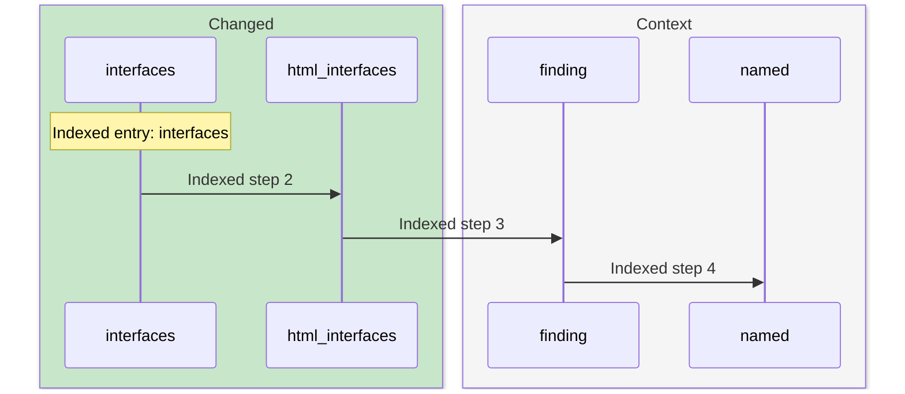

- **Step 1: [interfaces](https://github.com/m2ux/workflow-server/blob/4882414d678268aaa282fb4c0b184f14e3e47d1b/skills/scripts/check_skill_files.py#L989).**
  skills/scripts/check_skill_files.py.
- **Step 2: [html_interfaces](https://github.com/m2ux/workflow-server/blob/4882414d678268aaa282fb4c0b184f14e3e47d1b/skills/scripts/check_skill_files.py#L685).**
  skills/scripts/check_skill_files.py.
- **Step 3: [finding](https://github.com/m2ux/workflow-server/blob/4882414d678268aaa282fb4c0b184f14e3e47d1b/skills/scripts/check_skill_files.py#L859).**
  skills/scripts/check_skill_files.py.
- **Step 4: [named](https://github.com/m2ux/workflow-server/blob/4882414d678268aaa282fb4c0b184f14e3e47d1b/skills/scripts/check_skill_files.py#L190).**
  skills/scripts/check_skill_files.py.

## 14. Link_roles → Link_role

Process `proc_162_link_roles` has 3 measured steps.

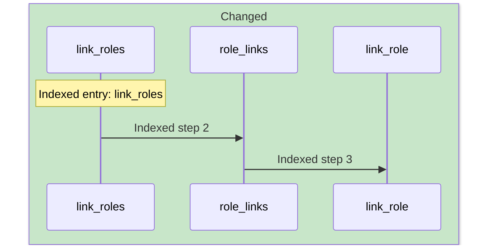

- **Step 1: [link_roles](https://github.com/m2ux/workflow-server/blob/4882414d678268aaa282fb4c0b184f14e3e47d1b/skills/scripts/check_skill_files.py#L536).**
  skills/scripts/check_skill_files.py.
- **Step 2: [role_links](https://github.com/m2ux/workflow-server/blob/4882414d678268aaa282fb4c0b184f14e3e47d1b/skills/scripts/check_skill_files.py#L499).**
  skills/scripts/check_skill_files.py.
- **Step 3: [link_role](https://github.com/m2ux/workflow-server/blob/4882414d678268aaa282fb4c0b184f14e3e47d1b/skills/scripts/check_skill_files.py#L493).**
  skills/scripts/check_skill_files.py.

## 15. Mode_commands → Anchor_of

Process `proc_170_mode_commands` has 4 measured steps.

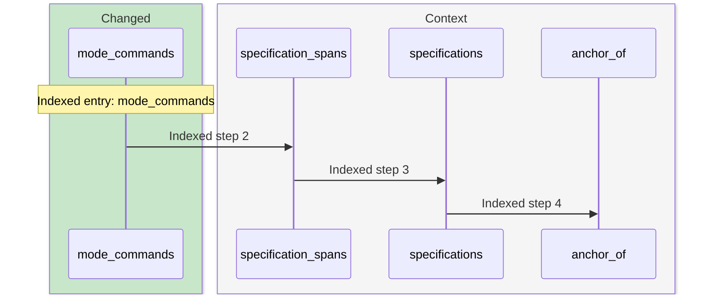

- **Step 1: [mode_commands](https://github.com/m2ux/workflow-server/blob/4882414d678268aaa282fb4c0b184f14e3e47d1b/skills/scripts/check_skill_files.py#L872).**
  skills/scripts/check_skill_files.py.
- **Step 2: [specification_spans](https://github.com/m2ux/workflow-server/blob/4882414d678268aaa282fb4c0b184f14e3e47d1b/skills/scripts/check_skill_files.py#L395).**
  skills/scripts/check_skill_files.py.
- **Step 3: [specifications](https://github.com/m2ux/workflow-server/blob/4882414d678268aaa282fb4c0b184f14e3e47d1b/skills/scripts/check_skill_files.py#L379).**
  skills/scripts/check_skill_files.py.
- **Step 4: [anchor_of](https://github.com/m2ux/workflow-server/blob/4882414d678268aaa282fb4c0b184f14e3e47d1b/skills/scripts/check_skill_files.py#L185).**
  skills/scripts/check_skill_files.py.

## 16. Operation_calls → Validate_structure_entry

Process `proc_177_operation_calls` has 6 measured steps.

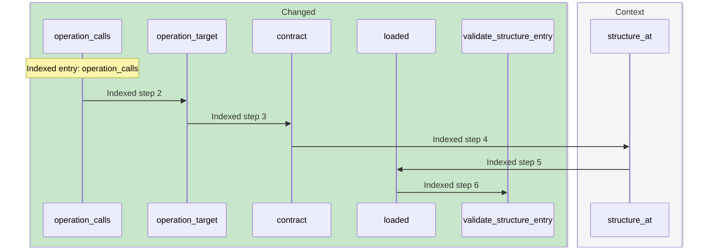

- **Step 1: [operation_calls](https://github.com/m2ux/workflow-server/blob/4882414d678268aaa282fb4c0b184f14e3e47d1b/skills/scripts/check_skill_files.py#L668).**
  skills/scripts/check_skill_files.py.
- **Step 2: [operation_target](https://github.com/m2ux/workflow-server/blob/4882414d678268aaa282fb4c0b184f14e3e47d1b/skills/scripts/check_skill_files.py#L517).**
  skills/scripts/check_skill_files.py.
- **Step 3: [contract](https://github.com/m2ux/workflow-server/blob/4882414d678268aaa282fb4c0b184f14e3e47d1b/skills/scripts/check_skill_files.py#L368).**
  skills/scripts/check_skill_files.py.
- **Step 4: [structure_at](https://github.com/m2ux/workflow-server/blob/4882414d678268aaa282fb4c0b184f14e3e47d1b/skills/scripts/check_skill_files.py#L293).**
  skills/scripts/check_skill_files.py.
- **Step 5: [loaded](https://github.com/m2ux/workflow-server/blob/4882414d678268aaa282fb4c0b184f14e3e47d1b/skills/scripts/check_skill_files.py#L309).**
  skills/scripts/check_skill_files.py.
- **Step 6: [validate_structure_entry](https://github.com/m2ux/workflow-server/blob/4882414d678268aaa282fb4c0b184f14e3e47d1b/skills/scripts/check_skill_files.py#L323).**
  skills/scripts/check_skill_files.py.

## 17. Interfaces → Heading_end

Process `proc_178_interfaces` has 4 measured steps.

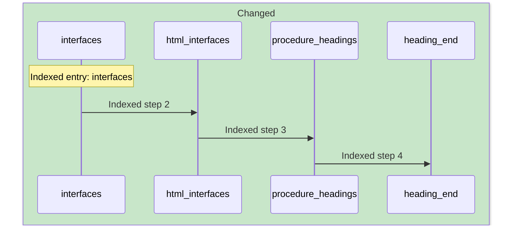

- **Step 1: [interfaces](https://github.com/m2ux/workflow-server/blob/4882414d678268aaa282fb4c0b184f14e3e47d1b/skills/scripts/check_skill_files.py#L989).**
  skills/scripts/check_skill_files.py.
- **Step 2: [html_interfaces](https://github.com/m2ux/workflow-server/blob/4882414d678268aaa282fb4c0b184f14e3e47d1b/skills/scripts/check_skill_files.py#L685).**
  skills/scripts/check_skill_files.py.
- **Step 3: [procedure_headings](https://github.com/m2ux/workflow-server/blob/4882414d678268aaa282fb4c0b184f14e3e47d1b/skills/scripts/check_skill_files.py#L464).**
  skills/scripts/check_skill_files.py.
- **Step 4: [heading_end](https://github.com/m2ux/workflow-server/blob/4882414d678268aaa282fb4c0b184f14e3e47d1b/skills/scripts/check_skill_files.py#L459).**
  skills/scripts/check_skill_files.py.

## 18. Inline_commands → Scan_blocks

Process `proc_179_inline_commands` has 5 measured steps.

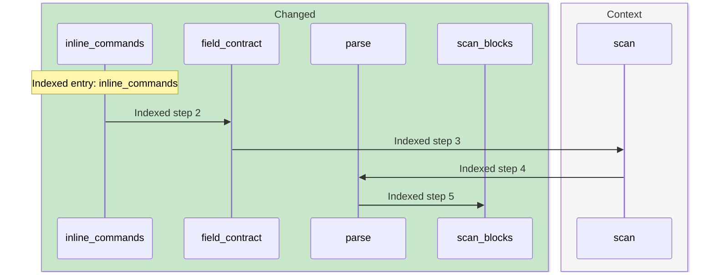

- **Step 1: [inline_commands](https://github.com/m2ux/workflow-server/blob/4882414d678268aaa282fb4c0b184f14e3e47d1b/skills/scripts/check_skill_files.py#L614).**
  skills/scripts/check_skill_files.py.
- **Step 2: [field_contract](https://github.com/m2ux/workflow-server/blob/4882414d678268aaa282fb4c0b184f14e3e47d1b/skills/scripts/check_skill_files.py#L476).**
  skills/scripts/check_skill_files.py.
- **Step 3: [scan](https://github.com/m2ux/workflow-server/blob/4882414d678268aaa282fb4c0b184f14e3e47d1b/skills/scripts/check_skill_files.py#L197).**
  skills/scripts/check_skill_files.py.
- **Step 4: [parse](https://github.com/m2ux/workflow-server/blob/4882414d678268aaa282fb4c0b184f14e3e47d1b/skills/scripts/check_skill_files.py#L258).**
  skills/scripts/check_skill_files.py.
- **Step 5: [scan_blocks](https://github.com/m2ux/workflow-server/blob/4882414d678268aaa282fb4c0b184f14e3e47d1b/skills/scripts/check_skill_files.py#L215).**
  skills/scripts/check_skill_files.py.

## 19. Doubled_conventions → Anchor_of

Process `proc_196_doubled_conventions` has 3 measured steps.

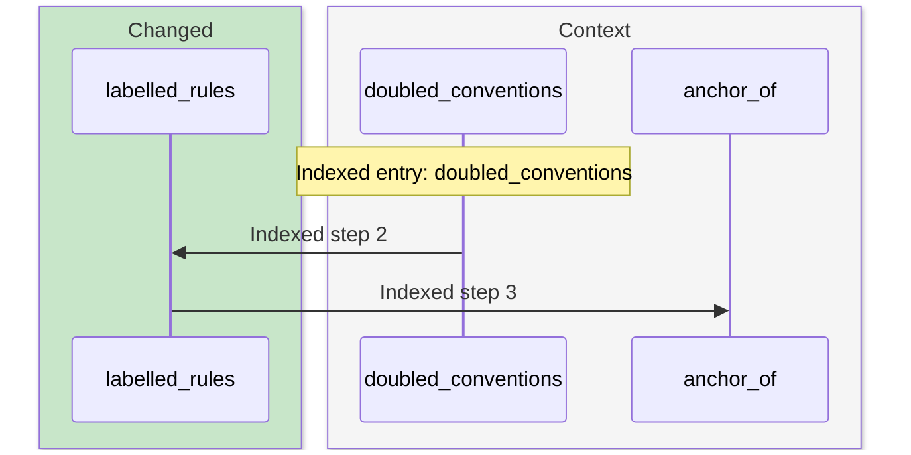

- **Step 1: [doubled_conventions](https://github.com/m2ux/workflow-server/blob/4882414d678268aaa282fb4c0b184f14e3e47d1b/skills/scripts/check_skill_files.py#L968).**
  skills/scripts/check_skill_files.py.
- **Step 2: [labelled_rules](https://github.com/m2ux/workflow-server/blob/4882414d678268aaa282fb4c0b184f14e3e47d1b/skills/scripts/check_skill_files.py#L939).**
  skills/scripts/check_skill_files.py.
- **Step 3: [anchor_of](https://github.com/m2ux/workflow-server/blob/4882414d678268aaa282fb4c0b184f14e3e47d1b/skills/scripts/check_skill_files.py#L185).**
  skills/scripts/check_skill_files.py.

## 20. Interfaces → Validate_structure_entry

Process `proc_200_interfaces` has 5 measured steps.


- **Step 1: [interfaces](https://github.com/m2ux/workflow-server/blob/4882414d678268aaa282fb4c0b184f14e3e47d1b/skills/scripts/check_skill_files.py#L989).**
  skills/scripts/check_skill_files.py.
- **Step 2: [contract](https://github.com/m2ux/workflow-server/blob/4882414d678268aaa282fb4c0b184f14e3e47d1b/skills/scripts/check_skill_files.py#L368).**
  skills/scripts/check_skill_files.py.
- **Step 3: [structure_at](https://github.com/m2ux/workflow-server/blob/4882414d678268aaa282fb4c0b184f14e3e47d1b/skills/scripts/check_skill_files.py#L293).**
  skills/scripts/check_skill_files.py.
- **Step 4: [loaded](https://github.com/m2ux/workflow-server/blob/4882414d678268aaa282fb4c0b184f14e3e47d1b/skills/scripts/check_skill_files.py#L309).**
  skills/scripts/check_skill_files.py.
- **Step 5: [validate_structure_entry](https://github.com/m2ux/workflow-server/blob/4882414d678268aaa282fb4c0b184f14e3e47d1b/skills/scripts/check_skill_files.py#L323).**
  skills/scripts/check_skill_files.py.

## 21. Link_roles → Heading_end

Process `proc_201_link_roles` has 4 measured steps.

```mermaid
sequenceDiagram
    box rgb(200,230,201) Changed
    participant P0 as link_roles
    participant P1 as operation_target
    participant P2 as procedure_headings
    participant P3 as heading_end
    end
    Note over P0: Indexed entry: link_roles
    P0->>P1: Indexed step 2
    P1->>P2: Indexed step 3
    P2->>P3: Indexed step 4
```

- **Step 1: [link_roles](https://github.com/m2ux/workflow-server/blob/4882414d678268aaa282fb4c0b184f14e3e47d1b/skills/scripts/check_skill_files.py#L536).**
  skills/scripts/check_skill_files.py.
- **Step 2: [operation_target](https://github.com/m2ux/workflow-server/blob/4882414d678268aaa282fb4c0b184f14e3e47d1b/skills/scripts/check_skill_files.py#L517).**
  skills/scripts/check_skill_files.py.
- **Step 3: [procedure_headings](https://github.com/m2ux/workflow-server/blob/4882414d678268aaa282fb4c0b184f14e3e47d1b/skills/scripts/check_skill_files.py#L464).**
  skills/scripts/check_skill_files.py.
- **Step 4: [heading_end](https://github.com/m2ux/workflow-server/blob/4882414d678268aaa282fb4c0b184f14e3e47d1b/skills/scripts/check_skill_files.py#L459).**
  skills/scripts/check_skill_files.py.

## 22. Link_roles → Scan_blocks

Process `proc_202_link_roles` has 5 measured steps.

```mermaid
sequenceDiagram
    box rgb(200,230,201) Changed
    participant P0 as link_roles
    participant P1 as field_contract
    participant P3 as parse
    participant P4 as scan_blocks
    end
    box rgb(245,245,245) Context
    participant P2 as scan
    end
    Note over P0: Indexed entry: link_roles
    P0->>P1: Indexed step 2
    P1->>P2: Indexed step 3
    P2->>P3: Indexed step 4
    P3->>P4: Indexed step 5
```

- **Step 1: [link_roles](https://github.com/m2ux/workflow-server/blob/4882414d678268aaa282fb4c0b184f14e3e47d1b/skills/scripts/check_skill_files.py#L536).**
  skills/scripts/check_skill_files.py.
- **Step 2: [field_contract](https://github.com/m2ux/workflow-server/blob/4882414d678268aaa282fb4c0b184f14e3e47d1b/skills/scripts/check_skill_files.py#L476).**
  skills/scripts/check_skill_files.py.
- **Step 3: [scan](https://github.com/m2ux/workflow-server/blob/4882414d678268aaa282fb4c0b184f14e3e47d1b/skills/scripts/check_skill_files.py#L197).**
  skills/scripts/check_skill_files.py.
- **Step 4: [parse](https://github.com/m2ux/workflow-server/blob/4882414d678268aaa282fb4c0b184f14e3e47d1b/skills/scripts/check_skill_files.py#L258).**
  skills/scripts/check_skill_files.py.
- **Step 5: [scan_blocks](https://github.com/m2ux/workflow-server/blob/4882414d678268aaa282fb4c0b184f14e3e47d1b/skills/scripts/check_skill_files.py#L215).**
  skills/scripts/check_skill_files.py.

## 23. Retired_terms → Named

Process `proc_208_retired_terms` has 3 measured steps.

```mermaid
sequenceDiagram
    box rgb(200,230,201) Changed
    participant P0 as retired_terms
    end
    box rgb(245,245,245) Context
    participant P1 as finding
    participant P2 as named
    end
    Note over P0: Indexed entry: retired_terms
    P0->>P1: Indexed step 2
    P1->>P2: Indexed step 3
```

- **Step 1: [retired_terms](https://github.com/m2ux/workflow-server/blob/4882414d678268aaa282fb4c0b184f14e3e47d1b/skills/scripts/check_skill_files.py#L919).**
  skills/scripts/check_skill_files.py.
- **Step 2: [finding](https://github.com/m2ux/workflow-server/blob/4882414d678268aaa282fb4c0b184f14e3e47d1b/skills/scripts/check_skill_files.py#L859).**
  skills/scripts/check_skill_files.py.
- **Step 3: [named](https://github.com/m2ux/workflow-server/blob/4882414d678268aaa282fb4c0b184f14e3e47d1b/skills/scripts/check_skill_files.py#L190).**
  skills/scripts/check_skill_files.py.

## 24. Inline_commands → Anchor_of

Process `proc_212_inline_commands` has 3 measured steps.

```mermaid
sequenceDiagram
    box rgb(200,230,201) Changed
    participant P0 as inline_commands
    participant P1 as field_contract
    end
    box rgb(245,245,245) Context
    participant P2 as anchor_of
    end
    Note over P0: Indexed entry: inline_commands
    P0->>P1: Indexed step 2
    P1->>P2: Indexed step 3
```

- **Step 1: [inline_commands](https://github.com/m2ux/workflow-server/blob/4882414d678268aaa282fb4c0b184f14e3e47d1b/skills/scripts/check_skill_files.py#L614).**
  skills/scripts/check_skill_files.py.
- **Step 2: [field_contract](https://github.com/m2ux/workflow-server/blob/4882414d678268aaa282fb4c0b184f14e3e47d1b/skills/scripts/check_skill_files.py#L476).**
  skills/scripts/check_skill_files.py.
- **Step 3: [anchor_of](https://github.com/m2ux/workflow-server/blob/4882414d678268aaa282fb4c0b184f14e3e47d1b/skills/scripts/check_skill_files.py#L185).**
  skills/scripts/check_skill_files.py.

## 25. Mode_commands → Validate_structure_entry

Process `proc_215_mode_commands` has 5 measured steps.

```mermaid
sequenceDiagram
    box rgb(200,230,201) Changed
    participant P0 as mode_commands
    participant P1 as contract
    participant P3 as loaded
    participant P4 as validate_structure_entry
    end
    box rgb(245,245,245) Context
    participant P2 as structure_at
    end
    Note over P0: Indexed entry: mode_commands
    P0->>P1: Indexed step 2
    P1->>P2: Indexed step 3
    P2->>P3: Indexed step 4
    P3->>P4: Indexed step 5
```

- **Step 1: [mode_commands](https://github.com/m2ux/workflow-server/blob/4882414d678268aaa282fb4c0b184f14e3e47d1b/skills/scripts/check_skill_files.py#L872).**
  skills/scripts/check_skill_files.py.
- **Step 2: [contract](https://github.com/m2ux/workflow-server/blob/4882414d678268aaa282fb4c0b184f14e3e47d1b/skills/scripts/check_skill_files.py#L368).**
  skills/scripts/check_skill_files.py.
- **Step 3: [structure_at](https://github.com/m2ux/workflow-server/blob/4882414d678268aaa282fb4c0b184f14e3e47d1b/skills/scripts/check_skill_files.py#L293).**
  skills/scripts/check_skill_files.py.
- **Step 4: [loaded](https://github.com/m2ux/workflow-server/blob/4882414d678268aaa282fb4c0b184f14e3e47d1b/skills/scripts/check_skill_files.py#L309).**
  skills/scripts/check_skill_files.py.
- **Step 5: [validate_structure_entry](https://github.com/m2ux/workflow-server/blob/4882414d678268aaa282fb4c0b184f14e3e47d1b/skills/scripts/check_skill_files.py#L323).**
  skills/scripts/check_skill_files.py.

## 26. Operation_calls → Heading_end

Process `proc_216_operation_calls` has 4 measured steps.

```mermaid
sequenceDiagram
    box rgb(200,230,201) Changed
    participant P0 as operation_calls
    participant P1 as operation_target
    participant P2 as procedure_headings
    participant P3 as heading_end
    end
    Note over P0: Indexed entry: operation_calls
    P0->>P1: Indexed step 2
    P1->>P2: Indexed step 3
    P2->>P3: Indexed step 4
```

- **Step 1: [operation_calls](https://github.com/m2ux/workflow-server/blob/4882414d678268aaa282fb4c0b184f14e3e47d1b/skills/scripts/check_skill_files.py#L668).**
  skills/scripts/check_skill_files.py.
- **Step 2: [operation_target](https://github.com/m2ux/workflow-server/blob/4882414d678268aaa282fb4c0b184f14e3e47d1b/skills/scripts/check_skill_files.py#L517).**
  skills/scripts/check_skill_files.py.
- **Step 3: [procedure_headings](https://github.com/m2ux/workflow-server/blob/4882414d678268aaa282fb4c0b184f14e3e47d1b/skills/scripts/check_skill_files.py#L464).**
  skills/scripts/check_skill_files.py.
- **Step 4: [heading_end](https://github.com/m2ux/workflow-server/blob/4882414d678268aaa282fb4c0b184f14e3e47d1b/skills/scripts/check_skill_files.py#L459).**
  skills/scripts/check_skill_files.py.

## 27. Operation_calls → Scan_blocks

Process `proc_217_operation_calls` has 5 measured steps.

```mermaid
sequenceDiagram
    box rgb(200,230,201) Changed
    participant P0 as operation_calls
    participant P1 as operation_target
    participant P3 as parse
    participant P4 as scan_blocks
    end
    box rgb(245,245,245) Context
    participant P2 as scan
    end
    Note over P0: Indexed entry: operation_calls
    P0->>P1: Indexed step 2
    P1->>P2: Indexed step 3
    P2->>P3: Indexed step 4
    P3->>P4: Indexed step 5
```

- **Step 1: [operation_calls](https://github.com/m2ux/workflow-server/blob/4882414d678268aaa282fb4c0b184f14e3e47d1b/skills/scripts/check_skill_files.py#L668).**
  skills/scripts/check_skill_files.py.
- **Step 2: [operation_target](https://github.com/m2ux/workflow-server/blob/4882414d678268aaa282fb4c0b184f14e3e47d1b/skills/scripts/check_skill_files.py#L517).**
  skills/scripts/check_skill_files.py.
- **Step 3: [scan](https://github.com/m2ux/workflow-server/blob/4882414d678268aaa282fb4c0b184f14e3e47d1b/skills/scripts/check_skill_files.py#L197).**
  skills/scripts/check_skill_files.py.
- **Step 4: [parse](https://github.com/m2ux/workflow-server/blob/4882414d678268aaa282fb4c0b184f14e3e47d1b/skills/scripts/check_skill_files.py#L258).**
  skills/scripts/check_skill_files.py.
- **Step 5: [scan_blocks](https://github.com/m2ux/workflow-server/blob/4882414d678268aaa282fb4c0b184f14e3e47d1b/skills/scripts/check_skill_files.py#L215).**
  skills/scripts/check_skill_files.py.

## 28. Link_roles → Anchor_of

Process `proc_224_link_roles` has 3 measured steps.

```mermaid
sequenceDiagram
    box rgb(200,230,201) Changed
    participant P0 as link_roles
    participant P1 as field_contract
    end
    box rgb(245,245,245) Context
    participant P2 as anchor_of
    end
    Note over P0: Indexed entry: link_roles
    P0->>P1: Indexed step 2
    P1->>P2: Indexed step 3
```

- **Step 1: [link_roles](https://github.com/m2ux/workflow-server/blob/4882414d678268aaa282fb4c0b184f14e3e47d1b/skills/scripts/check_skill_files.py#L536).**
  skills/scripts/check_skill_files.py.
- **Step 2: [field_contract](https://github.com/m2ux/workflow-server/blob/4882414d678268aaa282fb4c0b184f14e3e47d1b/skills/scripts/check_skill_files.py#L476).**
  skills/scripts/check_skill_files.py.
- **Step 3: [anchor_of](https://github.com/m2ux/workflow-server/blob/4882414d678268aaa282fb4c0b184f14e3e47d1b/skills/scripts/check_skill_files.py#L185).**
  skills/scripts/check_skill_files.py.

## 29. Reach → Validate_structure_entry

Process `proc_226_reach` has 5 measured steps.

```mermaid
sequenceDiagram
    box rgb(200,230,201) Changed
    participant P1 as contract
    participant P3 as loaded
    participant P4 as validate_structure_entry
    end
    box rgb(245,245,245) Context
    participant P0 as reach
    participant P2 as structure_at
    end
    Note over P0: Indexed entry: reach
    P0->>P1: Indexed step 2
    P1->>P2: Indexed step 3
    P2->>P3: Indexed step 4
    P3->>P4: Indexed step 5
```

- **Step 1: [reach](https://github.com/m2ux/workflow-server/blob/4882414d678268aaa282fb4c0b184f14e3e47d1b/skills/scripts/check_skill_files.py#L1367).**
  skills/scripts/check_skill_files.py.
- **Step 2: [contract](https://github.com/m2ux/workflow-server/blob/4882414d678268aaa282fb4c0b184f14e3e47d1b/skills/scripts/check_skill_files.py#L368).**
  skills/scripts/check_skill_files.py.
- **Step 3: [structure_at](https://github.com/m2ux/workflow-server/blob/4882414d678268aaa282fb4c0b184f14e3e47d1b/skills/scripts/check_skill_files.py#L293).**
  skills/scripts/check_skill_files.py.
- **Step 4: [loaded](https://github.com/m2ux/workflow-server/blob/4882414d678268aaa282fb4c0b184f14e3e47d1b/skills/scripts/check_skill_files.py#L309).**
  skills/scripts/check_skill_files.py.
- **Step 5: [validate_structure_entry](https://github.com/m2ux/workflow-server/blob/4882414d678268aaa282fb4c0b184f14e3e47d1b/skills/scripts/check_skill_files.py#L323).**
  skills/scripts/check_skill_files.py.

## 30. Heading_model → Heading_end

Process `proc_227_heading_model` has 3 measured steps.

```mermaid
sequenceDiagram
    box rgb(200,230,201) Changed
    participant P0 as heading_model
    participant P1 as procedure_headings
    participant P2 as heading_end
    end
    Note over P0: Indexed entry: heading_model
    P0->>P1: Indexed step 2
    P1->>P2: Indexed step 3
```

- **Step 1: [heading_model](https://github.com/m2ux/workflow-server/blob/4882414d678268aaa282fb4c0b184f14e3e47d1b/skills/scripts/check_skill_files.py#L550).**
  skills/scripts/check_skill_files.py.
- **Step 2: [procedure_headings](https://github.com/m2ux/workflow-server/blob/4882414d678268aaa282fb4c0b184f14e3e47d1b/skills/scripts/check_skill_files.py#L464).**
  skills/scripts/check_skill_files.py.
- **Step 3: [heading_end](https://github.com/m2ux/workflow-server/blob/4882414d678268aaa282fb4c0b184f14e3e47d1b/skills/scripts/check_skill_files.py#L459).**
  skills/scripts/check_skill_files.py.

## 31. Reach → Scan_blocks

Process `proc_228_reach` has 5 measured steps.

```mermaid
sequenceDiagram
    box rgb(200,230,201) Changed
    participant P1 as citation_kinds
    participant P3 as parse
    participant P4 as scan_blocks
    end
    box rgb(245,245,245) Context
    participant P0 as reach
    participant P2 as scan
    end
    Note over P0: Indexed entry: reach
    P0->>P1: Indexed step 2
    P1->>P2: Indexed step 3
    P2->>P3: Indexed step 4
    P3->>P4: Indexed step 5
```

- **Step 1: [reach](https://github.com/m2ux/workflow-server/blob/4882414d678268aaa282fb4c0b184f14e3e47d1b/skills/scripts/check_skill_files.py#L1367).**
  skills/scripts/check_skill_files.py.
- **Step 2: [citation_kinds](https://github.com/m2ux/workflow-server/blob/4882414d678268aaa282fb4c0b184f14e3e47d1b/skills/scripts/check_skill_files.py#L1329).**
  skills/scripts/check_skill_files.py.
- **Step 3: [scan](https://github.com/m2ux/workflow-server/blob/4882414d678268aaa282fb4c0b184f14e3e47d1b/skills/scripts/check_skill_files.py#L197).**
  skills/scripts/check_skill_files.py.
- **Step 4: [parse](https://github.com/m2ux/workflow-server/blob/4882414d678268aaa282fb4c0b184f14e3e47d1b/skills/scripts/check_skill_files.py#L258).**
  skills/scripts/check_skill_files.py.
- **Step 5: [scan_blocks](https://github.com/m2ux/workflow-server/blob/4882414d678268aaa282fb4c0b184f14e3e47d1b/skills/scripts/check_skill_files.py#L215).**
  skills/scripts/check_skill_files.py.

## 32. Mixed_moods → Anchor_of

Process `proc_234_mixed_moods` has 3 measured steps.

```mermaid
sequenceDiagram
    box rgb(200,230,201) Changed
    participant P0 as mixed_moods
    end
    box rgb(245,245,245) Context
    participant P1 as specifications
    participant P2 as anchor_of
    end
    Note over P0: Indexed entry: mixed_moods
    P0->>P1: Indexed step 2
    P1->>P2: Indexed step 3
```

- **Step 1: [mixed_moods](https://github.com/m2ux/workflow-server/blob/4882414d678268aaa282fb4c0b184f14e3e47d1b/skills/scripts/check_skill_files.py#L1182).**
  skills/scripts/check_skill_files.py.
- **Step 2: [specifications](https://github.com/m2ux/workflow-server/blob/4882414d678268aaa282fb4c0b184f14e3e47d1b/skills/scripts/check_skill_files.py#L379).**
  skills/scripts/check_skill_files.py.
- **Step 3: [anchor_of](https://github.com/m2ux/workflow-server/blob/4882414d678268aaa282fb4c0b184f14e3e47d1b/skills/scripts/check_skill_files.py#L185).**
  skills/scripts/check_skill_files.py.

## 33. Undecided_rules → Scan_blocks

Process `proc_236_undecided_rules` has 5 measured steps.

```mermaid
sequenceDiagram
    box rgb(200,230,201) Changed
    participant P1 as labelled_rules
    participant P3 as parse
    participant P4 as scan_blocks
    end
    box rgb(245,245,245) Context
    participant P0 as undecided_rules
    participant P2 as scan
    end
    Note over P0: Indexed entry: undecided_rules
    P0->>P1: Indexed step 2
    P1->>P2: Indexed step 3
    P2->>P3: Indexed step 4
    P3->>P4: Indexed step 5
```

- **Step 1: [undecided_rules](https://github.com/m2ux/workflow-server/blob/4882414d678268aaa282fb4c0b184f14e3e47d1b/skills/scripts/check_skill_files.py#L1026).**
  skills/scripts/check_skill_files.py.
- **Step 2: [labelled_rules](https://github.com/m2ux/workflow-server/blob/4882414d678268aaa282fb4c0b184f14e3e47d1b/skills/scripts/check_skill_files.py#L939).**
  skills/scripts/check_skill_files.py.
- **Step 3: [scan](https://github.com/m2ux/workflow-server/blob/4882414d678268aaa282fb4c0b184f14e3e47d1b/skills/scripts/check_skill_files.py#L197).**
  skills/scripts/check_skill_files.py.
- **Step 4: [parse](https://github.com/m2ux/workflow-server/blob/4882414d678268aaa282fb4c0b184f14e3e47d1b/skills/scripts/check_skill_files.py#L258).**
  skills/scripts/check_skill_files.py.
- **Step 5: [scan_blocks](https://github.com/m2ux/workflow-server/blob/4882414d678268aaa282fb4c0b184f14e3e47d1b/skills/scripts/check_skill_files.py#L215).**
  skills/scripts/check_skill_files.py.

## 34. Operation_calls → Anchor_of

Process `proc_241_operation_calls` has 3 measured steps.

```mermaid
sequenceDiagram
    box rgb(200,230,201) Changed
    participant P0 as operation_calls
    participant P1 as operation_target
    end
    box rgb(245,245,245) Context
    participant P2 as anchor_of
    end
    Note over P0: Indexed entry: operation_calls
    P0->>P1: Indexed step 2
    P1->>P2: Indexed step 3
```

- **Step 1: [operation_calls](https://github.com/m2ux/workflow-server/blob/4882414d678268aaa282fb4c0b184f14e3e47d1b/skills/scripts/check_skill_files.py#L668).**
  skills/scripts/check_skill_files.py.
- **Step 2: [operation_target](https://github.com/m2ux/workflow-server/blob/4882414d678268aaa282fb4c0b184f14e3e47d1b/skills/scripts/check_skill_files.py#L517).**
  skills/scripts/check_skill_files.py.
- **Step 3: [anchor_of](https://github.com/m2ux/workflow-server/blob/4882414d678268aaa282fb4c0b184f14e3e47d1b/skills/scripts/check_skill_files.py#L185).**
  skills/scripts/check_skill_files.py.

## 35. Anchors → Scan_blocks

Process `proc_243_anchors` has 4 measured steps.

```mermaid
sequenceDiagram
    box rgb(200,230,201) Changed
    participant P2 as parse
    participant P3 as scan_blocks
    end
    box rgb(245,245,245) Context
    participant P0 as anchors
    participant P1 as scan
    end
    Note over P0: Indexed entry: anchors
    P0->>P1: Indexed step 2
    P1->>P2: Indexed step 3
    P2->>P3: Indexed step 4
```

- **Step 1: [anchors](https://github.com/m2ux/workflow-server/blob/4882414d678268aaa282fb4c0b184f14e3e47d1b/skills/scripts/check_skill_files.py#L716).**
  skills/scripts/check_skill_files.py.
- **Step 2: [scan](https://github.com/m2ux/workflow-server/blob/4882414d678268aaa282fb4c0b184f14e3e47d1b/skills/scripts/check_skill_files.py#L197).**
  skills/scripts/check_skill_files.py.
- **Step 3: [parse](https://github.com/m2ux/workflow-server/blob/4882414d678268aaa282fb4c0b184f14e3e47d1b/skills/scripts/check_skill_files.py#L258).**
  skills/scripts/check_skill_files.py.
- **Step 4: [scan_blocks](https://github.com/m2ux/workflow-server/blob/4882414d678268aaa282fb4c0b184f14e3e47d1b/skills/scripts/check_skill_files.py#L215).**
  skills/scripts/check_skill_files.py.

## 36. Interfaces → Scan_blocks

Process `proc_250_interfaces` has 4 measured steps.

```mermaid
sequenceDiagram
    box rgb(200,230,201) Changed
    participant P0 as interfaces
    participant P2 as parse
    participant P3 as scan_blocks
    end
    box rgb(245,245,245) Context
    participant P1 as scan
    end
    Note over P0: Indexed entry: interfaces
    P0->>P1: Indexed step 2
    P1->>P2: Indexed step 3
    P2->>P3: Indexed step 4
```

- **Step 1: [interfaces](https://github.com/m2ux/workflow-server/blob/4882414d678268aaa282fb4c0b184f14e3e47d1b/skills/scripts/check_skill_files.py#L989).**
  skills/scripts/check_skill_files.py.
- **Step 2: [scan](https://github.com/m2ux/workflow-server/blob/4882414d678268aaa282fb4c0b184f14e3e47d1b/skills/scripts/check_skill_files.py#L197).**
  skills/scripts/check_skill_files.py.
- **Step 3: [parse](https://github.com/m2ux/workflow-server/blob/4882414d678268aaa282fb4c0b184f14e3e47d1b/skills/scripts/check_skill_files.py#L258).**
  skills/scripts/check_skill_files.py.
- **Step 4: [scan_blocks](https://github.com/m2ux/workflow-server/blob/4882414d678268aaa282fb4c0b184f14e3e47d1b/skills/scripts/check_skill_files.py#L215).**
  skills/scripts/check_skill_files.py.

## 37. Undecided_rules → Anchor_of

Process `proc_255_undecided_rules` has 3 measured steps.

```mermaid
sequenceDiagram
    box rgb(200,230,201) Changed
    participant P1 as labelled_rules
    end
    box rgb(245,245,245) Context
    participant P0 as undecided_rules
    participant P2 as anchor_of
    end
    Note over P0: Indexed entry: undecided_rules
    P0->>P1: Indexed step 2
    P1->>P2: Indexed step 3
```

- **Step 1: [undecided_rules](https://github.com/m2ux/workflow-server/blob/4882414d678268aaa282fb4c0b184f14e3e47d1b/skills/scripts/check_skill_files.py#L1026).**
  skills/scripts/check_skill_files.py.
- **Step 2: [labelled_rules](https://github.com/m2ux/workflow-server/blob/4882414d678268aaa282fb4c0b184f14e3e47d1b/skills/scripts/check_skill_files.py#L939).**
  skills/scripts/check_skill_files.py.
- **Step 3: [anchor_of](https://github.com/m2ux/workflow-server/blob/4882414d678268aaa282fb4c0b184f14e3e47d1b/skills/scripts/check_skill_files.py#L185).**
  skills/scripts/check_skill_files.py.

## 38. Mode_commands → Scan_blocks

Process `proc_257_mode_commands` has 4 measured steps.

```mermaid
sequenceDiagram
    box rgb(200,230,201) Changed
    participant P0 as mode_commands
    participant P2 as parse
    participant P3 as scan_blocks
    end
    box rgb(245,245,245) Context
    participant P1 as scan
    end
    Note over P0: Indexed entry: mode_commands
    P0->>P1: Indexed step 2
    P1->>P2: Indexed step 3
    P2->>P3: Indexed step 4
```

- **Step 1: [mode_commands](https://github.com/m2ux/workflow-server/blob/4882414d678268aaa282fb4c0b184f14e3e47d1b/skills/scripts/check_skill_files.py#L872).**
  skills/scripts/check_skill_files.py.
- **Step 2: [scan](https://github.com/m2ux/workflow-server/blob/4882414d678268aaa282fb4c0b184f14e3e47d1b/skills/scripts/check_skill_files.py#L197).**
  skills/scripts/check_skill_files.py.
- **Step 3: [parse](https://github.com/m2ux/workflow-server/blob/4882414d678268aaa282fb4c0b184f14e3e47d1b/skills/scripts/check_skill_files.py#L258).**
  skills/scripts/check_skill_files.py.
- **Step 4: [scan_blocks](https://github.com/m2ux/workflow-server/blob/4882414d678268aaa282fb4c0b184f14e3e47d1b/skills/scripts/check_skill_files.py#L215).**
  skills/scripts/check_skill_files.py.

## 39. Retired_terms → Scan_blocks

Process `proc_264_retired_terms` has 4 measured steps.

```mermaid
sequenceDiagram
    box rgb(200,230,201) Changed
    participant P0 as retired_terms
    participant P2 as parse
    participant P3 as scan_blocks
    end
    box rgb(245,245,245) Context
    participant P1 as scan
    end
    Note over P0: Indexed entry: retired_terms
    P0->>P1: Indexed step 2
    P1->>P2: Indexed step 3
    P2->>P3: Indexed step 4
```

- **Step 1: [retired_terms](https://github.com/m2ux/workflow-server/blob/4882414d678268aaa282fb4c0b184f14e3e47d1b/skills/scripts/check_skill_files.py#L919).**
  skills/scripts/check_skill_files.py.
- **Step 2: [scan](https://github.com/m2ux/workflow-server/blob/4882414d678268aaa282fb4c0b184f14e3e47d1b/skills/scripts/check_skill_files.py#L197).**
  skills/scripts/check_skill_files.py.
- **Step 3: [parse](https://github.com/m2ux/workflow-server/blob/4882414d678268aaa282fb4c0b184f14e3e47d1b/skills/scripts/check_skill_files.py#L258).**
  skills/scripts/check_skill_files.py.
- **Step 4: [scan_blocks](https://github.com/m2ux/workflow-server/blob/4882414d678268aaa282fb4c0b184f14e3e47d1b/skills/scripts/check_skill_files.py#L215).**
  skills/scripts/check_skill_files.py.

## 40. Heading_model → Scan_blocks

Process `proc_269_heading_model` has 3 measured steps.

```mermaid
sequenceDiagram
    box rgb(200,230,201) Changed
    participant P0 as heading_model
    participant P1 as role_links
    participant P2 as scan_blocks
    end
    Note over P0: Indexed entry: heading_model
    P0->>P1: Indexed step 2
    P1->>P2: Indexed step 3
```

- **Step 1: [heading_model](https://github.com/m2ux/workflow-server/blob/4882414d678268aaa282fb4c0b184f14e3e47d1b/skills/scripts/check_skill_files.py#L550).**
  skills/scripts/check_skill_files.py.
- **Step 2: [role_links](https://github.com/m2ux/workflow-server/blob/4882414d678268aaa282fb4c0b184f14e3e47d1b/skills/scripts/check_skill_files.py#L499).**
  skills/scripts/check_skill_files.py.
- **Step 3: [scan_blocks](https://github.com/m2ux/workflow-server/blob/4882414d678268aaa282fb4c0b184f14e3e47d1b/skills/scripts/check_skill_files.py#L215).**
  skills/scripts/check_skill_files.py.

