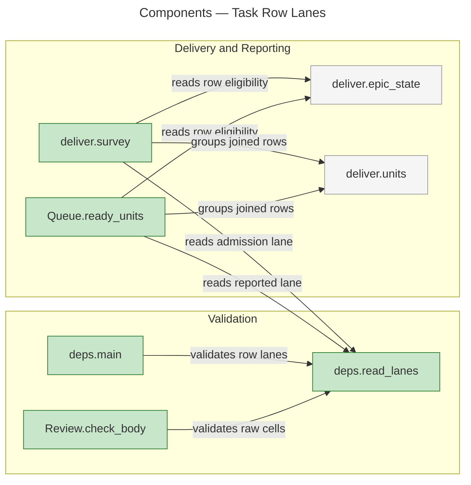
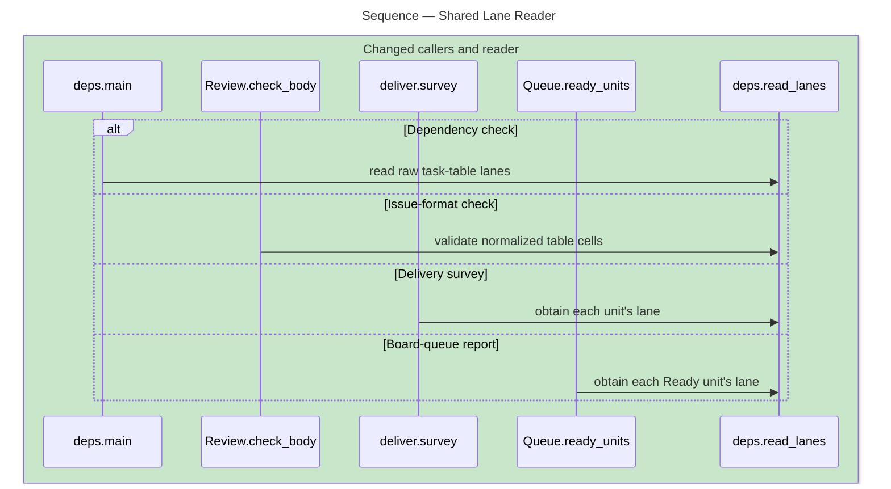
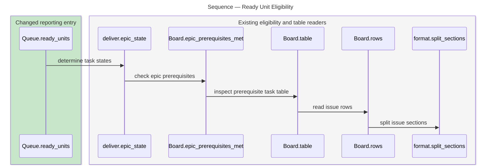

# Architecture Overview — Delivery Lanes

> architecture-overview · [m2ux/workflow-server#1627](https://github.com/m2ux/workflow-server/pull/1627) · 2026-11-05

## Summary

Task rows carry a bare board-wide lane index between Joins and Done. One raw-cell reader supplies dependency checking, issue-format validation, delivery admission and Ready-unit reports. Plan, Deliver and Advance carry that contract through their existing procedures.

## Structure

The measured callers converge on `deps.read_lanes`. Delivery admission and queue reporting also share the existing row-state and joined-unit helpers, so reporting uses the same eligibility boundary while keeping board placement independent. The diagram shows measured function relationships; the prose artifacts define their input contracts.

### Lane Validation

- **[Raw cell reader](https://github.com/m2ux/workflow-server/blob/dbfe21c2bc88d97034c3de8e64e8b490ae54688f/skills/work-planner/scripts/deps.py#L85).**
  `read_lanes` returns valid indices or empty values by task id, with row-specific problems for malformed cells. Reading before Markdown link stripping keeps a linked numeric label from becoming a bare index.
- **[Joined-unit checks](https://github.com/m2ux/workflow-server/blob/dbfe21c2bc88d97034c3de8e64e8b490ae54688f/skills/work-planner/scripts/deps.py#L420).**
  The dependency check requires a common index or all-empty cells across a unit. Out-of-epic Joins receive bounded diagnostics before whole-epic priority evaluation.
- **[Issue formatting](https://github.com/m2ux/workflow-server/blob/dbfe21c2bc88d97034c3de8e64e8b490ae54688f/skills/work-planner/scripts/format.py#L555).**
  `Review.check_body` normalizes the canonical table, validates raw Lane values and preserves row data through subsequent formatting.

### Delivery and Reporting

- **[Admission](https://github.com/m2ux/workflow-server/blob/dbfe21c2bc88d97034c3de8e64e8b490ae54688f/skills/work-planner/scripts/deliver.py#L396).**
  `survey` offers matching and unlaned free units for a requested index; an absent index offers unlaned units. Filtering preserves the existing order and keeps holds, dependencies and merge evidence visible.
- **[Ready-unit reports](https://github.com/m2ux/workflow-server/blob/dbfe21c2bc88d97034c3de8e64e8b490ae54688f/skills/work-planner/scripts/board-queue.py#L280).**
  `ready_units` reads supplied issue bodies and the existing eligibility helpers after placement derivation. Its lane annotations add no work-item or checkout input and leave Status and assignee calls determined by the existing queue logic.

## Behaviour

The central read paths share the raw reader; Ready-unit reporting reuses the existing snapshot eligibility path.

### Shared Raw Lane Reads

Four actual one-hop CALLS traces establish the alternatives below. Each alternative is a separate entry path, not a claim that the four commands run in sequence.

- **One row source.**
  Every caller receives lane values from the epic body. Work items continue to supply component data and implementation plans.
- **Explicit invalid input.**
  Markup, prose, missing cells and split joined assignments receive findings. Valid empty cells mean unlaned, and opaque spellings such as `02` retain their identity.

### Snapshot Eligibility

Exact process `proc_238_ready_units` supplies all six measured steps below, in their recorded order. This is the prerequisite-reading path inside eligibility; the raw lane read is the separate measured call above.

- **Whole free units.**
  The report groups reciprocal Joins and includes a unit only when every member is free and eligible under the proposed Ready or In Progress epic status.
- **Existing evidence boundary.**
  Reservations, open deliveries, Done rows and unmet dependencies stay excluded. Same-repository producer outputs requiring a checkout remain unverified in the snapshot-only queue.

## What Changed

### Planning Contract

- **[Task table](https://github.com/m2ux/workflow-server/blob/dbfe21c2bc88d97034c3de8e64e8b490ae54688f/skills/work-planner/artifacts/epic-issue-body.md#L134).**
  The canonical columns are Task, Description, Coverage, Depends on, Joins, Lane and Done. Plan mode confirms the initiative's lane map and passes each optional index to row population; Work Item has Component as its declaration.
- **[Mode inputs and reports](https://github.com/m2ux/workflow-server/blob/dbfe21c2bc88d97034c3de8e64e8b490ae54688f/skills/work-planner/modes/deliver-mode.md#L35).**
  Deliver carries the current request's lane through every survey path. Advance carries the returned Ready-unit lanes, and the owning artifacts state the rules.

### Runtime Checks

- **Shared validation and consumers.**
  Dependency, format, delivery and queue readers share the same raw data interpretation. The CLI refuses malformed requested indices, joined lane conflicts and unsupported cross-epic joins with explicit diagnostics.
- **Table data and metadata.**
  Regression fixtures cover normalization, holds, delivery links and completion ticks with populated/empty lanes. Guideline metadata names the current headings while preserving the target's user-authored prose edit.

## Reading Order

1. **[Epic Issue Body](https://github.com/m2ux/workflow-server/blob/dbfe21c2bc88d97034c3de8e64e8b490ae54688f/skills/work-planner/artifacts/epic-issue-body.md#L166)** — the exact row contract and optional index input.
2. **[Dependency Graph](https://github.com/m2ux/workflow-server/blob/dbfe21c2bc88d97034c3de8e64e8b490ae54688f/skills/work-planner/artifacts/dependency-graph.md#L85)** — the common-lane invariant for joined rows.
3. **[deps.py](https://github.com/m2ux/workflow-server/blob/dbfe21c2bc88d97034c3de8e64e8b490ae54688f/skills/work-planner/scripts/deps.py#L85)** — the raw reader and validation boundary used by each consumer.
4. **[format.py](https://github.com/m2ux/workflow-server/blob/dbfe21c2bc88d97034c3de8e64e8b490ae54688f/skills/work-planner/scripts/format.py#L555)** — validation during canonical table normalization.
5. **[deliver.py](https://github.com/m2ux/workflow-server/blob/dbfe21c2bc88d97034c3de8e64e8b490ae54688f/skills/work-planner/scripts/deliver.py#L396)** — eligibility, lane admission and explicit unit reports.
6. **[board-queue.py](https://github.com/m2ux/workflow-server/blob/dbfe21c2bc88d97034c3de8e64e8b490ae54688f/skills/work-planner/scripts/board-queue.py#L280)** — reporting after placement, sharing delivery eligibility.
7. **[Plan](https://github.com/m2ux/workflow-server/blob/dbfe21c2bc88d97034c3de8e64e8b490ae54688f/skills/work-planner/modes/plan-mode.md#L45), [Deliver](https://github.com/m2ux/workflow-server/blob/dbfe21c2bc88d97034c3de8e64e8b490ae54688f/skills/work-planner/modes/deliver-mode.md#L35) and [Advance](https://github.com/m2ux/workflow-server/blob/dbfe21c2bc88d97034c3de8e64e8b490ae54688f/skills/work-planner/modes/advance-mode.md#L37)** — the operative lane inputs and user reports.

## Risks and Watch Points

- **Raw markup and row identity.**
  Lane validation must precede link stripping, and writers must preserve the value by task id. Exact-head regression cases cover both seams.
- **Snapshot versus checkout evidence.**
  Queue reporting cannot establish producer-output ancestry in the consumer repository. The shared eligibility boundary retains that limitation.
- **Graph coverage.**
  Ranked process enumeration has documented entry/branch budgets. The diagrams use actual measured edges and exact ordered traces; absent ranked flows are not evidence of unused code. All 156 contexts and forty affected process traces are retained.

## References

- **R1.** [Criterion audit](criterion-audit.md) — all fourteen active criteria, current tests and the accepted historical W01 disposition.
- **R2.** [Graph method](graph-method.md) — exact revisions, full payload capture, trace identity and analyzer coverage limits.
- **R3.** [Integration changes](https://github.com/m2ux/workflow-server/pull/1627/files) — the complete diff and current review body.
