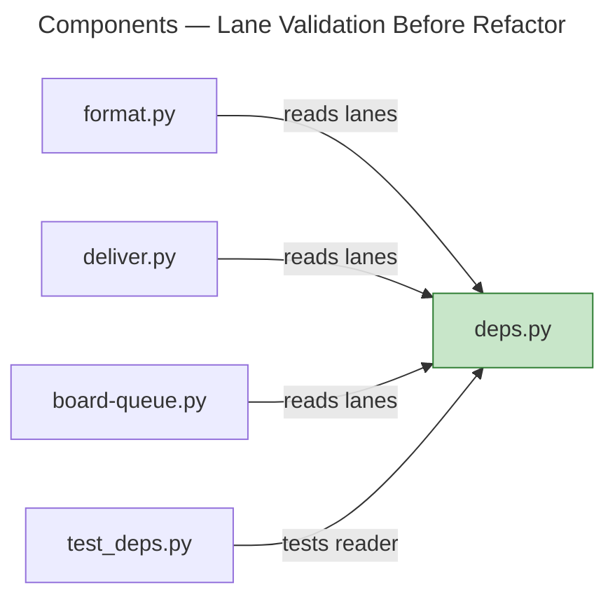
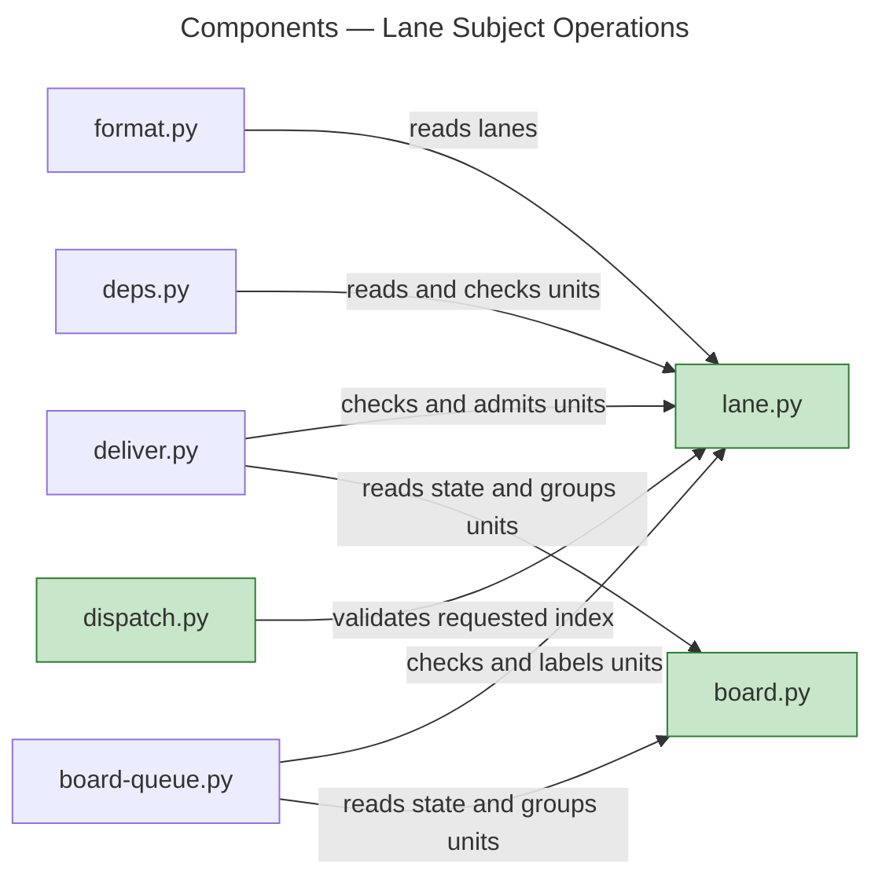
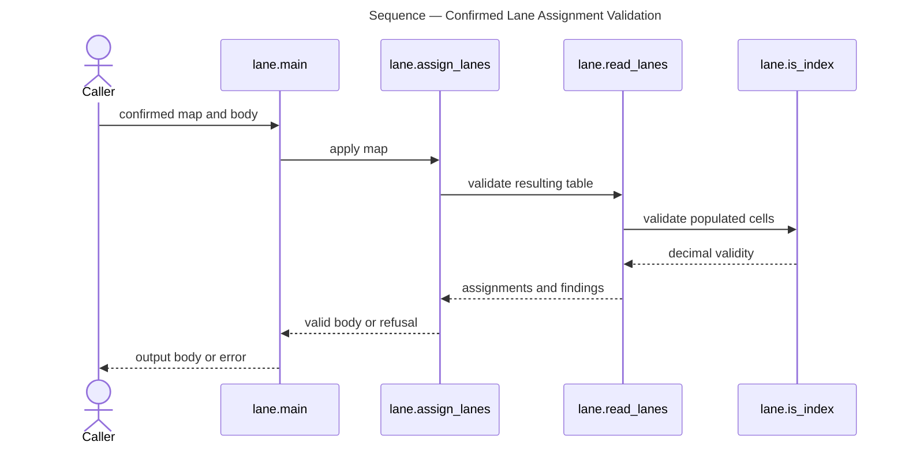

# Architecture Overview — Delivery Lanes

> architecture-overview · [m2ux/workflow-server#1627](https://github.com/m2ux/workflow-server/pull/1627) · 2026-11-05

## Summary

Task rows carry board-wide Lane indices, with one Lane artifact and module owning assignment, validation and admission. Queue/dependency/formatting consumers use that owner, and automatic dispatch receives only the survey’s Lane-admitted exports. The continuing coordinator retains its authorized scope and lane through capacity events, holds and refill.

## Structure

The exact-head graph measures 40 changed files, 263 changed symbols and 51 affected processes against the current workspace target. Five Lane/survey/batch contexts are checked and one ordered assignment trace is retained. The first diagram retains the historical pre-refactor Lane measurement; the subject diagram shows current production calls. Graph inference is supplementary to complete source comparison, byte/AST preservation and behavioral tests.

### Lane Ownership

- **Subject contract.**
  [Lane](https://github.com/m2ux/workflow-server/blob/1ebd241841fc5963743cb0440dfaeb97d9e9ab34/skills/work-planner/artifacts/lane.md#L1) defines index, assignment, unit consistency, admission and labels. The implementation depends only on standard-library values and files.
- **Body shape.**
  [Epic Issue Body](https://github.com/m2ux/workflow-server/blob/1ebd241841fc5963743cb0440dfaeb97d9e9ab34/skills/work-planner/artifacts/epic-issue-body.md#L130) owns the seven-column table with Lane after Joins and before Done, and delegates assignment.
- **Shared state.**
  [Board](https://github.com/m2ux/workflow-server/blob/1ebd241841fc5963743cb0440dfaeb97d9e9ab34/skills/work-planner/scripts/board.py#L467) supplies the row-state and unit grouping functions used by both consumers. Queue placement is independent of lane annotations.

## Behaviour

Current measured process `proc_68_main` orders lane.main → assign_lanes → read_lanes → is_index. Full CLI branching and export/batch composition are covered by observing integration tests.

### Confirmed Lane Assignment

- **Assignment.**
  Unknown rows and malformed resulting cells refuse output. Other body cells and line endings are preserved.
- **Admission.**
  Lane `02` differs from `2`; a request admits its matching units and unlaned units. A malformed unrelated row remains diagnostic without rejecting a healthy selected unit.

## What Changed

### Lane Operations

- **One owner.**
  Artifacts and consumers share the Lane rule home and executable operations; focused functions expose only the values each caller needs.
- **Current contracts.**
  The [PR Changes](https://github.com/m2ux/workflow-server/pull/1627) describes the full integration surface, including mode routing and table operations.

## Reading Order

1. [Lane contract](https://github.com/m2ux/workflow-server/blob/1ebd241841fc5963743cb0440dfaeb97d9e9ab34/skills/work-planner/artifacts/lane.md#L1) — subject fields and operations.
2. [Lane implementation](https://github.com/m2ux/workflow-server/blob/1ebd241841fc5963743cb0440dfaeb97d9e9ab34/skills/work-planner/scripts/lane.py#L1) — parsing, assignment, consistency and admission.
3. [Board state](https://github.com/m2ux/workflow-server/blob/1ebd241841fc5963743cb0440dfaeb97d9e9ab34/skills/work-planner/scripts/board.py#L467) — shared eligibility and grouping.
4. [Delivery](https://github.com/m2ux/workflow-server/blob/1ebd241841fc5963743cb0440dfaeb97d9e9ab34/skills/work-planner/scripts/deliver.py#L343) and [queue](https://github.com/m2ux/workflow-server/blob/1ebd241841fc5963743cb0440dfaeb97d9e9ab34/skills/work-planner/scripts/board-queue.py#L281) — caller policies and reports.
5. [Lane regressions](https://github.com/m2ux/workflow-server/blob/1ebd241841fc5963743cb0440dfaeb97d9e9ab34/skills/work-planner/test/test_lane.py#L1) — behavior and refusal cases.

## Risks and Watch Points

- **Graph limits.**
  The final analyzer reports 147 candidate entries dropped, 572 callees skipped and 21 walks cut by budget. Graph edges/traces are supplementary evidence; absence is not proof of no path. Complete source-diff inspection and behavioral suites establish the review scope. No claim of complete inferred flows is made.
- **Disclosure limits.**
  Fresh-context walks confirm report/validation contract reachability and supplied cases but do not complete broad pre-existing mode prerequisite closures. See the preserved failures and missing evidence in the disclosure record.
- **Merge boundary.**
  One approving human review is required under the active target rules before integration can merge.

## References

- **R1.** [Review](review.md) — complete guideline and SOLID dispositions.
- **R2.** [Measurements](graph-contexts.json) and [Measured Assignment Trace](graph-traces.json) — current relationship evidence and measured assignment trace, with analyzer limits in graph-analysis.log.
- **R3.** [Independent Reading Checks](review.md#independent-reading-checks) — independent observations and limits.
