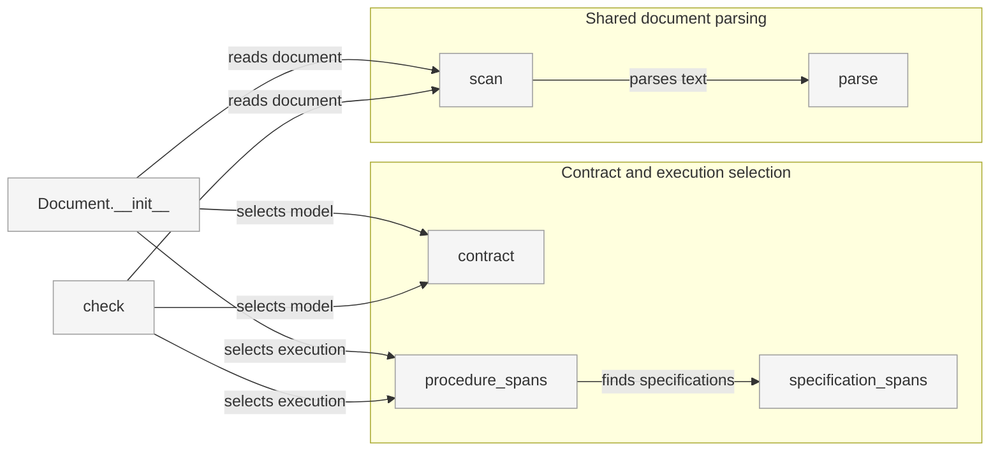
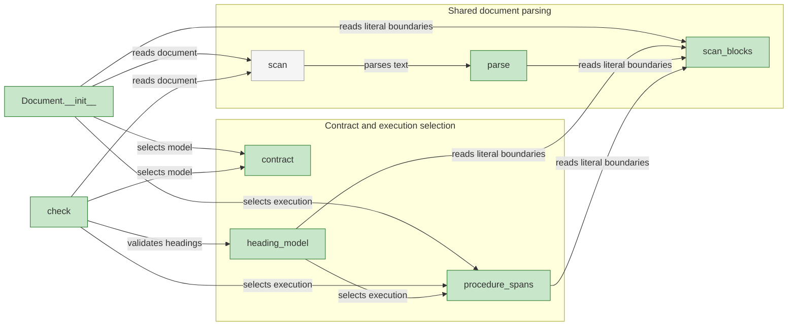
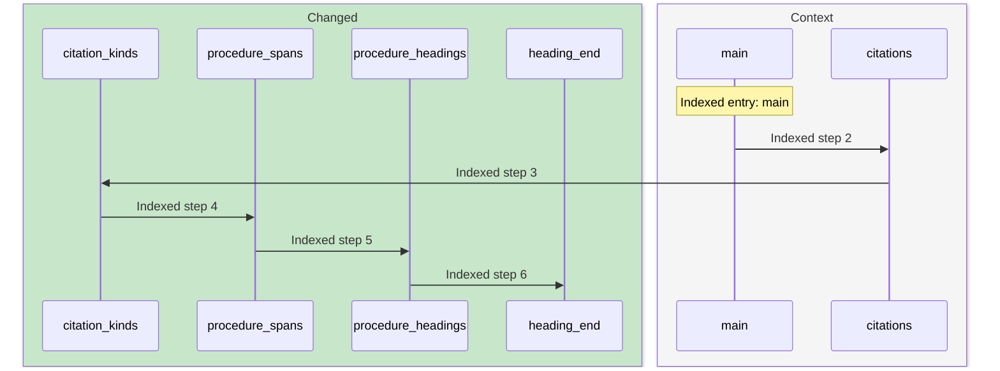

# Architecture Overview — Work Planner Skill Style

> architecture-overview · [m2ux/workflow-server#1641](https://github.com/m2ux/workflow-server/pull/1641) · 2026-11-05

## Summary

Work Planner expresses procedures as heading steps and links each consumed input and provided output to its Field in step prose. Markdown link titles identify input, output and callable operation roles; commands execute in their owning steps. Each skill's declarations select the shared checker model used by the converted corpus and its document readers.

## Symbol Notation

Symbol-notation revision `fbce2c7535b1518dd3ebb4dbe845b67576186d94` uses ○ input, ● output and ƒ for called operations, protocols and procedures. The diagrams and native graph archive below retain their explicit structural baseline `00ec0b9dd516cf6031d44c1ac2184ca95d1e0a01`; the [current verification](https://github.com/m2ux/workflow-server/blob/engineering/artifacts/planning/2026-11-05-1597-next-delivery/integration-validation.md) separately records the exact notation-preservation audit and final parser checks.

## Command Quoting

Current revision `eedc9a212ae38449a16638dc190b0e2f16d1a828` uses value-type shell quoting. The [command audit](https://github.com/m2ux/workflow-server/blob/engineering/artifacts/planning/2026-11-05-1597-next-delivery/command-quote-audit.json) records 114 argv-preserving quote removals. The measured structure below retains its stated baseline.

## Structure

The measured callers converge on contract selection, document parsing and execution-span selection. The diagrams group those shared responsibilities by their positive call relationships; they do not infer boundaries from folder names. Green marks changed elements and grey provides context.

### Before

The target revision's measured calls connect the checker and checkout reader to model selection and Markdown parsing; execution regions use command-specification spans.

### After

The integration adds a common lexical boundary for fences and HTML invocations. Declared heading validation and the checkout reader share it with execution-span selection.

### Shared Interpretation

- **[scan_blocks](https://github.com/m2ux/workflow-server/blob/00ec0b9dd516cf6031d44c1ac2184ca95d1e0a01/skills/scripts/check_skill_files.py#L210).**
  Owns fence and HTML boundaries so payload headings, brackets and sample links retain their literal role.
- **[contract](https://github.com/m2ux/workflow-server/blob/00ec0b9dd516cf6031d44c1ac2184ca95d1e0a01/skills/scripts/check_skill_files.py#L363).**
  Selects the exact-file or family declaration used by structural, citation and execution readers.
- **[heading_model](https://github.com/m2ux/workflow-server/blob/00ec0b9dd516cf6031d44c1ac2184ca95d1e0a01/skills/scripts/check_skill_files.py#L532).**
  Validates numbered headings, preambles, contract links and Apply/Follow routing for the selected model.

### Contextual Roles

The checker's link_roles validates role targets and operation_target recognizes callable procedures from declarations. The contextual-input readers reuse the same link parser while retaining independent command and checkout assertions. [Link Roles](https://github.com/m2ux/workflow-server/blob/00ec0b9dd516cf6031d44c1ac2184ca95d1e0a01/skills/work-planner/rules.md#link-roles) owns runtime meanings.

### Consuming Readers

- **[Document](https://github.com/m2ux/workflow-server/blob/00ec0b9dd516cf6031d44c1ac2184ca95d1e0a01/skills/work-planner/test/test_checkouts.py#L59).**
  Reads actual declarations, invocation boundaries and execution regions for checkout propagation checks.
- **[executable_scripts](https://github.com/m2ux/workflow-server/blob/00ec0b9dd516cf6031d44c1ac2184ca95d1e0a01/skills/work-planner/test/test_documents.py#L15).**
  Discovers scripts through cited executing operations; literal specimens and unexecuted invocations supply no coverage.

## Behaviour

The [flow atlas](https://github.com/m2ux/workflow-server/blob/engineering/artifacts/planning/2026-11-05-1597-next-delivery/integration-flow-atlas.md) contains one sequence diagram and pinned source references for each of the 37 reported affected processes; the following measured path illustrates the checker entry.

### Checker Entry to Heading Boundary

This indexed path starts at main and reaches the heading-boundary helper through the measured procedure-validation chain.

- **Measured order.**
  Exact process-membership rows establish the displayed order. These static paths describe indexed code relationships, with no claim that every branch runs in one invocation.

## What Changed

### Instruction Corpus

- **Callable procedures.**
  Heading steps and subject-owned operations give callers a stable execution home. Every callable link has the operation title; input and output links attach their role titles at natural prose uses, with Provide steps for results.
- **Common context.**
  Entry-point mode selection reaches rules and conventions; consumers reach deployed configuration at its owning sections.
- **Contained items.**
  Steps with multiple instruction or detail items bullet every item; a single item is plain text.

### Validation Model

- **Declared authority.**
  Work Planner's installed declarations select the model used by the ordinary checker and real-corpus tests.
- **Literal isolation.**
  Shared lexical spans keep payload text outside document structure while validating bold contract argument links.

The [pull request's Changes](https://github.com/m2ux/workflow-server/pull/1641) carries the functional change list. Its References retain the eight task pull requests.

## Reading Order

1. **[SKILL.md](https://github.com/m2ux/workflow-server/blob/00ec0b9dd516cf6031d44c1ac2184ca95d1e0a01/skills/work-planner/SKILL.md#L1)** — entry-point context and mode selection.
2. **[guidelines.md](https://github.com/m2ux/workflow-server/blob/00ec0b9dd516cf6031d44c1ac2184ca95d1e0a01/skills/work-planner/guidelines.md#L15)** — procedure, invocation and ownership contracts.
3. **[structure.json](https://github.com/m2ux/workflow-server/blob/00ec0b9dd516cf6031d44c1ac2184ca95d1e0a01/skills/work-planner/structure.json#L1)** — installed family and exact-file declarations.
4. **[board-delivery.md](https://github.com/m2ux/workflow-server/blob/00ec0b9dd516cf6031d44c1ac2184ca95d1e0a01/skills/work-planner/artifacts/board-delivery.md#L37)** — a representative operation with caller inputs and single/multiple item steps.
5. **[check_skill_files.py](https://github.com/m2ux/workflow-server/blob/00ec0b9dd516cf6031d44c1ac2184ca95d1e0a01/skills/scripts/check_skill_files.py#L197)** — shared lexical boundaries followed by declaration and heading validation.
6. **[test_documents.py](https://github.com/m2ux/workflow-server/blob/00ec0b9dd516cf6031d44c1ac2184ca95d1e0a01/skills/work-planner/test/test_documents.py#L15)** — installed-model operation, prerequisite and script-reach assertions.
7. **[test_checkouts.py](https://github.com/m2ux/workflow-server/blob/00ec0b9dd516cf6031d44c1ac2184ca95d1e0a01/skills/work-planner/test/test_checkouts.py#L60)** — execution discovery and transitive checkout propagation.

## Risks and Watch Points

- **Graph coverage.**
  The final index reports 308 total processes and 37 affected ones. It also reports 159 unranked candidate entries, 590 skipped callees and 21 budget-cut walks; an absent edge or process cannot establish that a path does not exist.
- **Evidence limits.**
  The current symbol-notation installed checker and both test suites pass. Six contextual-contract reading plans remain Partial for over-reading, prerequisite closure, truncation and receipt limits; the [verification record](https://github.com/m2ux/workflow-server/blob/engineering/artifacts/planning/2026-11-05-1597-next-delivery/integration-validation.md) preserves those boundaries.
- **Scope.**
  The migration covers Work Planner and its shared-checker support. Other skills' existing findings are outside its zero-finding gate.

## References

- **R1.** [Measured graph archive](https://github.com/m2ux/workflow-server/blob/engineering/artifacts/planning/2026-11-05-1597-next-delivery/integration-graph.tar.gz) — native responses, complete recovered symbols, exact flow memberships, paired freshness evidence and instruments.
- **R2.** [Parent graph audit](https://github.com/m2ux/workflow-server/blob/engineering/artifacts/planning/2026-11-05-1597-next-delivery/integration-graph-audit.json) — complete context and flow-order checks bound to the reviewed head and target.
- **R3.** [Agent review](https://github.com/m2ux/workflow-server/blob/engineering/artifacts/planning/2026-11-05-1597-next-delivery/integration-agent-review.json) — scope, criteria, validation and finding dispositions for the exact revision.
