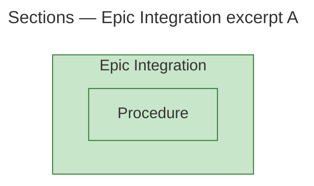

## Structure

This bounded excerpt shows the measured section containment of Epic Integration: it contains Procedure. The diagram uses the measured parent as its subgraph; nesting denotes CONTAINS, not a call or execution step. Both supplied sections are changed.

- **[Epic Integration](https://github.com/m2ux/workflow-server/blob/ff94f4a28ee0134a10f46ba571a9795f5e6841f1/skills/work-planner/protocols/epic-integration.md#L1).**
  Measured section N7; changed.
- **[Procedure](https://github.com/m2ux/workflow-server/blob/ff94f4a28ee0134a10f46ba571a9795f5e6841f1/skills/work-planner/protocols/epic-integration.md#L7).**
  Measured section N11; changed.

Two measured elements (one containing subgraph and one section node), one containment relation. No padding is needed. This is the requested structural excerpt, not a complete architecture overview or a functional diagram.
