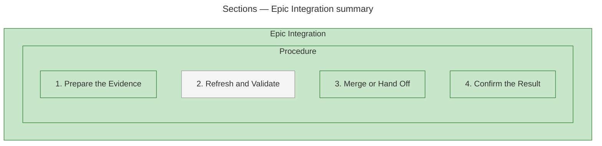
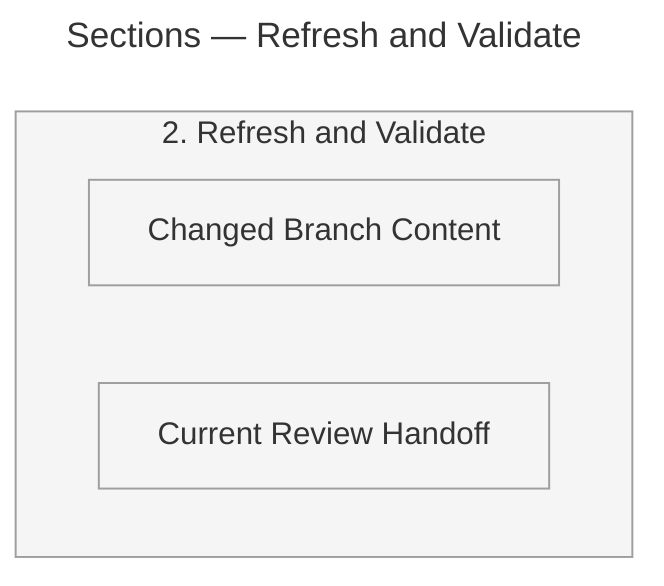
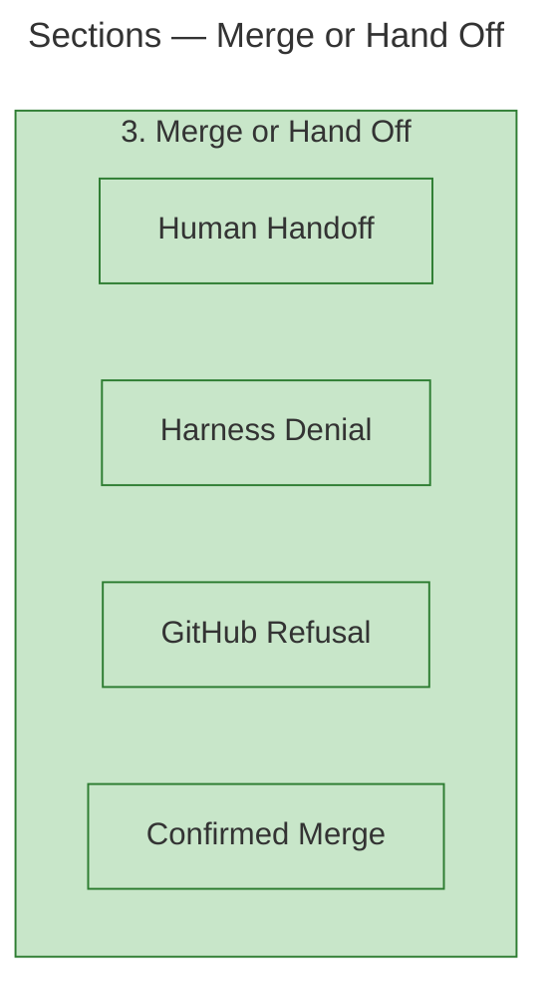

## Structure

The twelve measured sections form one containment tree. The excerpt splits at the measured Refresh and Validate and Merge or Hand Off sections: the summary shows Procedure's four direct sections; the details show the two branches with children. Nesting denotes CONTAINS, not execution order. Green marks changed sections; grey marks supplied untouched context.

Six measured elements, five containment relations. The numbers are source names; their visual arrangement asserts no production execution order.

Three measured elements, two containment relations.

Five measured elements, four containment relations. The two detail parents repeat their summary names and fills to locate each detail; no new measured element or relation is asserted. Together these views preserve all twelve unique supplied sections and eleven containment relations.

### Source Sections

- **[1. Prepare the Evidence](https://github.com/m2ux/workflow-server/blob/ff94f4a28ee0134a10f46ba571a9795f5e6841f1/skills/work-planner/protocols/epic-integration.md#L9).**
  Measured section N0; changed.
- **[2. Refresh and Validate](https://github.com/m2ux/workflow-server/blob/ff94f4a28ee0134a10f46ba571a9795f5e6841f1/skills/work-planner/protocols/epic-integration.md#L20).**
  Measured section N1; untouched context.
- **[3. Merge or Hand Off](https://github.com/m2ux/workflow-server/blob/ff94f4a28ee0134a10f46ba571a9795f5e6841f1/skills/work-planner/protocols/epic-integration.md#L48).**
  Measured section N2; changed.
- **[4. Confirm the Result](https://github.com/m2ux/workflow-server/blob/ff94f4a28ee0134a10f46ba571a9795f5e6841f1/skills/work-planner/protocols/epic-integration.md#L74).**
  Measured section N3; changed.
- **[Changed Branch Content](https://github.com/m2ux/workflow-server/blob/ff94f4a28ee0134a10f46ba571a9795f5e6841f1/skills/work-planner/protocols/epic-integration.md#L27).**
  Measured section N4; untouched context.
- **[Confirmed Merge](https://github.com/m2ux/workflow-server/blob/ff94f4a28ee0134a10f46ba571a9795f5e6841f1/skills/work-planner/protocols/epic-integration.md#L70).**
  Measured section N5; changed.
- **[Current Review Handoff](https://github.com/m2ux/workflow-server/blob/ff94f4a28ee0134a10f46ba571a9795f5e6841f1/skills/work-planner/protocols/epic-integration.md#L33).**
  Measured section N6; untouched context.
- **[Epic Integration](https://github.com/m2ux/workflow-server/blob/ff94f4a28ee0134a10f46ba571a9795f5e6841f1/skills/work-planner/protocols/epic-integration.md#L1).**
  Measured section N7; changed.
- **[GitHub Refusal](https://github.com/m2ux/workflow-server/blob/ff94f4a28ee0134a10f46ba571a9795f5e6841f1/skills/work-planner/protocols/epic-integration.md#L62).**
  Measured section N8; changed.
- **[Harness Denial](https://github.com/m2ux/workflow-server/blob/ff94f4a28ee0134a10f46ba571a9795f5e6841f1/skills/work-planner/protocols/epic-integration.md#L58).**
  Measured section N9; changed.
- **[Human Handoff](https://github.com/m2ux/workflow-server/blob/ff94f4a28ee0134a10f46ba571a9795f5e6841f1/skills/work-planner/protocols/epic-integration.md#L54).**
  Measured section N10; changed.
- **[Procedure](https://github.com/m2ux/workflow-server/blob/ff94f4a28ee0134a10f46ba571a9795f5e6841f1/skills/work-planner/protocols/epic-integration.md#L7).**
  Measured section N11; changed.

This is a bounded section-containment excerpt. The supplied evidence does not establish a production component dependency graph or a functional sequence.
