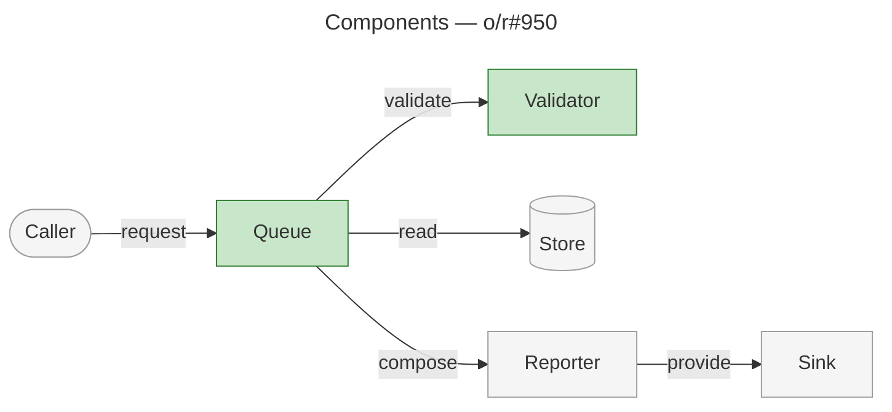
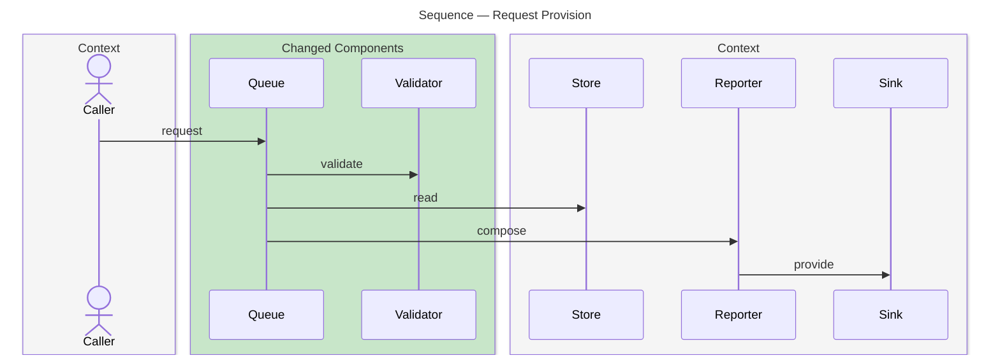

# Architecture Overview — o/r#950

> Outline from supplied evidence; base `main`; head `1111111111111111111111111111111111111111`.

## Summary

The change reaches Queue and Validator. Queue receives requests from Caller and invokes Validator before reading Store and composing through Reporter. Reporter provides the result to Sink.

## Structure

The measured graph contains six components. Queue and Validator are changed; Caller, Store, Reporter and Sink provide context. Architectural area membership was not supplied, so the outline does not invent area boundaries.

## Behaviour

The supplied flow begins with a request and ends with provision to Sink.

- **Request.**
  Caller submits the request to Queue.
- **Validation.**
  Queue invokes Validator.
- **Read.**
  Queue reads Store.
- **Composition.**
  Queue invokes Reporter to compose.
- **Provision.**
  Reporter provides to Sink.

## What Changed

- **Queue.**
  Supplied evidence marks Queue as changed. Its precise behavioral delta requires the diff; the flow establishes its current relationships only.
- **Validator.**
  Supplied evidence marks Validator as changed. Its precise behavioral delta requires the diff.

## Reading Order

1. **[src/queue.py](https://github.com/o/r/blob/1111111111111111111111111111111111111111/src/queue.py#L10-L40)** — start at the request receiver and its outgoing interactions.
2. **[src/validator.py](https://github.com/o/r/blob/1111111111111111111111111111111111111111/src/validator.py#L5-L25)** — inspect the validation invoked by Queue.

## Current and Stale Evidence Continuations

- **Current supplied evidence.**
  The named PR, verified head, matching detached checkout and fresh measurements permit the writing step. Reuse the existing record identity, read its README, retain its creation date and other artifacts/links, and prepare `architecture-overview.md` there. Replace the prior overview and retain one inventory row plus the PR link.
- **Missing or behind index.**
  Run Index Status in the review checkout. Index an absent or behind index for the verified head and confirm freshness before measuring the surface against `main`, changed-symbol contexts and the ordered flow trace.
- **Stale response.**
  Inspect every response's staleness block. Discard stale measurements, index for the verified head, confirm freshness, and repeat the discarded Change Surface with the same `main` base, affected Symbol Context and affected Flow Trace calls. An unresolved freshness issue returns a blocker before writing.
- **Changed head or revision.**
  Read the same PR state again, rebuild the detached-worktree evidence at the newly verified head, then repeat measurement. A worktree mismatch cannot proceed to authoring.
- **Registration and publication.**
  Once authorized, register the overview in the existing record, publish the record, then use the current PR body to retain or add the Architecture Overview References row and publish the complete body. This exercise stops at the outline.

## Completion Gaps

- **Record and title.**
  The existing folder path, its README, and the PR title were not supplied; a final destination and populated heading cannot be asserted.
- **Architectural areas.**
  Area membership was not supplied. The final structural diagram requires measured areas/subgraphs; the flat six-component outline preserves only the relationships provided.
- **Behavioral delta.**
  The diff and detailed symbol evidence were not supplied. The outline does not invent a before-state or claim validation semantics beyond the measured interactions.
- **References row.**
  The final row is `- **R<n>.** [Architecture Overview](https://github.com/o/r/tree/engineering/artifacts/planning/<existing-record>/architecture-overview.md) — the change's structure, its flows, and the order to read the diff.` Its number must retain any existing row or fit the current body.
