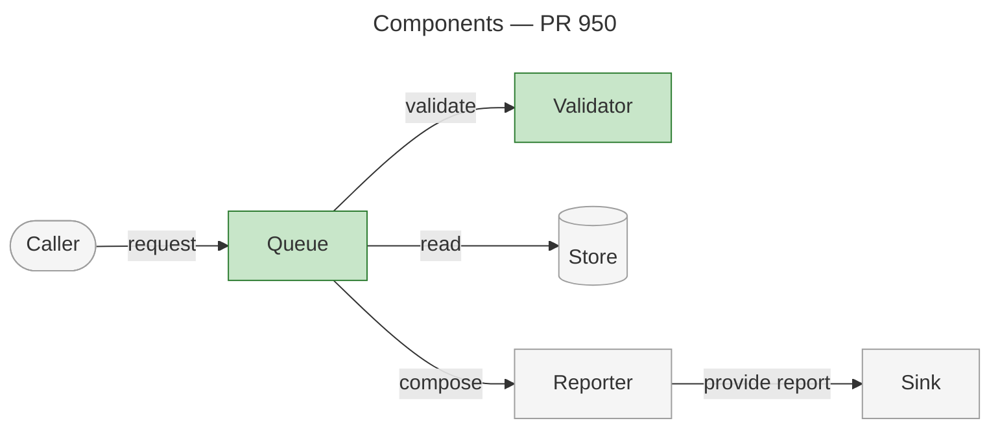
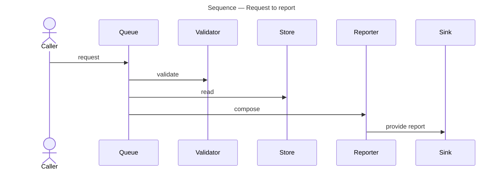

# Offline Understand consumer — o/r#950

Supplied scenario: https://github.com/o/r/pull/950, verified head `1111111111111111111111111111111111111111`, base `main`, matching detached checkout, fresh graph. This is an outline and continuation. No GitHub, graph services, repository mutation or publication occurred.

## Evidence and diagram sources

- **Identity and checkout.**
  Read Pull Request State supplies identity/title/base/head/changed paths. Create Pull Request Worktree supplies the matching detached review checkout. Reuse also requires clean tracked/untracked status; that condition is not explicitly supplied.
- **Structure.**
  Measure Repository Change supplies component relationships and symbol locations against `main`. Six measured components are Caller, Queue, Validator, Store, Reporter and Sink. Queue and Validator change. Directory layout cannot establish component-area boundaries.
- **Behaviour.**
  Use the supplied graph order: Caller→Queue request; Queue→Validator validate; Queue→Store read; Queue→Reporter compose; Reporter→Sink provide report. Raw graph flow entries carry `process_symbols`, `step_index`, file and lines. Do not invent returns, validation branches or a manually traced order.
- **Code.**
  Supplied source locations are queue lines 10–40 and validator lines 5–25 at the full verified head. Actual symbol names and product behavior remain unspecified.

## Overview outline

Destination: `<existing-record-folder>/architecture-overview.md`. Reuse this PR's existing record identity. Resolve its real title and folder; do not invent a dated slug. Target about 200 lines including diagrams, for an engineer unfamiliar with the repository. Use code names exactly and define coined terms on first use. Parallel items use bold leads with their explanation on the following line.

### Summary — required

At most three sentences stating the change, its location and what it enables. Queue and Validator are established changed components; the actual product effect needs source/diff evidence.

### Structure — required

One placement paragraph, structural diagram, and descriptions grouped by measured area. The following bounded diagram uses only supplied relationships. Final component diagrams use measured area subgraphs; area membership is missing here, so the draft remains flat rather than inventing groups.



Six elements meets the five-to-ten rule. Changed elements have distinct green fill; context is grey. Preserve names and fills across every diagram. Every edge names its interaction and points with data/control travel. Shape conventions: module `[name]`, store `[(name)]`, process boundary `[[name]]`, actor `([name])`. Caller/Store roles above follow their conventional labels and need confirmation; Sink is not assumed external.

### Behaviour — required

One introductory sentence, one subsection per measured flow, a sentence naming trigger/result, its sequence, then supported step explanations. One flow is supplied:



This sequence draft preserves measured order and names. Bare sequence syntax above does not implement per-participant fill: final rendering must satisfy the same Queue/Validator green and context grey rule before declaring styling complete. Actual step conditions require evidence.

A class diagram substitutes for components only when the change sits in one area and lands in types. Add a state diagram for a changed lifecycle, or before/after diagrams for rearranged structure/reordered flow. No such trigger is established here. Additional diagrams displace prose.

### What Changed — required

Group Queue and Validator's supported current behavior by measured area. Link the PR Changes section rather than reproduce its change-by-change inventory. Detailed behavior is not supplied.

### Reading Order — required

Read from the changed entry point outward; omit incidental files.

1. **[src/queue.py](https://github.com/o/r/blob/1111111111111111111111111111111111111111/src/queue.py#L10-L40)** — Queue receives the measured request and calls Validator, Store and Reporter.
2. **[src/validator.py](https://github.com/o/r/blob/1111111111111111111111111111111111111111/src/validator.py#L5-L25)** — Follow the validation interaction into the other changed component.

All code references use the complete reviewed head and line anchors, directly on the words they support. Branch-based or abbreviated-SHA code links do not qualify. The overview's engineering-branch URL serves a different purpose.

### Risks and Watch Points — conditional

Include only supported risks and locations; delete when empty. Missing fixture data is a verification limitation, not a product risk.

### References — conditional

Include useful supported links; delete when empty. The completed header carries the actual change title, PR link and date.

## Fresh-evidence continuation — planned, not executed

1. Reuse the supplied matching-head and fresh graph evidence for this outline. A live run obtains actual PR title/product effect, explicit clean detached status, measured area grouping, raw symbol/flow identities and source details from the designated evidence operations.
2. Locate the existing overview record for PR 950. Read its README; retain folder identity, creation date, other artifacts and links. Select Populate Planning Record's Existing Record branch and update only supplied content. Records live under `artifacts/planning/` on `engineering`, in its existing long-lived worktree. No actual folder/README is supplied.
3. Complete the template and validate Fields, Diagrams, Code References and Pull Request Head requirements. Retain `<existing-record-folder>/architecture-overview.md`.
4. Apply Populate Planning Record with the existing identity/folder, overview file and PR URL. Register this overview once in Artifacts; put the PR under Links. Preserve other rows/content. A repeat replaces this PR's overview within the same record.
5. Apply Publish Planning Record: Find Engineering Worktree, then Commit Planning Record. The installed command stages the shared engineering worktree, commits when needed using an external message file, fetches/rebases `origin/engineering`, then uses plain `git push`. Confirm this record's files reached the remote; report/stop on rebase conflict. Planning records take no PR. None of this runs offline.
6. Use the complete current PR body and published overview URL. Preserve an existing Architecture Overview row; otherwise allocate an unused reference identifier and add it in References at template position after Overview, Changes, Test Plan and optional Open Questions. Preserve unrelated content; save the complete updated body outside the repository.
7. Example row only; actual folder and identifier remain unresolved:

   `- **R1.** [Architecture Overview](https://github.com/o/r/tree/engineering/artifacts/planning/<existing-record-folder-name>/architecture-overview.md) — the change's structure, its flows, and the order to read the diff.`

8. Apply Publish Pull Request with the complete body file, selecting only the existing PR body PATCH. Read Pull Request State again to verify the saved body. Return PR, actual record folder, published overview, diagrams and exact References row. Publication/readback are not claimed here.

## Stale-evidence continuation — planned, not executed

Discard measurements from every behind response. Return unresolved freshness blockers before writing an overview. Do not substitute manual call order or directory grouping.

Before measuring again, select the review checkout and its revision/status checks:

```bash
git -C '<review-checkout>' rev-parse 'HEAD^{commit}'
git -C '<review-checkout>' status --porcelain --branch
```

Require the full supplied head, detached HEAD, and no tracked/untracked changes. If revision/PR head changes, Read Pull Request State again and Create Pull Request Worktree for the new verified head before rebuilding measurements. The online operation selects `gh api repos/o/r/pulls/950`, `git fetch origin pull/950/head`, and resolution of `FETCH_HEAD^{commit}` to compare against the verified head. Retain dirty/mismatched review checkouts and choose an unused commit-suffixed path. These are selected commands, not offline calls.

In the verified review checkout:

```bash
gitnexus status
gitnexus analyze
gitnexus status
gitnexus detect-changes --scope compare --base-ref 'main'
gitnexus context '<changed-symbol-identity-from-surface>'
gitnexus query --query '<reported-flow-identity-from-surface>' --limit 1
```

- **Freshness.**
  An absent/behind index requires analyze. Confirm indexed commit/worktree match the requested full head, then inspect the JSON `staleness` block on every measurement response.
- **Replay.**
  Repeat discarded Change Surface against the same base `main`, Symbol Context for each affected changed symbol, and Flow Trace for each affected reported flow. Component labels Queue/Validator are not established CLI symbol identities; obtain identities from the new surface. Do not invent a flow query identity.
- **Further staleness.**
  Discard affected results again; refresh/replay or return a blocker. A changed revision requires refreshed PR and review-checkout evidence.
- **Record/link resume.**
  Once measurements are fresh, follow the same record continuation: reuse the record, replace this overview, register it, publish planning files, preserve/add the Architecture Overview row through a complete body file, verify saved PR state, and return exact links. Staleness does not create a new record/reference.

## Missing context, separate from correctness

Missing actual title/product effect, record identity/path/README, complete current PR body/reference identifiers, explicit checkout cleanliness, measured area membership, raw symbol/flow identities/locations, source contents, and final render evidence for consistent fill. These limit a publishable overview; they do not prevent this requested bounded outline and continuation. No fixture values are presented as live verification.
