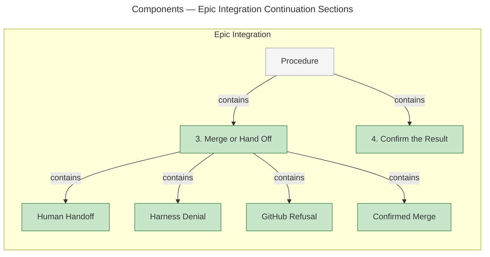
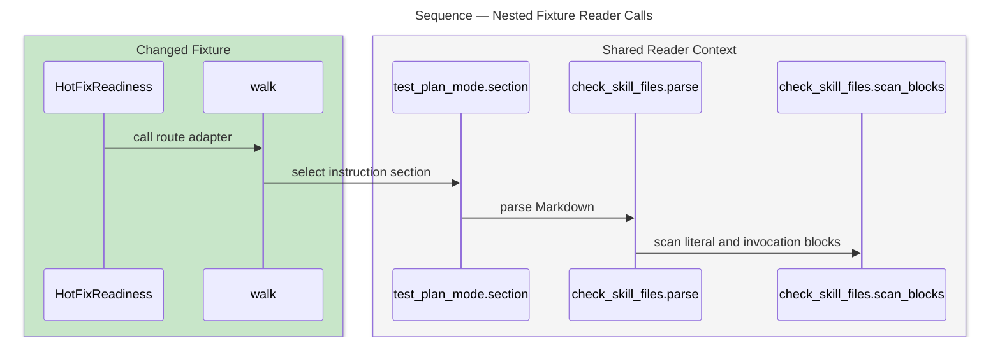
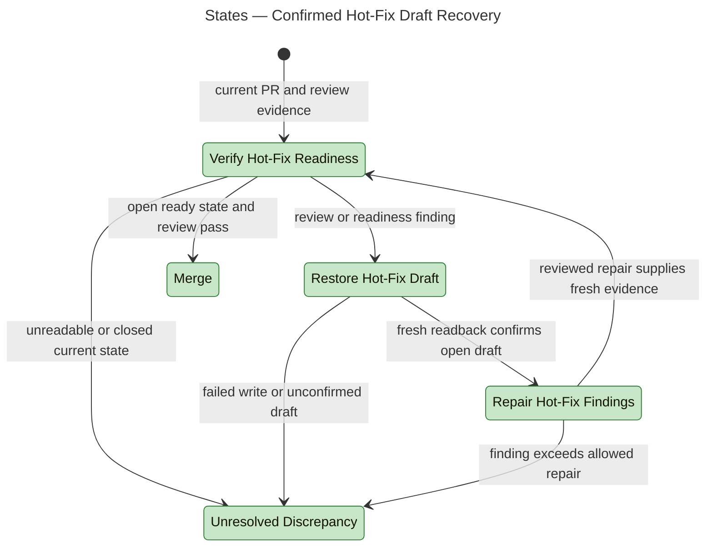

# Architecture Overview — Delivery Failure Recovery

> architecture-overview · [m2ux/workflow-server#1660](https://github.com/m2ux/workflow-server/pull/1660) · 2026-11-06

## Summary

Work Planner confirms draft state before repairing a hot-fix readiness failure and gives merge attempts explicit terminal outcomes. The change sits in the delivery instructions, their shared pull-request operations and the epic integration protocol. Each merge command submits the verified commit SHA, so a moved head cannot silently supply different content.

## Structure

Three instruction owners divide the work: Deliver Mode handles hot-fix readiness, Pull Request owns merge authorization and outcomes, and Epic Integration handles the outcome's continuation. The graph below shows the measured section structure of that continuation; `contains` denotes document ownership, not a call or a state transition.

The seven nodes and six edges come directly from the indexed Markdown `CONTAINS` relationships. The diagram selects the changed merge continuation and its containing Procedure, rather than asserting a complete inventory of the protocol. [Measurement details](measurements.md#section-structure) retain their exact graph identities.

### Delivery Instructions

- **Deliver Mode.**
  [Verify Hot-Fix Readiness](https://github.com/m2ux/workflow-server/blob/ff94f4a28ee0134a10f46ba571a9795f5e6841f1/skills/work-planner/modes/deliver-mode.md#L226-L243) accepts only open, ready metadata with current passing review evidence. Its [restoration route](https://github.com/m2ux/workflow-server/blob/ff94f4a28ee0134a10f46ba571a9795f5e6841f1/skills/work-planner/modes/deliver-mode.md#L245-L258) uses fresh state before selecting a draft write and confirming its result.
- **Pull Request.**
  [Merge Delivery Pull Request](https://github.com/m2ux/workflow-server/blob/ff94f4a28ee0134a10f46ba571a9795f5e6841f1/skills/work-planner/artifacts/pull-request.md#L7-L45) owns target review requirements, mutation selection, classified results and merge confirmation. Task and epic mutations both carry the verified head.
- **Epic Integration.**
  [Merge or Hand Off](https://github.com/m2ux/workflow-server/blob/ff94f4a28ee0134a10f46ba571a9795f5e6841f1/skills/work-planner/protocols/epic-integration.md#L48-L78) consumes the classified result. Its named branches distinguish terminal handoff and denial from a GitHub refusal eligible for one fresh-verification retry.

### Observing Fixtures

- **Hot-fix adapter.**
  [`walk`](https://github.com/m2ux/workflow-server/blob/ff94f4a28ee0134a10f46ba571a9795f5e6841f1/skills/work-planner/test/test_hotfix_readiness.py#L71-L136) reads the selected instruction clauses and records captured tracker calls. The fixture's tracker invokes the installed agent-review validator for review evidence.
- **Merge adapter.**
  [`Instructions`](https://github.com/m2ux/workflow-server/blob/ff94f4a28ee0134a10f46ba571a9795f5e6841f1/skills/work-planner/test/test_merge_outcomes.py#L39-L157) reads the owner and caller branches. Its mutation adapter renders the documented command and runs it against a local `gh` double that captures the submitted SHA.
- **Catalogue.**
  [Document coverage](https://github.com/m2ux/workflow-server/blob/ff94f4a28ee0134a10f46ba571a9795f5e6841f1/skills/work-planner/test/test_readme.py#L183-L220) includes a test module's document subjects even when it also imports an executable script.

## Behaviour

The verification sequence below is a measured nested fixture call path; the hot-fix state diagram describes the source-defined delivery continuation separately.

### Nested Fixture Reader Calls

The [`HotFixReadiness.test_changed_head_after_ready_restores_before_repair` fixture](https://github.com/m2ux/workflow-server/blob/ff94f4a28ee0134a10f46ba571a9795f5e6841f1/skills/work-planner/test/test_hotfix_readiness.py#L155-L162) enters the route adapter, which obtains real instruction sections through the shared Markdown reader.

- **Measured order.**
  Each arrow is an indexed `CALLS` edge on one nested path. Nesting establishes entry order along that path; the diagram selects no order between sibling calls and claims no complete test execution trace. [Path identities](measurements.md#nested-fixture-path) identify the four measured edges.
- **Source received.**
  The [shared section reader](https://github.com/m2ux/workflow-server/blob/ff94f4a28ee0134a10f46ba571a9795f5e6841f1/skills/work-planner/test/test_plan_mode.py#L25-L40) excludes literal specimens and scopes a read to its actual heading. The [Markdown parser](https://github.com/m2ux/workflow-server/blob/ff94f4a28ee0134a10f46ba571a9795f5e6841f1/skills/scripts/check_skill_files.py#L259-L267) distinguishes headings from command payload.
- **Verification boundary.**
  This sequence explains executable fixture infrastructure. It is not a measured production-agent sequence, a live tracker write or a claim that the adapter executes arbitrary prose.

### Hot-Fix Readiness States

These states and transitions are a source-derived view of [readiness and restoration](https://github.com/m2ux/workflow-server/blob/ff94f4a28ee0134a10f46ba571a9795f5e6841f1/skills/work-planner/modes/deliver-mode.md#L226-L258); they are not GitNexus process measurements.

- **Readback governs repair.**
  A request to restore draft supplies no draft-success claim. The route requires fresh confirmation, including a read after a failed restoration write, and retains unresolved discrepancies before repair or merge.
- **Merge outcomes govern integration.**
  A human handoff or harness denial terminates the current merge attempt. A GitHub refusal withdraws readiness and permits at most one retry after fresh evidence; only confirmed merge reaches success readback.
- **Exact commit governs mutation.**
  The [task command](https://github.com/m2ux/workflow-server/blob/ff94f4a28ee0134a10f46ba571a9795f5e6841f1/skills/work-planner/artifacts/pull-request.md#L326-L341) and [epic command](https://github.com/m2ux/workflow-server/blob/ff94f4a28ee0134a10f46ba571a9795f5e6841f1/skills/work-planner/artifacts/pull-request.md#L361-L375) submit the verified commit SHA. A moved head returns refusal evidence for fresh verification.

## What Changed

### Recovery Contracts

- **Observed state.**
  Draft restoration and merge completion are confirmed against current metadata; unresolved responses remain explicit failures.
- **Bounded continuation.**
  Recovery follows the owning result contract, retaining the existing person-review and harness permission boundaries.

### Verification Surface

- **Executable observations.**
  Two bounded fixture adapters observe selected calls, command arguments and terminal states. Source-removal controls distinguish the installed route from an expected trace alone.
- **Review evidence.**
  [The PR's Test Plan](https://github.com/m2ux/workflow-server/pull/1660) links the task evidence and combined validation; the change-by-change inventory remains in its Changes section.

## Reading Order

1. **[Deliver Mode](https://github.com/m2ux/workflow-server/blob/ff94f4a28ee0134a10f46ba571a9795f5e6841f1/skills/work-planner/modes/deliver-mode.md#L218-L265)** — start at the hot-fix readiness failure and its draft-restoration continuation.
2. **[Pull Request](https://github.com/m2ux/workflow-server/blob/ff94f4a28ee0134a10f46ba571a9795f5e6841f1/skills/work-planner/artifacts/pull-request.md#L7-L45)** — read the shared authorization, outcome and confirmation contract, then its SHA-bound commands.
3. **[Epic Integration](https://github.com/m2ux/workflow-server/blob/ff94f4a28ee0134a10f46ba571a9795f5e6841f1/skills/work-planner/protocols/epic-integration.md#L48-L78)** — follow the caller's terminal and bounded-retry branches.
4. **[Hot-Fix Fixtures](https://github.com/m2ux/workflow-server/blob/ff94f4a28ee0134a10f46ba571a9795f5e6841f1/skills/work-planner/test/test_hotfix_readiness.py#L71-L226)** — inspect the selected operations and draft/readback fault cases.
5. **[Merge Fixtures](https://github.com/m2ux/workflow-server/blob/ff94f4a28ee0134a10f46ba571a9795f5e6841f1/skills/work-planner/test/test_merge_outcomes.py#L39-L279)** — inspect captured mutation arguments and the owner/caller refusal cases.

## Risks and Watch Points

- **Graph coverage.**
  The fresh index reports 102 changed symbols across seven files and zero affected processes. Its process analysis is capped, so this does not establish absence of behavior; the overview uses measured containment and nested fixture calls, not a reconstructed production-agent flow.
- **Adapter scope.**
  The fixture executors recognize the instruction forms they test. Independent reader evidence and source review address agent interpretation; local fixtures do not establish real GitHub or harness outcomes.
- **Moving evidence.**
  This overview is pinned to `ff94f4a28ee0134a10f46ba571a9795f5e6841f1` against `9a924cfdda903ca64257449d8b5bf2ff762725ce`. A changed PR tip requires refreshed measurements and review evidence.

## References

- **R1.** [Draft Recovery PR](https://github.com/m2ux/workflow-server/pull/1657) — draft restoration and its observing fixtures.
- **R2.** [Merge Outcomes PR](https://github.com/m2ux/workflow-server/pull/1658) — exact-head mutations and merge continuation.
- **R3.** [Measurements](measurements.md) — graph freshness, exact identities, diagram edge checks and coverage limits.
