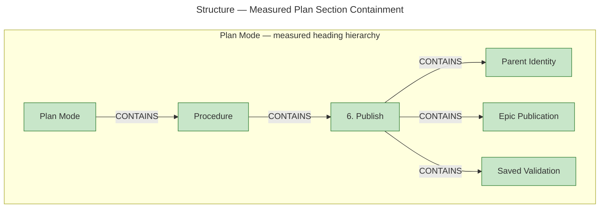
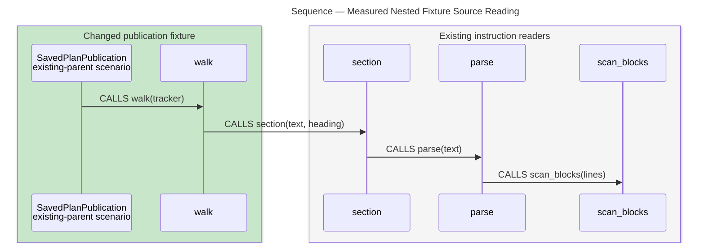

# Architecture Overview — Confirmed Plan Publication

> architecture-overview · [m2ux/workflow-server#1662](https://github.com/m2ux/workflow-server/pull/1662) · 2026-11-06

## Summary

Plan Mode publishes new or revised epics under either an existing or a new initiative, then validates the freshly saved parent and every linked epic. Confirmed issue identities connect dependent drafts and complete parent rows; failed saves or disagreeing readbacks stop preparation. This change lives in the skill's instructions, with captured publication scenarios providing offline verification.

## Structure

The measured structural boundary is the Plan document's section hierarchy. GitNexus records the following six changed headings and their `CONTAINS` relationships; the diagram describes ownership within the instruction document, rather than a set of running services. The separate fixture module reads those instructions and checks saved issue bodies.

Green marks added or altered graph symbols. In a document symbol, alteration includes a changed descendant; the root headings remain structural owners of the changed content. Every drawn edge is present in the [raw containment measurement](containment.json).

### Publication Ownership

- **Parent Identity.**
  The [parent stage](https://github.com/m2ux/workflow-server/blob/581c525137d0779649ad97e89370bafbde927d34/skills/work-planner/modes/plan-mode.md#L68-L73) creates a parent only for a new initiative and retains an existing parent's identity.

- **Epic Publication.**
  The [publication stage](https://github.com/m2ux/workflow-server/blob/581c525137d0779649ad97e89370bafbde927d34/skills/work-planner/modes/plan-mode.md#L75-L86) uses confirmed identities in prerequisite links, dependent drafts and complete parent rows.

- **Saved Validation.**
  The [saved-context stage](https://github.com/m2ux/workflow-server/blob/581c525137d0779649ad97e89370bafbde927d34/skills/work-planner/modes/plan-mode.md#L88-L99) obtains fresh parent and sibling records before body, goal and dependency checks.

### Verification Surface

- **Tracker.**
  The [captured tracker](https://github.com/m2ux/workflow-server/blob/581c525137d0779649ad97e89370bafbde927d34/skills/work-planner/test/test_plan_publication.py#L23-L134) stores concrete saved identities and bodies, records operations, and injects save/readback faults.

- **walk.**
  The [bounded route adapter](https://github.com/m2ux/workflow-server/blob/581c525137d0779649ad97e89370bafbde927d34/skills/work-planner/test/test_plan_publication.py#L137-L234) selects supported clauses and linked operations from the installed publication sections.

- **SavedPlanPublication.**
  The [scenario class](https://github.com/m2ux/workflow-server/blob/581c525137d0779649ad97e89370bafbde927d34/skills/work-planner/test/test_plan_publication.py#L237-L354) observes identity flow, parent/sibling context and terminal failures, including source-mutation controls.

## Behaviour

The publication procedure and its verification have different evidence: source instructions define the publication lifecycle, while indexed calls establish the nested fixture-reading sequence below.

### Confirmed Publication

This is the source-defined publication contract, not a GitNexus Process trace. An initiative is the parent issue; its Work Breakdown lists the epic issues that deliver it.

- **Retain or create the parent.**
  An existing initiative retains its issue identity. A new initiative receives an initial save containing temporary epic links; a failed or disagreeing save stops further publication. See [Parent Identity](https://github.com/m2ux/workflow-server/blob/581c525137d0779649ad97e89370bafbde927d34/skills/work-planner/modes/plan-mode.md#L68-L73).

- **Publish the intended epics.**
  Each new or revised epic saves in dependency order. Its confirmed identity supplies the parent row and dependent drafts, and an existing epic keeps its identity. See [epic saves and identity substitution](https://github.com/m2ux/workflow-server/blob/581c525137d0779649ad97e89370bafbde927d34/skills/work-planner/modes/plan-mode.md#L77-L82).

- **Confirm the complete parent.**
  Once epic placeholders are resolved, either parent path saves the complete intended parent rows. A failed final-parent save stops before saved validation or preparation. See [parent publication](https://github.com/m2ux/workflow-server/blob/581c525137d0779649ad97e89370bafbde927d34/skills/work-planner/modes/plan-mode.md#L84-L86).

- **Validate fresh saved context.**
  The parent and every epic its saved table names supply body, goal and dependency checks. Unreadable or disagreeing context stops before validation; unresolved findings prevent preparation. See [Saved Validation](https://github.com/m2ux/workflow-server/blob/581c525137d0779649ad97e89370bafbde927d34/skills/work-planner/modes/plan-mode.md#L88-L99).

- **Preserve identities during correction.**
  Findings return to the affected drafts and repeat publication and saved validation with the same saved issue identities. This preserves the distinction between a confirmed partial save and a coherent published plan. See the [correction continuation](https://github.com/m2ux/workflow-server/blob/581c525137d0779649ad97e89370bafbde927d34/skills/work-planner/modes/plan-mode.md#L96-L99).

### Measured Nested Fixture Reading

The existing-parent scenario's indexed call path reaches the shared Markdown block scanner through four actual `CALLS` edges. This sequence shows static caller nesting in the verification code; it is not a runtime timeline, production publication trace or ordering claim about sibling calls.

- **Scenario entry.**
  `SavedPlanPublication.test_existing_parent_saves_epic_then_parent_then_reads_before_validation` calls `walk` in the [existing-parent test](https://github.com/m2ux/workflow-server/blob/581c525137d0779649ad97e89370bafbde927d34/skills/work-planner/test/test_plan_publication.py#L238-L249).

- **Selected instruction sections.**
  `walk` uses the existing [section reader](https://github.com/m2ux/workflow-server/blob/581c525137d0779649ad97e89370bafbde927d34/skills/work-planner/test/test_plan_mode.py#L25-L40) to obtain the publication clauses it can interpret.

- **Markdown parsing.**
  `section` calls the shared [`parse`](https://github.com/m2ux/workflow-server/blob/581c525137d0779649ad97e89370bafbde927d34/skills/scripts/check_skill_files.py#L259-L267), whose call to [`scan_blocks`](https://github.com/m2ux/workflow-server/blob/581c525137d0779649ad97e89370bafbde927d34/skills/scripts/check_skill_files.py#L216-L256) identifies fences and invocation blocks.

- **Measured path.**
  The [raw path result](nested-fixture-path.json) contains exactly one matching four-edge chain. Each edge is a static `CALLS` relation with confidence `0.85`; no return edge, timing measurement or inferred tracker dispatch is drawn.

## What Changed

### Plan Publication

- **One publication route.**
  New and existing parents share epic saving, confirmed identity substitution, complete parent publication and fresh saved-context validation. The owning Issue capability retains responsibility for the actual save and readback comparison.

- **Explicit terminal boundaries.**
  Publication failures stop the dependent continuation with their observed evidence. A successful write response alone does not supply a matching saved body.

### Observing Evidence

- **Concrete saved context.**
  Captured scenarios exercise new/existing parents, dependent epics, existing epic identities and unaffected siblings. Actual installed formatter/dependency checks receive the saved issue set.

- **Failure and mutation controls.**
  Injected save/read failures stop preparation. Removing a required epic save, parent save or fresh read from source prevents a successful fixture result.

The [PR Changes section](https://github.com/m2ux/workflow-server/pull/1662) carries the change listing; the [task verification record](https://github.com/m2ux/workflow-server/blob/engineering/artifacts/planning/2026-11-06-1655-i17-e05-w01-confirm-epic-and-parent/validation.md) carries criterion and regression evidence.

## Reading Order

1. **[Plan Mode: Publish](https://github.com/m2ux/workflow-server/blob/581c525137d0779649ad97e89370bafbde927d34/skills/work-planner/modes/plan-mode.md#L61-L99)** — start with the parent/epic publication boundary and saved-context gates.
2. **[Issue: Save Tracker Issue](https://github.com/m2ux/workflow-server/blob/581c525137d0779649ad97e89370bafbde927d34/skills/work-planner/artifacts/issue.md#L23-L57)** — see the existing owner of writes, saved-field comparison and confirmed identity results.
3. **[Publication fixtures](https://github.com/m2ux/workflow-server/blob/581c525137d0779649ad97e89370bafbde927d34/skills/work-planner/test/test_plan_publication.py#L23-L354)** — inspect the captured tracker, bounded interpreter and observing scenarios together.
4. **[Section reader](https://github.com/m2ux/workflow-server/blob/581c525137d0779649ad97e89370bafbde927d34/skills/work-planner/test/test_plan_mode.py#L25-L40)** — follow the measured nested reading dependency used by the fixture.
5. **[Shared block parser](https://github.com/m2ux/workflow-server/blob/581c525137d0779649ad97e89370bafbde927d34/skills/scripts/check_skill_files.py#L216-L267)** — understand how literal examples are kept separate from instruction headings and invocations.

## Risks and Watch Points

- **Partial publication.**
  A failed parent save can follow successful child saves. The failure report must preserve observed identities and uncertainty about remote side effects; the procedure specifies no automatic rollback.

- **Bounded verification.**
  The fixture adapter recognizes these publication clauses. It is not an interpreter for arbitrary instructions, and neither fixtures nor captured reader cases prove live tracker publication.

- **Graph coverage.**
  All 46 changed symbol contexts were measured, with zero reported affected Processes. The index does not expose the prose publication lifecycle as an ordered executable flow, and its parameter-dispatched tracker calls are incomplete; absence from the graph is not absence of behavior.

- **Current evidence.**
  The measurements belong to head `581c525137d0779649ad97e89370bafbde927d34` against base `50da3794d96e816a1938e1643a0f79fc0596bc37`. A different head requires refreshed measurements and review.

## References

- **R1.** [Measurements](measurements.md) — exact graph scope, symbol contexts, caps, provenance and limitations.
- **R2.** [Publication validation](https://github.com/m2ux/workflow-server/blob/engineering/artifacts/planning/2026-11-06-1655-i17-e05-w01-confirm-epic-and-parent/validation.md) — criterion mapping, offline test results and independent-reader receipts.
- **R3.** [Task PR #1661](https://github.com/m2ux/workflow-server/pull/1661) — the task delivery carried by this integration.
