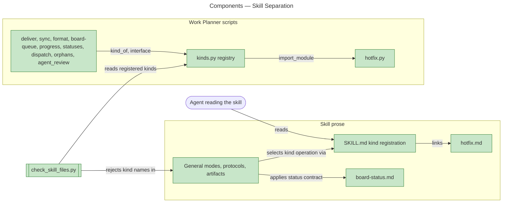
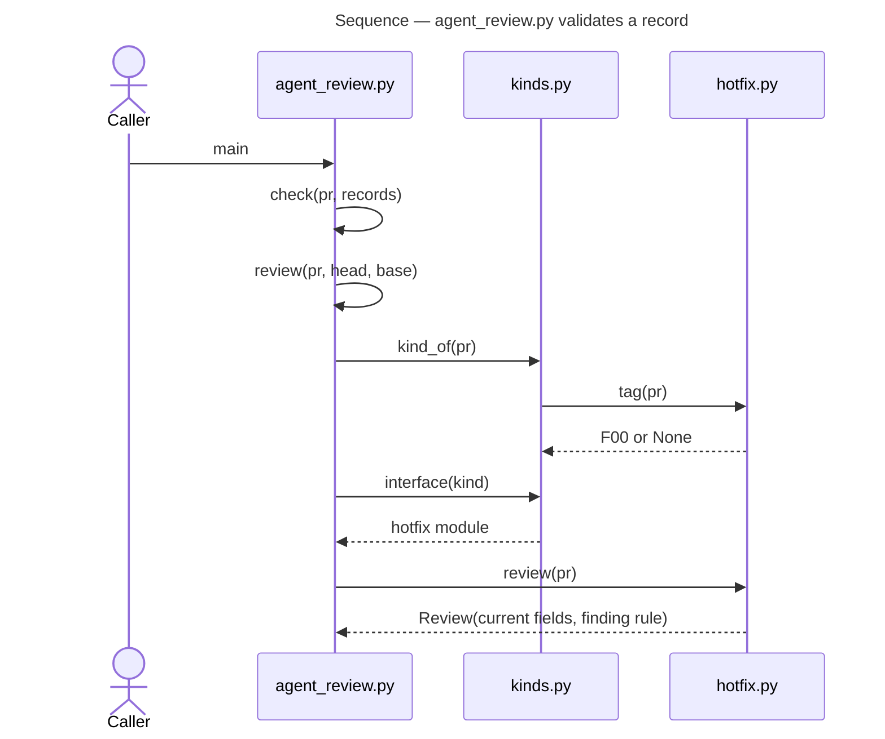
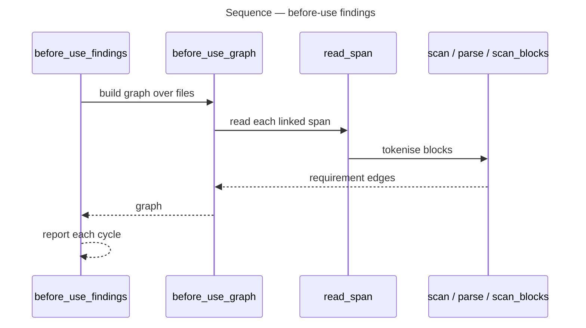

# Architecture Overview — Skill Separation: Ownership and Bounded Context

> architecture-overview · [m2ux/workflow-server#1659](https://github.com/m2ux/workflow-server/pull/1659) · 2026-11-11

## Summary

The change gives every Work Planner rule one home before the skill is extracted: kinds of work (today, the hot-fix) are reached only through a registration in `SKILL.md` and a script registry, `kinds.py`, so general modes, artifacts and scripts name no kind. It lands across the skill's scripts, its prose artifacts and the shared skill checker. It makes a new kind addable by one module and one registration entry, and lets the checker hold that boundary.

## Structure

Four areas carry the change. The **kind registration** in `SKILL.md` and the **script registry** `kinds.py` are the two entry points to a kind. The **general scripts** (delivery, sync, format, queue, status, review) select a kind through the registry and call its interface. The **hot-fix kind** supplies that interface in `hotfix.py` and `hotfix.md`. The **shared checker** `check_skill_files.py` reports a general file naming a kind, behaviour placed under Fields, and before-use cycles. Board Status, a new artifact, owns the status-change contract that Board Delivery and Hot-fix apply.

The edges from the general scripts to `kinds.py` and from `kinds.py` to `hotfix.py` are the measured import graph: nine general scripts and `hotfix.py` import `kinds.py`, and only the registry imports the hot-fix module.

### Kind registration

- **SKILL.md.**
  Lists each kind of work with the artifacts that hold it and the interface operations each supplies; a kind's operation takes the interface name with the kind's name after its verb, such as Settle Hot-fix Board Status.

### Script registry

- **kinds.py.**
  `KINDS` maps a kind name to its module; `Kind` is the interface (tag, letter, labels, faults, target, board_status, linking_pulls, delivery_fault, delivering_pulls, unit_state, review); `kind_of` selects a title's kind and `interface` returns its module.

### Hot-fix kind

- **hotfix.py.**
  Supplies every `Kind` operation and exports nothing else; its private helpers are underscored.
- **hotfix.md.**
  Holds Release, Dispatch Status, Delivery, Merge and Review operations under the registration's names.

### Shared checker

- **check_skill_files.py.**
  Adds three checks: a numbered step or operation call under Fields, a cycle of explicit before-use requirements between files, and a kind named or kind module imported in a general file.

## Behaviour

Three measured flows show the registry route; one shows the checker's before-use scan.

### Kind lookup from a general script

A general script meets an issue or pull request and asks which kind owns it; the result is that kind's operation.

- **Selection.**
  `kind_of` asks each registered module's `tag`; with no match the script applies the general rule (the head and base SHAs `check` validated are current, blocking findings fixed).
- **Kind rule.**
  A hot-fix's review is current by head SHA and `base_ref`, and every finding must be fixed.

The same route runs from `deliver.py` (`main → place → statuses.place → owns → kind_of → interface`) and from `board-queue.py` (`main → decide → kinded → kind_of → interface`).

### Before-use scan

The shared checker builds the explicit before-use graph across a skill's files and reports each cycle with a closed witness. A `Read … first` sentence (ending `.`, `:`, `;` or `, then`), a Prerequisites link or a declared preamble link is an edge; a link to a section of the same file is none, since position orders it.

## What Changed

### Scripts

- **General scripts.**
  Select kinds through `kinds.py`; title tags and issue identity come from `board.py` and `sync.py`, each pattern defined once in `sync.py`.
- **deps.py and deliver.py.**
  A work item's Component line lists every file its task changes as `branch:path` entries; a comma starts a new entry only before another `branch:path`, and prose after a path is dropped. Rows are grouped and paired by any shared file, and a unit is routed to every epic base its files name.

### Prose

- **guidelines.md.**
  Defines SOLID for prose capabilities and the Fields boundary.
- **board-status.md.**
  Owns the status-change and dispatch-status commands that Board Delivery previously held.
- **Modes and protocols.**
  Reach kind operations through the registration; Unit Dispatch verifies a retained worktree before reuse.

### Checker

- **check_skill_files.py.**
  Fields-execution, Fields-behaviour candidate, before-use cycle and kind-name checks.

## Reading Order

1. **[kinds.py](https://github.com/m2ux/workflow-server/blob/bdfb52b011320fba6658d653421281faefb4c607/skills/work-planner/scripts/kinds.py#L26-L81)** — the registry and interface every other change routes through.
2. **[hotfix.py](https://github.com/m2ux/workflow-server/blob/bdfb52b011320fba6658d653421281faefb4c607/skills/work-planner/scripts/hotfix.py)** — the one kind implementing that interface.
3. **[SKILL.md](https://github.com/m2ux/workflow-server/blob/bdfb52b011320fba6658d653421281faefb4c607/skills/work-planner/SKILL.md#L9-L44)** — the prose registration that mirrors the script registry.
4. **[agent_review.py](https://github.com/m2ux/workflow-server/blob/bdfb52b011320fba6658d653421281faefb4c607/skills/work-planner/scripts/agent_review.py#L52-L61)** — the smallest caller of the registry.
5. **[deliver.py](https://github.com/m2ux/workflow-server/blob/bdfb52b011320fba6658d653421281faefb4c607/skills/work-planner/scripts/deliver.py#L153-L280)** — base routing by declared files and kind units.
6. **[deps.py](https://github.com/m2ux/workflow-server/blob/bdfb52b011320fba6658d653421281faefb4c607/skills/work-planner/scripts/deps.py#L167-L263)** — multi-file declarations, contention and candidate units.
7. **[board-status.md](https://github.com/m2ux/workflow-server/blob/bdfb52b011320fba6658d653421281faefb4c607/skills/work-planner/artifacts/board-status.md)** — the extracted status contract.
8. **[check_skill_files.py](https://github.com/m2ux/workflow-server/blob/bdfb52b011320fba6658d653421281faefb4c607/skills/scripts/check_skill_files.py#L1686-L1861)** — before-use and kind-name checks.

## Risks and Watch Points

- **Import cycles.**
  `hotfix.py` imports `format` and `sync` inside functions because those modules import the registry; a top-level import there would cycle.
- **Queue jurisdiction.**
  `statuses.owns` lets the queue settle In Review or Done for any registered kind, a rule written for hot-fixes; a second kind inherits it.
- **Registry by import name.**
  `KINDS` holds module names resolved from the scripts folder on the import path; a script run from elsewhere must keep that folder on `sys.path`.

## References

- **R1.** [Epic #1615](https://github.com/m2ux/workflow-server/issues/1615) — the task table and acceptance criteria this change delivers.
- **R2.** [Review pull request #1659](https://github.com/m2ux/workflow-server/pull/1659) — the change-by-change listing under Changes.
