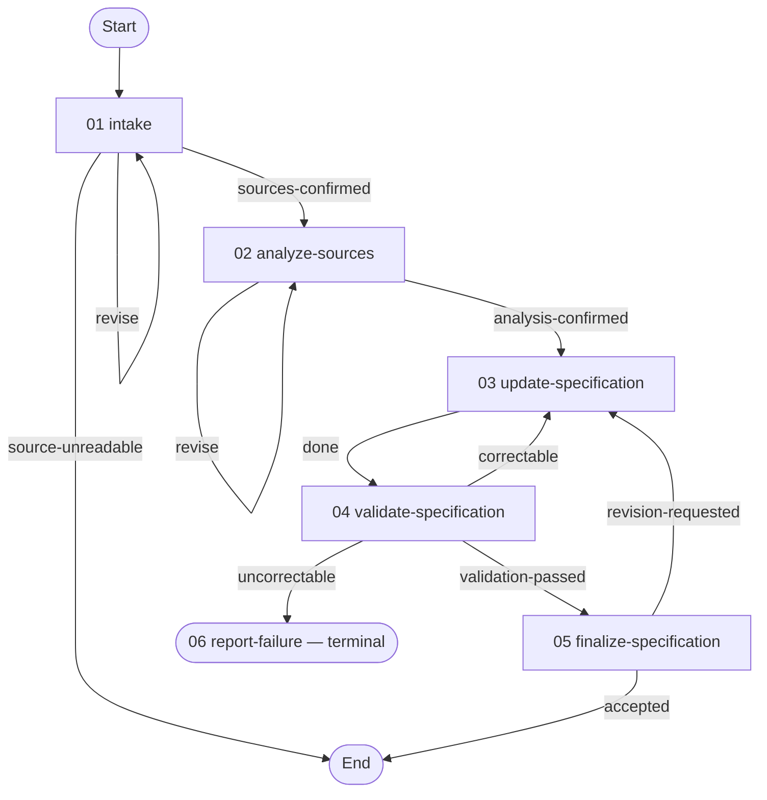

# Requirements Refinement Workflow

> Refine a canonical requirements specification from a set of source documents (meeting transcripts and unstructured documents): classify, analyze, apply, validate, correct within a bounded loop, and stage the result.

---

## Overview

This workflow turns one or more source documents — meeting transcripts and unstructured documents
(proposals, briefs, emails, or similar) — into reviewed changes against a canonical requirements
specification (an SRS-style document). It classifies each source, analyzes them for requirement changes,
applies them while preserving the [specification protocol](resources/specification-protocol.md)
verbatim, validates the result, iteratively corrects within a bounded loop, and stages a finalized
specification plus a change summary in the planning folder.

Intake holds each source in the repository, so every artifact cites it by a relative path: a meeting
transcript in the meetings folder, redacted of personal and off-topic conversation, and a document from
outside the repository in the documents folder.

Each source is traced in its own right: a meeting transcript is recorded as an `SRC-MTG###` reference,
an unstructured document as an `SRC-DOC###` reference credited to its author. The source-coverage
matrix names the source each section came from and records that section as the heading above the
passage. Each new or updated requirement carries those headings so the specification's source list
can link to them.

---

## When to use

Use this workflow when you want to:

- Fold the requirement changes from meetings and documents into a specification, with traceability.
- Keep a specification conformant to a fixed protocol (entry format, identifier schemes, status rules).
- Review proposed specification changes — analysis, working drafts, validation verdict, and a change
  summary — as planning-folder artifacts.

---

## Parameters

- The request names the [source document paths](techniques/resolve-inputs.md#source_paths) for the meeting transcripts and unstructured documents to refine from.
- The [target specification path](techniques/record-intake.md#target_doc_path) identifies the specification to augment or create. When the request names no target, the run asks for its path.

---

## Graph

Arrow labels are exit ids from the [workflow graph](workflow.yaml). The correctable exit requires correctable issues, no critical issues, and fewer than three correction iterations; uncorrectable is the default exit when validation does not pass and that correction condition is not met. Report Failure has no outgoing graph edge and ends the run after recording the unresolved issues.



The staged specification sits in the planning folder.

---

## Activities

| # | Name | Description |
|---|----------|---------|
| 01 | [Intake](activities/01-intake.yaml) | Establish readable, classified sources held in the repository, each transcript redacted, and the target specification |
| 02 | [Analyze Sources](activities/02-analyze-sources.yaml) | Produce a confirmed analysis of the requirement changes the sources imply |
| 03 | [Update Specification](activities/03-update-specification.yaml) | Apply the analysis (or corrections) to a versioned working specification |
| 04 | [Validate Specification](activities/04-validate-specification.yaml) | Validate (conformance + source coverage) and categorize issues |
| 05 | [Finalize Specification](activities/05-finalize-specification.yaml) | Stage the final specification and change summary |
| 06 | [Report Failure](activities/06-report-failure.yaml) | Compile a failure report when a critical issue or the correction limit stops refinement |

---

## Techniques

| Name | Description |
|-----------|-----------|
| [resolve-inputs](techniques/resolve-inputs.md) | Read which source documents and which target specification a run is for, from the request and any correction the user typed |
| [intake-sources](techniques/intake-sources.md) | Record whether every source document is readable and what type each one is |
| [store-sources](techniques/store-sources.md) | Hold each source document in the repository under its own file name |
| [redact-transcripts](techniques/redact-transcripts.md) | Redact the personal and off-topic conversation in each stored meeting transcript, keeping every heading |
| [record-intake](techniques/record-intake.md) | Settle the target specification — where it is, and whether it is augmented or created — and record the intake |
| [analyze-source](techniques/analyze-source.md) | Produce a structured analysis of the requirement changes the source documents imply, with a source-coverage matrix and the heading of each contributing passage |
| [update-specification](techniques/update-specification.md) | Apply the analysis, correction findings, or requested revisions to a complete updated specification |
| [validate-specification](techniques/validate-specification.md) | Validate the updated specification and categorize each issue |
| [finalize-specification](techniques/finalize-specification.md) | Assemble the final specification and change summary |
| [report-failure](techniques/report-failure.md) | Compile a failure report when refinement stops with unresolved issues |

---

## Resources

| Name | Description |
|----------|----------|
| [specification-protocol](resources/specification-protocol.md) | The canonical specification layout and conventions, preserved verbatim |
| [requirements-analysis-report](resources/requirements-analysis-report.md) | Structure for the analysis of requirement changes derived from a set of source documents |
| [validation-rubric](resources/validation-rubric.md) | Validation checks and the severity/type categorization that labels each issue |
| [change-summary](resources/change-summary.md) | Structure for the change summary that accompanies a finalized specification |
| [intake-record](resources/intake-record.md) | Structure for the record of what a run was given: sources, target, the classification each source carries, each transcript's redactions, and augment-or-create mode |
| [validation-report](resources/validation-report.md) | Structure for a pass's verdict, its issues, and any coverage gaps |
| [failure-report](resources/failure-report.md) | Structure for the unresolved issues an uncorrectable run leaves, each with the manual resolution it needs |
| [transcript-redaction](resources/transcript-redaction.md) | The conversation a stored meeting transcript redacts, and the marker that replaces it |

---

## File Structure

- [`workflow.yaml`](workflow.yaml) — metadata and variables.
- [`activities/`](activities/) — the pipeline activities.
- [`techniques/`](techniques/) — the procedures the activities apply.
- [`resources/`](resources/) — the specification protocol and the report/rubric/summary templates.

```
corpus/requirements-refinement/
├── workflow.yaml   # Workflow definition and graph
├── README.md       # Workflow orientation
├── activities/     # Activity definitions and orientation
├── techniques/     # Technique protocols and shared contracts
└── resources/      # Reference material and artifact guides
```
