# Work Package Implementation Workflow

> Carries ONE work package to the terminal state its mode reaches — a merged pull request on the implementation path, a posted review awaiting the author's disposition on the review path.

---

## Overview

This workflow guides the complete lifecycle of a single work package through its main activities plus a codebase-comprehension sub-flow, entered from design-philosophy or assumptions-review. Each activity has defined techniques, checkpoints, and exits. Activities may be conditional (skipped based on complexity) or looped (repeated on failure), and review mode conditions their steps, checkpoints, and exits.

Where assumptions or comprehension questions are settled, agent-resolvable concerns converge before any residual stakeholder ask.

---

## When to use

Use this workflow when you want to:

- Carry one feature, bug fix, enhancement, or refactoring through implementation and review.
- Review an existing pull request and record findings for its author.
- Keep requirements, assumptions, validation, and close-out artifacts together for one work package.

---

## Parameters

- [work request](techniques/review-mode-detection.md#user_request) describes the task and whether it calls for implementation or review.
- [repository context](techniques/repo-root-resolution.md#inputs) identifies the host checkout and, when applicable, the component being worked on.
- [issue reference (optional)](techniques/issue-reference-detection.md#issue_request) identifies an existing GitHub issue or Jira ticket by key, number, or URL.

### Review Mode

- [pull request reference](techniques/review-mode-detection.md#pr_reference) supplies the existing pull request's number or URL; the run asks when that reference is missing.

---

## Graph

Activity order and the exits between activities are the `graph` in [workflow.yaml](./workflow.yaml).

Arrow labels are exit ids; a slash groups exits with the same destination. Multiple destinations for one exit run as parallel branches and converge at their join activity. Start marks the initial activity; End is the terminal state.

```mermaid
graph TD
    startNode(["Start"]) --> SWP["01 start-work-package"]
    SWP -->|"done"| DP["02 design-philosophy"]

    DP -->|"revise-classification"| DP
    DP -->|"done"| CC["15 codebase-comprehension"]

    CC -->|"needs-elicitation"| REL["03 requirements-elicitation"]
    CC -->|"research-needed / comprehension-complete"| RS["04 research"]
    CC -->|"research-needed / comprehension-complete"| IA["05 implementation-analysis"]
    CC -->|"skip-optional-activities"| PP["06 plan-prepare"]

    REL -->|"elicitation-incomplete"| REL
    REL -->|"research-needed / no-research-needed"| RS
    REL -->|"research-needed / no-research-needed"| IA
    RS -->|"done"| PP
    IA -->|"done"| PP

    PP -->|"revise"| PP
    PP -->|"done"| AR["07 assumptions-review"]

    AR -->|"needs-further-discussion"| AR
    AR -->|"needs-comprehension"| CC
    AR -->|"needs-plan-revision"| PP
    AR -->|"review-mode"| LCA["09 lean-coding-audit"]
    AR -->|"assumptions-approved"| CT["20 contract-tests"]
    AR -->|"assumptions-approved"| IMP["08 implement"]

    CT -->|"done"| IJ["21 implementation-join"]
    IMP -->|"done"| IJ
    IJ -->|"needs-rework"| IMP
    IJ -->|"needs-contract-tests"| CT
    IJ -->|"done"| LCA["09 lean-coding-audit"]
    LCA -->|"done"| PD["16 prism-decision"]
    PD -->|"remeasure"| PD
    PD -->|"done"| CR["17 code-review"]
    PD -->|"done"| SA["18 structural-analysis"]
    PD -->|"done"| TSR["19 test-suite-review"]
    CR -->|"done"| PIR["10 post-impl-review"]
    SA -->|"done"| PIR
    TSR -->|"done"| PIR
    PIR -->|"has-blocker"| IMP
    PIR -->|"done"| VAL["11 validate"]
    VAL -->|"done"| SR["12 strategic-review"]

    SR -->|"review-failed"| PP
    SR -->|"needs-more-review"| SR
    SR -->|"review-mode / review-passed"| SFR["13 submit-for-review"]

    SFR -->|"provide-input"| SFR
    SFR -->|"review-requires-changes"| PP
    SFR -->|"review-mode / review-approved / abort"| COMP["14 complete"]

    COMP -->|"done"| doneNode(["End"])
```



---

## Activities

| # | Name | Description |
|---|----------|-------------|
| 01 | [**Start Work Package**](activities/01-start-work-package.yaml) | Verify/create issue, set up branch, PR, and planning folder |
| 02 | [**Design Philosophy**](activities/02-design-philosophy.yaml) | Classify problem, assess complexity, determine workflow path |
| 15 | [**Codebase Comprehension**](activities/15-codebase-comprehension.yaml) | Build/augment mental model of codebase via persistent knowledge artifacts |
| 03 | [**Requirements Elicitation**](activities/03-requirements-elicitation.yaml) | Clarify requirements through stakeholder conversation |
| 04 | [**Research**](activities/04-research.yaml) | Discovery fan branch — knowledge-base and web research |
| 05 | [**Implementation Analysis**](activities/05-implementation-analysis.yaml) | Discovery fan branch — baselines and gaps |
| 06 | [**Plan & Prepare**](activities/06-plan-prepare.yaml) | Discovery fan join — research gates, assumption ingest, plan |
| 07 | [**Assumptions Review**](activities/07-assumptions-review.yaml) | Converge the open assumptions and settle what stays open with the user before implementation |
| 08 | [**Implement**](activities/08-implement.yaml) | Execute tasks with implement-test-commit cycles |
| 20 | [**Contract Tests**](activities/20-contract-tests.yaml) | Implementation fan branch — contract suites that fail on the base tree |
| 21 | [**Implementation Join**](activities/21-implementation-join.yaml) | Implementation fan join — hoist both branches, run the suites, settle provenance |
| 09 | [**Lean-Coding Audit**](activities/09-lean-coding-audit.yaml) | Tag and score over-engineering, harvest deliberate-simplification debt, apply accepted simplifications |
| 16 | [**Prism Decision**](activities/16-prism-decision.yaml) | Settle whether structural analysis takes the full prism pipeline or the inline pass |
| 17 | [**Code Review**](activities/17-code-review.yaml) | Automated review fan branch — code findings |
| 18 | [**Structural Analysis**](activities/18-structural-analysis.yaml) | Automated review fan branch — inline structural pass |
| 19 | [**Test Suite Review**](activities/19-test-suite-review.yaml) | Automated review fan branch — coverage map and test findings |
| 10 | [**Post-Implementation Review**](activities/10-post-impl-review.yaml) | Review fan join — manual diff gates, full prism when chosen, classify, fix cycle |
| 11 | [**Validate**](activities/11-validate.yaml) | Run tests, build, and lint checks |
| 12 | [**Strategic Review**](activities/12-strategic-review.yaml) | Ensure minimal, focused changes |
| 13 | [**Submit for Review**](activities/13-submit-for-review.yaml) | Push PR, mark ready, handle reviewer feedback |
| 14 | [**Complete**](activities/14-complete.yaml) | Finalize documentation, create ADR, resolve session traces, and conduct retrospective |

---

## Techniques

The [technique library](techniques/README.md) explains the shared namespaces; [shared routines](routines/README.md) catalog reusable activity steps.

| Name | Description |
|------|-------------|
| [Shared contract](techniques/TECHNIQUE.md) | Inputs and rules inherited by the workflow techniques |
| [analyse-challenge (shared contract)](techniques/analyse-challenge/TECHNIQUE.md) | Adversarial challenge of a concern set and the fold of its findings back into that set — the shared contract both techniques work over. |
| [analyse-challenge/challenge](techniques/analyse-challenge/challenge.md) | Adversarial challenge perspectives over the current concern set for the combine step. |
| [analyse-challenge/combine](techniques/analyse-challenge/combine.md) | Challenge findings folded into the concern set, with the convergence and residue flags that fold implies. |
| [apply-review-fixes](techniques/apply-review-fixes.md) | User-selected code-review findings and/or test improvements implemented and committed as one atomic step. |
| [assess-prism-value](techniques/assess-prism-value.md) | A recommendation, with its reason, on whether a change warrants the full prism pipeline or the single inline structural pass. |
| [assess-ticket-completeness](techniques/assess-ticket-completeness.md) | Tracker-ticket quality across problem, goal, scope, acceptance criteria, and user stories — gaps and optional refactor. |
| [codebase-comprehension (shared contract)](techniques/codebase-comprehension/TECHNIQUE.md) | Progressive codebase comprehension over a cumulative corpus artifact and a session-local log. |
| [codebase-comprehension/deep-dive](techniques/codebase-comprehension/deep-dive.md) | Targeted investigation of a selected codebase area, recorded in the comprehension log with its settled outcomes promoted to the corpus artifact. |
| [codebase-comprehension/revise-questions](techniques/codebase-comprehension/revise-questions.md) | The authoritative open questions on the comprehension log. |
| [codebase-comprehension/survey](techniques/codebase-comprehension/survey.md) | Initial mental model of the codebase area — architecture, abstractions, design rationale, and domain mapping. |
| [conduct-retrospective (shared contract)](techniques/conduct-retrospective/TECHNIQUE.md) | Conduct workflow retrospective to capture lessons learned and prepare for next work package |
| [conduct-retrospective/retrospective](techniques/conduct-retrospective/retrospective.md) | Close-out retrospective — session history, friction (user-message and mechanical), lean session-trace, and work-package status (implementation merge or review-mode audit). |
| [conduct-retrospective/select-next](techniques/conduct-retrospective/select-next.md) | Identify the next work package and prepare context for the transition. |
| [create-adr](techniques/create-adr.md) | An Architecture Decision Record for the work package, numbered next in the record directory and opening at Proposed. |
| [create-issue (shared contract)](techniques/create-issue/TECHNIQUE.md) | Shared contract for raising a tracker issue: what the issue is about, what kind of change it records, and the identity the run carries forward once it exists. |
| [create-issue/create-github](techniques/create-issue/create-github.md) | A GitHub issue raised for the work package, labelled for the kind of change it records and verified to exist. |
| [create-issue/create-jira](techniques/create-issue/create-jira.md) | A Jira issue raised for the work package in its project, typed for the kind of change it records. |
| [create-test-plan](techniques/create-test-plan.md) | Create test strategy and test plan with cases and acceptance criteria |
| [dco-provenance (shared contract)](techniques/dco-provenance/TECHNIQUE.md) | DCO compliance and AI provenance tracking for the work package — the record of which assistant did what, and the human certification that closes it. |
| [dco-provenance/append-task-row](techniques/dco-provenance/append-task-row.md) | Per-task row in `provenance-log.md` (canonical header on first write). |
| [dco-provenance/record-attestation](techniques/dco-provenance/record-attestation.md) | Human DCO attestation recorded once per work package in `provenance-log.md`. |
| [design-philosophy (shared contract)](techniques/design-philosophy/TECHNIQUE.md) | Structured design framework — problem classification, complexity, and workflow-path choice. |
| [design-philosophy/classify](techniques/design-philosophy/classify.md) | Classify the problem as specific (cause known/unknown) or inventive (improvement/prevention) and assess its complexity. |
| [design-philosophy/define](techniques/design-philosophy/define.md) | Define a clear problem statement with system understanding, impact, success criteria, and constraints. |
| [design-philosophy/determine-path](techniques/design-philosophy/determine-path.md) | The rationale behind the selected workflow path, and the comprehension pass every path carries. |
| [design-philosophy/document](techniques/design-philosophy/document.md) | Design philosophy artifact — problem statement, classification, complexity, and workflow-path rationale. |
| [finalize-documentation (shared contract)](techniques/finalize-documentation/TECHNIQUE.md) | The documentation a closing work package leaves behind, and the planning-folder context every technique here writes into. |
| [finalize-documentation/create-complete-doc](techniques/finalize-documentation/create-complete-doc.md) | Work package's single terminal close-out artifact — delivered work, coverage, limitations, and the open work its registers hold. |
| [finalize-documentation/ensure-docs](techniques/finalize-documentation/ensure-docs.md) | Ensure public/exported APIs in the diff carry inline documentation. |
| [finalize-documentation/finalize-test-plan](techniques/finalize-documentation/finalize-test-plan.md) | Finalize the test plan by linking each test case to its actual source location. |
| [finalize-documentation/gather-open-work](techniques/finalize-documentation/gather-open-work.md) | The work still open at close-out that no register entry holds, sorted into in-task follow-ups and out-of-scope deferrals. |
| [finalize-documentation/render-token-usage](techniques/finalize-documentation/render-token-usage.md) | Sole cost home for a run — the token-use and cost-estimate artifact, reconciled against the run's actual dispatch count, with a one-line README link. |
| [finalize-documentation/update-adr](techniques/finalize-documentation/update-adr.md) | Update the work package's ADR to Accepted, recording the implementation outcome. |
| [findings-classification](techniques/findings-classification.md) | Single-scale severity classification for review or validation findings, tiered for delivery against the reachability each finding states, with routing flags for downstream fix cycles. |
| [implement-task](techniques/implement-task.md) | Implement a single task by writing code changes |
| [implementation-analysis (shared contract)](techniques/implementation-analysis/TECHNIQUE.md) | Current-implementation effectiveness analysis — baseline metrics and the gaps the change closes. |
| [implementation-analysis/analyze](techniques/implementation-analysis/analyze.md) | Effectiveness, baseline metrics, and gaps of the current implementation against success criteria. |
| [implementation-analysis/document](techniques/implementation-analysis/document.md) | Create the analysis-document artifact capturing the current state, baseline metrics, and identified gaps. |
| [ingest-assumption-surfaces](techniques/ingest-assumption-surfaces.md) | Append the bound assumption surfaces into the assumptions log. |
| [issue-reference-detection](techniques/issue-reference-detection.md) | Whether the user supplied an issue reference, with platform and id when present (`#N` GitHub, `PROJ-N` Jira). |
| [issue-type-detection](techniques/issue-type-detection.md) | The work-type category of an already-tracked issue, with an ambiguity flag when its own signals do not settle one category. |
| [locate-contract-tests-worktree](techniques/locate-contract-tests-worktree.md) | The branch and directory for contract-test files. |
| [manage-artifacts (shared contract)](techniques/manage-artifacts/TECHNIQUE.md) | Shared contract for a workflow's planning-folder artifacts — prefixing, organization, and output discipline. |
| [manage-artifacts/verify-artifact-links](techniques/manage-artifacts/verify-artifact-links.md) | Link integrity across a planning folder, measured as a reader following the published links would experience it. |
| [manage-artifacts/write-artifact](techniques/manage-artifacts/write-artifact.md) | Planning-folder artifact write keyed on bare filename — one numbered instance per logical artifact (find-or-update). |
| [manage-git (shared contract)](techniques/manage-git/TECHNIQUE.md) | Shared contract for the work package's git work: which checkout each class of technique runs in, what a code commit carries, and which shell reaches a remote. |
| [manage-git/artifact-commits](techniques/manage-git/artifact-commits.md) | Commit planning artifacts in the engineering checkout with the canonical message pattern, rebasing onto sibling work-package commits to avoid push rejections. |
| [manage-git/commit-paths](techniques/manage-git/commit-paths.md) | Stage and commit selected paths on the edit-side feature branch (code commits, not planning-folder artifact commits). |
| [manage-git/detect-merge-strategy](techniques/manage-git/detect-merge-strategy.md) | Query GitHub for the component repository's allowed merge strategies (specifically, whether squash merging is enabled). |
| [manage-git/instruct-merge-strategy](techniques/manage-git/instruct-merge-strategy.md) | Advisory merge guidance for the PR. Branch commits are unsigned. The merge commit is signed, and creating it prompts the user to sign. Read-only; no merge is performed. |
| [manage-git/remove-worktree](techniques/manage-git/remove-worktree.md) | Tear down a worktree created earlier in the work package. |
| [manage-git/restore-paths-from-ref](techniques/manage-git/restore-paths-from-ref.md) | Restore selected worktree paths to match a base git ref (whole file or interactive hunks), then stage the restores. |
| [manage-git/sync-branch](techniques/manage-git/sync-branch.md) | Feature branch kept current with the default branch. |
| [manage-git/update-repo-submodules](techniques/manage-git/update-repo-submodules.md) | Refresh the monorepo's submodules to their tracked remote HEADs, with locking and skip-if-recent semantics to coordinate concurrent invocations from sibling work packages. |
| [manage-git/verify-commit-signatures](techniques/manage-git/verify-commit-signatures.md) | Feature-branch GPG signature hygiene before push — every commit signed. |
| [manage-git/verify-feature-branch](techniques/manage-git/verify-feature-branch.md) | Confirmation that the target path is on a feature branch rather than main or master. |
| [manage-git/verify-remote-private](techniques/manage-git/verify-remote-private.md) | Configured push remote confirmed private before an upcoming push. |
| [manage-registers (shared contract)](techniques/manage-registers/TECHNIQUE.md) | The work package's two open-work registers — the single home each keeps for its class of outstanding item, one entry per item. |
| [manage-registers/append-deferred-item](techniques/manage-registers/append-deferred-item.md) | The out-of-scope deferrals register, carrying one entry per item consciously placed beyond this work package. |
| [manage-registers/append-follow-up](techniques/manage-registers/append-follow-up.md) | The in-task follow-ups register, carrying one entry per piece of work still owed inside this work package. |
| [merge-contract-tests](techniques/merge-contract-tests.md) | Bring the contract-test files from the contract-tests worktree into the feature worktree. |
| [name-edit-target](techniques/name-edit-target.md) | Name the primary symbol a task changes. |
| [naming-conventions](techniques/naming-conventions.md) | Derive the feature branch name and the canonical worktree target path for a work package from naming conventions, keeping the worktree aligned with the server's planning folder. |
| [plan-prepare (shared contract)](techniques/plan-prepare/TECHNIQUE.md) | Implementation planning — design approach, work-package plan with a contract per task, and actionable TODO tasks. |
| [plan-prepare/create-todos](techniques/plan-prepare/create-todos.md) | The plan's task breakdown carried into the harness TODO list implementation is tracked against. |
| [plan-prepare/plan](techniques/plan-prepare/plan.md) | Work-package plan artifact — task breakdown, a contract per task, dependencies, ordering, and recorded design decisions. |
| [project-type-detection](techniques/project-type-detection.md) | Auto-detect the project type of the target component from its build manifest, so downstream work can shape comprehension, validation, and review to the technology stack. |
| [raise-deferred-items (shared contract)](techniques/raise-deferred-items/TECHNIQUE.md) | Deferred-items register entries carried into the issue tracker. |
| [raise-deferred-items/collect](techniques/raise-deferred-items/collect.md) | The deferred-items register read for entries that name no issue yet. |
| [raise-deferred-items/record](techniques/raise-deferred-items/record.md) | A deferred-items register entry naming the issue raised for it. |
| [record-change-scope](techniques/record-change-scope.md) | Add the symbols and flows a diff touches to the task record. |
| [repo-root-resolution](techniques/repo-root-resolution.md) | Component identity for this work package, assembled from the derived host repository. |
| [requirements-elicitation (shared contract)](techniques/requirements-elicitation/TECHNIQUE.md) | Discover and clarify requirements through structured sequential conversation. |
| [requirements-elicitation/create-document](techniques/requirements-elicitation/create-document.md) | Create the requirements document artifact capturing elicited requirements, success criteria, scope boundaries, and assumptions. |
| [requirements-elicitation/discuss](techniques/requirements-elicitation/discuss.md) | The baseline elicitation builds its questions on — the stakeholder discussion where one was held, and the recorded limitation where none was. |
| [requirements-elicitation/elicit](techniques/requirements-elicitation/elicit.md) | Requirements, success criteria and scope boundaries elicited across the question domains, with the question-and-response record behind them. |
| [requirements-elicitation/pose-question](techniques/requirements-elicitation/pose-question.md) | The next question for one elicitation domain, narrowed to what the record does not already answer. |
| [requirements-elicitation/record-answer](techniques/requirements-elicitation/record-answer.md) | The elicitation record extended with one question and the answer given to it. |
| [requirements-elicitation/select-domains](techniques/requirements-elicitation/select-domains.md) | The question domains this run elicits across, drawn from the reference and narrowed to what the stakeholder discussion left open. |
| [research (shared contract)](techniques/research/TECHNIQUE.md) | Knowledge-base and external research synthesized against work-package requirements. |
| [research/document](techniques/research/document.md) | Create the research artifact capturing the synthesized findings, applicable patterns, and risks. |
| [research/reconcile](techniques/research/reconcile.md) | Research-reconcilable candidates closed until only irreconcilable residue remains. |
| [research/research](techniques/research/research.md) | Best practices, patterns, and resources gathered from the knowledge base and the web. |
| [research/synthesize](techniques/research/synthesize.md) | Synthesize the knowledge base and web findings against the work package requirements, mapping applicable patterns to specific needs. |
| [research/triage](techniques/research/triage.md) | Open research candidates classified as reconcilable-by-research or irreconcilable for the reconcile loop. |
| [resolve-artifact-publish](techniques/resolve-artifact-publish.md) | Resolve the engineering checkout's publish branch and the planning-folder files that ride on it, for artifact hyperlink construction. |
| [respond-to-pr-review](techniques/respond-to-pr-review.md) | Systematic response to PR review comments — analysis through posted replies. |
| [review-assumptions (shared contract)](techniques/review-assumptions/TECHNIQUE.md) | The assumption lifecycle a work package runs on: what an assumption is, the categories it is classified into, and the log that holds its outcome. |
| [review-assumptions/assemble-one](techniques/review-assumptions/assemble-one.md) | Judgement-augmentation context for the single open assumption under discussion, as an individual drill-down. |
| [review-assumptions/assemble-open-set](techniques/review-assumptions/assemble-open-set.md) | Judgement-augmentation context over the whole residual open-assumption set, ordered so a stakeholder settles the highest-impact decision first. |
| [review-assumptions/collect](techniques/review-assumptions/collect.md) | Assumptions from the work classified against the bound assumption categories in the assumptions log. |
| [review-assumptions/reconcile](techniques/review-assumptions/reconcile.md) | Code-analyzable assumptions closed via targeted analysis. |
| [review-assumptions/record](techniques/review-assumptions/record.md) | Assumption outcomes and stakeholder responses recorded in the assumptions log. |
| [review-baseline-state](techniques/review-baseline-state.md) | Review-mode baseline for PR evaluation — expected changes against requirements and the base↔PR authored surface. |
| [review-code](techniques/review-code.md) | Rust/Substrate code review of implementation changes for architecture, error handling, safety, and Substrate patterns. |
| [review-diff](techniques/review-diff.md) | Conduct structured manual diff review using external side-by-side diff tool with indexed block references |
| [review-existing-feedback](techniques/review-existing-feedback.md) | Prior PR feedback accounted for in the review verdict — dispositions and blocker-class rating caps. |
| [review-mode-detection](techniques/review-mode-detection.md) | Whether the request is review of an existing PR, with PR/branch/ticket identity when so. |
| [review-outcome-analysis](techniques/review-outcome-analysis.md) | Recommended PR review outcome from received comments — approve, minor inline fixes, or significant changes. |
| [review-summary](techniques/review-summary.md) | Consolidated review summary in the consolidated review format. |
| [review-test-suite](techniques/review-test-suite.md) | Test-suite quality and coverage review — gaps, assertion quality, isolation, and anti-patterns. |
| [run-contract-tests](techniques/run-contract-tests.md) | Run the merged contract tests against the implementation in the feature worktree. |
| [stakeholder-overview](techniques/stakeholder-overview.md) | Two-paragraph plain-language overview for non-technical stakeholders in a named README section. |
| [strategic-findings-analysis](techniques/strategic-findings-analysis.md) | Severity and go/no-go recommendation for strategic-review findings (fix now vs accept and proceed). |
| [strategic-review (shared contract)](techniques/strategic-review/TECHNIQUE.md) | Scope-disciplined strategic review of the implementation — findings, changes-folder hygiene, and cleanup of investigation artifacts. |
| [strategic-review/apply-cleanup](techniques/strategic-review/apply-cleanup.md) | Approved cleanup on source, with changes-folder fragment committed on the feature branch. |
| [strategic-review/changes-folder](techniques/strategic-review/changes-folder.md) | Target repository `changes/` changelog fragment for this work package when the repo uses that convention. |
| [strategic-review/defer-findings](techniques/strategic-review/defer-findings.md) | Every finding in the strategic review document that does not recommend keeping the change, as an out-of-scope deferral. |
| [strategic-review/document-findings](techniques/strategic-review/document-findings.md) | Strategic review document with findings typed from the review-scope pass, or a clean-review result. |
| [strategic-review/recommend-cleanup](techniques/strategic-review/recommend-cleanup.md) | Review-mode cleanup recommendations in the strategic review document — advisory only; source unchanged. |
| [strategic-review/resign-commits](techniques/strategic-review/resign-commits.md) | Feature-branch commits re-signed so every commit carries a valid GPG signature. |
| [strategic-review/review-scope](techniques/strategic-review/review-scope.md) | Scope-discipline and artifact-hygiene findings across the feature-branch diff for the strategic review document. |
| [strategic-review/verify-fragment](techniques/strategic-review/verify-fragment.md) | Whether the work-package change fragment under the target path references the issue. |
| [summarize-architecture](techniques/summarize-architecture.md) | Create high-level architecture summary with Mermaid diagrams for management stakeholders |
| [surface-assumptions](techniques/surface-assumptions.md) | Assumptions surfaced from the bound source and categories. |
| [task-completion-review](techniques/task-completion-review.md) | Post-task self-review for symbol provenance and code/test/documentation quality — catches fabricated symbols early. |
| [update-pr (shared contract)](techniques/update-pr/TECHNIQUE.md) | PR finalization for review — body update and ready mark, or consolidated review-mode commentary. |
| [update-pr/create-pr](techniques/update-pr/create-pr.md) | Draft PR linked to the issue and assigned to the current GitHub user. |
| [update-pr/mark-ready](techniques/update-pr/mark-ready.md) | Mark the PR ready for review once its description is finalized. |
| [update-pr/post-review-comment](techniques/update-pr/post-review-comment.md) | Confirmed consolidated review summary posted verbatim to the PR as a pull-request review. |
| [update-pr/render](techniques/update-pr/render.md) | PR description body from the selected template, sourced from planning artifacts. |
| [update-pr/verify-body](techniques/update-pr/verify-body.md) | PR-body-conformance verdict for the rendered PR description (conforms flag and findings). |
| [validate-build (shared contract)](techniques/validate-build/TECHNIQUE.md) | Triage validation failures and aggregate cross-check results. |
| [validate-build/analyze-failure](techniques/validate-build/analyze-failure.md) | Identify the root cause of a single failed validation check. |
| [validate-build/apply-fix](techniques/validate-build/apply-fix.md) | Concrete fix for a failed validation check, ready for re-validation. |
| [verify-contract-tests-fail](techniques/verify-contract-tests-fail.md) | Confirm the contract tests written for the current task fail against the base tree. |
| [write-contract-tests](techniques/write-contract-tests.md) | Write integration tests for one plan task from its Contract alone. |

---

## Resources

| Name | Description |
|------|-------------|
| [README Seed](resources/readme-seed.md) | Progress inventory, classifier, mode-exclusion map for create-readme |
| [Canonical Home Map](resources/canonical-home-map.md) | Which artifact homes each shared fact category, and the link-only slot every other template carries |
| [Issue Creation](resources/issue-creation.md) | Body template, anti-patterns and section rules for a tracker issue on any platform |
| [Jira Issue Creation](resources/jira-issue-creation.md) | What Jira adds — terminology, issue types, field arrangement, native markup, priority and labels |
| [Requirements Elicitation](resources/requirements-elicitation.md) | Question domains and elicitation output template |
| [Implementation Analysis](resources/implementation-analysis.md) | Analysis framework and document template |
| [Knowledge Base Research](resources/knowledge-base-research.md) | Research findings artifact template — knowledge-base and web findings in one list — and citation rules |
| [Design Framework](resources/design-framework.md) | TRIZICS solution-design methodology applied at plan time, plus the design-philosophy artifact template |
| [Work Package Plan](resources/plan-guide.md) | Plan document template with task breakdown format |
| [Test Plan](resources/test-plan-guide.md) | Test plan templates and test-design principles |
| [PR Description](resources/pr-description.md) | PR description templates, link-row rendering forms, and the conformance criteria a rendered body satisfies |
| [Assumptions Review](resources/assumptions-review.md) | Assumption collection, classification, and document formats |
| [Architecture Review](resources/architecture-review.md) | Architecture review criteria and checklist |
| [Findings Report](resources/findings-report.md) | Shared finding layout, designator, severity and reachability contracts, and the one-report shape every findings report follows |
| [Symbol Provenance](resources/symbol-provenance.md) | What establishes provenance for a symbol named in code or documentation, and how each class of symbol is verified |
| [Rust Substrate Code Review](resources/rust-substrate-code-review.md) | Rust/Substrate-specific code review criteria, field list and report template |
| [Test Suite Review](resources/test-suite-review.md) | Test suite quality assessment framework, field list and report template |
| [Strategic Review](resources/strategic-review.md) | Strategic review field list and report template |
| [Architecture Summary](resources/architecture-summary.md) | Architecture summary template with UML diagram guidance |
| [Workflow Retrospective](resources/workflow-retrospective.md) | Retrospective methodology and section template |
| [Close-out](resources/close-out-guide.md) | Close-out document template and fill rules |
| [Manual Diff Review](resources/manual-diff-review.md) | Lean-header and Block Rationale forms (titles naming each change, linked to its line) — the report renders as a code-review.md section |
| [Deferred Items](resources/deferred-items-guide.md) | Register template — the single canonical home for out-of-scope deferred work that every other artifact points at |
| [Follow-ups](resources/follow-ups-guide.md) | In-task follow-ups register template (distinct from out-of-scope deferred items) |
| [TDD Concepts Rust](resources/tdd-concepts-rust.md) | TDD best practices for Rust: Red-Green-Refactor, FIRST principles |
| [Review Mode](resources/review-mode.md) | Review comment template, per-category findings fragments, and the scales they share |
| [Codebase Comprehension](resources/codebase-comprehension.md) | Comprehension techniques, corpus and log artifact templates, promotion criteria, and deep-dive guidance from reverse engineering and code forensics literature |
| [Assumption Reconciliation](resources/assumption-reconciliation.md) | Assumptions-log integration shape and resolution statuses |
| [Research Reconciliation](resources/research-reconciliation.md) | Research-candidate inventory shape, reconcilability statuses, and scorecard format |
| [PR Review Response](resources/pr-review-response.md) | Response-format and review-document templates |
| [Prior Feedback Triage](resources/prior-feedback-triage-guide.md) | Creation guide: `prior-feedback-triage.json` — the disposition register the rating cap is computed from |
| [Provenance Log](resources/provenance-log-guide.md) | Creation guide: `provenance-log.md` — one appended row per task |
| [Architecture Decision Record](resources/adr-guide.md) | Creation guide: `NNNN-{decision_title}.md` — standard ADR form with at least one rejected alternative |

---

## File Structure

```
corpus/work-package/
├── workflow.yaml   # Workflow definition and graph
├── README.md       # Workflow orientation
├── REVIEW-MODE.md  # Review-mode guide
├── activities/     # Activity definitions and orientation
├── routines/       # Shared activity steps
├── techniques/     # Technique protocols and shared contracts
└── resources/      # Reference material and artifact guides
```
