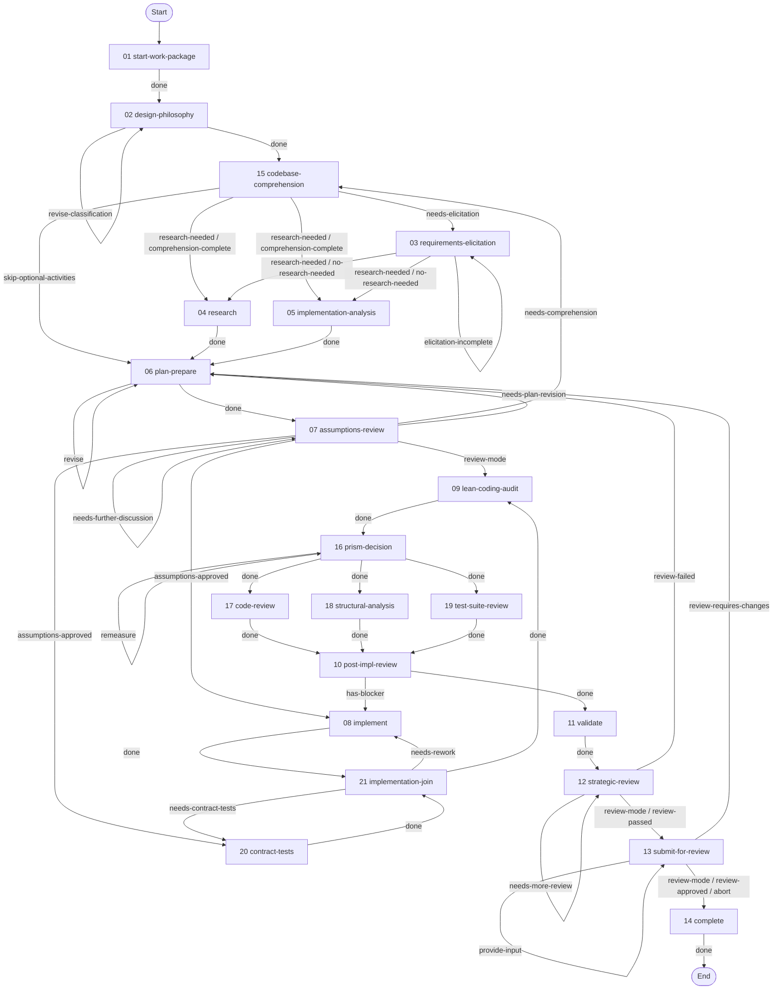

# Work Package Implementation Workflow

> Carries ONE work package to the terminal state its mode reaches — a merged pull request on the implementation path, a posted review awaiting the author's disposition on the review path.

---

## Overview

This workflow guides the complete lifecycle of a single work package through its main activities plus a codebase-comprehension sub-flow, entered from design-philosophy or assumptions-review. Each activity has defined techniques, checkpoints, and exits. Activities may be conditional (skipped based on complexity) or looped (repeated on failure), and review mode conditions their steps, checkpoints, and exits.

Where assumptions or comprehension questions are settled, agent-resolvable concerns converge before any residual stakeholder ask.

---

## When to use

Use this workflow when you want to:

- Carry one feature, bug fix, enhancement, or refactoring through implementation and review.
- Review an existing pull request and record findings for its author.
- Keep requirements, assumptions, validation, and close-out artifacts together for one work package.

---

## Parameters

- The request identifies the work package and target repository.
- [Review mode](REVIEW-MODE.md) determines whether the run implements a change or reviews an existing pull request.
- Discovery choices determine which optional activities run.

---

## Graph

Activity order and the exits between activities are the `graph` in [workflow.yaml](./workflow.yaml).

Arrow labels are exit ids; a slash groups exits with the same destination. Multiple destinations for one exit run as parallel branches and converge at their join activity. Start marks the initial activity; End is the terminal state.



---

## Activities

| # | Name | Description |
|---|----------|-------------|
| 01 | [**Start Work Package**](activities/01-start-work-package.yaml) | Verify/create issue, set up branch, PR, and planning folder |
| 02 | [**Design Philosophy**](activities/02-design-philosophy.yaml) | Classify problem, assess complexity, determine workflow path |
| 15 | [**Codebase Comprehension**](activities/15-codebase-comprehension.yaml) | Build/augment mental model of codebase via persistent knowledge artifacts |
| 03 | [**Requirements Elicitation**](activities/03-requirements-elicitation.yaml) | Clarify requirements through stakeholder conversation |
| 04 | [**Research**](activities/04-research.yaml) | Discovery fan branch — knowledge-base and web research |
| 05 | [**Implementation Analysis**](activities/05-implementation-analysis.yaml) | Discovery fan branch — baselines and gaps |
| 06 | [**Plan & Prepare**](activities/06-plan-prepare.yaml) | Discovery fan join — research gates, assumption ingest, plan |
| 07 | [**Assumptions Review**](activities/07-assumptions-review.yaml) | Converge the open assumptions and settle what stays open with the user before implementation |
| 08 | [**Implement**](activities/08-implement.yaml) | Execute tasks with implement-test-commit cycles |
| 20 | [**Contract Tests**](activities/20-contract-tests.yaml) | Implementation fan branch — contract suites that fail on the base tree |
| 21 | [**Implementation Join**](activities/21-implementation-join.yaml) | Implementation fan join — hoist both branches, run the suites, settle provenance |
| 09 | [**Lean-Coding Audit**](activities/09-lean-coding-audit.yaml) | Tag and score over-engineering, harvest deliberate-simplification debt, apply accepted simplifications |
| 16 | [**Prism Decision**](activities/16-prism-decision.yaml) | Settle whether structural analysis takes the full prism pipeline or the inline pass |
| 17 | [**Code Review**](activities/17-code-review.yaml) | Automated review fan branch — code findings |
| 18 | [**Structural Analysis**](activities/18-structural-analysis.yaml) | Automated review fan branch — inline structural pass |
| 19 | [**Test Suite Review**](activities/19-test-suite-review.yaml) | Automated review fan branch — coverage map and test findings |
| 10 | [**Post-Implementation Review**](activities/10-post-impl-review.yaml) | Review fan join — manual diff gates, full prism when chosen, classify, fix cycle |
| 11 | [**Validate**](activities/11-validate.yaml) | Run tests, build, and lint checks |
| 12 | [**Strategic Review**](activities/12-strategic-review.yaml) | Ensure minimal, focused changes |
| 13 | [**Submit for Review**](activities/13-submit-for-review.yaml) | Push PR, mark ready, handle reviewer feedback |
| 14 | [**Complete**](activities/14-complete.yaml) | Finalize documentation, create ADR, resolve session traces, and conduct retrospective |


**Detailed documentation:**

- **Activities:** See [activities/README.md](./activities/README.md) for per-activity orientation (purpose and role) and a link to each activity's authoritative YAML definition.
- **Techniques:** See [techniques/README.md](./techniques/README.md) for the technique inventory orientation; per-technique protocols live in the technique files.
- **Resources:** See [resources/README.md](./resources/README.md) for the resource index.

---

## Techniques

| Name | Description |
|------|-------------|
| [Technique library](techniques/README.md) | Orientation to the workflow-specific and shared techniques |
| [Shared contract](techniques/TECHNIQUE.md) | Inputs and rules inherited by the workflow techniques |
| [Shared routines](routines/README.md) | Reusable activity steps |

The cross-cutting [`variable-binding`](/meta/techniques/variable-binding.md) technique applies to every activity. An activity declares its own `techniques[]` block only for an activity-specific strategy technique such as [`scatter-gather`](/meta/techniques/scatter-gather.md), on activities that aggregate per-item outputs across iteration.

---

## Resources

| Name | Description |
|------|-------------|
| [README Seed](resources/readme-seed.md) | Progress inventory, classifier, mode-exclusion map for create-readme |
| [Canonical Home Map](resources/canonical-home-map.md) | Which artifact homes each shared fact category, and the link-only slot every other template carries |
| [Issue Creation](resources/issue-creation.md) | Body template, anti-patterns and section rules for a tracker issue on any platform |
| [Jira Issue Creation](resources/jira-issue-creation.md) | What Jira adds — terminology, issue types, field arrangement, native markup, priority and labels |
| [Requirements Elicitation](resources/requirements-elicitation.md) | Question domains and elicitation output template |
| [Implementation Analysis](resources/implementation-analysis.md) | Analysis framework and document template |
| [Knowledge Base Research](resources/knowledge-base-research.md) | Research findings artifact template — knowledge-base and web findings in one list — and citation rules |
| [Design Framework](resources/design-framework.md) | TRIZICS solution-design methodology applied at plan time, plus the design-philosophy artifact template |
| [Work Package Plan](resources/plan-guide.md) | Plan document template with task breakdown format |
| [Test Plan](resources/test-plan-guide.md) | Test plan templates and test-design principles |
| [PR Description](resources/pr-description.md) | PR description templates, link-row rendering forms, and the conformance criteria a rendered body satisfies |
| [Assumptions Review](resources/assumptions-review.md) | Assumption collection, classification, and document formats |
| [Architecture Review](resources/architecture-review.md) | Architecture review criteria and checklist |
| [Findings Report](resources/findings-report.md) | Shared finding layout, designator, severity and reachability contracts, and the one-report shape every findings report follows |
| [Symbol Provenance](resources/symbol-provenance.md) | What establishes provenance for a symbol named in code or documentation, and how each class of symbol is verified |
| [Rust Substrate Code Review](resources/rust-substrate-code-review.md) | Rust/Substrate-specific code review criteria, field list and report template |
| [Test Suite Review](resources/test-suite-review.md) | Test suite quality assessment framework, field list and report template |
| [Strategic Review](resources/strategic-review.md) | Strategic review field list and report template |
| [Architecture Summary](resources/architecture-summary.md) | Architecture summary template with UML diagram guidance |
| [Workflow Retrospective](resources/workflow-retrospective.md) | Retrospective methodology and section template |
| [Close-out](resources/close-out-guide.md) | Close-out document template and fill rules |
| [Manual Diff Review](resources/manual-diff-review.md) | Lean-header and Block Rationale forms (titles naming each change, linked to its line) — the report renders as a code-review.md section |
| [Deferred Items](resources/deferred-items-guide.md) | Register template — the single canonical home for out-of-scope deferred work that every other artifact points at |
| [Follow-ups](resources/follow-ups-guide.md) | In-task follow-ups register template (distinct from out-of-scope deferred items) |
| [TDD Concepts Rust](resources/tdd-concepts-rust.md) | TDD best practices for Rust: Red-Green-Refactor, FIRST principles |
| [Review Mode](resources/review-mode.md) | Review comment template, per-category findings fragments, and the scales they share |
| [Codebase Comprehension](resources/codebase-comprehension.md) | Comprehension techniques, corpus and log artifact templates, promotion criteria, and deep-dive guidance from reverse engineering and code forensics literature |
| [Assumption Reconciliation](resources/assumption-reconciliation.md) | Assumptions-log integration shape and resolution statuses |
| [Research Reconciliation](resources/research-reconciliation.md) | Research-candidate inventory shape, reconcilability statuses, and scorecard format |
| [PR Review Response](resources/pr-review-response.md) | Response-format and review-document templates |
| [Prior Feedback Triage](resources/prior-feedback-triage-guide.md) | Creation guide: `prior-feedback-triage.json` — the disposition register the rating cap is computed from |
| [Provenance Log](resources/provenance-log-guide.md) | Creation guide: `provenance-log.md` — one appended row per task |
| [Architecture Decision Record](resources/adr-guide.md) | Creation guide: `NNNN-{decision_title}.md` — standard ADR form with at least one rejected alternative |

---

## File Structure

```
corpus/work-package/
├── workflow.yaml   # Workflow definition and graph
├── README.md       # Workflow orientation
├── REVIEW-MODE.md  # Review-mode guide
├── activities/     # Activity definitions and orientation
├── routines/       # Shared activity steps
├── techniques/     # Technique protocols and shared contracts
└── resources/      # Reference material and artifact guides
```

---

## Orchestration Model

Inherits the meta orchestrator/worker pattern — [workflow-orchestrator](/meta/techniques/workflow-engine/workflow-orchestrator.md) / [activity-worker](/meta/techniques/workflow-engine/activity-worker.md) via [dispatch-activity](/meta/techniques/workflow-engine/dispatch-activity.md). Work-package-specific mode behaviour is below.

---

## Review Mode

The workflow carries a work package over an existing pull request as well as over a new implementation. Review mode is ordinary state — a boolean `is_review_mode` variable, with every mode-specific behaviour expressed as a condition on a step, a checkpoint, or an exit predicate.

[REVIEW-MODE.md](./REVIEW-MODE.md) is where review mode is documented: how it activates, what it changes, and where a review run still stops for a person.

---

## Appendix: Artifact Locations

| Location | Path | Purpose |
|----------|------|---------|
| Planning | `{planning_folder_path}` | Work package planning documents and review artifacts |
| Session trace | `{planning_folder_path}/session-trace.md` | Lean mechanical close-out summary (tool counts, durations, errors, validation-warning clusters) when opaque handoff tokens resolve |
| Reviews | `.engineering/artifacts/reviews` | PR review analysis documents |
| ADR | `{adr_dir}` | Architecture Decision Records |
| Comprehension | `{comprehension_dir}` | Persistent codebase knowledge artifacts (cumulative across work packages) |
