# Work Package Activities

> Part of the [Work Package Implementation Workflow](../README.md)

| # | Name | Description |
|---|----------|-------------|
| 01 | [**Start Work Package**](#01-start-work-package) | Verify/create issue, set up branch, PR, and planning folder |
| 02 | [**Design Philosophy**](#02-design-philosophy) | Classify problem, assess complexity, determine workflow path |
| 15 | [**Codebase Comprehension**](#codebase-comprehension-optional) | Build/augment mental model of codebase via persistent knowledge artifacts |
| 03 | [**Requirements Elicitation**](#03-requirements-elicitation-optional) | Clarify requirements through stakeholder conversation |
| 04 | [**Research**](#04-research-optional) | Discovery fan branch — knowledge-base and web research |
| 05 | [**Implementation Analysis**](#05-implementation-analysis-optional) | Discovery fan branch — baselines and gaps |
| 06 | [**Plan & Prepare**](#06-plan--prepare) | Discovery fan join — research gates, assumption ingest, plan |
| 07 | [**Assumptions Review**](#07-assumptions-review) | Converge the open assumptions and settle what stays open with the user before implementation |
| 08 | [**Implement**](#08-implement) | Execute tasks with implement-test-commit cycles |
| 20 | [**Contract Tests**](#contract-tests) | Implementation fan branch — contract suites that fail on the base tree |
| 21 | [**Implementation Join**](#implementation-join) | Implementation fan join — hoist both branches, run the suites, settle provenance |
| 09 | [**Lean-Coding Audit**](#09-lean-coding-audit) | Tag and score over-engineering, harvest deliberate-simplification debt, apply accepted simplifications |
| 16 | [**Prism Decision**](#prism-decision) | Settle whether structural analysis takes the full prism pipeline or the inline pass |
| 17 | [**Code Review**](#code-review) | Automated review fan branch — code findings |
| 18 | [**Structural Analysis**](#structural-analysis) | Automated review fan branch — inline structural pass |
| 19 | [**Test Suite Review**](#test-suite-review) | Automated review fan branch — coverage map and test findings |
| 10 | [**Post-Implementation Review**](#10-post-implementation-review) | Review fan join — manual diff gates, full prism when chosen, classify, fix cycle |
| 11 | [**Validate**](#11-validate) | Run tests, build, and lint checks |
| 12 | [**Strategic Review**](#12-strategic-review) | Ensure minimal, focused changes |
| 13 | [**Submit for Review**](#13-submit-for-review) | Push PR, mark ready, handle reviewer feedback |
| 14 | [**Complete**](#14-complete) | Finalize documentation, create ADR, resolve session traces, and conduct retrospective |

This is the per-activity orientation map: each entry gives the activity's purpose, the value it delivers, how it connects to the rest of the workflow, and a link to its authoritative definition. The structured definition of each activity — its steps, checkpoints, loops, exits, and artifacts — lives in the corresponding `NN-<id>.yaml` file.

For the activity-to-activity flow diagram, the feedback loops, and review-mode behaviour, see the [workflow README](../README.md).

Each diagram follows the current activity definition. Boxes name steps; double-bordered boxes call shared routines. Diamonds show step conditions, checkpoints, loop tests, and exit selection. A false step condition skips that step. Checkpoint arrows name option ids; options on the same arrow continue through the same sequence after applying their effects. Loop tests show their declared iteration limits; a doWhile body runs before its test. Immediate exits leave directly from their checkpoint. Multiple destinations from one exit are parallel branches. Routine internals remain in the linked definitions.

---

### 01. Start Work Package

[Gives](./01-start-work-package.yaml) the work package its tracked, isolated home: a tracker issue, a dedicated git worktree at `{target_path}` holding the feature branch and draft PR, and the planning folder. In review mode that home is the existing PR's branch. Entry activity; leads to design-philosophy.

```mermaid
flowchart TD
    n102(["Entry"])
    n1(["Exit: done"])
    n2(["design-philosophy"])
    n1 --> n2
    n3{"Select activity exit<br/>First matching predicate; otherwise default"}
    n3 -->|"default"| n1
    n4["announce-completion"]
    n4 --> n3
    n5["link-pr-to-ticket-github"]
    n5 --> n4
    n6{"(is_review_mode != true AND pr_number exists AND issue_creation_declined != true AND issue_platform == #quot;github#quot;)"}
    n6 -->|"true"| n5
    n6 -->|"false / skip"| n4
    n7["link-pr-to-ticket-jira"]
    n7 --> n6
    n8{"(is_review_mode != true AND pr_number exists AND issue_creation_declined != true AND issue_platform == #quot;jira#quot;)"}
    n8 -->|"true"| n7
    n8 -->|"false / skip"| n6
    n9["create-pr"]
    n9 --> n8
    n10{"is_review_mode != true &amp;&amp; use_existing_pr == false &amp;&amp; pr_creation_declined != true"}
    n10 -->|"true"| n9
    n10 -->|"false / skip"| n8
    n11{"pr-creation<br/>Checkpoint"}
    n11 -->|"proceed / skip-pr"| n10
    n12{"(is_review_mode != true AND issue_cancelled != true AND use_existing_pr != true)"}
    n12 -->|"true"| n11
    n12 -->|"false / skip"| n10
    n13{"pr-check<br/>Checkpoint"}
    n13 -->|"use-existing / create-new"| n12
    n14{"(pr_exists == true AND use_existing_pr != true)"}
    n14 -->|"true"| n13
    n14 -->|"false / skip"| n12
    n15["announce-auto-use-existing-pr"]
    n15 --> n14
    n16{"pr_exists == true &amp;&amp; use_existing_pr == true"}
    n16 -->|"true"| n15
    n16 -->|"false / skip"| n14
    n17["check-pr"]
    n17 --> n16
    n18{"is_review_mode != true"}
    n18 -->|"true"| n17
    n18 -->|"false / skip"| n16
    n19["check-branch"]
    n19 --> n18
    n20["create-review-worktree"]
    n20 --> n19
    n21{"is_review_mode == true"}
    n21 -->|"true"| n20
    n21 -->|"false / skip"| n19
    n22["create-component-worktree"]
    n22 --> n21
    n23{"is_review_mode != true"}
    n23 -->|"true"| n22
    n23 -->|"false / skip"| n21
    n24["derive-branch-and-target-path"]
    n24 --> n23
    n25["present-problem-overview"]
    n25 --> n24
    n26["initialize-planning-folder"]
    n26 --> n25
    n27["assign-issue-github"]
    n27 --> n26
    n28{"issue_creation_declined != true &amp;&amp; issue_platform == 'github'"}
    n28 -->|"true"| n27
    n28 -->|"false / skip"| n26
    n29["transition-issue-jira"]
    n29 --> n28
    n30{"issue_creation_declined != true &amp;&amp; issue_platform == 'jira'"}
    n30 -->|"true"| n29
    n30 -->|"false / skip"| n28
    n31["assign-issue-jira"]
    n31 --> n30
    n32{"issue_creation_declined != true &amp;&amp; issue_platform == 'jira'"}
    n32 -->|"true"| n31
    n32 -->|"false / skip"| n30
    n33["lookup-current-user"]
    n33 --> n32
    n34{"issue_platform == 'jira' &amp;&amp; issue_creation_declined != true"}
    n34 -->|"true"| n33
    n34 -->|"false / skip"| n32
    n35["create-jira-issue"]
    n35 --> n34
    n36{"needs_issue_creation == true &amp;&amp; issue_platform == 'jira'"}
    n36 -->|"true"| n35
    n36 -->|"false / skip"| n34
    n37["create-github-issue"]
    n37 --> n36
    n38{"needs_issue_creation == true &amp;&amp; issue_platform == 'github'"}
    n38 -->|"true"| n37
    n38 -->|"false / skip"| n36
    n39{"issue-review<br/>Checkpoint"}
    n39 -->|"create / edit / cancel"| n38
    n40{"(is_review_mode != true AND needs_issue_creation == true)"}
    n40 -->|"true"| n39
    n40 -->|"false / skip"| n38
    n41{"issue-type-selection<br/>Checkpoint"}
    n41 -->|"feature / bug / task / enhancement / epic"| n40
    n42{"(needs_issue_creation == true OR needs_issue_type == true)"}
    n42 -->|"true"| n41
    n42 -->|"false / skip"| n40
    n43["derive-issue-type"]
    n43 --> n42
    n44{"is_review_mode != true &amp;&amp; needs_issue_creation != true &amp;&amp; issue_creation_declined != true"}
    n44 -->|"true"| n43
    n44 -->|"false / skip"| n42
    n45{"jira-project-selection<br/>Checkpoint"}
    n45 -->|"select / specify"| n44
    n46{"(issue_platform == #quot;jira#quot; AND needs_issue_creation == true)"}
    n46 -->|"true"| n45
    n46 -->|"false / skip"| n44
    n47["create-github-issue-for-jira"]
    n47 --> n46
    n48{"needs_github_issue_creation == true"}
    n48 -->|"true"| n47
    n48 -->|"false / skip"| n46
    n49{"github-issue-missing<br/>Checkpoint"}
    n49 -->|"create / skip"| n48
    n50{"(is_review_mode != true AND issue_platform == #quot;jira#quot; AND github_issue_found == false)"}
    n50 -->|"true"| n49
    n50 -->|"false / skip"| n48
    n51["search-github-issue"]
    n51 --> n50
    n52{"issue_platform == 'jira'"}
    n52 -->|"true"| n51
    n52 -->|"false / skip"| n50
    n53["verify-github-issue"]
    n53 --> n52
    n54{"issue_platform == 'github'"}
    n54 -->|"true"| n53
    n54 -->|"false / skip"| n52
    n55["verify-jira-issue"]
    n55 --> n54
    n56{"issue_platform == 'jira'"}
    n56 -->|"true"| n55
    n56 -->|"false / skip"| n54
    n57["detect-provided-issue-reference"]
    n57 --> n56
    n58{"(is_review_mode != true AND issue_present == false AND needs_issue_creation != true AND issue_creation_declined != true AND issue_platform notExists)"}
    n58 -->|"true"| n57
    n58 -->|"false / skip"| n56
    n59{"platform-selection<br/>Checkpoint"}
    n59 -->|"github / jira"| n58
    n60{"needs_issue_creation == true"}
    n60 -->|"true"| n59
    n60 -->|"false / skip"| n58
    n61{"issue-verification<br/>Checkpoint"}
    n61 -->|"provide-existing / create-issue / skip-issue"| n60
    n62{"(is_review_mode != true AND issue_present == false)"}
    n62 -->|"true"| n61
    n62 -->|"false / skip"| n60
    n63["check-issue"]
    n63 --> n62
    n64["announce-project-type"]
    n64 --> n63
    n65["detect-project-type"]
    n65 --> n64
    n66["detect-merge-strategy"]
    n66 --> n65
    n67[["analyze-repo-with-gitnexus<br/>Routine: ensure-graph-index"]]
    n67 --> n66
    n68["update-repo-submodules"]
    n68 --> n67
    n69{"host_repo_path exists"}
    n69 -->|"true"| n68
    n69 -->|"false / skip"| n67
    n70["verify-reviewed-pr-body"]
    n70 --> n69
    n71{"is_review_mode == true"}
    n71 -->|"true"| n70
    n71 -->|"false / skip"| n69
    n72["read-reviewed-pr-body"]
    n72 --> n71
    n73{"is_review_mode == true"}
    n73 -->|"true"| n72
    n73 -->|"false / skip"| n71
    n74["resolve-repo-root"]
    n74 --> n73
    n75["derive-host-repo"]
    n75 --> n74
    n76["ingest-prior-feedback"]
    n76 --> n75
    n77{"is_review_mode == true"}
    n77 -->|"true"| n76
    n77 -->|"false / skip"| n75
    n78["read-pr-base"]
    n78 --> n77
    n79{"is_review_mode == true"}
    n79 -->|"true"| n78
    n79 -->|"false / skip"| n77
    n80["list-pr-review-comments"]
    n80 --> n79
    n81{"is_review_mode == true"}
    n81 -->|"true"| n80
    n81 -->|"false / skip"| n79
    n82["list-pr-reviews"]
    n82 --> n81
    n83{"is_review_mode == true"}
    n83 -->|"true"| n82
    n83 -->|"false / skip"| n81
    n84["list-issue-comments"]
    n84 --> n83
    n85{"is_review_mode == true"}
    n85 -->|"true"| n84
    n85 -->|"false / skip"| n83
    n86["mark-run-headless"]
    n86 --> n85
    n87{"is_review_mode == true"}
    n87 -->|"true"| n86
    n87 -->|"false / skip"| n85
    n88["capture-pr-reference"]
    n88 --> n87
    n89{"(is_review_mode == true AND review_pr_captured == true AND branch_name notExists)"}
    n89 -->|"true"| n88
    n89 -->|"false / skip"| n87
    n90{"review-pr-reference<br/>Checkpoint"}
    n90 -->|"pr-provided / cancel-review"| n89
    n91{"(is_review_mode == true AND needs_review_pr == true)"}
    n91 -->|"true"| n90
    n91 -->|"false / skip"| n89
    n92["mark-review-pr-captured"]
    n92 --> n91
    n93{"(is_review_mode == true AND needs_review_pr != true AND pr_number exists)"}
    n93 -->|"true"| n92
    n93 -->|"false / skip"| n91
    n94{"review-mode-detection<br/>Checkpoint"}
    n94 -->|"confirm-review / new-implementation"| n93
    n95{"needs_review_mode == true"}
    n95 -->|"true"| n94
    n95 -->|"false / skip"| n93
    n96["announce-derived-review-pr"]
    n96 --> n95
    n97{"(is_review_mode == true AND needs_review_pr != true AND pr_number exists)"}
    n97 -->|"true"| n96
    n97 -->|"false / skip"| n95
    n98["announce-derived-review-mode"]
    n98 --> n97
    n99{"is_review_mode == true &amp;&amp; needs_review_mode != true"}
    n99 -->|"true"| n98
    n99 -->|"false / skip"| n97
    n100["detect-review-mode"]
    n100 --> n99
    n101["announce-start"]
    n101 --> n100
    n102 --> n101
```

---

### 02. Design Philosophy

[Applies](./02-design-philosophy.yaml) a structured design framework to classify the problem (type and complexity), reconcile early assumptions, and decide which optional discovery activities are needed. The complexity it sets drives ADR creation later in Complete. In review mode it also assesses ticket completeness. Its exit leads to codebase-comprehension, which then routes onward.

```mermaid
flowchart TD
    n22(["Entry"])
    n1(["Exit: revise-classification"])
    n2(["design-philosophy"])
    n1 --> n2
    n3(["Exit: done"])
    n4(["codebase-comprehension"])
    n3 --> n4
    n5{"Select activity exit<br/>First matching predicate; otherwise default"}
    n5 -->|"default"| n3
    n6["set-review-mode-path"]
    n6 --> n5
    n7{"is_review_mode == true"}
    n7 -->|"true"| n6
    n7 -->|"false / skip"| n5
    n8{"ticket-completeness<br/>Checkpoint"}
    n8 -->|"refactor-ticket / proceed-with-gaps / no-gaps"| n7
    n9{"(is_review_mode == true AND ticket_gaps_documented == true)"}
    n9 -->|"true"| n8
    n9 -->|"false / skip"| n7
    n10["assess-ticket-completeness"]
    n10 --> n9
    n11{"is_review_mode == true"}
    n11 -->|"true"| n10
    n11 -->|"false / skip"| n9
    n12[["assumption-convergence<br/>Routine: converge-assumptions"]]
    n12 --> n11
    n13["collect-assumptions"]
    n13 --> n12
    n14["document-philosophy"]
    n14 --> n13
    n15["determine-path"]
    n15 --> n14
    n16{"workflow-path-selected<br/>Checkpoint"}
    n16 -->|"full-workflow / elicitation-only / research-only / skip-optional"| n15
    n17{"is_review_mode != true"}
    n17 -->|"true"| n16
    n17 -->|"false / skip"| n15
    n18{"classification-confirmed<br/>Checkpoint"}
    n18 -->|"revise-classification"| n1
    n18 -->|"classification-accurate"| n17
    n19{"is_review_mode != true"}
    n19 -->|"true"| n18
    n19 -->|"false / skip"| n17
    n20["classify-problem"]
    n20 --> n19
    n21["define-problem"]
    n21 --> n20
    n22 --> n21
```

---

### Codebase Comprehension (optional)

[Builds](./15-codebase-comprehension.yaml) or augments a durable mental model of the codebase sufficient to qualify the design assumptions raised in later activities. Produces persistent knowledge artifacts under the cumulative comprehension corpus that grow across successive work packages, and a session-local log of the questions and investigations behind them. Runs after design-philosophy and routes to elicitation, research, analysis, or plan-prepare depending on the chosen path.

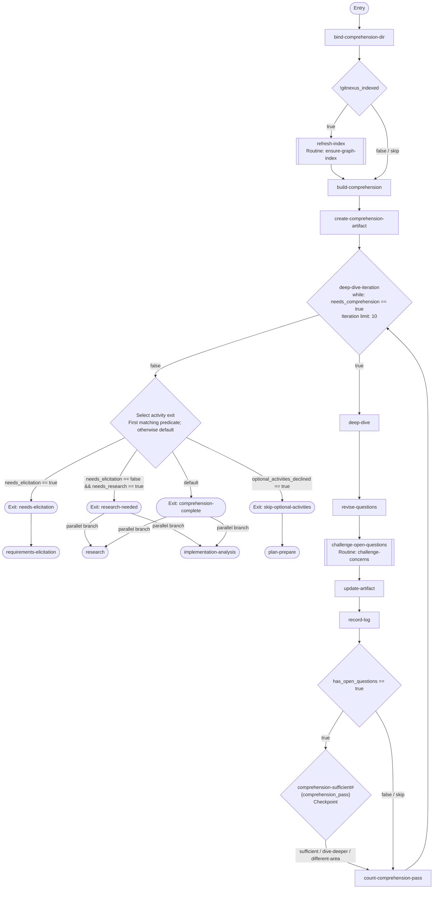

---

### 03. Requirements Elicitation (optional)

[Discovers](./03-requirements-elicitation.yaml) and clarifies what the work package should accomplish through a structured stakeholder conversation, so planning starts from agreed requirements. Skipped in review mode (requirements come from the ticket). Both exits fan to research and implementation-analysis together.

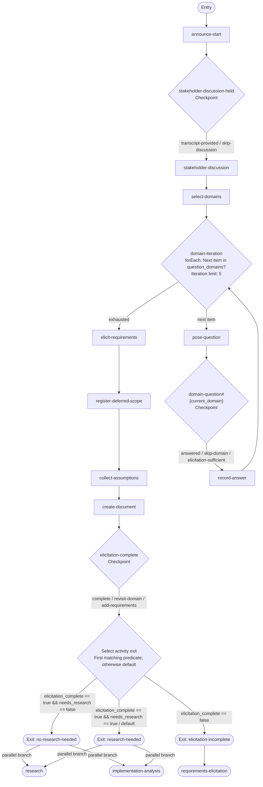

---

### 04. Research (optional)

[Gathers](./04-research.yaml) best practices, patterns, and reference material from the knowledge base and external sources, and surfaces assumptions as a value. A branch of the discovery fan when research is needed; converges on plan-prepare. Research's soft gates live at the join.

```mermaid
flowchart TD
    n20(["Entry"])
    n1(["Exit: done"])
    n2(["plan-prepare"])
    n1 --> n2
    n3{"Select activity exit<br/>First matching predicate; otherwise default"}
    n3 -->|"default"| n1
    n4["close-research-phase"]
    n4 --> n3
    n5{"needs_research == true"}
    n5 -->|"true"| n4
    n5 -->|"false / skip"| n3
    n6["announce-derived-context-scope"]
    n6 --> n5
    n7{"needs_research == true &amp;&amp; needs_context_scope != true"}
    n7 -->|"true"| n6
    n7 -->|"false / skip"| n5
    n8["document"]
    n8 --> n7
    n9{"needs_research == true"}
    n9 -->|"true"| n8
    n9 -->|"false / skip"| n7
    n10["surface-assumptions"]
    n10 --> n9
    n11{"needs_research == true"}
    n11 -->|"true"| n10
    n11 -->|"false / skip"| n9
    n12["triage-research-candidates"]
    n12 --> n11
    n13{"needs_research == true"}
    n13 -->|"true"| n12
    n13 -->|"false / skip"| n11
    n14["synthesize"]
    n14 --> n13
    n15{"needs_research == true"}
    n15 -->|"true"| n14
    n15 -->|"false / skip"| n13
    n16["research-knowledge-base"]
    n16 --> n15
    n17{"needs_research == true"}
    n17 -->|"true"| n16
    n17 -->|"false / skip"| n15
    n18["skip-when-not-needed"]
    n18 --> n17
    n19{"needs_research == false"}
    n19 -->|"true"| n18
    n19 -->|"false / skip"| n17
    n20 --> n19
```

---

### 05. Implementation Analysis (optional)

[Analyzes](./05-implementation-analysis.yaml) the current implementation to understand effectiveness, establish baselines, and identify the gaps the change closes — giving planning a grounded starting point. In review mode it analyzes the pre-change baseline from the base branch and documents the expected changes. A branch of the discovery fan beside research; both converge on plan-prepare.

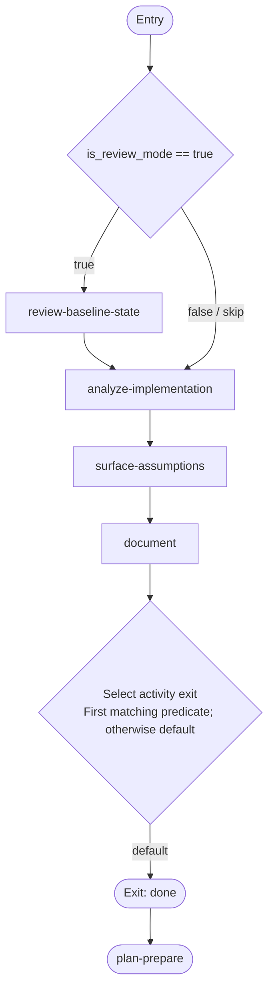

---

### 06. Plan & Prepare

[The](./06-plan-prepare.yaml) discovery fan's join: raises research's gates, writes the assumptions the branches surfaced into the log once, then designs the approach and produces the work-package plan and test plan. Convergence point for all optional discovery paths, and the target that rework loops return to. Leads to assumptions-review.

```mermaid
flowchart TD
    n34(["Entry"])
    n1(["Exit: done"])
    n2(["assumptions-review"])
    n1 --> n2
    n3(["Exit: revise"])
    n4(["plan-prepare"])
    n3 --> n4
    n5{"Select activity exit<br/>First matching predicate; otherwise default"}
    n5 -->|"default"| n1
    n6{"approach-confirmed<br/>Checkpoint"}
    n6 -->|"revise"| n3
    n6 -->|"confirmed"| n5
    n7{"is_review_mode != true"}
    n7 -->|"true"| n6
    n7 -->|"false / skip"| n5
    n8["update-pr"]
    n8 --> n7
    n9{"is_review_mode != true &amp;&amp; stealth_mode != true"}
    n9 -->|"true"| n8
    n9 -->|"false / skip"| n7
    n10["sync-branch"]
    n10 --> n9
    n11["create-todos"]
    n11 --> n10
    n12["collect-assumptions"]
    n12 --> n11
    n13["present-solution-overview"]
    n13 --> n12
    n14["create-test-plan"]
    n14 --> n13
    n15["find-test-patterns"]
    n15 --> n14
    n16["create-plan"]
    n16 --> n15
    n17{"context-scope-declaration<br/>Checkpoint"}
    n17 -->|"repo-only / web-retrieval / mixed"| n16
    n18{"needs_context_scope == true"}
    n18 -->|"true"| n17
    n18 -->|"false / skip"| n16
    n19{"research-reconciliation<br/>doWhile: has_reconcilable_research == true<br/>Iteration limit: 10"}
    n20["count-research-pass"]
    n20 --> n19
    n21{"research-convergence#{research_pass}<br/>Checkpoint"}
    n21 -->|"accept-research / request-more"| n20
    n22{"has_reconcilable_research == false"}
    n22 -->|"true"| n21
    n22 -->|"false / skip"| n20
    n23["reconcile-research-candidates"]
    n23 --> n22
    n24{"has_reconcilable_research == true"}
    n24 -->|"true"| n23
    n24 -->|"false / skip"| n22
    n25["announce-research-direction"]
    n25 --> n24
    n26{"has_reconcilable_research == true"}
    n26 -->|"true"| n25
    n26 -->|"false / skip"| n24
    n19 -->|"true"| n26
    n19 -->|"false"| n18
    n27{"has_reconcilable_research == true"}
    n27 -->|"true"| n26
    n27 -->|"false / skip"| n18
    n28["ingest-discovery-assumptions"]
    n28 --> n27
    n29["take-analysis-fan"]
    n29 --> n28
    n30{"implementation_analysis_outputs"}
    n30 -->|"true"| n29
    n30 -->|"false / skip"| n28
    n31["take-research-fan"]
    n31 --> n30
    n32{"research_outputs"}
    n32 -->|"true"| n31
    n32 -->|"false / skip"| n30
    n33["env-prerequisites"]
    n33 --> n32
    n34 --> n33
```

---

### 07. Assumptions Review

[Converges](./07-assumptions-review.yaml) the assumptions logged since design philosophy and settles those still open, so the plan rests on settled assumptions before code is written. May loop back for further discussion, deeper comprehension, or plan revision. Review mode continues to lean-coding audit. An approved set fans to contract-tests and implement together.

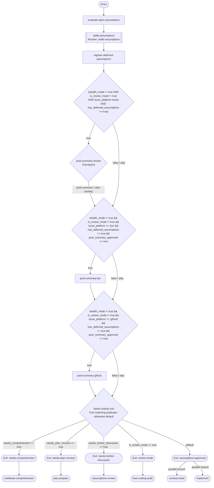

---

### 08. Implement

[Executes](./08-implement.yaml) the implementation plan task by task in its own worktree, turning the plan into committed work. A branch of the implementation fan beside contract-tests; both converge on implementation-join. Skipped in review mode (the code already exists).

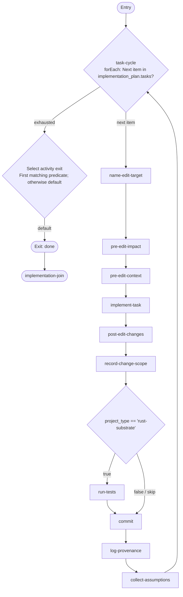

---

### Contract Tests

[Writes](./20-contract-tests.yaml) each task's contract tests from the Contract alone into a dedicated worktree, and confirms each suite fails against the base tree. A branch of the implementation fan that converges on implementation-join.

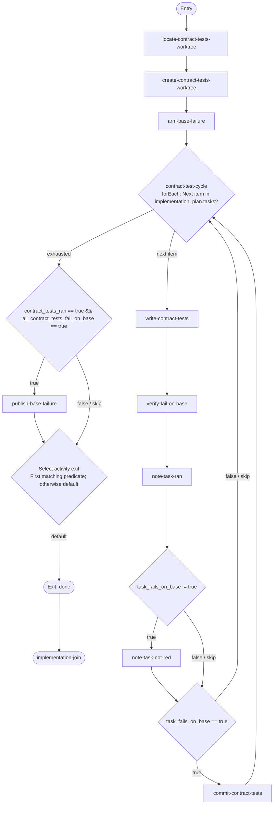

---

### Implementation Join

[The](./21-implementation-join.yaml) implementation fan's join: hoists the contract-tests and implement branch containers, confirms contract suites are red against the base tree, runs them against the implementation, and settles symbol provenance and residual assumptions. A failing suite returns to implement; a disputed test reaches the user as a contract ambiguity. Leads to lean-coding-audit when the suite passes.

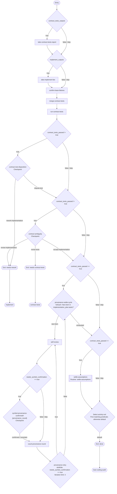

---

### 09. Lean-Coding Audit

[Applies](./09-lean-coding-audit.yaml) the ponytail lean-coding lens to the just-implemented change, so accepted simplifications land without breaching the safety floor and deliberate ones are tracked as debt. Complementary to strategic-review (leanness lens, not scope-vs-issue fit). In review mode findings are documented, not applied. Leads to prism-decision.

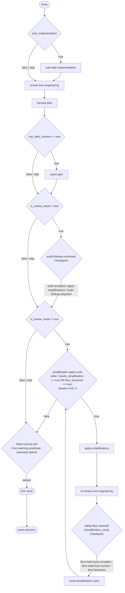

---

### Prism Decision

[Settles](./16-prism-decision.yaml) which structural analysis the review fan and its join run — the full prism pipeline or the single inline pass — on an assessed recommendation where the change is complex. Leads to the automated review fan, or measures the change again.

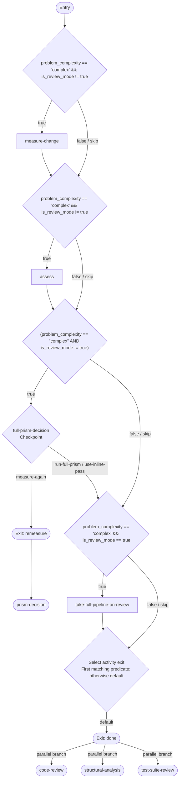

---

### Code Review

[Reviews](./17-code-review.yaml) the change's code for architecture, error handling, safety and project-specific patterns. A branch of the automated review fan that converges on post-impl-review.

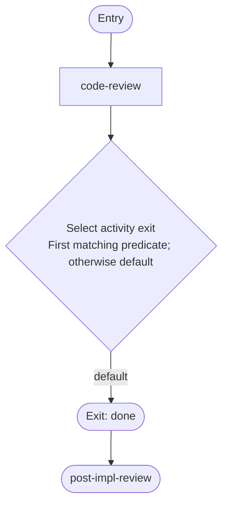

---

### Structural Analysis

[Runs](./18-structural-analysis.yaml) the single inline structural pass when prism-decision settled that mode. A branch of the automated review fan; the full prism pipeline runs at post-impl-review.

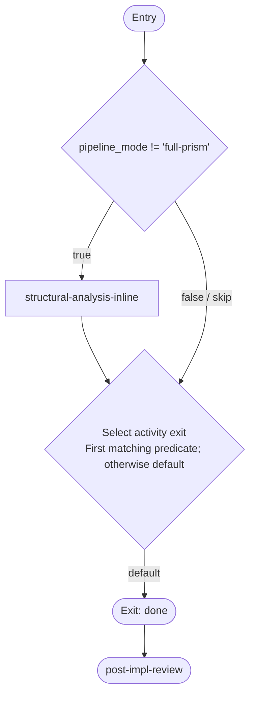

---

### Test Suite Review

[Maps](./19-test-suite-review.yaml) diff coverage and reviews the test suite for gaps, assertion quality and anti-patterns. A branch of the automated review fan that converges on post-impl-review.

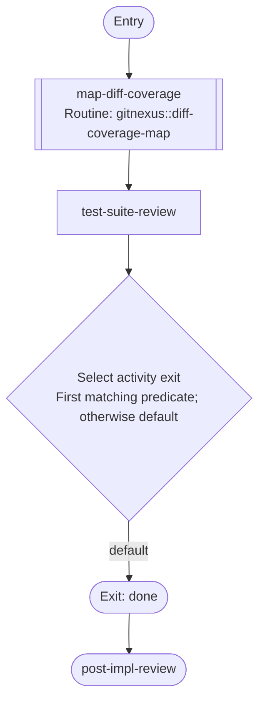

---

### 10. Post-Implementation Review

[The](./10-post-impl-review.yaml) automated review fan's join: raises the manual diff review gates, runs the full prism pipeline when chosen, classifies the branches' findings, and runs the fix cycle. The fix cycle belongs to create mode: on the review path an actionable finding is raised to the pull-request author. A critical blocker routes back to implement for remediation; otherwise leads to validate.

```mermaid
flowchart TD
    n44(["Entry"])
    n1(["Exit: has-blocker"])
    n2(["implement"])
    n1 --> n2
    n3(["Exit: done"])
    n4(["validate"])
    n3 --> n4
    n5{"Select activity exit<br/>First matching predicate; otherwise default"}
    n5 -->|"has_critical_blocker == true"| n1
    n5 -->|"default"| n3
    n6{"local-validation-permission<br/>Checkpoint"}
    n6 -->|"run-suite / suite-not-run"| n5
    n7{"has_critical_blocker != true"}
    n7 -->|"true"| n6
    n7 -->|"false / skip"| n5
    n8{"review-fix-cycle<br/>while: (code_findings_actionable == true OR test_findings_actionable == true)<br/>Iteration limit: 3"}
    n9["reclassify-findings"]
    n9 --> n8
    n10["re-test-suite-review"]
    n10 --> n9
    n11[["remap-diff-coverage<br/>Routine: gitnexus::diff-coverage-map"]]
    n11 --> n10
    n12["re-code-review"]
    n12 --> n11
    n13["re-manual-diff-review"]
    n13 --> n12
    n14["reset-fix-flags"]
    n14 --> n13
    n15["apply-fixes"]
    n15 --> n14
    n8 -->|"true"| n15
    n8 -->|"false"| n7
    n16{"is_review_mode != true"}
    n16 -->|"true"| n8
    n16 -->|"false / skip"| n7
    n17["classify-and-route-findings"]
    n17 --> n16
    n18["read-prism-findings"]
    n18 --> n17
    n19{"pipeline_mode == 'full-prism'"}
    n19 -->|"true"| n18
    n19 -->|"false / skip"| n17
    n20["read-prism-manifest"]
    n20 --> n19
    n21{"pipeline_mode == 'full-prism'"}
    n21 -->|"true"| n20
    n21 -->|"false / skip"| n19
    n22[["walk-prism-child<br/>Routine: activity-loop"]]
    n22 --> n21
    n23{"pipeline_mode == 'full-prism'"}
    n23 -->|"true"| n22
    n23 -->|"false / skip"| n21
    n24["dispatch-prism"]
    n24 --> n23
    n25{"pipeline_mode == 'full-prism'"}
    n25 -->|"true"| n24
    n25 -->|"false / skip"| n23
    n26["name-prism-target"]
    n26 --> n25
    n27{"pipeline_mode == 'full-prism'"}
    n27 -->|"true"| n26
    n27 -->|"false / skip"| n25
    n28["take-inline-structural"]
    n28 --> n27
    n29{"pipeline_mode != 'full-prism' &amp;&amp; structural_analysis_outputs"}
    n29 -->|"true"| n28
    n29 -->|"false / skip"| n27
    n30["take-fan-reports"]
    n30 --> n29
    n31{"code_review_outputs &amp;&amp; test_suite_review_outputs"}
    n31 -->|"true"| n30
    n31 -->|"false / skip"| n29
    n32{"block-interview-loop<br/>forEach: Next item in flagged_block_indices?<br/>Iteration limit: 50"}
    n33{"block-interview#{current_block_index}<br/>Checkpoint"}
    n33 -->|"issue-recorded / critical-blocker / skip-block"| n32
    n32 -->|"next item"| n33
    n32 -->|"exhausted"| n31
    n34{"has_flagged_blocks == true"}
    n34 -->|"true"| n32
    n34 -->|"false / skip"| n31
    n35["re-render-block-rationale"]
    n35 --> n34
    n36{"rationale_attested == false"}
    n36 -->|"true"| n35
    n36 -->|"false / skip"| n34
    n37{"rationale-attestation<br/>Checkpoint"}
    n37 -->|"rationale-accurate / rationale-corrected"| n36
    n38["register-review-follow-ups"]
    n38 --> n37
    n39["collect-flagged-blocks"]
    n39 --> n38
    n40{"has_flagged_blocks == true"}
    n40 -->|"true"| n39
    n40 -->|"false / skip"| n38
    n41{"file-index-table<br/>Checkpoint"}
    n41 -->|"no-flagged-blocks / flagged-blocks"| n40
    n42["manual-diff-review"]
    n42 --> n41
    n43["announce-start"]
    n43 --> n42
    n44 --> n43
```

---

### 11. Validate

[Validates](./11-validate.yaml) the implementation against tests, build, format, and lint checks when the local environment can run them. In review mode it documents failures as findings and assesses coverage. Suite-only — build-dependent artifact hand-off lives in submit-for-review. Leads to strategic-review.

```mermaid
flowchart TD
    n21(["Entry"])
    n1(["Exit: done"])
    n2(["strategic-review"])
    n1 --> n2
    n3{"Select activity exit<br/>First matching predicate; otherwise default"}
    n3 -->|"default"| n1
    n4{"fix-revalidate-cycle<br/>while: (run_local_validation == true AND project_type == #quot;rust-substrate#quot; AND validation_results.validation_passed == false)<br/>Iteration limit: 10"}
    n5["revalidate"]
    n5 --> n4
    n6["apply-fix"]
    n6 --> n5
    n7["analyze-failure"]
    n7 --> n6
    n4 -->|"true"| n7
    n4 -->|"false"| n3
    n8{"is_review_mode != true"}
    n8 -->|"true"| n4
    n8 -->|"false / skip"| n3
    n9["assess-test-coverage"]
    n9 --> n8
    n10{"is_review_mode == true"}
    n10 -->|"true"| n9
    n10 -->|"false / skip"| n8
    n11[["map-diff-coverage<br/>Routine: gitnexus::diff-coverage-map"]]
    n11 --> n10
    n12{"is_review_mode == true"}
    n12 -->|"true"| n11
    n12 -->|"false / skip"| n10
    n13["document-failures"]
    n13 --> n12
    n14{"is_review_mode == true &amp;&amp; project_type == 'rust-substrate' &amp;&amp; run_local_validation == true"}
    n14 -->|"true"| n13
    n14 -->|"false / skip"| n12
    n15["run-suite"]
    n15 --> n14
    n16{"project_type == 'rust-substrate' &amp;&amp; run_local_validation == true"}
    n16 -->|"true"| n15
    n16 -->|"false / skip"| n14
    n17["preflight"]
    n17 --> n16
    n18{"project_type == 'rust-substrate' &amp;&amp; run_local_validation == true"}
    n18 -->|"true"| n17
    n18 -->|"false / skip"| n16
    n19["mark-validation-na"]
    n19 --> n18
    n20{"run_local_validation == false"}
    n20 -->|"true"| n19
    n20 -->|"false / skip"| n18
    n21 --> n20
```

---

### 12. Strategic Review

[Reviews](./12-strategic-review.yaml) the change set to ensure it is minimal and focused — that the PR contains only what the solution requires — and produces the strategic review document and the architecture summary. In review mode it documents cleanup recommendations for the posted review without applying them. Leads to submit-for-review when the review passes, otherwise back to plan-prepare for rework.

```mermaid
flowchart TD
    n38(["Entry"])
    n1(["Exit: review-mode"])
    n2(["submit-for-review"])
    n1 --> n2
    n3(["Exit: review-passed"])
    n3 --> n2
    n4(["Exit: needs-more-review"])
    n5(["strategic-review"])
    n4 --> n5
    n6(["Exit: review-failed"])
    n7(["plan-prepare"])
    n6 --> n7
    n8{"Select activity exit<br/>First matching predicate; otherwise default"}
    n8 -->|"is_review_mode == true"| n1
    n8 -->|"review_passed == true"| n3
    n8 -->|"strategic_findings_disposition == 're-review'"| n4
    n8 -->|"default"| n6
    n9["register-deferred-findings"]
    n9 --> n8
    n10["defer-checkpoint-findings"]
    n10 --> n9
    n11{"strategic_findings_disposition == 'deferred'"}
    n11 -->|"true"| n10
    n11 -->|"false / skip"| n9
    n12{"findings-delivery<br/>Checkpoint"}
    n12 -->|"raise-all / raise-selected / raise-none"| n11
    n13{"(is_review_mode == true AND strategic_findings_summary != #quot;#quot;)"}
    n13 -->|"true"| n12
    n13 -->|"false / skip"| n11
    n14{"review-findings<br/>Checkpoint"}
    n14 -->|"acceptable / fix-findings / selective-fixes / defer-findings / more-review"| n13
    n15{"(is_review_mode != true AND strategic_findings_summary != #quot;#quot;)"}
    n15 -->|"true"| n14
    n15 -->|"false / skip"| n13
    n16["analyze-strategic-findings"]
    n16 --> n15
    n17["create-architecture-summary"]
    n17 --> n16
    n18[["source-sequence-diagrams<br/>Routine: gitnexus::sequence-diagram-source"]]
    n18 --> n17
    n19[["source-package-diagram<br/>Routine: gitnexus::package-diagram-source"]]
    n19 --> n18
    n20["apply-cleanup"]
    n20 --> n19
    n21{"is_review_mode != true"}
    n21 -->|"true"| n20
    n21 -->|"false / skip"| n19
    n22["document-cleanup-recommendations"]
    n22 --> n21
    n23{"is_review_mode == true"}
    n23 -->|"true"| n22
    n23 -->|"false / skip"| n21
    n24["document-findings"]
    n24 --> n23
    n25["verify-change-fragment"]
    n25 --> n24
    n26["ensure-changes-folder-entry"]
    n26 --> n25
    n27[["verify-readme<br/>Routine: ensure-readme"]]
    n27 --> n26
    n28["verify-artifact-conformance"]
    n28 --> n27
    n29["refresh-pr-body"]
    n29 --> n28
    n30{"is_review_mode != true &amp;&amp; stealth_mode != true"}
    n30 -->|"true"| n29
    n30 -->|"false / skip"| n28
    n31["review-strategy"]
    n31 --> n30
    n32[["scan-orphans<br/>Routine: gitnexus::orphan-scan"]]
    n32 --> n31
    n33[["check-scope-discipline<br/>Routine: gitnexus::scope-discipline-check"]]
    n33 --> n32
    n34["verify-pr-body"]
    n34 --> n33
    n35{"pr_number exists"}
    n35 -->|"true"| n34
    n35 -->|"false / skip"| n33
    n36["read-live-pr-body"]
    n36 --> n35
    n37{"pr_number exists"}
    n37 -->|"true"| n36
    n37 -->|"false / skip"| n35
    n38 --> n37
```

---

### 13. Submit for Review

[Takes](./13-submit-for-review.yaml) the DCO-signed change set to a ready PR with a finalized description, and sees reviewer feedback through. In review mode it delivers all findings as structured PR review comments and ends the workflow. In stealth mode there is no PR lifecycle: the branch's unsigned commits reach the consumer's private `push_remote`. Significant requested changes loop back to plan-prepare; otherwise leads to complete.

```mermaid
flowchart TD
    n67(["Entry"])
    n1(["Exit: review-mode"])
    n2(["complete"])
    n1 --> n2
    n3(["Exit: review-requires-changes"])
    n4(["plan-prepare"])
    n3 --> n4
    n5(["Exit: review-approved"])
    n5 --> n2
    n6(["Exit: provide-input"])
    n7(["submit-for-review"])
    n6 --> n7
    n8(["Exit: abort"])
    n8 --> n2
    n9{"Select activity exit<br/>First matching predicate; otherwise default"}
    n9 -->|"is_review_mode == true"| n1
    n9 -->|"review_requires_changes == true"| n3
    n9 -->|"review_requires_changes == false / default"| n5
    n10["announce-completion"]
    n10 --> n9
    n11{"review-outcome<br/>Checkpoint"}
    n11 -->|"approved / minor-changes / significant-changes"| n10
    n12{"(is_review_mode != true AND stealth_mode != true)"}
    n12 -->|"true"| n11
    n12 -->|"false / skip"| n10
    n13["analyze-review-outcome"]
    n13 --> n12
    n14{"is_review_mode != true &amp;&amp; stealth_mode != true"}
    n14 -->|"true"| n13
    n14 -->|"false / skip"| n12
    n15["process-review-comments"]
    n15 --> n14
    n16{"is_review_mode != true &amp;&amp; stealth_mode != true"}
    n16 -->|"true"| n15
    n16 -->|"false / skip"| n14
    n17{"await-review-loop<br/>doWhile: awaiting_review == true"}
    n18["count-await-round"]
    n18 --> n17
    n19{"review-received#{await_round}<br/>Checkpoint"}
    n19 -->|"yes-review / no-waiting"| n18
    n20{"(is_review_mode != true AND stealth_mode != true)"}
    n20 -->|"true"| n19
    n20 -->|"false / skip"| n18
    n21["await-review"]
    n21 --> n20
    n22{"stealth_mode != true"}
    n22 -->|"true"| n21
    n22 -->|"false / skip"| n20
    n17 -->|"true"| n22
    n17 -->|"false"| n16
    n23["mark-ready"]
    n23 --> n22
    n24{"is_review_mode != true &amp;&amp; stealth_mode != true"}
    n24 -->|"true"| n23
    n24 -->|"false / skip"| n22
    n25["announce-regen-owed"]
    n25 --> n24
    n26{"build_dependent_artifacts_pending == true"}
    n26 -->|"true"| n25
    n26 -->|"false / skip"| n24
    n27{"build-artifact-check<br/>Checkpoint"}
    n27 -->|"artifacts-current / user-owns-regen"| n26
    n28{"(is_review_mode != true AND stealth_mode != true AND project_type == #quot;rust-substrate#quot;)"}
    n28 -->|"true"| n27
    n28 -->|"false / skip"| n26
    n29["merge-strategy-guidance"]
    n29 --> n28
    n30{"is_review_mode != true &amp;&amp; stealth_mode != true"}
    n30 -->|"true"| n29
    n30 -->|"false / skip"| n28
    n31["instruct-merge-strategy"]
    n31 --> n30
    n32{"is_review_mode != true &amp;&amp; stealth_mode != true"}
    n32 -->|"true"| n31
    n32 -->|"false / skip"| n30
    n33{"body-non-conformant<br/>Checkpoint"}
    n33 -->|"provide-input"| n6
    n33 -->|"abort"| n8
    n33 -->|"proceed-with-override"| n32
    n34{"(is_review_mode != true AND stealth_mode != true AND body_conforms == false)"}
    n34 -->|"true"| n33
    n34 -->|"false / skip"| n32
    n35{"verify-pr-body-rerender<br/>while: body_conforms == false<br/>Iteration limit: 2"}
    n36["verify-body"]
    n36 --> n35
    n37["rerender-body"]
    n37 --> n36
    n35 -->|"true"| n37
    n35 -->|"false"| n34
    n38{"is_review_mode != true &amp;&amp; stealth_mode != true"}
    n38 -->|"true"| n35
    n38 -->|"false / skip"| n34
    n39["update-description"]
    n39 --> n38
    n40{"is_review_mode != true &amp;&amp; stealth_mode != true"}
    n40 -->|"true"| n39
    n40 -->|"false / skip"| n38
    n41["push-commits"]
    n41 --> n40
    n42{"is_review_mode != true"}
    n42 -->|"true"| n41
    n42 -->|"false / skip"| n40
    n43{"private-push-confirmation<br/>Checkpoint"}
    n43 -->|"abort"| n8
    n43 -->|"confirmed"| n42
    n44{"stealth_mode == true"}
    n44 -->|"true"| n43
    n44 -->|"false / skip"| n42
    n45["verify-push-remote"]
    n45 --> n44
    n46{"stealth_mode == true"}
    n46 -->|"true"| n45
    n46 -->|"false / skip"| n44
    n47["dco-sign-off"]
    n47 --> n46
    n48{"is_review_mode != true"}
    n48 -->|"true"| n47
    n48 -->|"false / skip"| n46
    n49{"dco-sign-off-confirmation<br/>Checkpoint"}
    n49 -->|"certify / flag-legal"| n48
    n50{"is_review_mode != true"}
    n50 -->|"true"| n49
    n50 -->|"false / skip"| n48
    n51["post-pr-review"]
    n51 --> n50
    n52{"is_review_mode == true &amp;&amp; review_posted == true"}
    n52 -->|"true"| n51
    n52 -->|"false / skip"| n50
    n53["prepare-review-comment"]
    n53 --> n52
    n54{"is_review_mode == true &amp;&amp; review_posted == true"}
    n54 -->|"true"| n53
    n54 -->|"false / skip"| n52
    n55["persist-review-summary"]
    n55 --> n54
    n56{"is_review_mode == true &amp;&amp; review_posted == true"}
    n56 -->|"true"| n55
    n56 -->|"false / skip"| n54
    n57{"review-summary-cycle<br/>doWhile: summary_refine_requested == true<br/>Iteration limit: 3"}
    n58["count-summary-round"]
    n58 --> n57
    n59{"review-summary-approval#{summary_round}<br/>Checkpoint"}
    n59 -->|"post-approve / post-request-changes / post-comment / refine / skip-posting"| n58
    n60["generate-review-summary"]
    n60 --> n59
    n57 -->|"true"| n60
    n57 -->|"false"| n56
    n61{"is_review_mode == true"}
    n61 -->|"true"| n60
    n61 -->|"false / skip"| n56
    n62[["publish-review-artifacts<br/>Routine: publish-planning-artifacts"]]
    n62 --> n61
    n63{"is_review_mode == true"}
    n63 -->|"true"| n62
    n63 -->|"false / skip"| n61
    n64["consolidate-review-findings"]
    n64 --> n63
    n65{"is_review_mode == true"}
    n65 -->|"true"| n64
    n65 -->|"false / skip"| n63
    n66["announce-start"]
    n66 --> n65
    n67 --> n66
```

---

### 14. Complete

[The](./14-complete.yaml) terminal activity: closes the work package with a close-out, a cost record and a retrospective in `COMPLETE.md` (plus an ADR for moderate or complex work), and selects the next work package. In review mode the branch the posted review links carries the close-out.

```mermaid
flowchart TD
    n39(["Entry"])
    n1(["Exit: done"])
    n2(["End"])
    n1 --> n2
    n3{"Select activity exit<br/>First matching predicate; otherwise default"}
    n3 -->|"default"| n1
    n4["announce-completion"]
    n4 --> n3
    n5["select-next"]
    n5 --> n4
    n6["remove-worktree"]
    n6 --> n5
    n7{"worktree_created == true"}
    n7 -->|"true"| n6
    n7 -->|"false / skip"| n5
    n8[["publish-close-out-artifacts<br/>Routine: publish-planning-artifacts"]]
    n8 --> n7
    n9{"is_review_mode == true"}
    n9 -->|"true"| n8
    n9 -->|"false / skip"| n7
    n10["verify-artifact-links"]
    n10 --> n9
    n11["announce-retrospective"]
    n11 --> n10
    n12["create-complete-doc"]
    n12 --> n11
    n13{"deferred-item-raise-loop<br/>forEach: Next item in open_deferred_items?"}
    n14["record-deferred-item-issue"]
    n14 --> n13
    n15{"raise_current_deferred_item == true"}
    n15 -->|"true"| n14
    n15 -->|"false / skip"| n13
    n16["raise-deferred-item-issue"]
    n16 --> n15
    n17{"raise_current_deferred_item == true"}
    n17 -->|"true"| n16
    n17 -->|"false / skip"| n15
    n18{"deferred-item-raise#{current_deferred_item.id}<br/>Checkpoint"}
    n18 -->|"raise / skip"| n17
    n13 -->|"next item"| n18
    n13 -->|"exhausted"| n12
    n19{"is_review_mode != true &amp;&amp; stealth_mode != true"}
    n19 -->|"true"| n13
    n19 -->|"false / skip"| n12
    n20["collect-deferred-items"]
    n20 --> n19
    n21{"is_review_mode != true"}
    n21 -->|"true"| n20
    n21 -->|"false / skip"| n19
    n22["register-open-deferrals"]
    n22 --> n21
    n23["register-open-follow-ups"]
    n23 --> n22
    n24["gather-open-work"]
    n24 --> n23
    n25["register-retrospective-follow-ups"]
    n25 --> n24
    n26["conduct-retrospective"]
    n26 --> n25
    n27["read-session"]
    n27 --> n26
    n28["ensure-docs"]
    n28 --> n27
    n29{"is_review_mode != true"}
    n29 -->|"true"| n28
    n29 -->|"false / skip"| n27
    n30[["enumerate-public-api<br/>Routine: gitnexus::public-api-enum"]]
    n30 --> n29
    n31{"is_review_mode != true"}
    n31 -->|"true"| n30
    n31 -->|"false / skip"| n29
    n32["render-token-usage"]
    n32 --> n31
    n33["finalize-test-plan"]
    n33 --> n32
    n34{"is_review_mode != true"}
    n34 -->|"true"| n33
    n34 -->|"false / skip"| n32
    n35["update-adr-status"]
    n35 --> n34
    n36{"is_review_mode != true &amp;&amp; (problem_complexity == #quot;moderate#quot; || problem_complexity == #quot;complex#quot;)"}
    n36 -->|"true"| n35
    n36 -->|"false / skip"| n34
    n37["create-adr"]
    n37 --> n36
    n38{"is_review_mode != true &amp;&amp; (problem_complexity == #quot;moderate#quot; || problem_complexity == #quot;complex#quot;)"}
    n38 -->|"true"| n37
    n38 -->|"false / skip"| n36
    n39 --> n38
```

---
